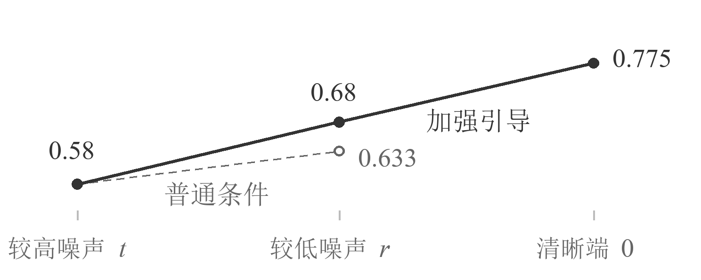
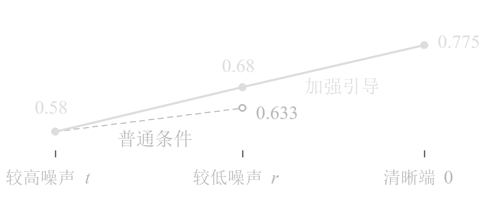
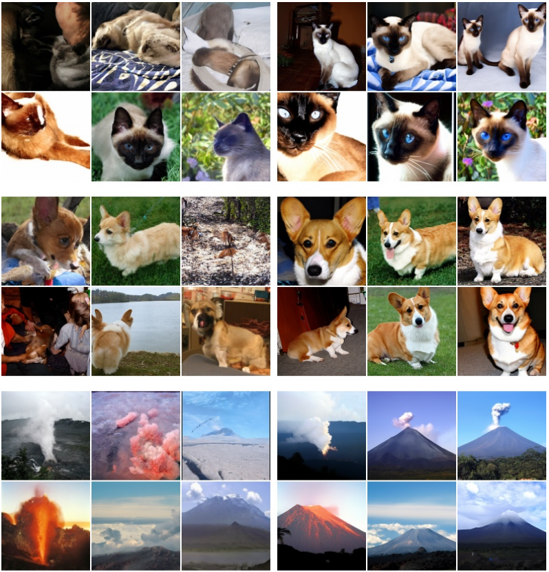


CFG 让条件扩散模型在生成时调节类别或提示词的影响。训练时随机把一部分标签换成空条件，同一网络便能做有条件和无条件的噪声预测。生成时固定带噪图像和时刻，两份预测的差就是加入条件带来的修正。CFG 调节这份修正的权重，再把合成的预测交给采样器。适度引导能让类别特征更鲜明；引导过强，则可能让同一类别中的样本变得相似。（由 GPT-6 总结）

**关键公式**

$$
\mathcal L=\mathbb E\!\left[\|\epsilon-\epsilon_\theta(x_t,t,\tilde c)\|^2\right].
$$

$$
\hat\epsilon_t=\epsilon_u+s(\epsilon_c-\epsilon_u).
$$

$$
\hat\epsilon_t=(1+w)\epsilon_c-w\epsilon_u,\qquad s=1+w.
$$

$$
g_c-g_u=\nabla_{x_t}\log q_t(c\mid x_t).
$$



### 1. 基本思路

把同一个犬种标签交给一个按 [DDPM](/papers/ddpm/) 训练的条件模型，可能生成清楚的正脸，也可能生成被草挡住的背影。两张图都符合标签。普通条件生成学的是这个类别有哪些图，训练照片里的各种视角都会保留下来。如果希望做一张一眼就能认出犬种的配图，模型还需要一个选择：在生成时多偏向能让人辨认类别的特征，偏多少可以当场调节。

一种办法是先正常生成，再用分类器筛图，但它只能丢掉已经算完的样本。**分类器引导**把这个判断放到了采样途中：每到一个时刻，额外的分类器估计当前带噪图属于目标类别的概率，再算出往哪个方向小改一下会提高这个概率，供采样器调整下一步。这样可以在图像还没成形时就影响结果，代价是要另训练一个能识别各种噪声程度的分类器。

Jonathan Ho 和 Tim Salimans 提出的 **Classifier-Free Diffusion Guidance（CFG，无分类器引导）** 从去噪网络本身估计这个方向。对同一张带噪图，先不提供标签，得到一份基准预测；再提供标签，看噪声预测怎样改变。CFG 把两份预测的差乘上一个可调系数，再加回基准预测。差值本身还是噪声预测的改变量，换算之后才对应分类器给出的方向。

原论文以 ImageNet 类别生成为主要实验，噪声时间是连续的；这里用 DDPM 的离散时刻来表示。训练时的标签丢弃率决定网络多久收到一次空条件，生成时的引导尺度决定怎样组合两份预测。同一个训练好的模型可以换用不同的引导尺度。

### 2. 条件预测

#### 2.1 条件输入

设训练样本为原图与类别标签组成的一对 $(x_0,c)$。随机抽取时刻 $t$，从训练噪声表读取累计信号系数 $\bar\alpha_t$，再按 DDPM 的公式给图像加噪：

$$
x_t=\sqrt{\bar\alpha_t}\,x_0+\sqrt{1-\bar\alpha_t}\,\epsilon,\qquad\epsilon\sim\mathcal N(0,I).
$$

$\epsilon$ 是构造这张带噪图像时独立抽取的标准高斯噪声，乘上 $\sqrt{1-\bar\alpha_t}$ 后代表从原图到时刻 $t$ 的累计噪声。标签 $c$ 不参与加噪，它作为额外的输入，帮助网络从 $x_t,t$ 估计 $\epsilon$。

从原图加噪时，$\epsilon$ 是独立抽取的。但网络只看到混合后的 $x_t$：如果一块突起可能是犬耳，也可能是噪声，知道目标类别会改变它对这两种解释的判断。判断为犬耳，相应的亮暗差就更多留在原图估计里；判断为噪声，就更多分给 $\epsilon$。按平方误差训练，网络求的是这些可能噪声的[条件均值](/papers/ddim/#31-原图估计)。标签改变了候选原图的范围，也就改变了噪声预测。

论文用 U-Net 提取带噪图像 $x_t$ 的特征，将类别编号 $c$ 查表转成可学习的向量，与时间嵌入一起调节残差块。由于标签改变了中间特征，同一份 $x_t$ 换一个标签就可能得到另一份噪声预测；输出的形状仍与 $x_t$ 相同。

> [!Note] **一个标签怎样影响卷积**
> 卷积处理的是带有高、宽和通道的特征图，类别编号只是一条信息。常见做法是让编号选中一行可学习的向量，把它变成与某层通道数相同的一组偏置。每个空间位置的同一通道都加同一个值，后续卷积继续结合当前位置的图像特征。噪声误差经反向传播也会更新类别向量。这就是把一个全局标签接到图像网络的一种办法。

#### 2.2 条件丢弃

刚才的模型只在训练中见过实际标签，生成时突然把标签留空，并不能指望它会给出全部类别的基准预测。可以单独训练一套无条件网络，但两种任务都在估计带噪图中的累计噪声，只是可用的信息不同。CFG 让同一网络练习两种输入：对每个训练样本，以概率 $p_{\mathrm{drop}}$ 暂时隐藏类别标签。带噪图像、时刻和用于监督的噪声照常构造。

$$
\tilde c=\begin{cases}\varnothing,&\text{以概率 }p_{\mathrm{drop}},\\c,&\text{以概率 }1-p_{\mathrm{drop}}.\end{cases}
$$

$\tilde c$ 是这次实际送进网络的条件；$\varnothing$ 表示这次不提供类别。类别模型可以为它分配一个专用的可学习向量，文本模型则可以使用空文本的编码。

记 $\epsilon_\theta$ 为参数是 $\theta$ 的去噪网络。对原图和标签、时间、噪声以及丢弃结果共同取平均，得到训练目标：

$$
\mathcal L=\mathbb E_{x_0,c,t,\epsilon,\tilde c}\!\left[\|\epsilon-\epsilon_\theta(x_t,t,\tilde c)\|^2\right].
$$

每个样本只做一次前向计算，无论 $\tilde c$ 取标签还是空条件，都用构造 $x_t$ 时抽到的 $\epsilon$ 作监督，更新同一套参数。

标签是否丢弃与图像内容无关，空条件样本的类别分布因此与整个训练集相同。按平方误差的最优预测，空条件下估计 $\mathbb E[\epsilon\mid x_t,t]$，给定标签时则估计 $\mathbb E[\epsilon\mid x_t,t,c]$。训练完成后，切换条件输入就能在同一状态上得到这两份预测。

### 3. 生成步骤

#### 3.1 预测组合

到生成时，训练好的网络参数保持固定，当前状态来自采样器，也没有对应的真实原图或噪声可作监督。固定当前状态 $x_t$ 和时刻 $t$，用同一个网络分别计算无条件预测 $\epsilon_u$（unconditional）和给定目标类别的预测 $\epsilon_c$（conditional）：

$$
\epsilon_u=\epsilon_\theta(x_t,t,\varnothing),\qquad
\epsilon_c=\epsilon_\theta(x_t,t,c).
$$

两次计算的图像和时刻完全相同，差值 $\epsilon_c-\epsilon_u$ 来自本步使用的条件不同。CFG 以 $\epsilon_u$ 为基准，用生成时设定的引导尺度 $s$ 调节这份修正：

$$
\boxed{\hat\epsilon_t=\epsilon_u+s(\epsilon_c-\epsilon_u)}.
$$

这里采用许多生成工具中 guidance scale 的常见约定。先看 $s=0$ 和 $s=1$：前者去掉类别的影响，后者恰好还原普通的类别条件预测。

| 引导尺度 | 组合结果 | 含义 |
| --- | --- | --- |
| $s=0$ | $\epsilon_u$ | 使用无条件预测 |
| $0<s<1$ | 两种预测之间 | 减弱条件的影响 |
| $s=1$ | $\epsilon_c$ | 使用普通有条件预测 |
| $s>1$ | 越过 $\epsilon_c$ 继续沿差异方向调整 | 加强条件带来的修正 |

增强引导取 $s>1$ 时，可以从普通条件预测 $\epsilon_c$ 出发，再加上 $(s-1)(\epsilon_c-\epsilon_u)$。这叫**外推**：如果某个像素通道的两份预测一样，差值就是零，无论怎样调 $s$，该通道的预测都不会变。直接把整个 $\epsilon_c$ 乘大，则连这些与标签无关的预测也会改变。

原论文将同一个公式写成：

$$
\hat\epsilon_t=(1+w)\epsilon_c-w\epsilon_u.
$$

两种记号满足 $s=1+w$。论文中“不额外引导”的 $w=0$ 对应本文的 $s=1$。

#### 3.2 采样更新

生成时先抽取初始噪声 $x_T$，选定类别和采样时间表。以后每到一个时刻，都先让网络在当前状态上算出 $\epsilon_c,\epsilon_u$，再用引导尺度 $s$ 合成 $\hat\epsilon_t$。在确定性 DDIM 中，采样器把这份预测当作当前的累计噪声估计，用它换算清晰图像的估计：

$$
\hat x_0=\frac{x_t-\sqrt{1-\bar\alpha_t}\,\hat\epsilon_t}{\sqrt{\bar\alpha_t}}.
$$

随后将同一份引导预测代入 DDIM 的更新，走到时间表上下一个较低噪声时刻 $r<t$：

$$
x_r=\sqrt{\bar\alpha_r}\,\hat x_0+\sqrt{1-\bar\alpha_r}\,\hat\epsilon_t.
$$

同一份 $\hat\epsilon_t$ 在两式中分别用于扣除当前的噪声，以及按下一时刻的比例保留一部分噪声。两处符号相反，因而噪声预测改变量的方向不能直接当作图像更新的方向。

下一轮把新状态 $x_r$ 同时作为两次预测的输入，类别标签保持不变。中间的 $\hat x_0$ 只用于这次更新；到了 $r=0$，$x_r$ 才等于这次的原图估计。如果用 DDPM，就把同一份合成预测代入 DDPM 的反向均值公式，再按它的方差采样。

实现时常把相同的 $x_t$ 放在批次的两部分，分别与类别和空条件配对，一次批处理算出两份结果。这样可以并行，但仍计算了两份预测。$s=1$ 时只需有条件输出，可以跳过空条件的计算。

### 4. 引导原理

#### 4.1 条件梯度

要知道这份差为什么有效，可以先明确「更像指定类别」是什么意思。比如草地在很多犬种的照片里都常见，画得再清楚，也不一定更容易认出是哪种狗。如果某种耳形在指定犬种里远比在全部照片里常见，这个特征才更有辨识度。因此判断不是只看某种外观在类别 $c$ 中出现得多不多，还要看它在类别 $c$ 中**比在总体中常见多少**。

固定噪声时刻 $t$，用 $q_t(x_t)$ 表示全部训练图像加噪后的密度，用 $q_t(x_t\mid c)$ 表示只选类别 $c$ 的图像加噪后的密度。看到 $x_t$ 后，它属于类别 $c$ 的概率为：

$$
q_t(c\mid x_t)=q(c)\,\frac{q_t(x_t\mid c)}{q_t(x_t)}.
$$

采样时关心的是方向：从当前的 $x_t$ 朝哪里移动，这个概率会上升？先看分式里的两项密度各自怎样随图像变化。密度取对数后，对图像的各个像素通道求梯度，得到与图像同形状的向量，称为 **score（分数函数）**。记总体和指定类别的 score 为：

$$
g_u=\nabla_{x_t}\log q_t(x_t),\qquad g_c=\nabla_{x_t}\log q_t(x_t\mid c).
$$

> [!Note] **对输入图像求梯度**
> 反向传播可以求一个标量对网络权重的梯度，也可以求它对输入的梯度。这里固定时刻、类别和模型参数，逐分量问：若稍微增大当前像素的一个通道，目标类别的概率会升还是降？所有通道的偏导组成一张和输入同形状的方向图。对概率取对数会把乘除改写成加减；对数单调递增，概率与对数概率给出的局部上升方向相同。

把贝叶斯公式取对数，密度之比变成两个对数密度之差。再对 $x_t$ 求导，固定的类别先验 $q(c)$ 消失，得到：

$$
g_c-g_u=\nabla_{x_t}\log q_t(c\mid x_t).
$$

右侧指向目标类别概率上升最快的方向。为什么需要减掉 $g_u$？因为 $g_c$ 同时包含了数据的共有规律与类别特征。比如一种纹理在各种犬种里都常见，如果它让有条件和无条件的对数密度升高相同的幅度，两项相减就会抵消，目标类别的后验概率也不会为此上升。

分类器引导用额外的分类器估计这个条件梯度；CFG 用同一个去噪网络分别估计左侧的两项。下面说明怎样把噪声预测换算成 score。

#### 4.2 噪声换算

网络并不直接输出 score。固定原图时，$x_t$ 服从高斯分布。对其对数密度求导，就是把当前点与高斯中心的差 $x_t-\sqrt{\bar\alpha_t}\,x_0$ 取负，再除以方差 $1-\bar\alpha_t$。代入加噪公式，得到：

$$
\nabla_{x_t}\log q(x_t\mid x_0)=-\frac{\epsilon}{\sqrt{1-\bar\alpha_t}}.
$$

生成时只看到 $x_t$。每张可能的原图都让带噪图服从一个高斯，所有这些高斯合起来才是当前的图像分布。对密度取对数再求导，等于先把各成分的密度梯度相加，再除以总密度。每一项的密度梯度又等于该项密度乘上它自己的 score，所以最后得到的是各个 score 的加权平均，权重是各项在 $x_t$ 处贡献的密度占比。这与第 2 节训练时对可能的噪声标签取条件均值使用的是同一组权重：原图越可能产生这张带噪图，对结果的影响越大。因此不论有没有类别条件，都可以用同一个系数将网络的噪声预测换成对 score 的估计：

$$
g_\theta(x_t,t,c)=-\frac{\epsilon_\theta(x_t,t,c)}{\sqrt{1-\bar\alpha_t}}.
$$

负号来自高斯梯度指向密度增大的方向，而噪声指向偏离中心的方向。两份预测都在时刻 $t$，换算系数完全相同，所以可以在换算前组合两份噪声预测，也可以换算后再组合。若网络预测达到了理想的条件均值，得到的引导 score 为：

$$
g_{\mathrm{cfg}}=g_u+s(g_c-g_u).
$$

当 $s>1$，引导会在普通有条件的方向 $g_c$ 上再沿 $g_c-g_u$ 移动一段。这个方向就是分类器引导所用的类别梯度，CFG 用去噪网络的两次预测来近似它。

这个方向怎样传到下一张图 $x_r$？在 DDIM 的两条更新式里，用 $\rho_t=\sqrt{(1-\bar\alpha_t)/\bar\alpha_t}$ 表示时刻 $t$ 的噪声与信号乘数之比，$\rho_r$ 则是下一时刻的比值。把 $x_r$ 除以信号乘数 $\sqrt{\bar\alpha_r}$ 后，两步合起来就是：

$$
\frac{x_r}{\sqrt{\bar\alpha_r}}=\frac{x_t}{\sqrt{\bar\alpha_t}}+(\rho_r-\rho_t)\,\hat\epsilon_t.
$$

估计原图时减掉的是 $\rho_t\hat\epsilon_t$，下一站只加回 $\rho_r\hat\epsilon_t$。因为 $\rho_r<\rho_t$，图像变化与噪声预测的改变量反向；而噪声换成 score 时也反向一次。两个负号抵消，所以从同一个 $x_t$ 出发，加强引导相对于普通条件采样多走的那一段，沿着类别梯度 $g_c-g_u$。[DDPM 的反向均值](#72-ddpm-均值换算)也有同样的方向关系。

#### 4.3 分布取舍

沿着这个方向加强引导，会让哪些样本变多？在固定的时刻 $t$，把刚才得到的 $g_c-g_u$ 换成类别对数概率的梯度，理想的引导方向可以写成：

$$
g_{\mathrm{cfg}}=\nabla_{x_t}\log\!\left[q_t(x_t)\,q_t(c\mid x_t)^s\right].
$$

$s=0$ 时括号内就是无条件密度；$s=1$ 时由贝叶斯公式可知，它与普通条件密度只差一个归一化常数。$s>1$ 时，条件概率较高的区域相对更受偏好。即使有些图像本来就符合条件，只要它们的外观不够典型，也可能在较强引导下变少。

上式描述的是固定时刻 $t$ 时引导方向所对应的密度。各时刻得到的重加权密度未必来自同一个清晰分布的逐步加噪，所以它不能直接给出最终生成图像的密度。

<figure class="ddpm-figure">
  
  <figcaption>引导怎样改变条件分布；来源：原论文 Figure 2</figcaption>
</figure>

每一栏都是三类数据合在一起的二维密度，颜色越深表示密度越高。最左栏是原始混合密度；其余各栏先对每一类分别加强引导，再将三类合起来显示。引导越强，每类的密度越集中在与其他类较少重叠的区域。这组示意图展示的是上面的密度重加权。

#### 4.4 引导算例

沿用前面的犬种标签，只跟踪一个像素通道，看看训练时怎样处理空条件，以及采样器怎样使用两种预测。模型的输入和输出仍是整张图，下面只列这个通道的假设数值。

**训练时丢掉一次条件。** 设一张训练图在这个通道上的清晰值为 $0.50$，随机抽到时刻 $r$，信号和噪声的乘数分别为 $0.8$ 和 $0.6$。这次抽到的累计噪声为 $0.25$，所以带噪值是 $0.8\times0.50+0.6\times0.25=0.55$。若这次恰好丢弃犬种标签，网络就用带噪图、时刻 $r$ 和空条件预测，仍以 $0.25$ 为目标更新参数。其他样本保留标签时，同一网络练习有条件的预测。

**在同一个状态上算两次。** 训练完成后，指定要生成的犬种，从初始高斯噪声开始生成。假设经过前几步到了时刻 $t$，这个通道的当前值是 $x_t=0.58$，信号和噪声的乘数分别为 $0.6$ 和 $0.8$。两次预测用同一张带噪图和同一个时刻，只在条件上有区别。假设空条件给出 $\epsilon_u=0.40$，犬种标签给出 $\epsilon_c=0.30$。取 $s=2$，合成 $\hat\epsilon_t=0.40+2(0.30-0.40)=0.20$。

**将合成预测交给采样器。** 确定性 DDIM 先用它估计清晰值：

$$
\hat x_0=\frac{0.58-0.8\times0.20}{0.6}=0.70.
$$

采样器用较低噪声的时刻 $r$ 对应的乘数重新组合，得到 $x_r=0.8\times0.70+0.6\times0.20=0.68$。下一轮的两次预测都以这个带噪状态为输入。

**再算一次，得到最终图像。** 在新的 $x_r$ 上重新预测，假设空条件给出 $0.20$，犬种标签给出 $0.15$。仍取 $s=2$，这次合成的噪声是 $0.20+2(0.15-0.20)=0.10$。时间表的下一站是清晰端，直接输出这次估计的清晰值：

$$
\hat x_0=\frac{0.68-0.6\times0.10}{0.8}=0.775.
$$

最终图像中这个分量取值 $0.775$，其他通道和位置也按同一个更新公式计算。

<figure class="ddpm-figure paper-diagram" style="--diagram-width:372px;">
  
  
  <figcaption>引导怎样改变同一分量的下一步状态（本文自绘）。两份预测的组合见<a href="https://arxiv.org/abs/2207.12598">原论文 §3.2</a>。</figcaption>
</figure>

虚线与实线从同一个 $x_t$ 出发，只比较第一步。取 $s=1$ 时，采样器直接使用普通条件预测 $0.30$，得到 $x_r\approx0.633$。加强引导后，保留的噪声项减少 $0.06$，加权的原图估计却增加约 $0.107$，两项相加，让 $x_r$ 增至 $0.68$。用第 4.2 节的换算检查方向：两份噪声预测的差是 $-0.10$，换成类别梯度后，这个分量是 $-(-0.10)/0.8=0.125$，与实际更新时多出的位移同为正。第二步须在各自的新状态上重新预测，因此虚线只画到 $r$。至于整批图是否更容易辨认、会不会变得太相似，要看下面的实验。

### 5. 实验结果

#### 5.1 引导强度

算例只跟踪了一个分量。在真实的生成实验里，尺度控制的是每个时刻整张图的更新，效果要在一批生成图像上比较。论文在 $64\times64$ 和 $128\times128$ 的 ImageNet 类别生成上评估 CFG，每种设置生成 50,000 张图像。**FID**（Fréchet Inception Distance）比较真实与生成图像在 Inception 网络中的特征统计，越低越接近。**IS**（Inception Score）只看生成图：单张图的类别判断越明确、整批图覆盖的类别越多，分数越高。因此，即使同一类别里的图像很相似，IS 仍可能很高。

下面摘录原论文 Table 2 中 **128×128、256 步采样**的结果，同时列出论文的 $w$ 和本文的 $s$：

| 论文 $w$ | 本文 $s$ | FID ↓ | IS ↑ |
| ---: | ---: | ---: | ---: |
| 0 | 1 | 7.27 | 82.45 |
| 0.1 | 1.1 | 4.53 | 106.12 |
| 0.3 | 1.3 | 2.43 | 158.47 |
| 1 | 2 | 7.86 | 297.98 |
| 4 | 5 | 21.53 | 421.03 |

在同样的采样步数下，从 $s=1$ 调到 $1.3$，FID 由 7.27 降到 2.43，IS 也有提升。继续调到 $s=5$ 时，IS 仍在上升，FID 却反升到 21.53。这个对照说明两项指标衡量的是不同的变化：图像可以更容易分类，但整批样本的特征分布离真实图像更远。

<figure class="ddpm-figure">
  
  <figcaption>普通条件生成与较强引导；来源：原论文 Figure 3</figcaption>
</figure>

图中每类左侧使用普通有条件预测，右侧使用论文的 $w=3$，即本文的 $s=4$。右侧更突出典型类别特征，例如火山的喷发，也更容易看到颜色变得饱和。

#### 5.2 丢弃概率

丢弃概率改变的是训练中两种任务分别得到多少样本，需训练不同的网络才能比较。下表摘录原论文 Table 1 的 $64\times64$ 结果，将普通条件预测和适度引导放在一起：

| 条件丢弃率 | $s=1$ FID ↓ | $s=1.1$ FID ↓ |
| ---: | ---: | ---: |
| 0.1 | 1.80 | 1.55 |
| 0.2 | 1.80 | 1.62 |
| 0.5 | 2.21 | 1.91 |

在表中两个引导尺度下，丢弃率 0.1 与 0.2 的结果接近，丢弃一半标签时 FID 则更高。丢弃率提高后，训练中用于空条件的样本更多，用于学习各个类别的样本就更少，这项取舍与生成时改变引导尺度不同。

#### 5.3 采样步数

固定 $128\times128$ 模型和引导尺度 $s=1.3$，采样 128、256、1024 步时，FID 分别为 3.04、2.43、2.43。这组实验中，增加到 256 步有改善，再增加到 1024 步则没有继续降低 FID。因为启用引导后每步要算两份预测，增加步数也会增加两份预测的计算量。

### 6. 文本引导

做文本生成图像时，把类别向量换成文本编码器得到的特征。去噪网络在同一个带噪状态上，分别使用提示词和空文本的编码，仍按第 3 节的公式合成两份噪声预测。

一些工具还可以用负面提示词替换空文本，具体组合见 [第 7.1 节](#71-负面提示词)。

放大条件差也会放大预测误差。如果模型对提示词中的关系学得不准，增大尺度不一定能纠正画面。要判断过饱和或构图变化是否由引导造成，可以固定初始噪声和采样器，只调引导尺度。

CFG 每一步通常要计算两份预测，图像越大，反复运行去噪网络就越贵。接下来的 [LDM](/papers/ldm/) 从这里入手：先把图像压缩为较小的特征网格，让网络在网格上去噪，到最后才把结果解码成像素。引导仍然可以用在每一步的噪声预测上。

### 7. 补充说明

#### 7.1 负面提示词

使用**负面提示词**时，去噪网络的基准条件从空文本换成负面描述。基准预测记为 $\epsilon_-$；正向预测记为 $\epsilon_+$。组合变为：

$$
\hat\epsilon_t=\epsilon_-+s(\epsilon_+-\epsilon_-).
$$

当 $s>1$ 时，负面描述的系数是 $1-s<0$，合成预测沿着从负面条件到正向条件的方向外推；$s=1$ 时只使用正向预测。负面提示改变的是采样的方向：如果模型没学会辨认负面提示写的内容，或者正负两份预测很接近，这一步能做出的调整就很小。

#### 7.2 DDPM 均值换算

以 DDPM 为例，在反向均值公式中将噪声换成 score，可得到 $\mu_\theta=(x_t+\beta_tg_\theta)/\sqrt{\alpha_t}$。把引导结果和普通有条件结果比较，反向均值多出的一项为：

$$
\mu_{\mathrm{cfg}}-\mu_c=\frac{\beta_t(s-1)}{\sqrt{\alpha_t}}\,(g_c-g_u).
$$

当 $s>1$，前面的系数为正，反向均值便在普通条件结果的基础上，再沿 $g_c-g_u$ 的方向移动一段。理想情况下，这与分类器引导利用的是同一个条件梯度；实际计算用的是两次网络预测得到的近似。

### 参考资料

1. Jonathan Ho, Tim Salimans. *Classifier-Free Diffusion Guidance*. [arXiv:2207.12598](https://arxiv.org/abs/2207.12598)。本文依据 2022 年 arXiv v1；联合训练与引导见 §3.2、Algorithm 1–2，实验见 §4、Table 1–2；配图来自 Figure 2–3。短版发表于 NeurIPS 2021 的 Deep Generative Models and Downstream Applications Workshop。
2. Prafulla Dhariwal, Alex Nichol. *Diffusion Models Beat GANs on Image Synthesis*. NeurIPS 2021. [arXiv:2105.05233](https://arxiv.org/abs/2105.05233)。分类器引导的来源。
3. Ho, Jain, Abbeel. *Denoising Diffusion Probabilistic Models*. NeurIPS 2020. [arXiv:2006.11239](https://arxiv.org/abs/2006.11239)。累计加噪、噪声预测和 score 联系的基础。
4. Song, Meng, Ermon. *Denoising Diffusion Implicit Models*. ICLR 2021. [arXiv:2010.02502](https://arxiv.org/abs/2010.02502)。本文生成流程所用的确定性更新。
