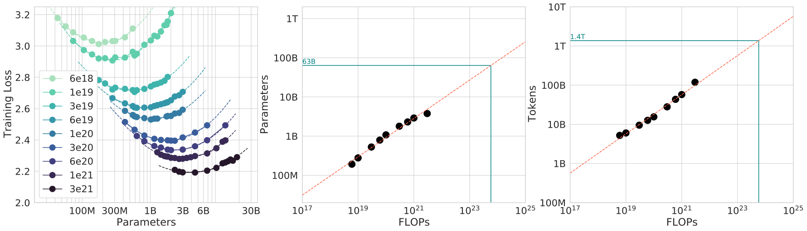


训练预算固定时，模型越大，能处理的 token 就越少。Chinchilla 论文通过多组语言模型实验，比较同样训练算力下不同的参数量和 token 数。结果显示，预算增加时，两者应当大致以相同的倍数增长。作者用与 Gopher 相近的算力训练了一个参数量约为其四分之一的模型，让它读过更多 token，并在多项测试中取得更好成绩。（由 GPT-6 总结）

**关键公式**

$$
C\approx 6ND.
$$

$$
\widehat L(N,D)=E+\frac{A}{N^\alpha}+\frac{B}{D^\beta}.
$$

$$
N_*\propto C^{\beta/(\alpha+\beta)},\quad D_*\propto C^{\alpha/(\alpha+\beta)}.
$$



### 1. 先定训练预算

**Training Compute-Optimal Large Language Models** 是 Hoffmann 等人在 2022 年发表的论文。[GPT-3](../gpt3/) 展示了扩大语言模型可以带来什么能力，Chinchilla 研究的是扩大的方式：如果团队已经定好了能用多少张加速卡、能训练多久，这笔算力要花在更大的模型上，还是花在更多的训练数据上？

先记三个量：$N$ 是模型参数量，$D$ 是预训练实际处理的 token 总数，$C$ 是一次训练的总计算量。模型越大，处理一个 token 通常越贵；训练的 token 越多，这项计算就要重复越多次。对论文研究的一类稠密 Transformer，常用近似是：

$$
C\approx 6ND.
$$

这里的 $C$ 以浮点操作总次数（FLOPs）计。固定 $C$ 时，把参数量 $N$ 提高到两倍，大致要把能训练的 token 数 $D$ 减半。预算约束只告诉我们哪些组合花费相近；哪一组训练完预测得更好，得比较语言模型的损失。

> [!Note] **6 从哪里来**
> 把参数矩阵乘法看作主要开销时，一次前向中，一个权重参与的乘加可计为 2 次浮点操作；反向还要计算输入梯度和权重梯度，合计约再花 4 次。这给出每个参数、每个 token 约 6 次操作的估计。注意力里 token 与 token 的运算等开销另有算法，真实训练还受实现和硬件影响。

语言模型损失衡量模型给真实下一个 token 分了多大概率：分得越少，负对数损失越大。文中用平滑后的训练损失估计这种预测水平；支撑拟合的训练实验没有用尽整份语料。这里的 $D$ 按模型实际看到的次数计数，同一段文本读两遍会记两次，数据来源和质量则通过训练设置影响结果。

### 2. 预算分配

在同一训练预算下，模型太小可能学不出更复杂的语言规律；模型太大虽然容量高，却因每个 token 更贵而读不到足够的数据。作者对数百次实验采用了三种分析方法，分别从训练过程、训练终点和拟合函数找出两种损失之间的平衡点。

三种方法要得到的都是同一组量：对给定的 $C$，哪组参数量 $N_*$、训练 token 数 $D_*$ 能达到最低损失？先对多个预算回答一次，再拟合 $N_*$ 和 $D_*$ 随 $C$ 增长的规律。这样可以用成本较低的实验估计大预算下的配置，而无需为每个候选的大模型付一次完整的训练成本。

#### 2.1 训练曲线

第一种方法先定若干档模型大小，每档各跑四种训练长度。每次训练都配合自己的长度安排学习率，让它在接近预定终点时降下来。把不同实验的损失画在同一张图上，横轴用累计 FLOPs，纵轴用平滑后的损失。任取一处预算，相当于沿横轴画一条竖线，比较各条相交曲线在这里的高度。交点最低的实验给出一组 $N$ 和当时已经读过的 $D$。

图上最低点会在不同曲线之间切换：预算小时，训练较充分的小模型可能更好；预算上去之后，大一些的模型也能读到足够多的数据，最低点就可能换到它的曲线上。把每个预算下最低的交点接起来，得到 Figure 2 所画的下包络；再对这些点对应的 $N$ 和 $D$ 拟合其随预算变化的趋势。

作者选中的交点都在各次训练最后约 15% 的区间里。直接截一条很长的训练曲线可能误判：例如，计划训练 1000 亿 token 的学习率仍较高时，截取其 200 亿 token 处的损失，不等同于把学习率安排得正好在 200 亿 token 结束的结果。

#### 2.2 等算力对照

第二种方法反过来先选训练预算，再在每档预算里试几种模型。每确定一个 $N$，便选取 $D$ 使该实验在指定预算处结束。这次只取最终损失。作者比较了从 $6\times10^{18}$ 到 $3\times10^{21}$ FLOPs 的九档预算。

<figure>
  
  <figcaption>论文 Figure 3。左图比较每档等算力实验的最终损失；中、右图用谷底的位置预测更高预算下的参数量和训练 token 数。</figcaption>
</figure>

左图的横轴是模型参数量，纵轴是最终损失。每个观测点来自一次实际训练；同色的一组点花费近似相同的 FLOPs，称为一条 **IsoFLOP** 曲线。沿同色曲线向右走，$N$ 增大，能处理的 $D$ 减少。左端容量不足，右端训练量不足，中间形成谷底。作者用二次曲线估计谷底所在的参数量，不必把每个可能的大小都训练一遍。

中图和右图换了坐标：横轴都是训练算力，纵轴分别是从谷底估计的 $N_*$ 和 $D_*$。在双对数坐标上，幂律近似成直线。绿色标记把这条线推到 Gopher 的训练预算，对应约 630 亿参数和 1.4 万亿 token。左图的终点损失是测量值，右侧的绿色标记是更高预算下的预测。

#### 2.3 损失拟合

第三种方法不必先挑出每档预算的赢家。它为实验中的每组 $(N,D)$ 预测最终损失，并从观测结果拟合常数 $E,A,B,\alpha,\beta$：

$$
\widehat L(N,D)=E+\frac{A}{N^\alpha}+\frac{B}{D^\beta}.
$$

$E$ 是拟合的损失下限；后两项分别表示有限模型容量与有限训练量造成的额外损失。指数 $\alpha,\beta$ 描述相应的一项随参数量或 token 数增加而消退的速度。比如 $N$ 翻倍，会把容量损失乘以 $2^{-\alpha}$，这一变化可以与减少 token 带来的损失增加直接比较。

拟合时，作者把前两种实验收集到的终点损失一并交给这个函数。训练过的 $(N,D)$ 决定函数的形状；拟合后，它可以估计未直接测试过的配置。要找固定预算下的最优点，将 $D=C/(6N)$ 代入：

$$
\widehat L(N)=E+A N^{-\alpha}+B(6N/C)^\beta.
$$

在相同预算下，让 $N$ 按比例增大一点，容量项会下降，训练量项会上升。用 $\log N$ 作变量是为了比较同样百分比的变化：容量项每往下走的速率为 $\alpha A N^{-\alpha}$，训练量项每往上走的速率为 $\beta B(6N/C)^\beta$。前者更大时，增大 $N$ 有利；后者更大时，就应缩小 $N$。前者随 $N$ 递减，后者随 $N$ 递增，于是最低点在两种变化抵消的地方：

$$
\alpha A N^{-\alpha}=\beta B(6N/C)^\beta.
$$

把含 $N$ 的因子移到同一边，有 $N_*^{\alpha+\beta}=\alpha A C^\beta/(\beta B6^\beta)$。其余系数固定，因此 $N_*$ 随预算按 $\beta/(\alpha+\beta)$ 次幂增长。再用 $D_*=C/(6N_*)$，得到最优 token 数的指数为 $\alpha/(\alpha+\beta)$。

#### 2.4 结果有多接近

| 估计方法 | 参数量的指数 | token 数的指数 |
| --- | ---: | ---: |
| 训练曲线 | 0.50 | 0.50 |
| 等算力对照 | 0.49 | 0.51 |
| 损失拟合 | 0.46 | 0.54 |

论文表 2 中，两列指数都接近 0.5，意味着预算增加时，参数量和 token 数要用相近的倍率增长。指数接近也会产生外推差距：同样是 Gopher 的预算，损失拟合预测约 400 亿参数，等算力法给出约 630 亿。论文据此把大规模验证选在这一区间的偏大一侧。

### 3. 四倍预算

假设小规模实验已经选出一组在原预算下表现较好的配置：$N=20$ 亿参数，$D=400$ 亿 token。用 $6ND$ 估算，它花费 $4.8\times10^{20}$ 次浮点操作。现在允许用四倍预算，即约 $1.92\times10^{21}$ 次操作。

若采用近似的平方根规律，新预算对应的参数量与 token 数都乘 $\sqrt 4=2$，得到 **40 亿参数、800 亿 token**。代回 $6ND$ 会得到新的预算。把新增算力全花在模型上，则是 **80 亿参数、400 亿 token**，也满足相同约束。乘积只能判断两组开销相近；根据前面的实验，在扩大模型的同时多读数据，更可能降低最终损失。

这个算例的起点是每个参数约 20 个训练 token，等比例扩大后比值保持不变。真实的 Chinchilla 也是约 20；这个数是特定数据、模型和目标下的参考点。两者指数只要有差别，比值就会随预算缓慢变化，起点也应从实际训练曲线估计。

### 4. 实验结果

Gopher 有 2800 亿参数，训练了约 3000 亿 token。论文用同档训练预算（约 $5.76\times10^{23}$ FLOPs）训练 700 亿参数的 Chinchilla，共处理 1.4 万亿 token。两个模型都用 80 层；Chinchilla 将模型宽度从 16384 减到 8192，并将注意力头数减半。前馈和注意力的线性投影里有许多矩阵的两条边都与模型宽度成比例，所以宽度减半，主干参数量接近原来的四分之一。参数量和 token 数经过取整，$6ND$ 算出的预算也只是近似。

语言建模方面，Chinchilla 在 WikiText-103 上的困惑度是 7.16，Gopher 是 7.75。困惑度是按 token 平均的负对数损失取指数，越低表示模型平均给真实 token 分配了越高的概率。下游任务方面，论文第 4.2 节报告，在各学科都给五条示范的 MMLU 选择题上，Chinchilla 平均准确率为 67.6%，Gopher 为 60.0%，相差 **7.6 个百分点**。

两次训练以同一套 MassiveText 语料为基础，采样配比、优化器和分词仍有差异。这组实验说明，在同量级算力下，用更小的模型、让它多读数据，可以同时改善语言建模指标和下游成绩。各部分改动分别贡献多少，不能直接从这两个模型的对照中读出。

### 5. 从训练到部署

论文所谓“最优”是在给定预训练计算量时，把预训练损失降得尽可能低。更换语料、重复使用数据，或把推理成本也计入预算，都可能改变最佳选择。Epoch AI 后来复查了论文第三种方法的拟合，发现调整后的参数仍支持大致平衡的分配，却会改变具体的预测比例。实际规划训练时，可以先用这项规律选几组参数量和训练长度，再在目标数据上比较。

训练只需要做一次，服务端却要反复生成。按每次生成的开销计费时，可以先选一个足够小、容易部署的模型，再多花训练算力让它达到所需效果。这时被固定的是部署端的限制，模型可以训练到超过原先按预训练算力优化时的 token 数。[LLaMA](../llama/) 就采用了这种取舍。至于在已有模型上针对任务微调，起点已经是训练好的权重；要考虑的是哪些参数需要改、每个任务要保存多少，而非重新分配整笔预训练算力。

### 参考资料

1. Hoffmann et al. *Training Compute-Optimal Large Language Models*. NeurIPS 2022. [论文 PDF](https://proceedings.neurips.cc/paper_files/paper/2022/file/c1e2faff6f588870935f114ebe04a3e5-Paper-Conference.pdf)。第 3 节介绍三种分配方法，第 4 节比较 Chinchilla 与 Gopher；[封面取自原论文 Figure 1](https://arxiv.org/html/2203.15556v1#S1.F1)。
2. Google DeepMind. *An Empirical Analysis of Compute-Optimal Large Language Model Training*. 2022. [研究博客](https://deepmind.google/blog/an-empirical-analysis-of-compute-optimal-large-language-model-training/)。作者团队解释为何在 Gopher 的预算下选择更小的模型和更多的训练 token。
3. Besiroglu et al. *Chinchilla Scaling: A Replication Attempt*. Epoch AI, 2024. [研究博客](https://epoch.ai/blog/chinchilla-scaling-a-replication-attempt)。复查参数化损失拟合及其对预算分配预测的影响。
