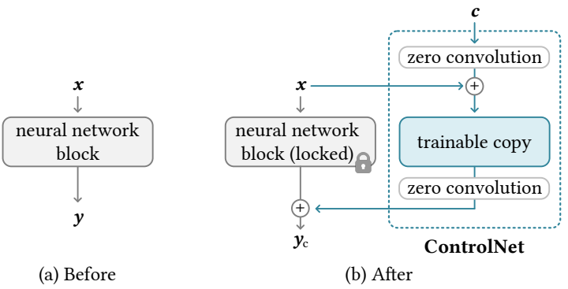
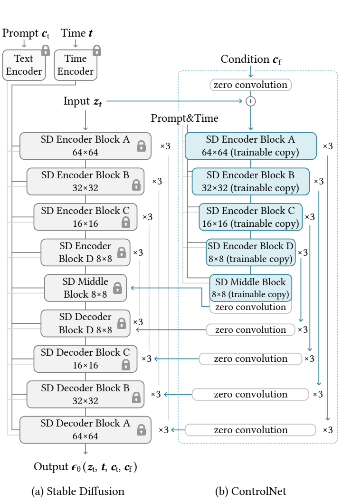


ControlNet 要解决的是文生图模型难以精确指定空间布局的问题。文字描述对象与风格，边缘、深度或姿态图则提供位置与形状。方法保留已训练好的扩散主干，复制其中的编码器与中间块作为可训练分支，让分支读取带噪潜变量、文本和空间条件，再将多尺度控制特征加入主干。连接处的零卷积使分支初始输出为零，随后通过训练逐步学习有效更新。训练仍预测已知噪声，生成仍由采样器逐步去噪；控制强度调节空间条件的影响，CFG 调节条件预测的引导。多个条件还可通过组合各自分支的输出共同作用。（由 GPT-6 总结）

**关键公式**

$$
z_t=\sqrt{\bar\alpha_t}\,z_0+\sqrt{1-\bar\alpha_t}\,\epsilon.
$$

$$
y_c=F(x)+Z_{\mathrm{out}}\!\left(F_c(x+Z_{\mathrm{in}}(c))\right).
$$

$$
r_\ell=Z_\ell(h_\ell),\qquad s'_\ell=s_\ell+\lambda_\ell r_\ell.
$$

$$
\mathcal L=\mathbb E\!\left[\|\epsilon-\epsilon_{\Theta,\phi}(z_t,t,e,c)\|_2^2\right].
$$



### 1. 基本思路

**Adding Conditional Control to Text-to-Image Diffusion Models** 是 Lvmin Zhang、Anyi Rao 和 Maneesh Agrawala 于 2023 年提出、发表于 ICCV 2023 的论文，方法称为 **ControlNet**。它承接潜空间扩散模型：已经有一个能根据文字生成图像的模型，现在希望额外指定物体的轮廓、人物的姿态或场景的空间结构。

文字擅长描述“画什么”，但很难准确表达每条轮廓的位置、每个关节的角度。仅仅增加提示词，模型仍可能改变构图。边缘图可以直接标出轮廓，姿态图可以标出人体关节，深度图可以描述前后关系；它们都保留二维位置，因此称为**空间条件**。

这类图像与普通照片的数值含义不同。预训练模型认识人物、房屋与绘画风格，却没有自动学会“这条彩色线段代表手臂”“这块灰度表示距离”。需要用成对数据训练，让模型建立条件图与生成内容之间的对应关系。

直接更新整个文生图模型，会同时改动原有生成能力与新控制能力。ControlNet 选择保留原模型，再增加一个专门学习空间条件的分支。**原模型提供已有的图像生成能力，新增分支学习怎样根据条件图调整去噪计算。**

<figure class="ddpm-figure">
  
  <figcaption>空间条件与文字共同控制生成；来源：原论文 Figure 1</figcaption>
</figure>

图中每行最左侧是条件：上行为鹿的边缘，下行为人体姿态。右侧在保留主要轮廓或姿势的同时，改变场景、人物身份和外观。边缘没有规定颜色，姿态也没有规定衣服，因此同一条件仍可对应多张合理图像。

本文沿用 [DDPM](/papers/ddpm/) 的累计加噪记号，以 [LDM 文章](/papers/ldm/) 介绍的 Stable Diffusion 为预训练主干，依次介绍条件如何进入网络、为什么采用零卷积，以及训练和生成的完整过程。

### 2. 从预训练网络到控制分支

#### 2.1 原模型已经具备什么

Stable Diffusion 先用图像编码器将图片压缩为潜变量 $z_0$，再在潜空间进行扩散。训练时选取时刻 $t$，加入已知高斯噪声：

$$
z_t=\sqrt{\bar\alpha_t}\,z_0+\sqrt{1-\bar\alpha_t}\,\epsilon,\qquad\epsilon\sim\mathcal N(0,I).
$$

去噪网络接收 $z_t$、时刻 $t$ 和文本特征 $e$，预测噪声。文本特征由文本编码器产生，并通过交叉注意力参与图像特征的更新：图像位置提供查询，文本位置提供键和值，使各图像位置读取相关文字信息。

去噪网络采用 **U-Net**。它的编码器逐步降低空间分辨率，提取不同尺度的特征；中间块在最低分辨率继续处理；解码器逐步恢复分辨率。编码器还把对应尺度的特征直接送给解码器，这些连接称为**跳跃连接**，用于补充恢复空间细节所需的信息。

这里的 U-Net 编码器是去噪网络的一部分，与把照片压缩为潜变量的图像编码器作用不同。前者每个去噪时刻都要运行，后者用于训练样本编码或图生图输入编码；最终潜变量由图像解码器恢复为图片。

#### 2.2 为什么复制已有网络

控制分支需要同时理解当前噪声状态与条件图，才能给出有用的更新。只把条件图经过一个浅层卷积后加进主干，虽然能传入数值，却把复杂对应关系留给了冻结的主干。复制预训练编码层，则让分支从已经学到的多尺度图像特征出发，继续学习空间控制。

先看一个抽象的网络块。块是一起完成一段特征变换的若干层，原块将输入特征 $x$ 变为 $F(x)$。ControlNet 冻结其参数，建立可训练副本 $F_c$，再为条件入口与分支出口各加一个零卷积：

$$
u=F_c\!\left(x+Z_{\mathrm{in}}(c)\right),\qquad y_c=F(x)+Z_{\mathrm{out}}(u).
$$

$c$ 是已经整理到对应尺寸的条件特征。副本同时读取原输入和条件，出口负责把它的结果转换成对原块输出的修正。训练开始时，副本中的已有层从原块复制参数；新增条件编码层与连接层则按各自规则初始化。

<figure class="ddpm-figure">
  
  <figcaption>带零卷积的控制分支；来源：原论文 Figure 2</figcaption>
</figure>

图左是原块，图右灰色块冻结、蓝色块可训练。沿蓝色路径看，条件先经过上方 zero convolution，再与输入相加；副本输出经过下方 zero convolution，最后加回灰色路径。这张图说明基本设计，完整 U-Net 则在多个尺度上建立这样的联系。

#### 2.3 零卷积怎样开始学习

**零卷积**是权重与偏置都初始化为零的 $1\times1$ 卷积。它在每个空间位置重新组合通道，不扩大空间范围。训练开始时，无论输入特征为何，出口零卷积的输出都为零，因此 $y_c=F(x)$。条件图已经作为额外输入传入网络，但尚未改变主干的计算结果。

这个初始化还让副本先接收与原模型接近的输入，避免随机条件特征立即扰动其预训练表示。随后连接权重逐步更新，空间条件才逐渐参与计算。

零权重并不意味着这层无法学习。把某个位置的出口写成 $r=Wu+b$，将损失对出口的梯度记为 $g=\partial\mathcal L/\partial r$，有：

$$
\frac{\partial\mathcal L}{\partial W}=gu^\top,\qquad\frac{\partial\mathcal L}{\partial u}=W^\top g.
$$

初始 $W=0$ 时，传到副本特征 $u$ 的梯度为零；但已有网络产生的 $u$ 通常非零，出口权重仍可获得梯度。出口更新后，后续反向传播就能到达副本与条件入口。因此，首先学习的是怎样连接已有特征，随后进一步调整分支内部的特征处理。

### 3. 接入 Stable Diffusion

#### 3.1 条件图如何进入潜空间计算

条件图记为 $c_{\mathrm{img}}$。它与输出图像采用相同的空间坐标，先经过专门的条件编码器 $E_c$，得到特征：

$$
c=E_c(c_{\mathrm{img}}).
$$

以 $512\times512$ 图像为例，Stable Diffusion 的带噪潜变量空间尺寸为 $64\times64$。官方实现用卷积和激活函数处理条件图，通过三次步长为 2 的下采样，将空间尺寸也变成 $64\times64$，并把通道数调整到分支入口需要的宽度。这样，条件与当前噪声特征才能按对应位置相加。

条件编码器随控制分支一起训练，末层也采用零初始化。它与压缩照片的图像编码器处理不同输入、学习不同任务；边缘线、深度值和关节标记的含义由控制任务的数据决定。

在 Stable Diffusion 1.5 的默认配置中，带噪潜变量有 4 个通道，先由入口卷积变成 320 通道特征；条件编码器也输出 320 通道。两者空间尺寸均为 $64\times64$，相加后才进入后续分支。条件图虽然外观上是一张图片，网络使用的是卷积提取后的特征，而不是把边缘图的像素直接叠到潜变量上。

#### 3.2 多尺度特征在哪里相加

原版 ControlNet 复制的是 U-Net 的 **12 个编码块和 1 个中间块**，保留原去噪 U-Net 的参数。副本读取 $z_t,t,e$ 和条件特征，产生多个尺度的特征图；每路输出再经过一个零卷积，得到 13 路控制特征。

其中 12 路加入原 U-Net 的跳跃连接，另一路加入中间块输出。记第 $\ell$ 路副本特征为 $h_\ell$，原跳连特征为 $s_\ell$：

$$
r_\ell=Z_\ell(h_\ell),\qquad s'_\ell=s_\ell+\lambda_\ell r_\ell.
$$

$r_\ell$ 与对应的 $s_\ell$ 形状相同，$\lambda_\ell$ 控制这一更新的强度。解码器再把修改后的跳连特征，与自身当前特征沿通道方向拼接，继续完成去噪计算。低分辨率特征能结合较大范围的结构，高分辨率特征则保留更多位置细节。

<figure class="ddpm-figure">
  
  <figcaption>ControlNet 与 Stable Diffusion 的连接；来源：原论文 Figure 3</figcaption>
</figure>

左侧灰色路径是原 U-Net，右侧蓝色路径是控制分支。蓝色横线把分支结果送往中间块与解码侧的跳连；$\times3$ 表示同一尺度包含多次块计算。控制分支只有下采样路径和中间块，恢复分辨率的工作由原解码器完成。

文本与空间条件在这里分工明确：文本特征进入相应注意力模块，控制图沿卷积编码路径形成多尺度修正。副本中的注意力层随网络结构继承；下采样等块则执行各自的卷积变换。

### 4. 训练与生成

#### 4.1 训练样本与目标

每个样本包含**目标图像、对应条件图和文字描述**。边缘、深度和姿态通常由相应检测器从目标图像提取；这些处理得到空间监督，不需要人工标注每个去噪时刻应输出什么特征。若裁剪或缩放目标图像，条件图也要采用对应的几何变换，保证位置一致。

先编码目标图像得到 $z_0$，随机抽取时刻和噪声构造 $z_t$，再由联合网络预测噪声。用 $\Theta$ 表示冻结主干参数，$\phi$ 表示控制分支及条件编码器参数，训练目标为：

$$
\mathcal L(\phi)=\mathbb E_{z_0,t,e,c,\epsilon}\!\left[\|\epsilon-\epsilon_{\Theta,\phi}(z_t,t,e,c)\|_2^2\right].
$$

它仍是噪声预测的平方误差。主干利用控制特征产生预测，损失经过这些相加位置传回分支，优化器只更新 $\phi$。因此，分支学到的是有助于当前去噪任务的特征更新，并不要求它直接重建一张照片。

**冻结参数与截断梯度是两件事。** 原解码器的权重保持不变，但计算损失对控制特征的梯度时，仍需经过原解码器。原编码器则可在不保存反向传播图的情况下提供自身跳连特征，节省训练显存。

论文训练时随机将 **50% 的文字描述替换为空字符串**，让控制分支在缺少文字提示时，也学习从条件图辨认内容。它省略的是文本，目标图像与空间条件仍然成对保留。一次更新只需随机时刻的一次预测，沿用 DDPM 的训练方式。

同一张目标图像在不同更新中可以抽到不同的时刻与噪声。因此，控制分支既要学会在高噪声时依据条件确定结构，也要在低噪声时配合已有内容修正细节。训练标签始终是本次加入的噪声，各尺度的控制特征通过同一个最终损失共同学习。

#### 4.2 生成时怎样运行

生成前准备好文字与条件图，选定匹配该条件类型的 ControlNet，并设置控制强度和采样参数。随后执行：

1. 文本编码器得到文本特征，条件编码器得到空间特征，从高斯分布采样初始潜变量 $z_T$。
2. 在当前时刻，将 $z_t,t$ 和文本特征送入主干及控制分支；分支结合空间条件，输出各尺度控制特征。
3. 将控制特征按强度加入主干，得到当前噪声预测；需要 CFG 时，组合两次条件设置下的预测。
4. 采样器根据噪声预测更新到较低噪声时刻，重复上述过程，最后用图像解码器把潜变量恢复为图片。

条件图在一次生成中通常保持不变，但控制分支仍随 $z_t,t$ 重新计算；它在不同噪声阶段提供的更新也随之改变。从随机噪声开始，意味着输入边缘或姿态约束的是结构，外观和纹理仍由文本、模型及随机种子共同决定。

#### 4.3 控制强度、CFG 与采样器

这几个设置作用于不同计算。**control strength** 对上面的 $r_\ell$ 乘系数，直接调节空间条件传入主干的幅度；取零时回到没有控制分支贡献的主干预测。提高它通常加强结构约束，也可能压缩模型调整外观的空间。

[CFG](/papers/cfg/) 则组合条件预测与弱条件预测。常见设置在两路中保留同一张控制图，只将弱条件一路的文字置空。将带文字的预测记为 $\epsilon_c$，文字置空的预测记为 $\epsilon_u$，以 $s$ 表示引导尺度：

$$
\hat\epsilon=\epsilon_u+s(\epsilon_c-\epsilon_u).
$$

此时“弱条件”一路仍有空间条件，$s$ 放大的是加入文字带来的预测差异。官方还提供 **Guess Mode**：弱条件一路不使用控制分支，并调整不同尺度的控制权重，让模型更多依靠条件图推断内容；因此，比较参数时需要同时看两路具体输入。

[DDIM](/papers/ddim/) 等采样器负责利用最终噪声预测，计算下一个潜变量状态。采样步数决定调用多少次网络，控制强度决定每次调用中空间特征的影响；ControlNet 改变去噪网络的输入路径，采样更新公式仍可沿用。

### 5. 条件的选择与组合

不同控制图包含不同信息，应根据希望保留的结构选择。常用条件及处理方式如下：

| 条件 | 输入形式与提供的信息 | 使用时关注什么 |
| --- | --- | --- |
| Canny 边缘 | 灰度边缘图，约束轮廓和部分细节 | 阈值改变边缘密度，背景纹理也可能成为约束 |
| 深度 | 深度估计图，描述场景前后与形状 | 使用对应模型预期的深度方向、归一化与编码方式 |
| 人体姿态 | 关键点与骨架绘制成的彩色图 | 关节缺失或检测错误会直接影响姿势约束 |
| 语义分割 | 用标签及配色标明各区域类别 | 类别和颜色约定应与训练数据相符 |

预处理器将普通图片转换成条件图，ControlNet 再学习利用它。二者是不同模块；更换检测器可能改变线宽、深度范围或骨架画法，因此推理时应保持与训练时接近的条件表达。

原版通常为每种条件训练一套参数。例如，边缘 ControlNet 学习线条与外观的关系，姿态 ControlNet 学习骨架与人体图像的关系。需要同时约束姿态和深度时，可以各运行一个对应分支，再把同一位置的控制特征相加：

$$
s'_\ell=s_\ell+\sum_{k=1}^{K}\lambda_{\ell,k}r_{\ell,k}.
$$

各分支共享同一个去噪主干，并接收当前潜变量。相容条件能提供互补信息；条件之间若在位置或形状上冲突，网络就需要折中，实际使用中可调整各分支强度。增加分支也会增加计算与显存成本。

### 6. 实验结果

论文不仅展示多种控制图的生成结果，还比较了不同连接和分支结构。将零卷积换成普通随机初始化卷积后，模型利用预训练特征的效果下降；把深层副本换成浅层卷积的 **ControlNet-lite**，在文字不足或为空时更难理解条件图内容。这些消融支持了“复用深层特征，再逐步学习连接”的设计。

语义分割实验用分割图控制生成，再对生成图像重新分割，与输入标签比较 **IoU**，即区域交集与并集之比。同时用 **FID** 衡量生成图像与真实图像的特征分布差异，数值越低越好。下表摘录原论文 Table 2、3：

| 方法 | 分割重建 IoU ↑ | FID ↓ |
| --- | ---: | ---: |
| LDM（分割条件） | $0.31\pm0.09$ | 25.35 |
| PITI（分割条件） | $0.26\pm0.16$ | 19.74 |
| ControlNet-lite | $0.32\pm0.12$ | 17.92 |
| ControlNet | $0.35\pm0.14$ | 15.27 |

ControlNet 在这组比较中同时改善了条件重建与生成分布质量。对真实图像运行同一分割器，IoU 为 $0.58\pm0.10$，也说明重建指标包含分割器的识别误差。这里的 LDM 是针对分割条件训练的对照配置，表中数字用于比较这项具体任务。

另一个用户实验邀请 12 位参与者，对 20 张未见过的手绘草图所生成的结果排序，评价图像质量与草图一致性。在 1 至 5、越高越好的排序中，ControlNet 两项平均分分别为 4.22 和 4.28，ControlNet-lite 为 3.93 和 4.09。这项比较补充了自动指标，反映参与者对这些草图结果的偏好。

论文还测试了不同数据规模：仅 1000 张训练图像时，模型已能学到一定的边缘控制，增加到 5 万和 300 万张后继续改善。深度控制实验使用 20 万样本，在一张 RTX 3090 Ti 上训练 5 天。这些结果说明可以从已有生成能力出发学习新控制任务，数据的覆盖范围仍决定了控制能力能推广到哪些输入。

### 7. 联系与局限

在此前的学习路径中，DDPM 规定怎样加噪和训练，DDIM 提供不同的生成更新，LDM 将主要计算移到压缩空间，CFG 调节条件引导；ControlNet 则提供一种利用现有主干增加空间输入的方法。它们可以组成同一个生成系统，分别处理不同问题。

ControlNet 提供的是学习得到的约束。若姿态检测漏掉手部关节，条件中就缺少相应信息；若边缘图极其密集，模型也可能把纹理当作需要保留的轮廓。提高控制强度会放大分支贡献，控制图质量和训练覆盖范围仍然决定最终效果。

代价来自额外的编码器副本。主干冻结减少了训练时需要更新的参数与部分梯度存储，但生成时每个去噪步仍要运行控制分支。迁移到其他基础模型时，还要匹配潜空间、网络结构和特征尺寸；原论文展示的社区模型迁移，是在兼容的 Stable Diffusion 系列内进行。

### 参考资料

1. Zhang, Rao, Agrawala. *Adding Conditional Control to Text-to-Image Diffusion Models*. ICCV 2023. [arXiv:2302.05543](https://arxiv.org/abs/2302.05543)，[CVF 正式版](https://openaccess.thecvf.com/content/ICCV2023/html/Zhang_Adding_Conditional_Control_to_Text-to-Image_Diffusion_Models_ICCV_2023_paper.html)。本文图 1–3、训练设置与实验数据的主要来源。
2. [ControlNet 官方实现](https://github.com/lllyasviel/ControlNet)，其中 [cldm/cldm.py](https://github.com/lllyasviel/ControlNet/blob/main/cldm/cldm.py) 给出条件编码、零卷积和多尺度注入，[训练教程](https://github.com/lllyasviel/ControlNet/blob/main/docs/train.md) 展示数据配对与训练流程。
3. Rombach et al. *High-Resolution Image Synthesis with Latent Diffusion Models*. CVPR 2022. [arXiv:2112.10752](https://arxiv.org/abs/2112.10752)。潜空间扩散和文本条件主干。
