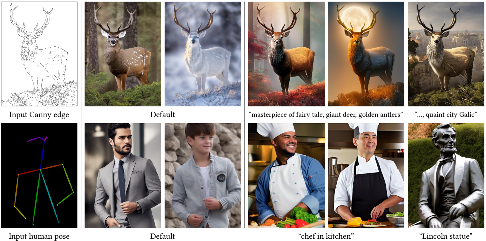
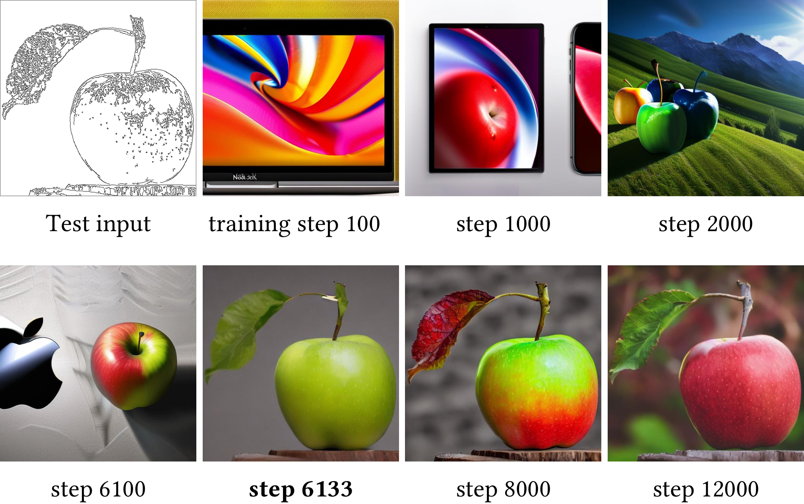


ControlNet 为已经训练好的文生图模型加入边缘、深度和姿态等空间条件。它冻结原去噪网络，复制编码器和中间块，让可训练分支结合条件图与当前带噪状态，生成供主干解码器使用的多尺度修正。连接层从零开始，模型初始保留原有预测，再用原来的噪声损失学习怎样利用条件。生成时，控制强度调节特征修正，CFG 组合两种条件设置下的噪声预测，采样器再据此更新潜变量。（由 GPT-6 总结）

**关键公式**

$$
z_t=\sqrt{\bar\alpha_t}\,z_0+\sqrt{1-\bar\alpha_t}\,\epsilon.
$$

$$
y_c=F(x)+Z_{\mathrm{out}}\!\left(F_c(x+Z_{\mathrm{in}}(c))\right).
$$

$$
r_\ell=Z_\ell(h_\ell),\qquad s'_\ell=s_\ell+\lambda_\ell r_\ell.
$$

$$
\mathcal L=\mathbb E\!\left[\|\epsilon-\epsilon_{\Theta,\phi}(z_t,t,e,c_{\mathrm{img}})\|_2^2\right].
$$



### 1. 基本思路

同一句“画一个带叶片的苹果”，可以画出许多合理的构图。如果需要果实偏右、叶片垂到左侧，反复改提示词、换随机种子也只能碰运气。一张轮廓图却能直接标出两者的位置，还能把颜色、光照和背景留给文字决定。边缘图、姿态图和深度图都以这种方式给出**空间条件**。

目标是让成图对齐这些位置，同时保留原文生图模型处理外观和文字的能力。直接改 U-Net 的输入，让它用一小批带轮廓的图重新学去噪，原来已经会的能力也可能随着参数更新而退化。Lvmin Zhang、Anyi Rao 和 Maneesh Agrawala 在 ICCV 2023 提出的 **ControlNet** 保留已训练好的网络，另设一条能看见控制图的路径。它在每次去噪时告诉原网络哪些中间特征应当调整，让采样结果逐步靠近给定的布局。

<figure class="ddpm-figure">
  
  <figcaption>空间条件与文字共同控制生成；来源：原论文 Figure 1</figcaption>
</figure>

图中每行最左侧是条件：上行为鹿的边缘，下行为人体姿态。右侧在保留主要轮廓或姿势的同时，改变场景、人物身份和外观。边缘没有规定颜色，姿态也没有规定衣服，因此同一条件仍可对应多张合理图像。

在 [LDM](/papers/ldm/) 中，每个图像位置用注意力选择该读哪些词；边缘图已经给出了这种对应关系，图上哪里有线，结果就应当在哪里形成轮廓。ControlNet 因而沿原有的二维网格传递条件，利用 U-Net 的各层特征把位置要求带进每一步去噪。

### 2. 单步架构

#### 2.1 两路编码

从下面的 Figure 3 看一次噪声预测。左边称为**主干**，就是已经训练好的 U-Net；右边称为**控制分支**，两者看到同一份带噪潜网格。右边还会看控制图，计算出要加到左边各层的数。这些与主干特征同形状的张量就是“修正”，最后仍由左边的 U-Net 输出整张网格的噪声预测。

<figure class="ddpm-figure">
  
  <figcaption>ControlNet 与 Stable Diffusion 的连接；来源：原论文 Figure 3</figcaption>
</figure>

1. **上方是输入。** 左右两路都接收当前的带噪潜变量 $z_t$、时刻 $t$ 和提示词编码所得的文本特征 $e$。时刻和文字沿用 U-Net 原来的条件入口。空间条件在图中标为 $c_f$，只从右上角进入，与控制副本入口处的带噪特征相加。
2. **两路都向下提取特征。** 左边的原编码器把各级特征留给解码器。右边的可训练副本沿相同的尺度向下，到中间块为止。
3. **蓝色箭头把修正送向左侧。** 右路用各自的卷积把特征变成修正，送给左侧 U-Net 的上升路径。图中称这些连接为“零卷积”，因为它们从零权重开始训练。图外另有一个图像解码器，在整个采样结束时才把潜变量转成像素。

#### 2.2 条件入口

同一张边缘图既会出现在采样开始、图像几乎全是噪声的时候，也会出现在轮廓已经成形的时候。早期的修正可能影响整体布局，后期的修正可以针对已经显现的局部轮廓。为此，控制分支同时读取条件与当前带噪状态，让修正随采样进度变化。图中右上角的加号就是两份信息会合的地方。

以 Stable Diffusion 1.5 生成 $512\times512$ 图像为例，条件图 $c_{\mathrm{img}}$ 的边缘或关节标在像素坐标上；当前的潜网格 $z_t$ 只有 $64\times64$ 个空间位置。为了让条件能在对应位置影响去噪，先把两条输入变到相同形状：

- **潜变量一侧：** 控制副本的入口卷积把 $z_t$ 从 4 通道转换为 320 通道，空间尺寸仍是 $64\times64$。
- **条件图一侧：** 条件编码器 $E_{\mathrm{cond}}$ 做三次步长为 2 的下采样，把 $512\times512$ 转为 $64\times64$，再由零初始化的 $3\times3$ 末层输出 320 通道特征 $v=E_{\mathrm{cond}}(c_{\mathrm{img}})$。

两份 $320\times64\times64$ 的特征逐元素相加：潜网格某个位置、某个通道的值，加的是条件特征里同一位置、同一通道的值。这一步只改变控制副本里的入口特征，主干仍从原来的 $z_t$ 开始处理。相加后，右路再用自己的卷积和注意力提取各级特征，轮廓的影响才会通过下面这些出口传到主干。

#### 2.3 多尺度融合

若只把控制信号送到最底部，每个最粗的网格位置已涵盖输入中相当大的区域。粗网格适合放置整个苹果，细叶尖落在哪边却更容易由高分辨率特征传递。U-Net 原本就有两条信息路径：上升路径从中间块取整体结构，每恢复一级分辨率，又直接取回下降路径在该尺寸保存的特征。后一条跨过中间几层的连接叫作**跳跃连接**，下文简称跳连。

沿着这个接口，控制分支在 $64\times64$、$32\times32$、$16\times16$、$8\times8$ 四个分辨率上各保留三份特征，最底部的中间块再输出一份。每份特征经过自己的 $1\times1$ 零卷积，得到与主干对应的修正。于是图中有 **12 份跳连修正加 1 份中间块修正**；控制分支到这里就可以结束，已有的解码路径会把这些信息合成为噪声预测。

> [!Note] **跳连保留了什么**
> 步长为 2 的卷积每次把一个邻域压成更稀疏的特征网格。上采样可以补齐空间位置，但粗网格里已经不易区分的细节并不会自动回来。跳跃连接把下降时保存的细网格直接交给上升路径，让下游卷积能同时看粗尺度的结果和当时保留的细尺度信息。

主干使用这些修正的顺序正好是从底部往上。先把中间块修正加到主干 $8\times8$ 的特征上，作为解码路径的起点。接下来，每当解码器要取回编码阶段保存的一份跳连特征，就先加上控制分支在同一处给出的修正。记原跳连特征为 $s_\ell$，控制分支特征为 $h_\ell$，则解码器实际取回的是 $s'_\ell$：

$$
r_\ell=Z_\ell(h_\ell),\qquad s'_\ell=s_\ell+\lambda_\ell r_\ell.
$$

下标 $\ell$ 标记取用哪条跳连。$Z_\ell$ 是该出口的 $1\times1$ 卷积：它在每个位置上重组 $h_\ell$ 的通道，输出与 $s_\ell$ 同形的 $r_\ell$，系数 $\lambda_\ell$ 决定加回多少，原版训练时直接加上修正，相当于取 $1$。以最浅的跳连为例，左路原特征和右路修正都是 $64\times64$、320 通道，相加后仍是 320 通道。解码器随后把这 320 个通道接在自己当前的特征通道后面，和原 U-Net 一样交给下一块处理。这样接入了控制，解码块的输入尺寸却不用改。最终输出的噪声预测与 $z_t$ 同形，仍为 4 通道、$64\times64$。

每次相加之后，解码器仍收到它原本能处理的特征形状。条件提供的位置信息由此被译成对原网络可用的修正；至于哪一层该强调果实位置、哪一层该保留细叶尖，并没有手工分工，由最终的噪声预测误差来教。

### 3. 分支初始化

#### 3.1 复制与冻结

控制分支需要学的是怎样把新条件接到已有的特征上。如果从随机参数开始，它还得在较小的控制数据集里学会怎样从带噪网格提取形状和位置。把原模型的编码器和中间块复制过来，训练开始就有这套特征，也正好能和主干的接收位置逐一对应。原 U-Net 保持冻结，副本、条件图编码器和连接层负责适应新数据。

复制出来的特征本身通常就不是零。如果直接加到原跳连，解码器从第一次预测便会读到与预训练时不同的输入，即使原参数全部冻结。接入新分支时需要一个既能把初始贡献设为零、又能在训练中学会增加贡献的连接。Figure 2 把这个设计画成一个模块：输入特征记为 $x$，原块输出 $F(x)$；可训练的副本 $F_c$ 还读取条件，算出特征 $u$，加回修正后得到 $y_c$：

$$
u=F_c\!\left(x+Z_{\mathrm{in}}(c)\right),\qquad y_c=F(x)+Z_{\mathrm{out}}(u).
$$

<figure class="ddpm-figure">
  
  <figcaption>带零卷积的控制分支；来源：原论文 Figure 2</figcaption>
</figure>

这里的 $c$ 是投影前的条件特征。图中上方的 $Z_{\mathrm{in}}$ 负责把它变成能与 $x$ 相加的张量，对应完整网络中条件编码器的末层。下方的 $Z_{\mathrm{out}}$ 把副本输出 $u$ 转成对原块的修正，对应前文的各路投影。

#### 3.2 零卷积学习

**零卷积**的权重和偏置都从零开始。以 $1\times1$ 的出口投影为例，它在每个空间位置用同一份权重矩阵重新组合通道。训练开始时，入口输出为零，副本接收的仍是原输入 $x$；出口的修正也为零，因此 $y_c=F(x)$，联合网络从原模型的预测开始训练。

不过，输出为零不意味着权重的梯度也为零。把一个空间位置的出口写成 $r=Wu+b$。训练用最终的噪声预测误差计算损失 $\mathcal L$，它传到这个出口的梯度记为 $g=\partial\mathcal L/\partial r$。按链式法则：

$$
\frac{\partial\mathcal L}{\partial W}=gu^\top,\qquad\frac{\partial\mathcal L}{\partial b}=g,\qquad\frac{\partial\mathcal L}{\partial u}=W^\top g.
$$

共享卷积核在各位置收到的梯度要相加。初始 $W=0$，所以传给副本的梯度 $W^\top g$ 为零。出口仍可更新：即使当时的 $r$ 为零，改变它也会改变主干收到的特征，所以 $g$ 可以非零；副本由预训练权重初始化，$u$ 通常也非零，因此 $gu^\top$ 可以非零。

出口权重离开零后，误差就能传回副本和条件入口。入口的零卷积也先调整自己的权重，随后才能把梯度传给更早的条件编码层。起初按这个顺序开始学习，之后这些层由同一份预测误差一起训练。

这还解释了两个容易混在一起的现象：控制分支**能改变预测**，不一定就已经**能区分两张控制图**。固定带噪状态、时刻和文字，拿两张不同的轮廓分别运行网络。只要条件入口的权重仍为零，两个输入都被映射成同一份特征；此时即使出口已经给出非零修正，两次修正也相同。等到条件入口能把轮廓的差异传进副本，出口也能把差异送到主干，改一条边才可能改变最终预测。这个先后关系由连接方式决定，具体训练多久能在图上看出差别则取决于数据和优化过程。

### 4. 训练与生成

#### 4.1 训练目标

控制分支要学会把轮廓送到正确的位置，首先得有一张满足该轮廓的目标图像。训练数据便从一张原图准备出两份输入：一份编码后再加噪，另一份提取边缘、深度或姿态，作为关于同一张原图的清晰结构线索；文字描述则提供外观和语义。裁剪或缩放时，原图和条件图一起做对应变换，训练才能把条件中的位置与图中同一部位联系起来。

先把目标图像压缩为潜变量 $z_0$。按 [DDPM](/papers/ddpm/) 的方式抽取时刻和高斯噪声，构造带噪潜变量：

$$
z_t=\sqrt{\bar\alpha_t}\,z_0+\sqrt{1-\bar\alpha_t}\,\epsilon,\qquad\epsilon\sim\mathcal N(0,I).
$$

带噪网格、时刻和文字进入两条分支，控制图只进入新分支。主干融合两路特征，输出噪声预测。用 $\Theta$ 表示冻结的主干参数，$\phi$ 表示待训练的控制分支及条件编码器参数，目标为：

$$
\mathcal L(\phi)=\mathbb E_{z_0,t,e,c_{\mathrm{img}},\epsilon}\!\left[\|\epsilon-\epsilon_{\Theta,\phi}(z_t,t,e,c_{\mathrm{img}})\|_2^2\right].
$$

这里 $\bar\alpha_t$ 是截至 $t$ 的信号保留系数平方，$\epsilon$ 是加噪时抽到的标准高斯噪声。一次训练先取同一张图得到的 $z_0$、文字 $e$ 和控制图 $c_{\mathrm{img}}$，再抽取噪声和时刻。预测与 $\epsilon$ 逐位置、逐通道做差并平方，外层的 $\mathbb E$ 表示对这样的训练样本取平均。

用噪声误差就能教位置，是因为条件给出了单看 $z_t$ 时缺少的信息。假如从带噪状态已很难看清叶片，边缘图仍指出它在哪里。由上面的加噪式反解可知：从同一个 $z_t$ 减去预测的噪声项，再除以信号系数，就得到清晰网格的估计。把叶片的信号误判成噪声，就会在这次相减时一并去掉，也会让预测偏离训练时实际抽到的噪声。误差沿原解码路径传回各个控制出口，继续训练副本和条件编码器。

> [!Note] **冻结的层仍能传回梯度**
> 对一个线性层 $y=Ax$，冻结 $A$ 只表示优化器不更新这组权重。给定后层传回的梯度 $g$，前层仍能收到 $A^\top g$，因为改变输入 $x$ 仍会改变输出 $y$。ControlNet 正是通过这条路径学习：主干的解码器权重固定，但它的输入有一部分来自控制分支，可以反向更新提供这部分输入的参数。

论文训练时随机将 **50% 的文字描述替换为空字符串**，保留空间条件。这样，遇到推理时有控制图、无文字的情况，控制分支也能从条件图辨认内容。

#### 4.2 生成流程

文生图从高斯噪声 $z_T$ 开始，条件图即使来自一张照片，也只提供空间约束。一次调用结束时，13 份特征修正已经被主干用掉，采样器接到的是一张噪声预测 $\hat\epsilon_t$。以确定性 DDIM 为例，它先换算清晰网格估计 $\hat z_0=(z_t-\sqrt{1-\bar\alpha_t}\,\hat\epsilon_t)/\sqrt{\bar\alpha_t}$，再按下一个时刻的噪声比例，把 $\hat z_0$ 和同一份 $\hat\epsilon_t$ 组合成新网格。这个新网格才是下一次网络调用的输入。循环结束后由图像解码器输出像素。

把一次生成停在相邻两步之间，可以看清哪些东西发生了变化。边缘图没有动，条件编码器单独算出的 $E_{\mathrm{cond}}(c_{\mathrm{img}})$ 也可以复用。可它随后要加到控制副本从**当前** $z_t$ 提取的特征上，副本还接收当前时刻。到了下一步，哪怕边缘的位置完全相同，带噪内容也已改变；12 份跳连修正和 1 份中间块修正都要重新计算。这样，模型能在轮廓尚不清楚和轮廓已经成形时，用不同方式利用同一张边缘图。

#### 4.3 控制与引导

**控制强度**对上面的 $r_\ell$ 乘系数，直接调节加进 U-Net 的特征修正。常见界面用同一个值设置所有 $\lambda_\ell$，也可以按层分配。所有 $\lambda_\ell$ 都取零时，在相同潜变量、时刻和文本下，主干预测恢复到没有控制分支贡献的结果。提高控制强度通常会让结构约束更明显，最终图像的变化仍取决于解码器和后续去噪。

[CFG](/papers/cfg/) 则在同一个 $z_t,t$ 上组合两份完整的噪声预测。第 2 节的左右两路是在**一次预测内部**合并特征；这里是先得到两次预测的输出，再组合它们。常见做法是两次使用同一张控制图，基准预测用空文本或负面提示。将目标提示的预测记为 $\epsilon_c$，基准预测记为 $\epsilon_u$，以 $s$ 表示引导尺度：

$$
\hat\epsilon_t=\epsilon_u+s(\epsilon_c-\epsilon_u).
$$

通常两次预测共用控制图和控制强度，所以 $s$ 放大的是更换提示词带来的变化。如果两次都用空文本，空间条件仍然有效，只是两份预测相同，CFG 不再额外改变结果。

[DDIM](/papers/ddim/) 等采样器负责利用最终噪声预测，计算下一个潜变量状态。采样步数决定调用多少次网络，控制强度决定每次调用中空间特征的影响；ControlNet 改变去噪网络的输入路径，采样更新公式仍可沿用。

#### 4.4 照着轮廓画苹果

原论文用下图左上角的苹果轮廓检验控制分支学到了什么。苹果偏右，叶片垂向左侧，果梗连接两者。只说“画一个苹果”，模型也许能画对物体，却很难恰好把这三处放到指定位置。

<figure class="ddpm-figure">
  
  <figcaption>左上为测试输入，其余各格都是对应训练阶段模型生成的完整图像。来源：<a href="https://arxiv.org/html/2302.05543v3#S3.F4">原论文 Figure 4</a>。可点开原图对照叶片与果梗。</figcaption>
</figure>

这样的控制能力怎样学出来？训练时，让一张 $512\times512$ 的照片走两条路：边缘检测器提取清晰轮廓作为条件；图像编码器把照片变成 $64\times64$ 的四通道潜网格，训练程序只给这份网格加噪。主干与控制分支根据当前带噪状态、文字和轮廓预测加入的噪声。预测误差通过冻结的主干解码路径传回控制分支；即使没人标注“叶片附近的特征要改多少”，分支也能逐渐学会使用边缘。

测试时给出轮廓图和提示词，没有目标照片，采样从随机潜网格开始。假设在一次预测中，叶片附近某条跳连的一个特征值为 $1.2$，控制分支算出的修正为 $-0.4$。控制强度取 $0.5$ 时，主干解码路径读到的就是 $1.2+0.5\times(-0.4)=1.0$。这是一个内部特征，经过主干才影响噪声预测。采样器更新潜网格后，条件图保持不动，分支针对新的网格重新计算修正。如此走到清晰端，图像解码器才输出一张苹果图。

回到图中，按上排从左到右、再看下排。训练 100 步时已经能画出完整的电脑，但没有服从轮廓；2000 步时认出了苹果，却画了好几个。6133 步的结果才明显对上右侧果实和左侧叶片。8000、12000 步的输出换了果皮颜色和背景，主要轮廓依旧吻合。图中的每格都是对应阶段网络重新采样的成图，可以用来分别检查两件事：它是否会画合理的图，又是否会把东西画在指定位置。

### 5. 条件组合

不同控制图包含不同信息，应根据希望保留的结构选择。常用条件及处理方式如下：

| 条件 | 输入形式与提供的信息 | 使用时关注什么 |
| --- | --- | --- |
| Canny 边缘 | 在亮度变化较强的位置提取细线，得到黑白轮廓图 | 调高检测阈值通常会留下更少的线，背景纹理也可能被检出 |
| 深度 | 深度估计图，描述场景前后与形状 | 使用对应模型预期的深度方向、归一化与编码方式 |
| 人体姿态 | 关键点与骨架绘制成的彩色图 | 关节缺失或检测错误会直接影响姿势约束 |
| 语义分割 | 用标签及配色标明各区域类别 | 类别和颜色约定应与训练数据相符 |

预处理器将普通图片转换成条件图，ControlNet 再学习利用它。二者是不同模块；更换检测器可能改变线宽、深度范围或骨架画法，因此推理时应保持与训练时接近的条件表达。

原版通常为每种条件训练一套参数。例如，边缘 ControlNet 学习线条与外观的关系，姿态 ControlNet 学习骨架与人体图像的关系。需要同时约束姿态和深度时，可以各运行一个对应分支，再把同一位置的控制特征相加：

$$
s'_\ell=s_\ell+\sum_{k=1}^{K}\lambda_{\ell,k}r_{\ell,k}.
$$

这里 $k$ 标记不同控制分支。各分支接收同一个当前潜变量，算出的修正在对应层相加，再由同一个解码器产生噪声预测。深度和姿态若给出不同的人体位置，相加会把两份冲突的修正都交给解码器。因此，组合前先检查两张条件图的位置是否对齐。

具体到一条跳连，姿态分支和深度分支都以原始的 $z_t$ 为输入；后者不会先收到“已经修好姿态”的潜网格。两份修正只在主干取用这条跳连时会合。它们在某个通道上可能同号加强，也可能异号抵消。随后还要经过带非线性变换的解码块以及之后的采样步，因此把两个控制强度各设为一半，并不等于把单独生成的两张图各取一半。强度调节的对象始终是各层特征。

### 6. 实验结果

#### 6.1 结构消融

预训练副本和零初始化的连接是否有助于控制？论文比较了两个变体：一组保留预训练副本，将零卷积换成高斯随机初始化的卷积，用来观察连接初始化的影响；另一组用单层卷积替换每块的可训练副本，称为 **ControlNet-lite**。轻量版同时改变了分支深度和它能复用的预训练层，两项因素的作用无法从这一比较中单独分开。

原论文 Figure 8 比较了空提示、提示信息不足、文字与条件图冲突，以及文字完整描述对象四种设置。在前两种设置中，物体信息更多来自控制图，两种变体都比完整模型更难复现预期结构。

Figure 8 比较的是不同结构训练后的结果；[第 4.4 节的苹果实验](#44-照着轮廓画苹果)则跟踪同一结构的不同训练阶段。两者合起来看，主干原有的成图能力在训练初期就可用，让图像遵循指定的轮廓则需要学习。

#### 6.2 量化比较

语义分割实验使用 ADE20K 的标注图作为条件，图上每个像素都标明了它所属的类别。生成后，论文用同一个 OneFormer 分割器识别图像中的类别和位置，再把识别出的区域与输入标签比较。**IoU** 是同一类别两个区域的交集面积除以并集面积，数值越高，表示重新识别出的区域越接近原标注。**FID** 考察另一件事：先用 Inception 网络分别提取真实图与生成图的特征，再比较两批特征的均值和协方差；数值越低，表示两批图像在这些统计量上越接近。下表摘录原论文 Table 2、3：

| 方法 | 分割重建 IoU ↑ | FID ↓ |
| --- | ---: | ---: |
| LDM（分割条件） | $0.31\pm0.09$ | 25.35 |
| PITI（分割条件） | $0.26\pm0.16$ | 19.74 |
| ControlNet-lite | $0.32\pm0.12$ | 17.92 |
| ControlNet | $0.35\pm0.14$ | 15.27 |

先比较 ControlNet-lite 与完整模型：把深一些的控制副本保留下来，两项指标同时改善。它们回答的仍是不同问题。一批图可以拍得像真实街景，因而得到好的 FID，却把人行道画到了输入标签指定的车道位置，拉低 IoU。反过来，分割器也可能认错区域：把真实图像交给同一个分割器，测得的 IoU 也只有 $0.58\pm0.10$。这里的 IoU 因而同时受生成布局和测量工具影响。表中的 LDM 是针对分割图训练的对照模型。

另一个用户实验邀请 12 位参与者，对 20 张未见过的手绘草图所生成的结果排序，评价图像质量与草图一致性。在 1 至 5、越高越好的排序中，ControlNet 两项平均分分别为 4.22 和 4.28，ControlNet-lite 为 3.93 和 4.09。这项比较补充了自动指标，反映参与者对这些草图结果的偏好。

#### 6.3 数据规模

论文在 Figure 10 用不同规模的数据训练边缘控制模型。只用 1000 张图时，展示结果已能辨认主要对象；继续增加数据后，轮廓和内容呈现有所改善。这组对照展示了复用已有生成能力的价值，但能控制哪些拍摄角度、场景与线条画法，仍受训练数据的覆盖范围影响。

另一个深度控制实验以 Stable Diffusion V2 为主干，用 20 万样本在一张 RTX 3090 Ti 上训练 5 天。参与者在给定示例后，区分它和 Stable Diffusion V2 Depth-to-Image 的平均精确率为 $0.52\pm0.17$。这说明在该次辨认任务中两者很难区分；它衡量的是生成结果的可辨识度，前面的分割 IoU 则衡量另一类空间对齐问题。

### 7. 适用边界

结果没有跟住结构时，可以沿条件进入网络的顺序排查。先看预处理器交出的图：姿态检测漏了手部关节，分支就拿不到相应坐标；边缘图若把背景纹理也描了出来，模型可能把它们一并保留。控制图本身正确时，再看训练所用的条件类型是否匹配，最后才调各层修正的强度。增大强度能放大已有的特征修正，却不能替输入补画一处缺失的标记。

代价来自额外的编码器副本。主干冻结减少了训练时需要更新的参数与部分梯度存储，但生成时每个去噪步仍要运行控制分支。多路条件还需要分别执行各自的分支。原论文展示的是兼容的 Stable Diffusion 社区模型之间的迁移；接入其他主干时，首先要检查潜空间、文本特征和残差注入位置能否对应。

如果只有控制图而不提供文字，官方实现还给出一种 **Guess Mode**：只在 CFG 的目标预测中使用控制图，并对较浅层的修正赋予较小权重。这时两次预测的差值包含有无空间控制的影响，即使文字为空也可以做引导。

### 参考资料

1. Zhang, Rao, Agrawala. *Adding Conditional Control to Text-to-Image Diffusion Models*. ICCV 2023. [arXiv:2302.05543](https://arxiv.org/abs/2302.05543)，[CVF 正式版](https://openaccess.thecvf.com/content/ICCV2023/html/Zhang_Adding_Conditional_Control_to_Text-to-Image_Diffusion_Models_ICCV_2023_paper.html)。本文图 1–3、训练设置与实验数据的主要来源。
2. [ControlNet 官方实现](https://github.com/lllyasviel/ControlNet)，其中 [cldm/cldm.py](https://github.com/lllyasviel/ControlNet/blob/main/cldm/cldm.py) 给出条件编码、零卷积和多尺度注入，[Canny 演示](https://github.com/lllyasviel/ControlNet/blob/main/gradio_canny2image.py) 展示 CFG 两路的控制设置。
3. Rombach et al. *High-Resolution Image Synthesis with Latent Diffusion Models*. CVPR 2022. [arXiv:2112.10752](https://arxiv.org/abs/2112.10752)。潜空间扩散和文本条件主干。
