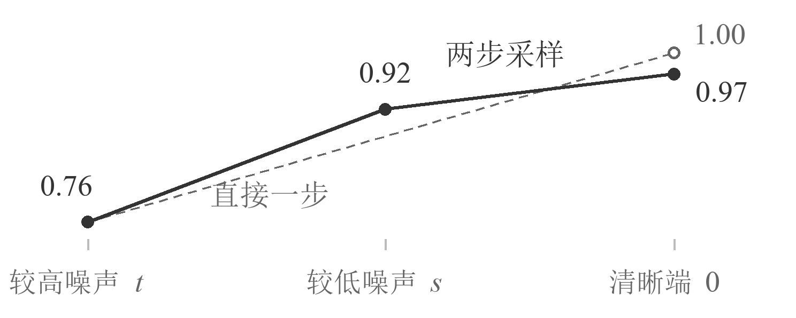
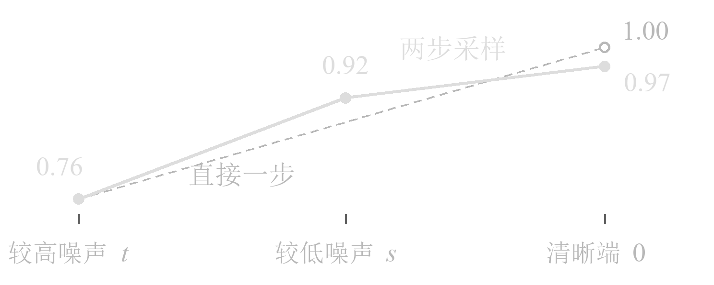
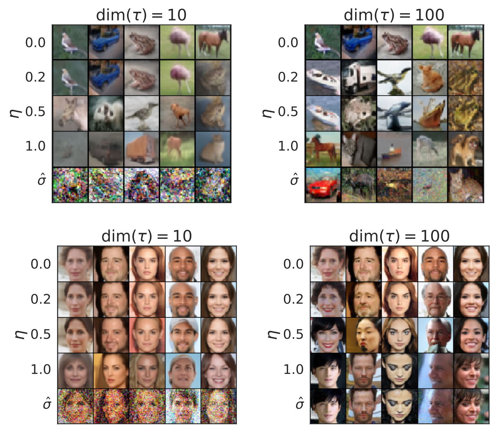
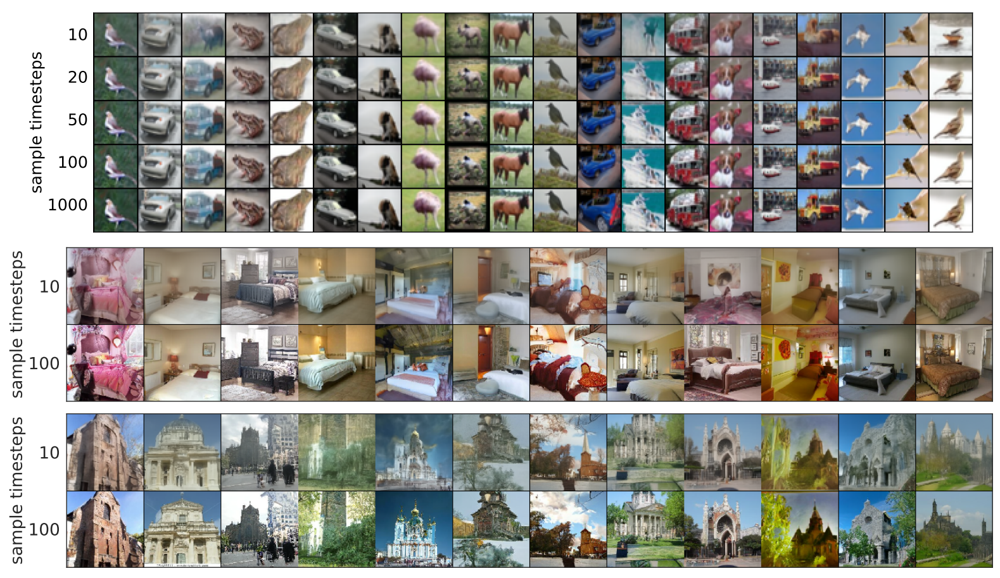
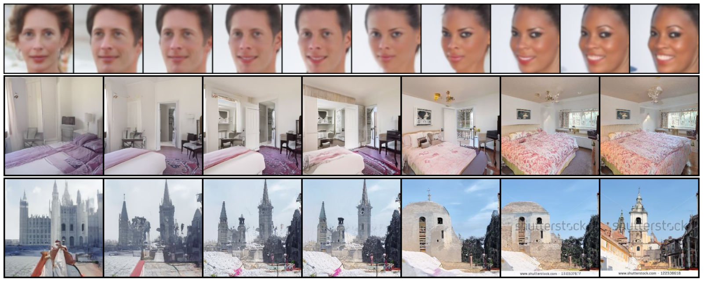


DDIM 可以用训练好的 DDPM 网络跳步生成图像。它改变了加噪路径上不同时刻的关联，却保留了训练所需的单时刻加噪分布，因此网络仍预测当前状态的累计噪声。生成时，采样器先用这份预测估计原图，再按目标时刻的系数组合原图估计、预测噪声和可选的新噪声。确定性 DDIM 不再重新抽取噪声；跳过部分时刻则减少了网络调用。（由 GPT-6 总结）

**关键公式**

$$
L_{\mathrm{simple}}=\mathbb E_{x_0,t,\epsilon}\!\left[\|\epsilon-\epsilon_\theta(x_t,t)\|^2\right].
$$

$$
\hat x_0=\frac{x_t-\sqrt{1-\bar\alpha_t}\,\hat\epsilon_t}{\sqrt{\bar\alpha_t}}.
$$

$$
x_s=\sqrt{\bar\alpha_s}\,\hat x_0+\sqrt{1-\bar\alpha_s-\sigma_{t,s}^2}\,\hat\epsilon_t+\sigma_{t,s}z.
$$

$$
\sigma_{t,s}(\eta)=\eta\sqrt{\frac{1-\bar\alpha_s}{1-\bar\alpha_t}}\sqrt{1-\frac{\bar\alpha_t}{\bar\alpha_s}}.
$$



### 1. 基本思路

用一个训练了 1000 个噪声时刻的 [DDPM](/papers/ddpm/) 生成图像，通常要先算出 $x_{999}$，才能接着算 $x_{998}$，一路走到 $x_0$。如果只打算调用网络几十次，第一步就可能要直接从 $x_{1000}$ 走到 $x_{980}$。只跳过循环中的几个时刻还不够：原来的公式按第 999 步的信号和噪声比例计算，输出仍是给第 999 步用的。若把它标成第 980 步送回网络，图像与时间标签的噪声水平就对不上了。要跨这一步，得按第 980 步的系数计算，同时让新的状态承接当前图像中的信息。

每次更新有两件事。去噪网络根据当前图像 $x_t$ 和时刻 $t$ 预测累计噪声；采样器拿到预测后，才决定如何计算下一张图。如果把目标从 $t-1$ 改为更早的 $s<t$，网络看到的仍是 $x_t,t$，变化发生在采样器这一侧。Jiaming Song、Chenlin Meng 和 Stefano Ermon 提出的 **DDIM**（Denoising Diffusion Implicit Models，去噪扩散隐式模型），就从重写这一步入手。

训练时可以直接抽取一个时刻 $t$，用原图 $x_0$ 和一份标准高斯噪声 $\epsilon$ 构造带噪图像。沿用 DDPM 的记号，$\beta_t$ 是第 $t$ 步新噪声的方差，$\alpha_t=1-\beta_t$ 是这一步的信号系数，图像项实际乘 $\sqrt{\alpha_t}$。将各步的 $\alpha_t$ 相乘，得到累计系数 $\bar\alpha_t=\prod_{u=1}^{t}\alpha_u$，约定 $\bar\alpha_0=1$。于是：

$$
x_t=\sqrt{\bar\alpha_t}\,x_0+\sqrt{1-\bar\alpha_t}\,\epsilon,\qquad\epsilon\sim\mathcal N(0,I).
$$

这组预先算好的 $\bar\alpha_t$ 构成**训练噪声表**：$t$ 越大，原图项的乘数越小，噪声项的乘数越大。DDIM 原论文将累计系数记为 $\alpha_t$，本文用 $\bar\alpha_t$，以便和 DDPM 的记号一致。

这个公式把前 $t$ 步加进来的噪声合并，用标准高斯变量 $\epsilon$ 表示。训练时，程序可以为每个样本抽一个 $t$，直接算出 $x_t$，再用刚抽到的 $\epsilon$ 给网络的预测打分。标签是从原图到当前时刻的**标准化累计噪声**，其中包含每一步的贡献。

这给了 DDIM 改写采样的余地。每项训练误差只用到一个时刻的 $x_t$ 和它的噪声标签；即使改了两个时刻之间的关联，只要单独抽到这个时刻时，输入与标签的统计规律还和原来一样，网络学的就是同一件事。接下来先假设手里有原图，看看怎样把两个带噪状态接起来；等到实际生成，再用噪声预测反推出原图的估计。

### 2. 重构加噪路径

#### 2.1 边缘分布

固定原图 $x_0$，反复抽取不同的 $\epsilon$，某个时刻 $t$ 得到的带噪图像服从：

$$
q(x_t\mid x_0)=\mathcal N\!\left(\sqrt{\bar\alpha_t}x_0,(1-\bar\alpha_t)I\right).
$$

这里的**边缘分布**是固定原图后，只统计时刻 $t$ 得到的分布。均值是保留下来的原图项，协方差描述加噪后的波动，$I$ 是单位矩阵。说 DDIM 和 DDPM 有相同的 $q(x_t\mid x_0)$，意思是对同一张原图、同一个时刻反复加噪，二者得到的图像有相同的均值和噪声分布。换一个时刻，原图和噪声的比例仍会变。

> [!Note] **联合分布与边缘分布**
> 只看同一张原图上的一个像素，分别在较早的时刻 $t-1$ 和较晚的时刻 $t$ 给它加噪。两次都要用一个标准高斯数。可以各抽一次，让两个时刻的噪声互相独立；也可以只抽一次，在两个时刻使用同一个数，只按各自的噪声强度乘上不同系数。
>
> 反复做这个实验，只看时刻 $t$，两种配法都满足上面的高斯分布，时刻 $t-1$ 也一样。这是两个时刻各自的边缘分布。把同一次实验的两个结果放在一起看，区别就出来了：共用一个数时，晚一步的像素若被噪声抬高，早一步的像素也会被抬高；独立抽取时，知道其中一个结果，并不能判断另一个朝哪个方向偏。这种一起变化的规律由**联合分布**描述。

DDPM 会在上一张带噪图的基础上再加新噪声，相邻状态本来就有关联。DDIM 改的是这层关联。比如让两个时刻共用同一份**标准化累计噪声**：只要知道原图，就能从 $x_t$ 解出这份噪声，然后用较早时刻的系数重新组合，直接得到那个时刻的图。两个时刻隔得多远，不影响这种构造。下面先用相邻时刻写出公式，再看怎样同时容纳沿用的噪声和新抽的噪声。

#### 2.2 路径构造

**构造更新。** 已知 $x_0$ 和 $x_t$，要怎样造出与 $x_t$ 相关、又符合第 $t-1$ 步噪声水平的图？噪声表已经给出了目标时刻的原图系数和总噪声方差。整张 $x_t$ 乘上一个数，会让信号和噪声一起缩放，二者的比例不变。走到较早时刻需要信号占比提高、噪声占比降低，所以要分开调整两项。先从 $x_t$ 中扣掉原图项，再除以当前噪声的标准差，取出当前状态里那份标准化噪声：

$$
r_t=\frac{x_t-\sqrt{\bar\alpha_t}x_0}{\sqrt{1-\bar\alpha_t}}.
$$

$r_t$ 对应第 1 节的 $\epsilon$。固定 $x_0$ 并反复抽样时，$r_t$ 服从 $\mathcal N(0,I)$，可以按目标时刻的方差重新缩放。把第 $t-1$ 步每个分量的总噪声方差 $1-\bar\alpha_{t-1}$ 分成两份：$\sigma_t^2$ 给新抽取的独立标准高斯噪声 $z$，其余留给 $r_t$。乘在两份噪声前的是各自的标准差，也就是分到的方差开平方：

$$
x_{t-1}=\sqrt{\bar\alpha_{t-1}}\,x_0+\sqrt{1-\bar\alpha_{t-1}-\sigma_t^2}\,r_t+\sigma_t z.
$$

这里 $\sigma_t$ 是新噪声的标准差，取 $0\leq\sigma_t\leq\sqrt{1-\bar\alpha_{t-1}}$。增大 $\sigma_t$ 时，新抽噪声的份额增加，沿用项的系数随之减小。

**检查分布。** 把整张图像展开为向量，$\operatorname{Cov}(x_{t-1}\mid x_0)$ 就是这个向量各分量之间的协方差矩阵：对角线记录各分量的方差，其余位置记录两两协方差。

计算下面的协方差时，**只固定原图 $x_0$**，当前状态 $x_t$ 以及新噪声 $z$ 都可以随采样变化。两个噪声项的均值为零，所以 $\mathbb E[x_{t-1}\mid x_0]=\sqrt{\bar\alpha_{t-1}}\,x_0$。协方差看的是相对均值的偏差；固定的原图项在减去条件均值时抵消。剩下的两个噪声项独立，各自的协方差乘上系数的平方后相加：

$$
\operatorname{Cov}(x_{t-1}\mid x_0)=(1-\bar\alpha_{t-1}-\sigma_t^2)I+\sigma_t^2I=(1-\bar\alpha_{t-1})I.
$$

独立高斯的线性组合仍是高斯，均值和协方差又都与 DDPM 相同，所以两条路径在 $t-1$ 给出同一个边缘分布。若在同一条路径上再固定 $x_t$，$r_t$ 也随之确定，只有新抽取的 $z$ 会变化，条件协方差便是 $\sigma_t^2I$。这两个结果分别回答了“单独看 $t-1$ 有多大波动”和“给定 $t$ 的状态后还有多大波动”。

**时刻关联。** 只看整个 $x_{t-1}$ 的方差，分不出两份噪声各占多少。为了专门看噪声之间的关联，对 $t>1$，从 $x_{t-1}$ 里减去原图项，再除以这一步的总噪声标准差。新噪声系数 $\lambda_t$ 是新噪声标准差与总噪声标准差之比，介于 $0$ 和 $1$ 之间；$\lambda_t^2$ 才是新噪声占总方差的比例：

$$
r_{t-1}=\sqrt{1-\lambda_t^2}\,r_t+\lambda_t z,\qquad \lambda_t=\frac{\sigma_t}{\sqrt{1-\bar\alpha_{t-1}}}.
$$

$z$ 与 $r_t$ 独立，所以两时刻噪声的条件协方差为 $\operatorname{Cov}(r_{t-1},r_t\mid x_0)=\sqrt{1-\lambda_t^2}\,I$。当 $\lambda_t=0$ 时，两步沿用同一份噪声；当 $\lambda_t=1$ 时，下一步的噪声完全重新抽取。**两端的噪声各自仍是标准高斯，变化的是它们如何关联。**

用 $q_\sigma(x_{t-1}\mid x_t,x_0)$ 记固定 $x_t,x_0$ 后得到的单步分布。由末端 $q(x_T\mid x_0)$ 出发，将这些单步分布依次接到 $x_1$，就得到一族具有相同边缘分布的路径 $q_\sigma$。下标 $\sigma$ 表示这条路径采用了哪一组标准差：

$$
q_\sigma(x_{1:T}\mid x_0)=q(x_T\mid x_0)\prod_{t=2}^Tq_\sigma(x_{t-1}\mid x_t,x_0).
$$

从同一个 $x_T$ 边缘分布出发，逐步应用上面的计算，就知道 $x_{T-1},\ldots,x_1$ 的边缘分布也都保留下来。不同的 $\sigma$ 会改变路径的联合分布。马尔可夫性问的是：知道当前状态后，更早的状态是否还会影响下一步？沿加噪的方向看，DDPM 知道 $x_{t-1}$ 就能按规则独立加一份新噪声；而在共用噪声的 DDIM 辅助路径上，单看 $x_{t-1}$ 无法分辨原图和噪声，知道更早的 $x_0$ 才能拆开它们、算出下一步。因此论文把这类路径称为**非马尔可夫过程**。

#### 2.3 训练复用

构造训练样本时已知原图，因此给定 $x_t$ 后，可以从第 1 节的累计加噪公式反算噪声标签：

$$
\epsilon=\frac{x_t-\sqrt{\bar\alpha_t}\,x_0}{\sqrt{1-\bar\alpha_t}}.
$$

给定 $x_0,t$，两条路径的 $x_t$ 分布相同，噪声标签又是由同一个公式从 $x_t$ 算出来的。因此，只要原图和时刻的抽样规则相同，**训练所用的 $(x_t,t,\epsilon)$ 的联合分布就相同**。每项误差只使用这个三元组，不用观察两个时刻怎样配对。记 $\epsilon_\theta$ 为参数是 $\theta$ 的噪声预测网络，DDPM 的简化损失就是对这些单时刻预测取平均平方误差：

$$
L_{\mathrm{simple}}=\mathbb E_{x_0,t,\epsilon}\!\left[\|\epsilon-\epsilon_\theta(x_t,t)\|^2\right].
$$

下标 $\mathrm{simple}$ 表示省去了各时刻的损失权重。完整的变分训练目标要最大化数据对数似然的下界；在这个目标里，改变路径也会改变各时刻误差的权重，推导见[第 7.1 节](#71-损失权重)。如果沿用上面这套简化损失，两条路径提供相同的训练样本和标签，也以同样的方式给预测打分，所以可以直接复用已经训练好的 DDPM 网络。

### 3. 反向生成

#### 3.1 原图估计

辅助路径需要知道 $x_0$ 才能从 $x_t$ 分离出信号和噪声。真正生成时恰好反过来：网络能从 $x_t,t$ 估计噪声，于是采样器先调用它得到 $\hat\epsilon_t=\epsilon_\theta(x_t,t)$，再解同一个加噪公式，估计剩下的原图项：

$$
\hat x_0=\frac{x_t-\sqrt{1-\bar\alpha_t}\,\hat\epsilon_t}{\sqrt{\bar\alpha_t}}.
$$

同一张带噪图可以由不同的原图和噪声组合得到。平方误差下，理想的预测会按这些组合在当前 $x_t,t$ 下的可能性，对噪声取平均。上式在 $x_t,t$ 固定后，只是把噪声乘上一个常数、再加一个常数，所以先平均噪声再代入，与先算出每个候选原图再按相同权重平均，结果一样。网络预测得越接近噪声的条件均值，换算出的 $\hat x_0$ 就越接近原图的条件均值。

噪声很重时，这份估计可能还看不清纹理，甚至不能确定画面里是什么。采样器先用它走到噪声较轻的时刻，再让网络看更新后的整张图，重新估计一次。

> [!Note] **平方误差与条件均值**
> 固定网络看到的输入 $u=(x_t,t)$，把相应噪声标签的平均记为 $m=\mathbb E[\epsilon\mid u]$。若网络预测为 $a$，平均平方误差可以分成两部分：标签围绕 $m$ 的波动，以及预测偏离 $m$ 的代价 $\|a-m\|^2$。网络只能减小第二部分，所以最优预测是 $m$。完整展开见 [DDPM 的训练步骤](/papers/ddpm/#41-训练步骤)。

#### 3.2 生成更新

训练让我们得到了一份当前累计噪声的预测；接下来还要把它变成上一时刻的状态。第 2.2 节已经给出了固定 $x_t,x_0$ 时的更新，其中两项用来确定更新的中心，一项用来围绕中心加噪。现在将原图换成估计值 $\hat x_0$，辅助路径里的标准化残差也随之变为：

$$
\frac{x_t-\sqrt{\bar\alpha_t}\,\hat x_0}{\sqrt{1-\bar\alpha_t}}=\hat\epsilon_t.
$$

于是得到可实际执行的相邻步更新：

$$
x_{t-1}=\sqrt{\bar\alpha_{t-1}}\,\hat x_0+\sqrt{1-\bar\alpha_{t-1}-\sigma_t^2}\,\hat\epsilon_t+\sigma_tz.
$$

三项分别承担不同作用：

- $\sqrt{\bar\alpha_{t-1}}\,\hat x_0$：按下一时刻的信号系数缩放清晰图像估计。
- $\sqrt{1-\bar\alpha_{t-1}-\sigma_t^2}\,\hat\epsilon_t$：沿当前预测的噪声方向保留一部分残差，使下一状态与当前状态相关。
- $\sigma_tz$：加入独立的新随机噪声，控制这一步的随机波动。

如果只知道 $x_t$，几个可能的原图会各自给出一个更新中心。固定 $x_t$ 后，中心的计算只对 $x_0$ 做乘常数和加常数，所以把原图的条件均值代进去，就能得到那些中心的加权平均。但把中心平均在一起，再加一份高斯噪声，只会让结果在这个平均中心周围波动。不同候选原图可能对应相隔很远的中心，这份随机波动还原不了它们各自的位置。

第 2 节的分布结论是在**已知原图**时推导的。生成时只能拿估计值来做更新，跳过的时刻越多，网络就越少有机会在新状态上修正这份估计。第 4.2 节会算出，中途多做一次预测，最后的结果会在哪里发生变化。

#### 3.3 确定性更新

令每一步 $\sigma_t=0$，新随机噪声项消失：

$$
\boxed{x_{t-1}=\sqrt{\bar\alpha_{t-1}}\,\hat x_0+\sqrt{1-\bar\alpha_{t-1}}\,\hat\epsilon_t}.
$$

这就是确定性的 **DDIM 更新**。固定模型和时间表后，从同一个 $x_T$ 出发，每一步以及最后的图像都相同；原版 DDPM 途中会重新抽噪声，同一个起点可以生成不同图像。从生成图像反推初始噪声，是另一个问题：把时间表倒过来走，每步都会在新的状态上重新预测，不一定能把原来的更新抵消。第 7.2 节用重建实验说明有限步长带来的误差。

**隐式模型**用生成规则来定义样本的分布。DDIM 每次抽取一份高斯噪声 $x_T$，按固定规则走到一张图像。反复抽取并生成，哪些图像更常出现，由这套规则决定。采样时无需计算给定图像在模型下的概率密度。

取 $\sigma_t=0$ 时，沿用的噪声项也随之调整。回到第 2.2 节的构造，原来由两项共同承担的噪声方差 $1-\bar\alpha_{t-1}$，现在全分给从 $x_t$ 解出的噪声，所以它的乘数变为 $\sqrt{1-\bar\alpha_{t-1}}$。实际采样用的是这份噪声的预测值。若只是把 DDPM 的随机项删掉，就只剩 DDPM 的更新均值；原先分给新噪声的那部分方差被拿掉了，沿用项的系数却没变。

如果按原时间表访问所有时刻，确定性更新仍要调用网络 $T$ 次。接下来把同一个构造用到相隔更远的时刻。

### 4. 跳步采样

#### 4.1 时间子序列

从 $t$ 出发时，网络按 $t$ 预测累计噪声，采样器按目标时刻重新配置信号和噪声。把目标从 $t-1$ 换成更早的 $s<t$，只需把第 2.2 节用到的目标系数换成 $\bar\alpha_s$：原图项乘 $\sqrt{\bar\alpha_s}$，沿用的噪声和新抽的噪声共同分配方差 $1-\bar\alpha_s$。因为这些数都可以从训练噪声表查到，计算时无需先走到中间的 $t-1$。采样可以只访问原时间表上的一部分时刻：

$$
0=\tau_0<\tau_1<\cdots<\tau_S=T.
$$

生成按相反顺序访问 $\tau_S,\tau_{S-1},\ldots,\tau_0$。令当前时刻为 $t=\tau_i$，下一时刻为 $s=\tau_{i-1}$，同样先预测 $\hat\epsilon_t$、计算 $\hat x_0$，再更新：

$$
\boxed{x_s=\sqrt{\bar\alpha_s}\,\hat x_0+\sqrt{1-\bar\alpha_s-\sigma_{t,s}^2}\,\hat\epsilon_t+\sigma_{t,s}z}.
$$

其中 $\sigma_{t,s}$ 是这次更新加入的新噪声的标准差。为了让根号内非负，需满足 $0\leq\sigma_{t,s}^2\leq1-\bar\alpha_s$。取 $\sigma_{t,s}=0$ 就得到确定性更新；第 4.3 节再说明随机采样时怎样取值。

例如，训练时间表有 $T=1000$ 个时刻，采样时可以选下面这五步：

| 网络接收的时刻 $t$ | 本次生成的时刻 $s$ |
| ---: | ---: |
| 1000 | 800 |
| 800 | 600 |
| 600 | 400 |
| 400 | 200 |
| 200 | 0 |

每行调用网络一次，共 5 次。第一步仍把 $1000$ 作为网络的时间输入，并从原训练时间表读取 $\bar\alpha_{1000}$ 和 $\bar\alpha_{800}$。到达 $s=0$ 时，$\bar\alpha_0=1$，可分给两项噪声的方差为零，因此直接输出这一步的 $\hat x_0$。

上表按相同的时间间隔取点。也可以在某些噪声区间取点更密集；步数相同，模型也可能走出不同的生成路径。

#### 4.2 跳步算例

只追踪图像的一个分量。训练时，假设原图在这里取值 $0.8$，抽到的标准化累计噪声是 $0.35$。取 $\bar\alpha_t=0.36$，得到带噪分量 $0.6\times0.8+0.8\times0.35=0.76$。这次训练就用 $x_t,t$ 预测刚抽出的标签 $0.35$，不需要指定跳步的目标时刻。

生成时，从另抽的初始噪声 $x_T$ 出发。假设走到同一个时刻 $t$ 时，这个分量也恰好是 $0.76$。两个分量数值相同，并不代表网络看到了同一张图：其他位置的内容可以不同，采样器也没有训练样本的原图和噪声标签。下面假设网络看完整张图后，对这个分量给出的预测是 $0.2$。代入公式，得到清晰值估计：

$$
\hat x_0=\frac{0.76-0.8\times0.2}{0.6}=1.
$$

若直接走到 $0$，这一次的估计 $1$ 就是输出。但我们先跳到 $\bar\alpha_s=0.64$ 的较早时刻，并取确定性更新。采样器按 $s$ 的系数，把同一份估计和噪声方向重新组合：

$$
x_s=0.8\times1+0.6\times0.2=0.92.
$$

最后从 $s$ 到 $0$。网络这次以整张 $x_s$ 和时刻 $s$ 为输入，假设新预测是 $0.24$，清晰值估计就是 $(0.92-0.6\times0.24)/0.8=0.97$。由于 $\bar\alpha_0=1$，更新时不再保留噪声，直接输出 $0.97$。

<figure class="ddpm-figure paper-diagram" style="--diagram-width:372px;">
  
  
  <figcaption>两步采样与直接一步（本文自绘）。虚线只连接起点和终点，中间不求值。参见<a href="https://arxiv.org/abs/2010.02502v4">原论文 §4.2</a>。</figcaption>
</figure>

图中两条路的差别来自第二次预测。到 $s$ 后如果继续沿用 $0.2$，原图估计仍是 $(0.92-0.6\times0.2)/0.8=1$，恰好与一步直达相同。算例里的第二次预测却是 $0.24$，乘上 $s$ 时刻的噪声系数并换算回原图尺度后，清晰值比 $1$ 低了 $0.03$。**跳步省掉的是一次重新估计。** 保留哪些时刻，决定了网络在哪些噪声水平上还能重新判断。[第 6.2 节](#62-同起点对照)对比了从同一份初始噪声出发、改变步数后的最终图像。

#### 4.3 采样方差

$\sigma_{t,s}$ 控制这一步重新抽入多少噪声。论文以 DDPM 为参照：只知道原图 $x_0$ 时，$x_s$ 的噪声方差是 $1-\bar\alpha_s$；再看到 $x_t$，就多知道了终点的信息，$x_s$ 的不确定性会缩小。这时的方差就是**跳步后验方差** $\tilde\beta_{t,s}$。

$\bar\alpha_t/\bar\alpha_s$ 去掉了两者共同包含的前 $s$ 步，得到 $s$ 到 $t$ 的累计信号系数 $a_{t,s}$，乘在 $x_s$ 前的则是 $\sqrt{a_{t,s}}$。这段新加的噪声方差是 $1-a_{t,s}$，从原图到 $t$ 的总噪声方差是 $1-\bar\alpha_t$。在高斯后验计算中，两者的比值给出 $x_s$ 还剩下原来多少方差：$s$ 之后新噪声占比越低，观察到的 $x_t$ 就越能约束 $x_s$。采样器用参数 $\eta$ 乘这个后验的标准差，得到：

$$
\sigma_{t,s}(\eta)=\eta\sqrt{\frac{1-\bar\alpha_s}{1-\bar\alpha_t}}\sqrt{1-\frac{\bar\alpha_t}{\bar\alpha_s}}.
$$

$\eta=0$ 不另抽噪声，就是上面算例用的确定性 DDIM。$\eta$ 从 $0$ 增至 $1$，新噪声的份额增大，沿用当前预测的噪声份额减小，两者的系数平方之和仍为 $1-\bar\alpha_s$。取 $\eta=1$ 时，更新的均值和方差都与采用后验方差的 DDPM 更新一致；若跳过了时刻，则对应缩短时间表后的 DDPM。后验方差和均值的来由见 [第 7.3 节](#73-ddpm-后验与跳步)。

实验还比较了一个方差较大的设置 $\hat\sigma$：沿用 $\eta=1$ 的均值，但将围绕该均值抽取的新噪声方差改为 $1-a_{t,s}$，到 $s=0$ 时直接输出均值。

### 5. 采样流程

把前面的算例放回整张图上，一次迭代就是：网络读入 $(x_t,t)$，输出每个分量的噪声预测；采样器再用这张预测图和目标时刻 $s$ 求出 $x_s$。循环编号 $i$ 只表示走到第几个采样点，传给网络的仍是训练噪声表上的时间标记 $t=\tau_i$。选定采样时间表 $\tau$ 和随机强度 $\eta$ 后，生成流程如下：

1. 抽取初始 $x_T\sim\mathcal N(0,I)$。训练噪声表末端的 $\bar\alpha_T$ 很小，带噪图的分布已接近标准高斯。
2. 按采样时间表取当前时刻 $t=\tau_i$ 与下一时刻 $s=\tau_{i-1}$，从 $i=S$ 开始。
3. 调用网络预测 $\hat\epsilon_t$，再换算 $\hat x_0$。由 $t,s,\eta$ 算出 $\sigma_{t,s}$，使用跳步公式计算 $x_s$；若需要新噪声，独立抽取 $z$。
4. 若 $s>0$，将 $x_s$ 作为输入，令 $i\leftarrow i-1$，继续第 2 步。到达 $s=0$ 后，取最后计算的 $\hat x_0$，再将像素转换为显示范围。

生成库通常把选择时刻、读取系数、计算 $x_s$ 的部分称为 **scheduler（采样调度器）**。同一个模型可以换用不同的调度器，因为预测仍从 $(x_t,t)$ 得到，调度器只决定怎样使用它。1000 步改为 50 步，网络调用次数就降为原来的 $1/20$；实际能省多少时间，还取决于更新和图像转换的开销。

为了分开比较时间表和随机强度，可以固定模型、训练噪声表与初始噪声。比较步数时记录实际选取的时刻；比较 $\eta$ 时使用同一组时刻，随机采样再固定中途抽噪声的种子。

### 6. 实验结果

#### 6.1 速度与质量

论文在 CIFAR-10、CelebA、LSUN Bedroom 与 LSUN Church 上比较采样方法。同一个数据集上的各组对照共用模型权重，所以结果反映的是采样规则和步数的差别。CIFAR-10 和 LSUN 用的是 DDPM 发布的模型，CelebA 则另行训练。论文用一张 NVIDIA 2080 Ti 测量生成 50,000 张图像的耗时：改用 20～100 步 DDIM，生成速度约为 1000 步 DDPM 的 10～50 倍。画质保留了多少，要结合具体步数读实验结果。

下表摘录原论文 Table 1 的 CIFAR-10 结果。**FID**（Fréchet Inception Distance）用 Inception 网络提取真实和生成图像的特征，再比较两批特征的均值和协方差；FID 越低，两批图像在这些统计量上越接近。沿列向下读，是把同一种采样规则放到不同步数上；沿行横着读，是在同样步数下改变每步的随机更新。三列分别是确定性 DDIM（$\eta=0$）、使用 DDPM 后验方差的采样（$\eta=1$），以及第 4.3 节介绍的较大方差对照（$\hat\sigma$）。

| 步数 | $\eta=0$ | $\eta=1$ | $\hat\sigma$ |
| ---: | ---: | ---: | ---: |
| 10 | 13.36 | 41.07 | 367.43 |
| 20 | 6.84 | 18.36 | 133.37 |
| 50 | 4.67 | 8.01 | 32.72 |
| 100 | 4.16 | 5.78 | 9.99 |
| 1000 | 4.04 | 4.73 | 3.17 |

开头的问题是少调用几次网络后，图像质量还能保留多少。沿确定性这一列看，50 次调用得到了 4.67，已接近同列 1000 次的 4.04。再固定 10 次调用横着看，确定性 DDIM 为 13.36，而采用 DDPM 后验方差的 $\eta=1$ 为 41.07；减少调用后，怎样走这几步比用足 1000 步时更重要。用足 1000 步时，较大方差的 DDPM 设定反而给出表中最低的 3.17。CIFAR-10 的少步实验按二次规律选取时刻，在低噪声端安排更多更新，这也是比较少步结果时应保留的实验条件。

<figure class="ddpm-figure">
  
  <figcaption>采样步数与随机强度；来源：原论文 Figure 3，按数据集分两行排布</figcaption>
</figure>

上排是 CIFAR-10，下排是 CelebA；左边用 10 步，右边用 100 步。每组的前四行依次增大 $\eta$，第五行对应 $\hat\sigma$。可以先看左边每组的首尾两行：同样只走 10 步，确定性更新已能生成可辨认的物体和人脸，更大方差的结果则仍有明显噪点。

#### 6.2 同起点对照

同一份初始噪声改用另一组采样时刻后，画面会改变多少？论文让确定性 DDIM 从相同的 $x_T$ 出发，只改变采样时间表：

<figure class="ddpm-figure">
  
  <figcaption>相同初始噪声，不同采样步数；来源：原论文 Figure 5</figcaption>
</figure>

每组内，同一列使用相同的 $x_T$，不同行使用不同步数。由上往下看，从同一份初始噪声生成的鸟、汽车、房间和建筑，往往有相近的整体布局，纹理、光线与清晰度则有变化。

#### 6.3 初始噪声插值

既然初始噪声与生成图像的整体结构有关，便可以逐渐改变这个起点，观察图像怎样过渡。取两份初始噪声 $u,v$，记它们的夹角为 $\vartheta$。论文使用**球面插值**构造中间状态：

$$
x_T(\lambda)=\frac{\sin((1-\lambda)\vartheta)}{\sin\vartheta}\,u+\frac{\sin(\lambda\vartheta)}{\sin\vartheta}\,v.
$$

$\lambda$ 从 $0$ 增加到 $1$ 时，起点从 $u$ 变到 $v$。独立抽出的高维高斯噪声长度通常相近，直接取两者的平均却会让向量缩短。球面插值让中间向量也保持与两端接近的长度，避免过渡中点的噪声整体明显变弱。论文对每个中间状态分别运行 50 步 DDIM：

<figure class="ddpm-figure">
  
  <figcaption>初始噪声空间的插值；来源：原论文 Figure 6</figcaption>
</figure>

每行两端是由 $u,v$ 生成的图像，中间各列是不同 $\lambda$ 对应的最终输出。模型和时间表保持不变，初始噪声的变化带来了人脸姿态、卧室布局和建筑形态的过渡。

### 7. 补充推导

#### 7.1 损失权重

第 2 节从训练样本的构造解释了为什么可以复用噪声预测网络。现在回到 DDPM 的变分目标，看更换路径后，每一步的误差权重怎样变化。

变分目标在每一步用 KL 散度衡量两个分布的差异：参照分布 $q_\sigma(x_{t-1}\mid x_t,x_0)$ 由辅助路径和已知原图给出，模型分布 $p_\theta(x_{t-1}\mid x_t)$ 只用当前状态生成。对 $t>1$ 且 $\sigma_t>0$ 的情况，两边都用协方差为 $\sigma_t^2I$ 的高斯，只需比较均值。为看清估计原图会带来多大的均值偏差，把第 2 节的 $r_t$ 展开，将原图项和当前状态项分开写成 $m_q=A_tx_0+B_tx_t$：

$$
B_t=\sqrt{\frac{1-\bar\alpha_{t-1}-\sigma_t^2}{1-\bar\alpha_t}},\qquad A_t=\sqrt{\bar\alpha_{t-1}}-B_t\sqrt{\bar\alpha_t}.
$$

生成时用 $\hat x_0$ 替换 $x_0$，所以模型均值是 $m_\theta=A_t\hat x_0+B_tx_t$。两个均值中的 $x_t$ 项相消；比较真实原图公式和估计公式，可将差值写成噪声误差：

$$
m_q-m_\theta=A_t(x_0-\hat x_0)=A_t\sqrt{\frac{1-\bar\alpha_t}{\bar\alpha_t}}(\hat\epsilon_t-\epsilon).
$$

两个同方差的高斯之间，KL 散度只取决于均值差。方差越小，同样大小的均值偏差就越明显，代价也越大：

$$
D_{\mathrm{KL}}=\frac{\|m_q-m_\theta\|^2}{2\sigma_t^2}=w_t\|\epsilon-\hat\epsilon_t\|^2,\qquad w_t=\frac{A_t^2(1-\bar\alpha_t)}{2\sigma_t^2\bar\alpha_t}.
$$

将 $1-\bar\alpha_{t-1}-\sigma_t^2\leq1-\bar\alpha_{t-1}<1-\bar\alpha_t$ 代入 $B_t$ 可知 $B_t<1$，又有 $\bar\alpha_{t-1}>\bar\alpha_t$，因此 $A_t>0$，上式的权重为正。论文把终点先验和最后一步的解码项也计入目标：前者与网络参数无关，后者在论文采用的正方差高斯解码下同样可以转为带权噪声误差。

不同的 $\sigma_t$ 会改变 $w_t$，即改变各时刻的误差在整个目标中占多少。单看某个时刻，乘上正权重不会改变最优预测；实际网络在各时刻共用参数，权重会影响它对不同噪声程度的拟合。论文沿用了 DDPM 的简化损失来训练和复用网络。确定性采样取 $\sigma_t=0$，对应生成公式的边界；上面的 KL 计算以严格正方差为前提。

#### 7.2 采样与重建

一次确定性跳步会把同一个原图估计和噪声预测重新组合。若想看清这一跳到底改变了多少，可以先把起点和终点放到同一信号尺度上：各自除以原图项的乘数，让原图估计的系数都变成 $1$。这样做差时，原图估计就会消掉，只留下噪声的变化。记换算后的状态为 $u_t$，噪声相对信号的乘数为 $\rho_t$，用它作为新的时间刻度：

$$
u_t=\frac{x_t}{\sqrt{\bar\alpha_t}},\qquad \rho_t=\sqrt{\frac{1-\bar\alpha_t}{\bar\alpha_t}}.
$$

由原图估计公式，当前状态可写成 $u_t=\hat x_0+\rho_t\hat\epsilon_t$。同样，将确定性跳步公式除以 $\sqrt{\bar\alpha_s}$，得到 $u_s=\hat x_0+\rho_s\hat\epsilon_t$。两式相减，原图估计抵消：

$$
u_s=u_t+(\rho_s-\rho_t)\hat\epsilon_t.
$$

这个式子可以读成“新位置等于旧位置加上斜率乘步长”。$\hat\epsilon_t$ 是在起点计算的斜率，$\rho_s-\rho_t$ 是带方向的步长；走到终点之前，整段都用起点的斜率。这就是**显式欧拉法**。将噪声表视作连续刻度，在每个状态上重新求方向，就得到以 $\rho$ 为自变量的常微分方程。第 4.2 节直接走到 $0$，整段都用预测值 $0.2$；在 $s$ 停一次，后半段改用 $0.24$，所以输出从 $1$ 变为 $0.97$。

从随机噪声生成图像时，$\rho$ 由大变小。论文也尝试反过来，从一张图像逐步增大 $\rho$ 得到噪声表示，再用 DDIM 从这份噪声重建图像。去程从一段的起点预测噪声，回程则从另一端预测。步长的符号反了，但这两个状态上的预测通常不同，所以走回同一刻度时，算出的图未必与出发时一样。这是用有限步近似求解时的重建误差。

在 CIFAR-10 重建实验中，去程和回程各用相同步数。把图像的像素值缩放到 $[0,1]$ 后，比较原图与重建图的均方误差。步数从 10 增至 100 时，误差从 0.014 降到 0.0009（原论文 Table 2）。

#### 7.3 DDPM 后验与跳步

第 4.3 节用 DDPM 的跳步后验方差作为参照。下面先算这个后验方差，再核对 $\eta=1$ 时的更新均值。

**先合并前向加噪。** $\bar\alpha_s$ 已包含前 $s$ 步的系数，$\bar\alpha_t$ 在此基础上又乘了第 $s+1$ 步到第 $t$ 步。因此仅这段的累计系数为：

$$
a_{t,s}=\prod_{k=s+1}^{t}\alpha_k=\frac{\bar\alpha_t}{\bar\alpha_s}.
$$

于是，在原来的 DDPM 前向链中，从 $x_s$ 走到 $x_t$ 可以合写成：

$$
x_t=\sqrt{a_{t,s}}\,x_s+\sqrt{1-a_{t,s}}\,\xi.
$$

这里 $\xi\sim\mathcal N(0,I)$ 表示合并后的标准高斯噪声，与 $x_s$ 独立。$1-a_{t,s}$ 是**这段新加入的噪声方差**；而 $1-\bar\alpha_t$ 是**从原图一路加到 $t$ 的总噪声方差**。后者还要算上 $x_s$ 原本就含有的噪声：

$$
a_{t,s}(1-\bar\alpha_s)+(1-a_{t,s})=1-\bar\alpha_t.
$$

**再算反向后验方差。** 给定原图 $x_0$ 和当前状态 $x_t$，哪些 $x_s$ 更有可能？既要看从 $x_0$ 得到它的概率，也要看从它继续加噪得到 $x_t$ 的概率。后验 $q(x_s\mid x_t,x_0)$ 把两条信息合在一起，它的方差衡量已知两端后中间状态还剩多少不确定性。

按 [DDPM 的后验推导](/papers/ddpm/#32-后验分布)，用贝叶斯公式将 $q(x_s\mid x_0)$ 与 $q(x_t\mid x_s)$ 相乘，再对 $x_s$ 归一化。先看一个像素分量：两个高斯密度相乘，指数中的二次项相加。提出共同的 $-1/2$ 后，前一个密度中 $x_s^2$ 的系数是 $1/(1-\bar\alpha_s)$；后一个来自 $(x_t-\sqrt{a_{t,s}}\,x_s)^2$，系数是 $a_{t,s}/(1-a_{t,s})$。将两项相加再取倒数，得到后验方差：

$$
\tilde\beta_{t,s}=\left(\frac{1}{1-\bar\alpha_s}+\frac{a_{t,s}}{1-a_{t,s}}\right)^{-1}.
$$

通分后，分母正是上面算出的总噪声方差 $1-\bar\alpha_t$，所以：

$$
\tilde\beta_{t,s}=\frac{1-\bar\alpha_s}{1-\bar\alpha_t}(1-a_{t,s}).
$$

这里按 $0<s<t$ 推导。若 $s=0$，已知原图就等于已知目标状态，方差为零，后一条公式也给出这个结果。

**与 DDPM 对照。** 取 $\eta=1$ 时，新噪声项已经用上了 DDPM 的后验方差，还要核对前两项之和是不是 DDPM 的均值。用上面的后验方差化简方向项的根号，先提出共同因子 $1-\bar\alpha_s$。余下的是 $1-(1-a_{t,s})/(1-\bar\alpha_t)$，通分后的分子为 $a_{t,s}-\bar\alpha_t=a_{t,s}(1-\bar\alpha_s)$。对结果开根，方向项的系数就是：

$$
\sqrt{1-\bar\alpha_s-\tilde\beta_{t,s}}=\frac{\sqrt{a_{t,s}}\,(1-\bar\alpha_s)}{\sqrt{1-\bar\alpha_t}}.
$$

将第一项里的 $\hat x_0$ 展开后，$x_t$ 的系数是 $\sqrt{\bar\alpha_s/\bar\alpha_t}=1/\sqrt{a_{t,s}}$。$\hat\epsilon_t$ 的系数来自两处：第一项减去的噪声给出 $-\sqrt{1-\bar\alpha_t}/\sqrt{a_{t,s}}$，方向项加回噪声用的是上式系数。两项通分后，分子化为 $-(1-\bar\alpha_t)+a_{t,s}(1-\bar\alpha_s)=-(1-a_{t,s})$。

因此，固定当前 $x_t$、对新噪声 $z$ 取平均，得到更新的均值：

$$
\mu_\theta=\frac{1}{\sqrt{a_{t,s}}}
\left(x_t-\frac{1-a_{t,s}}{\sqrt{1-\bar\alpha_t}}\hat\epsilon_t\right).
$$

若 $s=t-1$，则 $a_{t,s}=\alpha_t$、$1-a_{t,s}=\beta_t$，上式就是 DDPM 的均值，新增噪声采用后验方差 $\tilde\beta_t$。若 $s<t-1$，则得到缩短后的时间表上的 DDPM 更新，均值和方差都按选中的两个时刻计算。

这也解释了 DDPM 为什么能用**累计噪声的预测来估计上一步的均值**。以相邻更新为例，代入真实原图对应的 $\epsilon$，得到给定 $x_t,x_0$ 的后验均值。生成时只知道 $x_t$，反向均值相当于按各原图在当前状态下的可能性，再对这些后验均值取平均。因为上式对噪声是一次函数，可以先取 $\epsilon$ 的条件均值，再代入公式；这就是用网络预测 $\hat\epsilon_t$ 所做的近似。至于反向分布的方差，仍需另行设定。

具体来说，只给定 $x_t$ 时，真实的反向分布是对不同原图的后验分布做加权混合。在 DDPM 里，给定 $x_0$ 后每个高斯成分都用 $\tilde\beta_{t,s}I$，但它们的中心随 $x_0$ 改变。整体协方差除了各成分内部的波动，还包含这些中心之间的差异。即使网络预测的均值完全准确，取 $\eta=1$ 也只是按 DDPM 的高斯更新规则采样，并没有恢复这个混合分布。

令 $\eta=0$ 会同时去掉新噪声、增大沿用预测噪声的系数。因此，确定性 DDIM 的更新通常不等于直接输出上面的 DDPM 均值。

### 8. 定位与局限

DDIM 的实用之处，在于不用重训噪声预测网络，就能选哪些时刻要访问、每一步要不要再抽噪声。跳过一个时刻可以省一次前向计算，但确定性采样也会在更长的区间里沿用同一次预测。第 6.2 节的图展示了这种取舍：同一个起点在不同步数下往往保留相近的整体布局，细节和清晰度却会发生变化。少步生成好不好，既看总步数，也看这几步留在了哪些噪声区间。

后面的 [CFG](/papers/cfg/) 用条件信息调整生成时采用的预测方向，[LDM](/papers/ldm/) 则把扩散过程搬到压缩后的图像表示中。它们分别改变预测和表示，因此可以和 DDIM 的采样规则配合使用。

### 参考资料

1. Jiaming Song, Chenlin Meng, Stefano Ermon. *Denoising Diffusion Implicit Models*. ICLR 2021. [arXiv:2010.02502v4](https://arxiv.org/abs/2010.02502v4)。路径构造与训练目标见 §3，生成、跳步及连续时间联系见 §4，实验见 §5。本文的生成样本及 CIFAR-10 实验数据来自该文的 Figure 3、5、6 和 Table 1、2。
2. Ho, Jain, Abbeel. *Denoising Diffusion Probabilistic Models*. NeurIPS 2020. [arXiv:2006.11239](https://arxiv.org/abs/2006.11239)。累计加噪、噪声预测训练与 DDPM 采样的来源。
3. Ermon Group. *DDIM 官方实现*. [GitHub](https://github.com/ermongroup/ddim)。`functions/denoising.py` 中的 `generalized_steps` 对应原图估计、方向项与随机项的组合。
