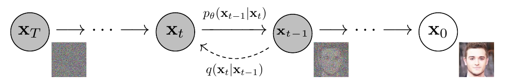
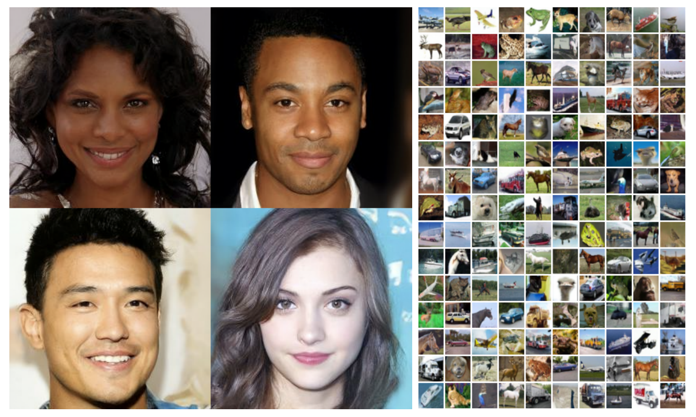
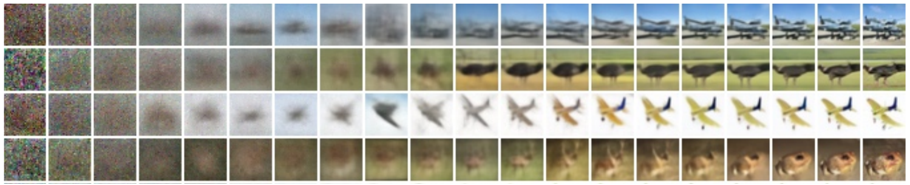
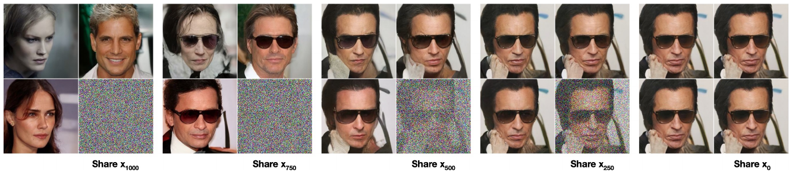
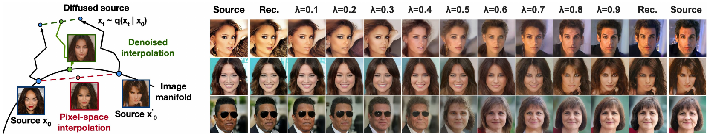

### 1. 基本思路

**DDPM（Denoising Diffusion Probabilistic Models，去噪扩散概率模型）** 的想法是：先规定一种逐步破坏图片的方法，再训练网络学习相反方向的变化。训练完成后，从一张随机噪声图出发，重复许多次去噪，就能生成符合训练数据规律的新图片。

将原图记为 $x_0$，加噪一次后记为 $x_1$，共加噪 $T$ 次。两个方向分别是：

$$
\begin{aligned}
\text{前向加噪：}&\quad x_0\longrightarrow x_1\longrightarrow\cdots\longrightarrow x_T,\\
\text{反向生成：}&\quad x_T\longrightarrow x_{T-1}\longrightarrow\cdots\longrightarrow x_0.
\end{aligned}
$$

前向过程按预设规则加噪，反向过程由网络学习。加噪会丢失信息，同一张噪声图可能对应多种合理结果，因此模型学习的是如何逐步生成符合数据规律的新图片。

<figure class="ddpm-figure">
  
  <figcaption>加噪与生成</figcaption>
</figure>

图中从左向右是生成方向，$x_T$ 在左、$x_0$ 在右。把图片的像素和颜色通道展开，就可以将 $x_t$ 看作 $\mathbb R^D$ 中的向量；例如 $32\times32$ 的 RGB 图片有 $D=32\times32\times3$ 个分量。下面的向量公式同时作用于所有分量，初读时也可以先按一个像素理解。

全文用 $q$ 表示真实数据及预设的加噪分布，用 $p_\theta$ 表示生成模型，$\theta$ 是网络中需要学习的参数。离散步数 $t$ 用来标记当前的噪声程度。

> [!Note] **高斯分布与条件分布**
> 一维高斯分布的均值为 $\mu$、方差为 $\sigma^2$，密度为：
>
> $$f(x)=\frac{1}{\sqrt{2\pi\sigma^2}}\exp\!\left(-\frac{(x-\mu)^2}{2\sigma^2}\right).$$
>
> 向量记号 $\mathcal N(\mu,\Sigma)$ 中，$\Sigma$ 是协方差矩阵。$\mathcal N(0,I)$ 表示各分量相互独立，均值为零、方差为一；$\mathcal N(\mu,\sigma^2I)$ 则将每个分量的方差统一为 $\sigma^2$。
>
> $q(x_t\mid x_0)$ 表示已知原图后，噪声图像的条件分布。密度描述反复采样时的统计规律，某张具体图片只是一次样本；连续变量的概率需要对密度积分，密度值本身不是取到某个点的概率。

### 2. 前向过程

#### 2.1 单步加噪

第 $t$ 步预先选择一个较小的数 $0<\beta_t<1$，定义 $\alpha_t=1-\beta_t$，然后进行：

$$
x_t=\sqrt{\alpha_t}\,x_{t-1}+\sqrt{\beta_t}\,\epsilon_t,
\qquad \epsilon_t\sim\mathcal N(0,I).
$$

每一步都重新抽取与已有状态独立的噪声。第一项略微缩小已有图像，第二项加入随机扰动；根号作用在系数上，因此这个式子仍然是线性叠加。由于 $\beta_t$ 表示新噪声的**方差**，乘在标准噪声前的系数应是标准差 $\sqrt{\beta_t}$。

同一操作也可以写成条件分布：

$$
q(x_t\mid x_{t-1})
=\mathcal N\!\left(x_t;\sqrt{\alpha_t}x_{t-1},\beta_tI\right).
$$

这里采用**马尔可夫链**：给定当前状态后，下一步的分布不再需要此前的历史，即 $q(x_t\mid x_{t-1},\ldots,x_0)=q(x_t\mid x_{t-1})$。整条加噪路径的条件密度因此是各步密度的乘积。

> [!Note] **为什么方差要乘系数的平方**
> 方差衡量变量偏离其平均值的程度，定义为：
>
> $$\operatorname{Var}(X)=\mathbb E\!\left[(X-\mathbb E[X])^2\right].$$
>
> 将 $X$ 乘以 $a$ 后，偏离量也乘以 $a$，平方后便得到：
>
> $$\operatorname{Var}(aX)=a^2\operatorname{Var}(X).$$
>
> 对两个变量的线性组合展开平方，有：
>
> $$\begin{aligned}\operatorname{Var}(aX+bY)&=a^2\operatorname{Var}(X)+b^2\operatorname{Var}(Y)\\&\quad+2ab\operatorname{Cov}(X,Y).\end{aligned}$$
>
> 独立变量的协方差为零，因此两个独立标准高斯变量组合后，方差为 $a^2+b^2$。

只看一个分量，单步加噪满足：

$$
\operatorname{Var}(x_t^{(i)})
=\alpha_t\operatorname{Var}(x_{t-1}^{(i)})+\beta_t.
$$

若上一步方差为 $1$，下一步仍为 $\alpha_t+\beta_t=1$；其他情况下，新方差是旧方差与 $1$ 的加权平均。这就是“方差保持”这一设计的含义：在逐步增加噪声的同时控制数值尺度，便于同一个网络处理不同噪声程度的图片。

图片和纯噪声可以有相同的总体方差，而物体轮廓等结构仍会被加噪破坏。对于不同分量 $i\ne j$，独立噪声还使原有协方差逐步减弱：

$$
\operatorname{Cov}(x_t^{(i)},x_t^{(j)})
=\alpha_t\operatorname{Cov}(x_{t-1}^{(i)},x_{t-1}^{(j)}).
$$

这种变化作用于整张图片中的像素联系。协方差逐渐减小，最终各分量的近似独立性则来自整个联合分布接近标准高斯。

#### 2.2 累积加噪

定义累计系数：

$$
\bar\alpha_t=\prod_{s=1}^{t}\alpha_s,
\qquad \bar\alpha_0=1.
$$

将前两步展开：

$$
\begin{aligned}
x_2
&=\sqrt{\alpha_2}\left(\sqrt{\alpha_1}x_0+\sqrt{\beta_1}\epsilon_1\right)
+\sqrt{\beta_2}\epsilon_2\\
&=\sqrt{\alpha_1\alpha_2}x_0
+\sqrt{\alpha_2\beta_1}\epsilon_1+\sqrt{\beta_2}\epsilon_2.
\end{aligned}
$$

独立高斯变量的线性组合仍是高斯。两项噪声合并后的方差为 $\alpha_2\beta_1+\beta_2=1-\alpha_1\alpha_2$，推广到第 $t$ 步就得到：

$$
\boxed{x_t=\sqrt{\bar\alpha_t}\,x_0+\sqrt{1-\bar\alpha_t}\,\epsilon},
\qquad \epsilon\sim\mathcal N(0,I).
$$

等价地，

$$
q(x_t\mid x_0)
=\mathcal N\!\left(x_t;\sqrt{\bar\alpha_t}x_0,(1-\bar\alpha_t)I\right).
$$

$\epsilon$ 表示此前所有噪声合并后的标准高斯变量，与单步噪声 $\epsilon_t$ 区分。这个公式让我们能直接抽取符合第 $t$ 步分布的 $x_t$，省去前面各步的模拟，是高效构造训练样本的关键。

#### 2.3 加噪终点

随着 $t$ 增加，$\bar\alpha_t$ 越来越小，原图项逐渐减弱，噪声项逐渐接近标准高斯。只要选择足够长的加噪日程，使 $\bar\alpha_T$ 很小，就有：

$$
x_T\approx\epsilon\sim\mathcal N(0,I).
$$

此时，整张图像的联合分布接近各分量独立的标准高斯，生成过程便可以直接从随机噪声出发。

若将原图也视为随机变量，其总体协方差为：

$$
\operatorname{Cov}(x_t)
=\bar\alpha_t\operatorname{Cov}(x_0)+(1-\bar\alpha_t)I.
$$

给定某张原图时，条件协方差则只有 $(1-\bar\alpha_t)I$。前者还包含“原图本身会变化”的不确定性，后者已经把原图固定下来。这个区别在理解反向方差时还会用到。

### 3. 反向过程

#### 3.1 随机采样

真正希望学习的是 $q(x_{t-1}\mid x_t)$：看到当前噪声图后，前一步可能是什么。它依赖未知的数据分布，通常无法直接计算。DDPM 用一个由网络确定均值的高斯分布来近似它：

$$
p_\theta(x_{t-1}\mid x_t)
=\mathcal N\!\left(x_{t-1};\mu_\theta(x_t,t),\sigma_t^2I\right),
\qquad t>1.
$$

每步只加入少量噪声，使局部高斯近似较为合理。从这个模型分布中抽样，就是：

$$
x_{t-1}=\mu_\theta(x_t,t)+\sigma_tz,
\qquad z\sim\mathcal N(0,I).
$$

均值给出合理的中心位置，随机项表达中心附近的不确定性。比如只知道一个模糊轮廓，可能有多种纹理都符合它；采样让这些可能性有机会出现在生成结果中。扰动大小由 $\sigma_t$ 控制，后续网络继续对所得状态去噪。

例如，设 $x_t\sim\mathcal N(0,1)$，目标转移分布为 $\mathcal N(0.9x_t,0.19)$。只取均值会使输出方差变成 $0.81$，完整采样则得到 $0.81+0.19=1$。随机项在这里补上了目标分布所需的波动；对一般图像，它的大小同样应服务于反向分布的建模。

#### 3.2 后验分布

训练时已知原图，可以先求出容易计算的 $q(x_{t-1}\mid x_t,x_0)$。根据贝叶斯公式，它由前向过程中的两个高斯分布决定：

$$
q(x_{t-1}\mid x_t,x_0)
\propto q(x_t\mid x_{t-1})\,q(x_{t-1}\mid x_0).
$$

第一个因子衡量“候选的前一步能否加噪成当前图像”，第二个因子衡量“这个前一步是否符合原图的加噪规律”。两种证据结合，就得到后验分布。

> [!Note] **贝叶斯公式与配方**
> 联合概率既可以按 $A$ 分解，也可以按 $B$ 分解，因此有：
>
> $$p(A\mid B)=\frac{p(B\mid A)p(A)}{p(B)}.$$
>
> 固定 $B$ 后，分母与待求的 $A$ 无关，可以用 $\propto$ 省略归一化因子。高斯密度相乘时，指数中的二次式可用配方处理：
>
> $$Ay^2-2By+C=A\left(y-\frac BA\right)^2+C'.$$
>
> 当密度写成下面的形式时，配方后就能读出均值为 $B/A$、方差为 $1/A$：
>
> $$p(y)\propto\exp\!\left[-\frac12(Ay^2-2By+C)\right].$$

先按一维计算，令待求变量为 $y=x_{t-1}$。将对数密度乘以 $-2$，忽略与 $y$ 无关的项，得到：

$$
\frac{(x_t-\sqrt{\alpha_t}y)^2}{\beta_t}
+\frac{(y-\sqrt{\bar\alpha_{t-1}}x_0)^2}{1-\bar\alpha_{t-1}}.
$$

展开后，$y^2$ 与 $-2y$ 的系数分别为：

$$
\begin{aligned}
A&=\frac{\alpha_t}{\beta_t}+\frac1{1-\bar\alpha_{t-1}}
=\frac{1-\bar\alpha_t}{\beta_t(1-\bar\alpha_{t-1})},\\
B&=\frac{\sqrt{\alpha_t}}{\beta_t}x_t
+\frac{\sqrt{\bar\alpha_{t-1}}}{1-\bar\alpha_{t-1}}x_0.
\end{aligned}
$$

因此方差为 $1/A$、均值为 $B/A$。恢复向量记号，就得到：

$$
q(x_{t-1}\mid x_t,x_0)
=\mathcal N\!\left(x_{t-1};\tilde\mu_t(x_t,x_0),\tilde\beta_tI\right),
$$

$$
\begin{aligned}
\tilde\mu_t(x_t,x_0)
&=\frac{\sqrt{\bar\alpha_{t-1}}\beta_t}{1-\bar\alpha_t}x_0+\frac{\sqrt{\alpha_t}(1-\bar\alpha_{t-1})}{1-\bar\alpha_t}x_t,\\[3pt]
\tilde\beta_t
&=\frac{1-\bar\alpha_{t-1}}{1-\bar\alpha_t}\beta_t.
\end{aligned}
$$

这里 $\tilde\mu_t$ 是根据原图算出的条件均值，作为网络学习的参照。推导用于 $t\ge2$；$t=1$ 时已经给定 $x_0$，相应后验退化为确定点。

#### 3.3 噪声预测

从累计加噪公式中解出原图：

$$
x_0=\frac{x_t-\sqrt{1-\bar\alpha_t}\,\epsilon}{\sqrt{\bar\alpha_t}}.
$$

代入后验均值，再利用 $\bar\alpha_t=\alpha_t\bar\alpha_{t-1}$ 合并系数，得到更简洁的形式：

$$
\tilde\mu_t
=\frac1{\sqrt{\alpha_t}}
\left(x_t-\frac{\beta_t}{\sqrt{1-\bar\alpha_t}}\epsilon\right).
$$

这启发我们让网络预测累计噪声，记为 $\epsilon_\theta(x_t,t)$，再据此计算模型均值：

$$
\boxed{\mu_\theta(x_t,t)
=\frac1{\sqrt{\alpha_t}}
\left(x_t-\frac{\beta_t}{\sqrt{1-\bar\alpha_t}}\epsilon_\theta(x_t,t)\right)}.
$$

训练时噪声由我们抽取，目标值现成可得。网络输入 $x_t,t$ 并输出噪声预测；预测越接近目标，算出的均值就越接近后验均值。这种关系稍后会转化为训练损失。

也可以把网络输出换算成原图估计：

$$
\hat x_0(x_t,t)
=\frac{x_t-\sqrt{1-\bar\alpha_t}\,\epsilon_\theta(x_t,t)}{\sqrt{\bar\alpha_t}}.
$$

高噪声阶段的 $\bar\alpha_t$ 很小，误差会被分母放大，因此原图估计通常较粗糙；随着逐步去噪，估计中的结构和细节会逐渐清晰。

#### 3.4 方差选择

最简单的做法是预先固定 $\sigma_t^2$，让网络只学习均值。两种常用选择是：

$$
\sigma_t^2=\beta_t,
\qquad\text{或}\qquad
\sigma_t^2=\tilde\beta_t
=\frac{1-\bar\alpha_{t-1}}{1-\bar\alpha_t}\beta_t,
\quad t>1.
$$

$\beta_t=1-\alpha_t$ 由加噪日程给定，$\tilde\beta_t$ 则来自刚才算出的条件后验。两者满足 $\tilde\beta_t<\beta_t$，在累计噪声较大时通常很接近，靠近清晰图像的一端差别更明显。早期实验中，两种固定选择得到了相似的生成效果。

$\tilde\beta_t$ 描述的是**同时知道 $x_t$ 和原图 $x_0$ 时**的不确定性。生成时只知道 $x_t$，原图还有多种可能，这会带来额外的波动；固定方差就是对这种较复杂情况的一种简化。

两个选择各有一个理想参照：原始数据为标准高斯时，真实反向方差恰为 $\beta_tI$；原图为固定点时，条件后验方差则为 $\tilde\beta_tI$。

> [!Note] **全协方差公式**
> 一个变量的波动可以拆成“各条件内部的波动”和“条件均值之间的波动”：
>
> $$\begin{aligned}\operatorname{Cov}(Y\mid X)&=\mathbb E[\operatorname{Cov}(Y\mid X,Z)\mid X]\\&\quad+\operatorname{Cov}(\mathbb E[Y\mid X,Z]\mid X).\end{aligned}$$
>
> 在这里，令 $Y=x_{t-1}$、$X=x_t$、$Z=x_0$，并将后验均值中 $x_0$ 的系数记为 $c_t$，便有：
>
> $$c_t=\frac{\sqrt{\bar\alpha_{t-1}}\beta_t}{1-\bar\alpha_t},$$
>
> $$\operatorname{Cov}(x_{t-1}\mid x_t)=\tilde\beta_tI+c_t^2\operatorname{Cov}(x_0\mid x_t).$$
>
> 第二项正是“尚不能确定原图”的影响。因此，已知原图的后验方差与生成时需要的反向方差并不相同。

固定方差后，网络只需预测均值，分布之间的比较也能化成均值误差，从而简化建模和优化。两种选择都可以使用；后续也可以让网络学习方差。它们影响每一步的转移分布，生成时仍需逐步运行反向链。

### 4. 训练与生成

#### 4.1 训练步骤

训练使用的主要目标非常直接：构造一张噪声图，让网络预测我们加入的噪声，并最小化两者的平方误差。

$$
L_{\mathrm{simple}}(\theta)
=\mathbb E_{t,x_0,\epsilon}
\left[\|\epsilon-\epsilon_\theta(x_t,t)\|^2\right].
$$

一次更新可以分成四步：

1. 从数据集抽取原图 $x_0$，均匀随机选取 $t\in\{1,\ldots,T\}$。
2. 抽取 $\epsilon\sim\mathcal N(0,I)$，直接计算 $x_t=\sqrt{\bar\alpha_t}x_0+\sqrt{1-\bar\alpha_t}\epsilon$。
3. 将 $x_t,t$ 输入网络，计算预测噪声与 $\epsilon$ 的平方误差。
4. 通过反向传播求参数梯度，再由优化器更新 $\theta$。

其中 $\|v\|^2=\sum_i v_i^2$，即把各像素通道的误差平方后相加。期望表示对不同原图、步数和噪声取平均；实际训练用一批随机样本估计它，不必每次遍历整条链。随机选步数也让同一个网络不断练习不同难度的去噪任务。

> [!Note] **平方误差为什么学到条件均值**
> 固定输入 $u=(x_t,t)$，令 $c=\mathbb E[\epsilon\mid u]$。对任意预测值 $m$，展开平方可得：
>
> $$\begin{aligned}\mathbb E[\|\epsilon-m\|^2\mid u]&=\mathbb E[\|\epsilon-c\|^2\mid u]\\&\quad+\|c-m\|^2.\end{aligned}$$
>
> 交叉项因 $\mathbb E[\epsilon-c\mid u]=0$ 而消失。第一项与 $m$ 无关，因此最优预测为：
>
> $$\epsilon_\theta^*(x_t,t)=\mathbb E[\epsilon\mid x_t,t].$$
>
> 同一张噪声图可能来自不同的原图与噪声组合，因此平方误差让网络学习这些可能噪声的平均值。

#### 4.2 采样与网络

生成时不再提供原图，也不更新参数。先抽取 $x_T\sim\mathcal N(0,I)$，再从 $t=T$ 到 $1$ 重复：

$$
\begin{aligned}
x_{t-1}
&=\frac1{\sqrt{\alpha_t}}
\left(x_t-\frac{\beta_t}{\sqrt{1-\bar\alpha_t}}\epsilon_\theta(x_t,t)\right)\\
&\quad+\sigma_tz.
\end{aligned}
$$

当 $t>1$ 时，每次重新抽取 $z\sim\mathcal N(0,I)$；最后一步令 $z=0$，输出均值。**反向传播**是训练参数的方法，**反向扩散**是生成样本的过程，两者发生在不同阶段。

噪声预测通常由 **U-Net** 完成。它先逐渐降低空间分辨率，提取较大范围的结构，再逐渐恢复分辨率；同尺度的前后层通过跳跃连接传递细节。输入与输出的尺寸相同，输出的每个分量对应一个像素通道的噪声预测。

步数 $t$ 先转换成由不同频率正弦、余弦组成的时间编码，再注入各个残差块，使网络知道当前应处理多强的噪声。所有时间步共用参数，不需要训练 $T$ 个独立网络。残差连接帮助传递特征和梯度，GroupNorm 调整数值尺度，自注意力则让较远位置的特征相互关联。

一套经典配置是 $T=1000$，$\beta_t$ 从 $10^{-4}$ 线性增加到 $0.02$，将整数像素从 $[0,255]$ 缩放至 $[-1,1]$。U-Net 在 $16\times16$ 的特征分辨率加入自注意力，使用 Adam 优化；评估时使用衰减率 $0.9999$ 的参数指数移动平均，以减轻训练波动。

<figure class="ddpm-figure">
  
  <figcaption>生成样例</figcaption>
</figure>

### 5. 训练目标

#### 5.1 变分界

现在回到训练目标的来源。生成模型应当对真实图片赋予较高概率，这对应**最大似然**，也就是最小化负对数似然 $\mathbb E_{q(x_0)}[-\log p_\theta(x_0)]$。整条生成路径的联合分布为：

$$
p_\theta(x_{0:T})
=p(x_T)\prod_{t=1}^{T}p_\theta(x_{t-1}\mid x_t).
$$

但同一张图片可以经由许多中间路径生成。只计算最终图片的概率时，必须将所有中间状态积分掉：

$$
p_\theta(x_0)=\int p_\theta(x_{0:T})\,\mathrm dx_1\cdots\mathrm dx_T.
$$

这些中间状态叫作**潜变量**。单条路径的密度容易算，对所有路径的高维积分却很困难，因此引入容易采样的前向分布 $q(x_{1:T}\mid x_0)$。暂将中间路径记为 $h=x_{1:T}$，有：

$$
\begin{aligned}
p_\theta(x_0)
&=\int q(h\mid x_0)\frac{p_\theta(x_0,h)}{q(h\mid x_0)}\,\mathrm dh\\
&=\mathbb E_{q(h\mid x_0)}
\left[\frac{p_\theta(x_0,h)}{q(h\mid x_0)}\right].
\end{aligned}
$$

乘除同一个密度不改变结果。取对数并应用 Jensen 不等式，得到**证据下界（ELBO）**：

$$
\log p_\theta(x_0)
\geq\mathbb E_{q(h\mid x_0)}
\left[\log\frac{p_\theta(x_0,h)}{q(h\mid x_0)}\right].
$$

将右边取负，记为 $L(x_0)$，便得到负对数似然的可计算上界：

$$
-\log p_\theta(x_0)
\leq\underbrace{\mathbb E_{q(h\mid x_0)}
\left[\log\frac{q(h\mid x_0)}{p_\theta(x_0,h)}\right]}_{L(x_0)}.
$$

它对对数似然是下界，对负对数似然是上界。训练转而降低 $L=\mathbb E_{q(x_0)}[L(x_0)]$，不必直接计算难以处理的积分。

> [!Note] **Jensen 不等式与 KL 散度**
> 对数是凹函数，所以对正随机变量 $W$ 有：
>
> $$\mathbb E[\log W]\leq\log\mathbb E[W].$$
>
> 将 $W$ 换成上面的密度比，就得到 ELBO。另一个常用量是 KL 散度：
>
> $$D_{\mathrm{KL}}(q\|p)=\mathbb E_{x\sim q}\!\left[\log\frac{q(x)}{p(x)}\right].$$
>
> KL 非负，两个分布相同时为零，但一般不对称。由贝叶斯公式还能得到：
>
> $$L(x_0)=-\log p_\theta(x_0)+D_{\mathrm{KL}}\!\left(q(h\mid x_0)\|p_\theta(h\mid x_0)\right).$$
>
> 上界与真实负对数似然之间的差距，来自两种路径分布的 KL：一种是预设的加噪路径，另一种是生成模型在已知原图时推断出的路径。

#### 5.2 逐步分解

给定原图后，根据贝叶斯公式：

$$
q(x_{t-1}\mid x_t,x_0)
=\frac{q(x_t\mid x_{t-1})q(x_{t-1}\mid x_0)}{q(x_t\mid x_0)}.
$$

将这些式子从 $t=2$ 连乘到 $T$，累计分布 $q(x_t\mid x_0)$ 会在分子、分母中逐项约消，只剩首尾项。因此，同一条前向路径可以倒序写成：

$$
q(x_{1:T}\mid x_0)
=q(x_T\mid x_0)\prod_{t=2}^{T}q(x_{t-1}\mid x_t,x_0).
$$

将它与生成路径的乘积分解代入 $L$，对数将乘积化成求和，再按对应条件分布取期望，便得到：

$$
\begin{aligned}
L&=\mathbb E_q\!\left[L_T+\sum_{t=2}^{T}L_{t-1}+L_0\right],\\
L_T&=D_{\mathrm{KL}}\!\left(q(x_T\mid x_0)\|p(x_T)\right),\\
L_{t-1}&=D_{\mathrm{KL}}\!\left(q(x_{t-1}\mid x_t,x_0)\|p_\theta(x_{t-1}\mid x_t)\right),\\
L_0&=-\log p_\theta(x_0\mid x_1).
\end{aligned}
$$

三类项各有作用：$L_T$ 比较加噪终点与生成起点；$L_{t-1}$ 比较每步后验与模型反向分布；$L_0$ 衡量最后一步对原始图片的解释程度。加噪日程固定时，$L_T$ 是与网络参数无关的常数，参数更新时可以省去。

中间的 KL 使用已知原图的后验作为参照，把整张图片的似然目标拆成了容易计算的逐步去噪任务。

#### 5.3 噪声损失

对 $t\ge2$，后验与模型都是协方差为标量乘 $I$ 的高斯分布，其 KL 可以直接写出：

$$
\begin{aligned}
L_{t-1}
&=\frac{\|\tilde\mu_t-\mu_\theta\|^2}{2\sigma_t^2}\\
&\quad+\frac D2\left(\frac{\tilde\beta_t}{\sigma_t^2}-1+\log\frac{\sigma_t^2}{\tilde\beta_t}\right).
\end{aligned}
$$

方差固定后，第二行与 $\theta$ 无关，因此优化分布差异就等价于优化均值误差。将两个均值的噪声表达式相减：

$$
\tilde\mu_t-\mu_\theta
=\frac{\beta_t}{\sqrt{\alpha_t}\sqrt{1-\bar\alpha_t}}
\left(\epsilon_\theta(x_t,t)-\epsilon\right).
$$

平方后代回 KL，可得：

$$
L_{t-1}
=\underbrace{\frac{\beta_t^2}{2\sigma_t^2\alpha_t(1-\bar\alpha_t)}}_{w_t}
\|\epsilon-\epsilon_\theta(x_t,t)\|^2+C,
$$

其中 $C$ 与网络参数无关。这样，**固定方差下的高斯分布匹配，就转化成了带权的噪声预测误差。**

实际常用的 $L_{\mathrm{simple}}$ 进一步去掉 $w_t$，让随机抽到的各个步数使用相同形式的损失。这个改动重新分配了不同噪声程度对训练的贡献：在经典配置下，相对降低小 $t$、轻微噪声任务的权重，使训练更关注噪声较大的任务。

若网络容量无限，每个 $t$ 的正权重不改变该步的最优条件均值；实际中所有步数共用有限的网络，权重会影响网络如何分配能力。简化目标改变了原始变分训练的权衡，并在实验中改善了生成质量。

#### 5.4 离散解码

$L_0$ 需要单独处理。原始图像的像素是 $0$ 到 $255$ 的整数，缩放后的取值为：

$$
x=\frac{2k}{255}-1,
\qquad k\in\{0,\ldots,255\}.
$$

相邻值间隔为 $2/255$。连续高斯在某个点的密度不是离散像素的概率，因此将每个像素值对应到一个小区间，再对高斯密度积分：

$$
\begin{aligned}
p_\theta(x_0\mid x_1)
&=\prod_{i=1}^{D}P_i,\\
P_i&=\int_{\delta_-(x_0^{(i)})}^{\delta_+(x_0^{(i)})}
\mathcal N\!\left(u;\mu_\theta^{(i)}(x_1,1),\sigma_1^2\right)\,\mathrm du.
\end{aligned}
$$

普通像素的上下界是 $x_0^{(i)}\pm1/255$；最小像素把下界延伸到 $-\infty$，最大像素把上界延伸到 $+\infty$，以接收高斯尾部的概率。网络根据整张 $x_1$ 预测各个分量的均值，再把各分量的区间概率相乘，得到整张原图的条件概率。

计算似然时，使用这些区间概率求 $L_0=-\sum_i\log P_i$。若高斯密度在像素区间内变化不大，且不是两个边界像素，就可以用“区间宽度乘以密度”近似积分：

$$
L_0\approx\frac{\|x_0-\mu_\theta(x_1,1)\|^2}{2\sigma_1^2}+C.
$$

在 $t=1$ 时，$\bar\alpha_1=\alpha_1$，由加噪式与模型均值式相减可得：

$$
x_0-\mu_\theta(x_1,1)
=\sqrt{\frac{\beta_1}{\alpha_1}}\left(\epsilon_\theta(x_1,1)-\epsilon\right).
$$

将它代回均值误差，便得到：

$$
L_0\approx
\frac{\beta_1}{2\sigma_1^2\alpha_1}
\|\epsilon-\epsilon_\theta(x_1,1)\|^2+C.
$$

忽略系数后，最后一步也得到相同形式的噪声损失。至此，所有时间步统一到了 $L_{\mathrm{simple}}$ 中；与原始 ELBO 相比，它调整了时间步权重，并对最后一步作了近似。

$\tilde\beta_1=0$ 来自已知原图的退化后验；计算离散像素似然时，解码高斯仍采用正方差。生成算法最后令 $z=0$，则是直接把预测均值作为输出。

### 6. 分数匹配

#### 6.1 概率梯度

把第 $t$ 步所有可能噪声图的边缘密度记为 $q_t(x_t)$。它的 **score（分数函数）** 定义为：

$$
s_t(x_t)=\nabla_{x_t}\log q_t(x_t).
$$

score 是对输入图像求导得到的对数密度梯度。把图像空间中的概率密度想成高低起伏的地形，它就指出当前位置附近密度上升最快的方向。

已知原图时，加噪分布是高斯，对它求导很容易：

$$
\begin{aligned}
\nabla_{x_t}\log q(x_t\mid x_0)
&=-\frac{x_t-\sqrt{\bar\alpha_t}x_0}{1-\bar\alpha_t}\\
&=-\frac{\epsilon}{\sqrt{1-\bar\alpha_t}}.
\end{aligned}
$$

网络学到的最优噪声预测是 $\mathbb E[\epsilon\mid x_t,t]$，恰好可以换算成边缘分布的 score。因此定义：

$$
s_\theta(x_t,t)
=-\frac{\epsilon_\theta(x_t,t)}{\sqrt{1-\bar\alpha_t}}
\approx\nabla_{x_t}\log q_t(x_t).
$$

这就是噪声预测与**去噪分数匹配**的联系：通过一个有已知答案的加噪任务，间接学习未知数据密度的梯度。用 $s_\theta$ 改写噪声损失，还有：

$$
\|\epsilon-\epsilon_\theta\|^2
=(1-\bar\alpha_t)\left\|s_\theta+\frac{\epsilon}{\sqrt{1-\bar\alpha_t}}\right\|^2.
$$

因此，相同的噪声平方误差也可理解为不同噪声层级上的加权分数匹配。

> [!Note] **条件 score 为什么能学到边缘 score**
> 从边缘化公式出发，在可以交换求导与积分的条件下：
>
> $$q_t(x)=\mathbb E_{x_0\sim q}[q(x\mid x_0)],$$
>
> $$\nabla_x\log q_t(x)=\mathbb E_{x_0\sim q(\cdot\mid x)}[\nabla_x\log q(x\mid x_0)].$$
>
> 第二行使用了 $\nabla q=q\nabla\log q$ 和贝叶斯公式，即边缘 score 等于条件 score 的后验平均。代入高斯条件 score，便得到：
>
> $$\nabla_{x_t}\log q_t(x_t)=-\frac{\mathbb E[\epsilon\mid x_t,t]}{\sqrt{1-\bar\alpha_t}}.$$

#### 6.2 采样联系

将 $s_\theta$ 代入反向更新式，可以写成：

$$
x_{t-1}
=\frac1{\sqrt{\alpha_t}}\left(x_t+\beta_t s_\theta(x_t,t)\right)+\sigma_tz.
$$

常见的 Langevin 采样则具有如下形式：

$$
x^{k+1}=x^k+\eta\,\nabla_x\log p(x^k)+\sqrt{2\eta}\,z.
$$

两者都有“沿密度上升方向移动，再加入随机扰动”的结构：梯度引导移动方向，随机项使样本能够在分布中探索。

DDPM 还包含 $1/\sqrt{\alpha_t}$ 的尺度修正，并让每一步对应不同的 $q_t$。它由此形成了与 Langevin 有联系的逐层采样过程，从接近高斯的简单分布逐渐走向复杂的图像分布。

### 7. 实验结果

生成模型通常从视觉质量与似然两方面评估。**FID** 比较真实与生成图片的特征分布，越低越好；**IS** 综合分类器对单张图片的判断是否明确，以及生成结果的类别是否多样，越高越好。

负对数似然通常用 **bits/dim** 表示，即每个像素分量平均需要的比特数，越低越好。若 $L$ 用自然对数计算，则 $L/(D\log 2)$ 给出相应上界。一张 RGB 图片的每个像素有三个分量，因此维数是像素数的三倍。

下面是 CIFAR-10 上两种训练目标的经典结果，用来比较训练选择的影响：

| 训练目标 | IS ↑ | FID ↓ | 测试 NLL 上界 ↓ |
| --- | ---: | ---: | ---: |
| 原始变分目标 $L$ | $7.67\pm0.13$ | $13.51$ | $\leq3.70$ bits/dim |
| 简化目标 $L_{\mathrm{simple}}$ | $9.46\pm0.11$ | $3.17$ | $\leq3.75$ bits/dim |

表中 FID 以训练集为参照；同一个简化目标模型改用测试集参照时，FID 为 $5.24$。因此比较不同报告的数字时，参照集与评估方式也应一致。

简化目标明显改善了生成质量指标，似然上界则略差。直接预测均值与预测噪声在原始变分目标下的效果相近，更显著的改进来自噪声参数化与简化权重的配合。这也体现了视觉质量与似然之间的取舍。

2020 年的较大图像实验还展示了人脸、卧室、教堂等无条件生成结果，例如 LSUN Church 的 FID 为 $7.89$，较大卧室模型为 $4.90$。这些结果确立了扩散模型用于高质量图像生成的潜力。

### 8. 生成与应用

#### 8.1 渐进生成

生成中途的 $x_t$ 往往仍有明显噪声，不便直接观察内容。可以在各时刻计算 $\hat x_0(x_t,t)$，查看模型当前估计的清晰图像。实验中通常先出现轮廓、布局等大结构，再逐渐补足纹理和细节。

<figure class="ddpm-figure">
  
  <figcaption>逐步形成的图像</figcaption>
</figure>

图中展示的是各时刻的原图估计 $\hat x_0$，可以看到图像从大致轮廓逐渐形成细节。

还可以固定某个中间状态 $x_t$，从这里重复反向采样。较小 $t$ 已经保留较多内容，不同结果主要改变细节；较大 $t$ 留下更多不确定性，结果可以出现明显的内容变化。同一个 $x_T$ 也能因后续采样不同而产生不同图片。

<figure class="ddpm-figure">
  
  <figcaption>相同状态的不同后续</figcaption>
</figure>

每组右下角是固定的 $x_t$，其余三格是从它独立反向采样得到的图片。随着 $t$ 减小，固定状态本身也越来越清晰。

#### 8.2 渐进压缩

加噪逐渐抹去信息，去噪逐渐补回信息，因此扩散链也提供了一种渐进编码的视角。设发送方知道原图，接收方拥有相同生成模型：可以先传递很粗的状态，再逐步传递使图像更接近原图的信息；如果提前停止，接收方就根据已有状态估计图像。

发送方需要把从后验分布抽到的状态告诉接收方。在理想的共享随机性编码方案中，平均码长与后验和模型分布之间的 KL 有关，因此变分目标可以拆成两部分：

$$
\begin{aligned}
R&=\mathbb E_q\!\left[L_T+\sum_{t=2}^{T}L_{t-1}\right],\\
D_{\mathrm{rec}}&=\mathbb E_q[L_0],\qquad L=R+D_{\mathrm{rec}}.
\end{aligned}
$$

$R$ 是传递潜变量的码率，$D_{\mathrm{rec}}$ 是最后重建的对数损失；两者除以 $D\log2$ 后，都可以用 bits/dim 表示。

一个代表性模型的两部分分别约为 $1.78$ 和 $1.97$ bits/dim，重建图像在 $0$–$255$ 像素尺度上的均方根误差约为 $0.95$。这说明无损编码中相当一部分比特用于保存视觉上不明显的细节。这里展示的是压缩原理的概念验证，所依赖的理想编码算法还难以在高维图像上实际执行。

这个视角也能联系**自回归模型**。若前向过程每步只抹去一个像素分量，反向过程就变成按顺序恢复各个分量，即自回归生成。高斯扩散则同时对所有像素加噪，再随噪声程度降低而逐渐恢复信息。

#### 8.3 图像插值

直接平均两张图片，通常只会得到重影。另一种办法是先将两张图片分别加噪到同一时刻，得到 $x_t,x'_t$，再混合：

$$
y_t=(1-\lambda)x_t+\lambda x'_t,
\qquad 0\leq\lambda\leq1.
$$

随后从第 $t$ 步开始反向生成。当 $\lambda$ 逐渐变化时，模型可以把混合状态重新解释成较自然的图片，从而在两个端点之间形成内容过渡。

<figure class="ddpm-figure">
  
  <figcaption>噪声空间中的插值</figcaption>
</figure>

图中使用 $t=500$；Source 是输入原图，Rec. 是端点重建，中间各列对应不同的 $\lambda$。端点的重建也经过了加噪与反向生成。

$t$ 较小时保留更多原图细节，较大时允许更粗尺度的变化。观察一组 $\lambda$ 时，固定端点加噪所用的噪声，可以使变化更连贯。最终过渡由模型生成，图像内容的变化通常比像素的线性混合更复杂。

### 9. 定位与局限

扩散生成的思路可追溯到 2015 年。DDPM 的重要进展，是取得高质量的图像生成效果，并将变分训练、噪声预测、去噪分数匹配和类似 Langevin 的采样联系起来。

从潜变量模型的角度看，DDPM 与 **变分自编码器（VAE）** 都使用变分界，不过这里直接预设了加噪过程，省去了编码器的学习。**归一化流（normalizing flow）** 通过可逆变换连接简单分布与数据分布，扩散则采用逐步加噪与随机去噪。前面的 score 推导，又将它与多种噪声程度下的分数模型联系起来。

代价也很明确：经典生成过程约需 $1000$ 次串行网络调用，采样较慢；简单高斯与固定方差限制了单步分布的表达能力；最好的视觉质量也不对应最好的似然。这里讨论的基本模型主要进行无条件生成，文字控制、少步采样等能力需要进一步的方法。

高质量图像生成可以用于创作，也会带来伪造内容和训练数据偏见的影响。渐进压缩与表征学习则是由这一框架延伸出的研究方向。

### 参考资料

1. Ho, Jain, Abbeel. *Denoising Diffusion Probabilistic Models*. NeurIPS 2020. [arXiv:2006.11239v2](https://arxiv.org/abs/2006.11239)。本文实验数据及配图来源，图片保留原有英文标注。
2. Sohl-Dickstein et al. *Deep Unsupervised Learning using Nonequilibrium Thermodynamics*. ICML 2015. [arXiv:1503.03585](https://arxiv.org/abs/1503.03585)。早期扩散生成模型。
3. Vincent. *A Connection Between Score Matching and Denoising Autoencoders*. Neural Computation, 2011. [DOI:10.1162/NECO_a_00142](https://doi.org/10.1162/NECO_a_00142)。去噪与分数匹配的联系。
4. Song, Ermon. *Generative Modeling by Estimating Gradients of the Data Distribution*. NeurIPS 2019. [arXiv:1907.05600](https://arxiv.org/abs/1907.05600)。多噪声层级的分数建模与采样。
