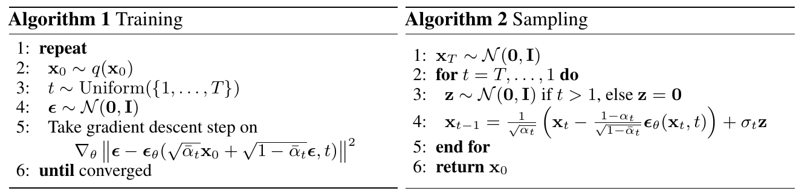

### 1. 基本思路

**DDPM（Denoising Diffusion Probabilistic Models，去噪扩散概率模型）** 通过学习逐步去噪，从随机噪声生成符合训练数据规律的新图片。图像记为 $x_0\in\mathbb R^D$，其中 $D$ 是像素与颜色通道展开后的总维数。模型包含两个方向：

$$
\begin{aligned}
\text{前向加噪：}&\quad x_0\longrightarrow x_1\longrightarrow\cdots\longrightarrow x_T,\\
\text{反向生成：}&\quad x_T\longrightarrow x_{T-1}\longrightarrow\cdots\longrightarrow x_0.
\end{aligned}
$$

前向过程按预设规则破坏原图，反向过程由模型学习。由于加噪会丢失信息，反向过程不是精确求逆，而是根据当前状态生成一种合理的前一步状态；最终生成的是新样本，不要求恢复某张指定原图。

<figure style="margin: 1.25em 0; text-align: center;">
  
  <figcaption style="margin-top: 0.4em; font-size: 0.9em; line-height: 1.5;">图 1：前向加噪与反向生成</figcaption>
</figure>

图中从左向右是生成方向，$x_T$ 在左、$x_0$ 在右；虚线箭头表示前向加噪。

两个过程均按 **马尔可夫链** 建模：给定当前状态后，下一步的分布不再需要更早的历史。例如，$q(x_t\mid x_{t-1},\ldots,x_0)=q(x_t\mid x_{t-1})$。本文用 $q$ 表示数据分布及前向过程，用 $p_\theta$ 表示待学习的生成模型，$\theta$ 是网络参数。

> [!Note] **高斯分布的记号**
> $\mathcal N(x;\mu,\Sigma)$ 表示均值为 $\mu$、协方差为 $\Sigma$ 的高斯密度在 $x$ 处的值；$x\sim\mathcal N(0,I)$ 表示各分量独立，均值为零、方差为一。连续变量的概率需要对密度积分，单个点的密度不等于取到该点的概率。一张噪声图是一次样本，“像素服从高斯分布”描述的是反复采样时的统计规律。

### 2. 前向过程

#### 2.1 单步加噪

第 $t$ 步的噪声方差记为 $\beta_t$，定义 $\alpha_t=1-\beta_t$。论文公式 (2) 规定：

$$
q(x_t\mid x_{t-1})
=\mathcal N\!\left(x_t;\sqrt{\alpha_t}x_{t-1},\beta_tI\right).
$$

等价的采样操作为：

$$
x_t=\sqrt{\alpha_t}x_{t-1}+\sqrt{\beta_t}\epsilon_t,
\qquad\epsilon_t\sim\mathcal N(0,I).
$$

每次新噪声 $\epsilon_t$ 与已有状态独立。根号只作用于系数，因此仍然是线性叠加；由于 $\beta_t$ 表示方差，乘在标准噪声前的系数应为标准差 $\sqrt{\beta_t}$。原论文实验取 $T=1000$，$\beta_t$ 从 $10^{-4}$ 线性增加到 $0.02$。

> [!Note] **方差与线性组合**
> 方差定义为 $\operatorname{Var}(X)=\mathbb E[(X-\mathbb E[X])^2]$，故 $\operatorname{Var}(aX)=a^2\operatorname{Var}(X)$。对 $aX+bY$ 的中心化表达式平方展开，可得 $\operatorname{Var}(aX+bY)=a^2\operatorname{Var}(X)+b^2\operatorname{Var}(Y)+2ab\operatorname{Cov}(X,Y)$。若 $X,Y$ 独立，协方差为零，方差便按前两项相加。

#### 2.2 方差与像素联系

先只看一个分量，利用新噪声的独立性：

$$
\operatorname{Var}(x_t^{(i)})
=(1-\beta_t)\operatorname{Var}(x_{t-1}^{(i)})+\beta_t.
$$

若上一步方差为 $1$，下一步仍为 $1$；否则新方差是旧方差与 $1$ 的加权平均，逐渐靠近 $1$。这种设计使数值尺度可控，避免单纯叠加噪声导致方差不断增加。但 **方差不变不代表信息不变**：原图的贡献在减小，噪声的贡献在增加，图像结构仍会被破坏。

对于不同位置 $i\ne j$，有：

$$
\operatorname{Cov}(x_t^{(i)},x_t^{(j)})
=\alpha_t\operatorname{Cov}(x_{t-1}^{(i)},x_{t-1}^{(j)}).
$$

原有的像素联系逐渐减弱，但协方差接近零一般不等于独立；最终的近似独立性来自联合分布接近 $\mathcal N(0,I)$。此外，给定具体的 $x_{t-1}$ 后，下一步只剩新噪声的不确定性，此时条件协方差是 $\beta_tI$，与上式讨论的总体方差不同。

#### 2.3 累积加噪

定义 $\bar\alpha_t=\prod_{s=1}^{t}\alpha_s=\prod_{s=1}^{t}(1-\beta_s)$，并约定 $\bar\alpha_0=1$。展开前两步：

$$
\begin{aligned}
x_2
&=\sqrt{\alpha_2}\left(\sqrt{\alpha_1}x_0+\sqrt{\beta_1}\epsilon_1\right)
+\sqrt{\beta_2}\epsilon_2\\
&=\sqrt{\alpha_1\alpha_2}x_0
+\sqrt{\alpha_2\beta_1}\epsilon_1+\sqrt{\beta_2}\epsilon_2.
\end{aligned}
$$

独立高斯变量的线性组合仍然是高斯，两项噪声合并后的方差为 $\alpha_2\beta_1+\beta_2=1-\alpha_1\alpha_2$。推广到任意步数，得到论文公式 (4)：

$$
\begin{aligned}
q(x_t\mid x_0)
&=\mathcal N\!\left(x_t;\sqrt{\bar\alpha_t}x_0,(1-\bar\alpha_t)I\right),\\
x_t&=\sqrt{\bar\alpha_t}x_0+\sqrt{1-\bar\alpha_t}\epsilon,
\qquad\epsilon\sim\mathcal N(0,I).
\end{aligned}
$$

$\epsilon$ 表示合并后的累计噪声，不是第 $t$ 步单独加入的 $\epsilon_t$。这个公式允许从原图直接构造任意 $x_t$，不必逐步模拟；它与逐步加噪得到的边缘分布相同，但重新抽噪后具体样本不必相同。

原图随机变化时，各分量的总体方差为：

$$
\operatorname{Var}(x_t^{(i)})
=\bar\alpha_t\operatorname{Var}(x_0^{(i)})+1-\bar\alpha_t.
$$

当 $\bar\alpha_T$ 足够小，原图项影响很弱，$x_T$ 接近标准高斯噪声。这里不仅是均值、方差趋近标准值，而是整个分布接近高斯；仅凭均值为零、方差为一，不能判断一个分布是否为高斯。

### 3. 反向过程

#### 3.1 反向采样

对于中间步骤 $t>1$，DDPM 用高斯分布近似反向转移：

$$
p_\theta(x_{t-1}\mid x_t)
=\mathcal N\!\left(x_{t-1};\mu_\theta(x_t,t),\sigma_t^2I\right).
$$

均值 $\mu_\theta$ 随输入图片变化；方差 $\sigma_t^2$ 在原论文的主要实现中预先固定，不参与训练。从这个分布抽样，就是：

$$
x_{t-1}=\mu_\theta(x_t,t)+\sigma_tz,
\qquad z\sim\mathcal N(0,I).
$$

**随机项用于保留条件分布的不确定性。** 给定 $x_t$，前一步可能有多种结果；只取均值会丢掉其周围的波动。例如，若正确转移为 $\mathcal N(0.9x_t,0.19)$ 且 $\operatorname{Var}(x_t)=1$，只取均值的方差为 $0.81$，完整采样的方差才是 $0.81+0.19=1$。这个例子说明随机项的作用，并不要求所有图像的反向步骤都保持单位方差。

原论文讨论的两种固定方差为：

$$
\sigma_t^2=\beta_t
\qquad\text{或}\qquad
\sigma_t^2=\tilde\beta_t
=\frac{1-\bar\alpha_{t-1}}{1-\bar\alpha_t}\beta_t.
$$

两者在论文中得到相似结果，可先采用较简单的 $\sigma_t^2=\beta_t$ 理解算法。固定方差简化了学习任务，但不直接减少生成步数。一般情况下反向生成的目标是恢复数据分布，不是保持方差恒定；随机采样也不能保证消除模型误差。

#### 3.2 已知原图的后验

真实反向分布 $q(x_{t-1}\mid x_t)$ 依赖未知的数据分布，难以直接计算。训练时已知原图，可以计算更容易处理的 $q(x_{t-1}\mid x_t,x_0)$，作为学习参照。根据贝叶斯公式和马尔可夫性质：

$$
\begin{aligned}
q(x_{t-1}\mid x_t,x_0)
&=\frac{q(x_t\mid x_{t-1},x_0)q(x_{t-1}\mid x_0)}{q(x_t\mid x_0)}\\
&\propto q(x_t\mid x_{t-1})q(x_{t-1}\mid x_0).
\end{aligned}
$$

两个因子均已知：$q(x_{t-1}\mid x_0)$ 是累积加噪分布，$q(x_t\mid x_{t-1})$ 是单步加噪分布。将高斯密度相乘并配方，得到论文公式 (6)、(7)：

$$
q(x_{t-1}\mid x_t,x_0)
=\mathcal N\!\left(x_{t-1};\tilde\mu_t(x_t,x_0),\tilde\beta_tI\right),
$$

$$
\begin{aligned}
\tilde\mu_t(x_t,x_0)
&=\frac{\sqrt{\bar\alpha_{t-1}}\beta_t}{1-\bar\alpha_t}x_0
+\frac{\sqrt{\alpha_t}(1-\bar\alpha_{t-1})}{1-\bar\alpha_t}x_t,\\
\tilde\beta_t&=\frac{1-\bar\alpha_{t-1}}{1-\bar\alpha_t}\beta_t.
\end{aligned}
$$

$\tilde\mu_t$ 是利用原图算出的条件均值，不是训练出来的；它也不一定等于某次加噪实际经过的 $x_{t-1}$。网络只能看到 $x_t,t$，需要在大量样本上学习逼近这些参照。

> [!Note] **贝叶斯公式与高斯配方**
> 由 $p(A,B)=p(B\mid A)p(A)=p(A\mid B)p(B)$，可得 $p(A\mid B)=p(B\mid A)p(A)/p(B)$。符号 $\propto$ 表示省去与待求变量无关的归一化因子。高斯密度相乘后，指数中的二次式可写成 $Ay^2-2By+C=A(y-B/A)^2+C'$，因此均值为 $B/A$、方差为 $1/A$。后验的系数就是通过这种配方得到的。

### 4. 噪声预测训练

#### 4.1 从均值到噪声

由累积加噪公式移项：

$$
x_0=\frac{x_t-\sqrt{1-\bar\alpha_t}\epsilon}{\sqrt{\bar\alpha_t}}.
$$

代入后验均值，利用 $\bar\alpha_t=\alpha_t\bar\alpha_{t-1}$ 与 $\beta_t+\alpha_t(1-\bar\alpha_{t-1})=1-\bar\alpha_t$，可化简为：

$$
\tilde\mu_t
=\frac1{\sqrt{\alpha_t}}
\left(x_t-\frac{\beta_t}{\sqrt{1-\bar\alpha_t}}\epsilon\right).
$$

因此让网络输出噪声预测 $\epsilon_\theta(x_t,t)$，再用同一形式定义模型均值，就得到论文公式 (11)：

$$
\mu_\theta(x_t,t)
=\frac1{\sqrt{\alpha_t}}
\left(x_t-\frac{\beta_t}{\sqrt{1-\bar\alpha_t}}\epsilon_\theta(x_t,t)\right).
$$

两者相减可得：

$$
\|\tilde\mu_t-\mu_\theta\|^2
=\frac{\beta_t^2}{\alpha_t(1-\bar\alpha_t)}
\|\epsilon-\epsilon_\theta(x_t,t)\|^2.
$$

所以固定步数时，预测噪声与预测后验均值的误差只差一个已知正系数。噪声预测还可以换算成原图估计 $\hat x_0=(x_t-\sqrt{1-\bar\alpha_t}\epsilon_\theta)/\sqrt{\bar\alpha_t}$，但噪声很大时估计未必准确，生成仍采用逐步采样。

#### 4.2 KL 与训练损失

**KL 散度** 衡量模型分布与参照分布的差异：

$$
D_{\mathrm{KL}}(q\|p)
=\mathbb E_{x\sim q}\left[\log\frac{q(x)}{p(x)}\right].
$$

离散情形为 $\sum_xq(x)\log(q(x)/p(x))$，连续情形为积分。KL 非负，分布相同时为零，但一般不对称。DDPM 比较 $q(x_{t-1}\mid x_t,x_0)$ 与 $p_\theta(x_{t-1}\mid x_t)$；对于这两个高斯分布，有：

$$
\begin{aligned}
D_{\mathrm{KL}}(q\|p_\theta)
&=\frac1{2\sigma_t^2}\|\tilde\mu_t-\mu_\theta\|^2\\
&\quad+\frac D2\left(
\frac{\tilde\beta_t}{\sigma_t^2}-1+\log\frac{\sigma_t^2}{\tilde\beta_t}
\right).
\end{aligned}
$$

方差固定时，第二项与 $\theta$ 无关，优化 KL 等价于优化第一项。再换成噪声误差，就得到带权损失：

$$
\ell_t(\theta)
=\underbrace{\frac{\beta_t^2}{2\sigma_t^2\alpha_t(1-\bar\alpha_t)}}_{w_t}
\|\epsilon-\epsilon_\theta(x_t,t)\|^2,
\qquad t>1.
$$

论文进一步去掉步数权重，采用公式 (14) 的 **简化目标**：

$$
L_{\mathrm{simple}}(\theta)
=\mathbb E_{t,x_0,\epsilon}
\left[\|\epsilon-\epsilon_\theta(x_t,t)\|^2\right].
$$

去掉权重会改变不同步数对训练的贡献，不是严格相等的代数变形。原论文指出，这在其设置下相对降低了小 $t$、轻微噪声任务的权重，使网络更关注噪声较大的任务。表 1 中，原变分目标与简化目标的 CIFAR10 FID 分别为 $13.51$ 和 $3.17$，但后者的负对数似然略差，生成质量与似然不一定同步改善。

> [!Note] **平方误差的最佳预测**
> 固定输入 $u=(x_t,t)$，记 $c=\mathbb E[\epsilon\mid u]$。平方展开并利用 $\mathbb E[\epsilon-c\mid u]=0$，可得 $\mathbb E[\|\epsilon-m\|^2\mid u]=\mathbb E[\|\epsilon-c\|^2\mid u]+\|c-m\|^2$。第一项不随预测 $m$ 改变，因此最优预测为条件平均值 $c$，不保证等于某次实际抽取的噪声。乘上仅依赖 $t$ 的正权重，不改变无限容量下各步的最佳预测，但会影响有限网络的训练。

> [!Note] **标准高斯数据的特例**
> 若 $x_0,\epsilon$ 独立且均为标准高斯，固定 $t$，则 $x_t$ 仍为标准高斯。联合高斯的条件均值公式给出 $\mathbb E[\epsilon\mid x_t]=\operatorname{Cov}(\epsilon,x_t)\operatorname{Var}(x_t)^{-1}x_t=\sqrt{1-\bar\alpha_t}x_t$（先按单个分量理解）。代入后得到 $\mu_\theta=\sqrt{\alpha_t}x_t$；再取 $\sigma_t^2=\beta_t$，输出方差为 $\alpha_t+\beta_t=1$。这依赖特殊的数据假设，不能直接用于真实图片；$x_t$ 与其噪声预测也并不独立。

#### 4.3 训练与生成

<figure style="margin: 1.25em 0; text-align: center;">
  
  <figcaption style="margin-top: 0.4em; font-size: 0.9em; line-height: 1.5;">图 2：训练与采样算法</figcaption>
</figure>

**训练时**，从数据集抽取 $x_0$，均匀随机选 $t\in\{1,\ldots,T\}$，抽取 $\epsilon$ 并直接构造 $x_t$。网络只输入 $x_t,t$，将预测与已知目标 $\epsilon$ 比较；通过反向传播求梯度，再由优化器更新 $\theta$。一次更新不必运行完整生成链。

**生成时**，固定网络参数，先抽取 $x_T\sim\mathcal N(0,I)$，再按 $t=T,\ldots,1$ 重复：

$$
x_{t-1}
=\frac1{\sqrt{\alpha_t}}
\left(x_t-\frac{\beta_t}{\sqrt{1-\bar\alpha_t}}\epsilon_\theta(x_t,t)\right)
+\sigma_tz.
$$

当 $t>1$ 时每次重新抽取 $z\sim\mathcal N(0,I)$，最后一步取 $z=0$。所有步数使用同一个网络，步数 $t$ 作为输入标明噪声程度。**反向传播** 是训练参数的方法，**反向扩散** 是生成样本的过程。

下图左侧为 CelebA-HQ，右侧为无条件 CIFAR10 的生成结果。

<figure style="margin: 1.25em 0; text-align: center;">
  
  <figcaption style="margin-top: 0.4em; font-size: 0.9em; line-height: 1.5;">图 3：生成样例</figcaption>
</figure>

### 5. 变分目标

#### 5.1 最大似然

最终希望模型对真实图片赋予较高的似然，即最小化 $\mathbb E_{q(x_0)}[-\log p_\theta(x_0)]$。整条生成路径的联合密度为：

$$
p_\theta(x_{0:T})
=p(x_T)\prod_{t=1}^{T}p_\theta(x_{t-1}\mid x_t).
$$

同一张图片可能通过许多路径生成，因此只看最终结果时，要将中间状态积分掉：

$$
p_\theta(x_0)=\int p_\theta(x_{0:T})\,\mathrm dx_1\cdots\mathrm dx_T.
$$

单条路径的密度容易计算，但这个高维积分通常难以直接求出。这里中间状态称为 **潜变量**；似然则是在数据已给定时，考察模型参数能多好地解释数据。

#### 5.2 变分下界

固定 $x_0$，记整条中间路径为 $z=(x_1,\ldots,x_T)$（与采样公式中的新噪声 $z$ 不同）。利用可采样的前向分布：

$$
\begin{aligned}
p_\theta(x_0)
&=\int q(z\mid x_0)\frac{p_\theta(x_0,z)}{q(z\mid x_0)}\,\mathrm dz\\
&=\mathbb E_{q(z\mid x_0)}
\left[\frac{p_\theta(x_0,z)}{q(z\mid x_0)}\right].
\end{aligned}
$$

乘除同一个密度不改变积分。再应用 Jensen 不等式，得到 **证据下界（ELBO）**：

$$
\log p_\theta(x_0)
\geq\mathbb E_{q(z\mid x_0)}
\left[\log\frac{p_\theta(x_0,z)}{q(z\mid x_0)}\right].
$$

取负号后，不等号反向：

$$
-\log p_\theta(x_0)
\leq\mathbb E_{q(z\mid x_0)}
\left[\log\frac{q(z\mid x_0)}{p_\theta(x_0,z)}\right]
=:L(x_0).
$$

所以同一目标对 **对数似然是下界，对负对数似然是上界**。对原图再取平均，记 $L=\mathbb E_{q(x_0)}[L(x_0)]$，对应论文公式 (3)。训练转而降低这个可计算的上界，但不保证每次更新都会同步改善真实似然。

> [!Note] **Jensen 不等式**
> $\log x$ 是凹函数，对正随机变量 $W$ 有 $\mathbb E[\log W]\leq\log\mathbb E[W]$。令 $W=p_\theta(x_0,z)/q(z\mid x_0)$ 就得到 ELBO。这是带方向的不等式，不能把对数与期望直接交换。

#### 5.3 分解为各步 KL

给定原图后，前向路径的同一个联合分布可以倒序分解为：

$$
q(x_{1:T}\mid x_0)
=q(x_T\mid x_0)\prod_{t=2}^{T}q(x_{t-1}\mid x_t,x_0).
$$

这只是分布的精确改写，不是已经训练出生成模型。代入 $L$ 中的密度比：

$$
\begin{aligned}
\frac{q(x_{1:T}\mid x_0)}{p_\theta(x_{0:T})}
&=\frac{q(x_T\mid x_0)}{p(x_T)}\\
&\quad\times\prod_{t=2}^{T}
\frac{q(x_{t-1}\mid x_t,x_0)}{p_\theta(x_{t-1}\mid x_t)}
\times\frac1{p_\theta(x_0\mid x_1)}.
\end{aligned}
$$

取对数将乘积化为求和，再按前向过程取期望，得到论文公式 (5)：

$$
L=\mathbb E_q\left[
\begin{aligned}
&\underbrace{D_{\mathrm{KL}}\!\left(
q(x_T\mid x_0)\,\|\,p(x_T)\right)}_{L_T}\\[4pt]
&{}+\sum_{t=2}^{T}\underbrace{D_{\mathrm{KL}}\!\left(
q(x_{t-1}\mid x_t,x_0)\,\|\,p_\theta(x_{t-1}\mid x_t)
\right)}_{L_{t-1}}\\[4pt]
&{}+\underbrace{-\log p_\theta(x_0\mid x_1)}_{L_0}
\end{aligned}
\right].
$$

- **$L_T$**：比较加噪终点与生成起点。前向调度固定时，它不依赖网络参数，可在训练更新中忽略。
- **$L_{t-1}$**：比较中间步骤的条件参照与模型反向分布，固定方差后化为第 4 节的带权噪声误差。
- **$L_0$**：最后一步生成原始图像的负对数似然。原论文使用离散解码，不能直接套用 $t>1$ 的非退化高斯 KL；这部分尚待展开。

由此，整体似然目标与单步噪声预测联系起来。实际训练可随机选步数估计损失，不必每次遍历全链。简化目标 $L_{\mathrm{simple}}$ 又调整了步数权重，并对最后一步作进一步近似，因此不等于原始变分目标。

**参考与图源**：Ho, Jain, Abbeel, *Denoising Diffusion Probabilistic Models*, NeurIPS 2020，[arXiv:2006.11239v2](https://arxiv.org/abs/2006.11239)。配图截自论文原文，公式编号沿用论文。
