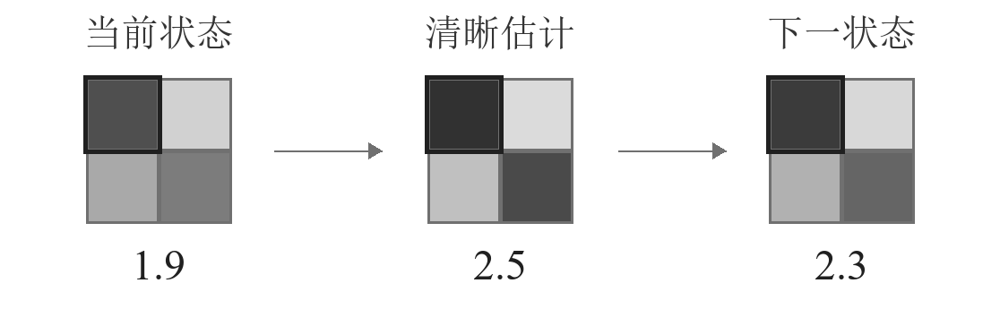
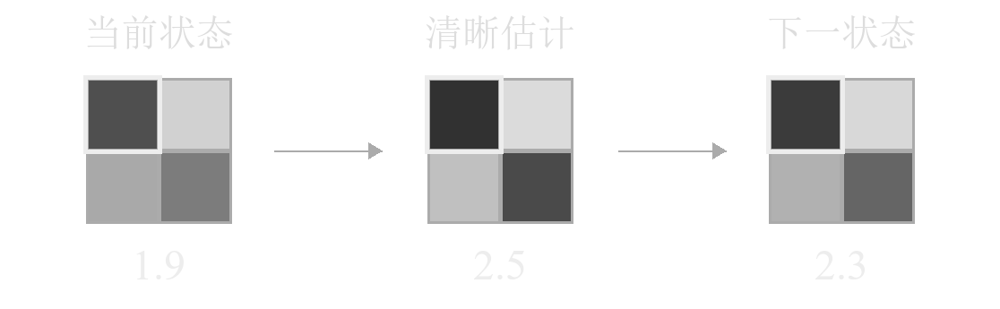
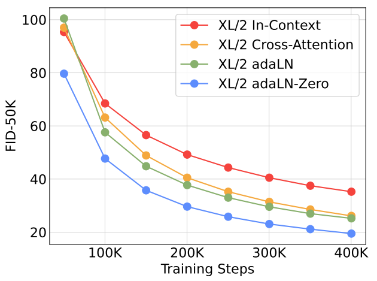
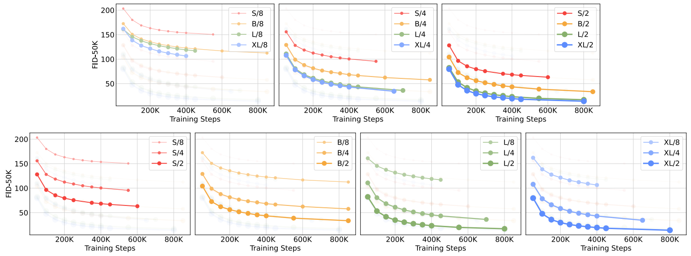


DiT 用 Transformer 取代 U-Net，估计当前潜网格里混入的噪声。它把网格切成小块，让各块通过注意力交换信息，并根据噪声程度和目标类别调整计算。算完后，各块的预测按原位置拼回网格，交给采样器继续去噪。在论文的 ImageNet 实验中，把块切小几乎不改变参数量，但每步要处理更多块，计算量更大，生成质量也更高。（由 GPT-6 总结）

**关键公式**

$$
z_t=\sqrt{\bar\alpha_t}\,z_0+\sqrt{1-\bar\alpha_t}\,\epsilon.
$$

$$
n=\frac{H}{p}\frac{W}{p},\qquad c=e_t+e_y.
$$

$$
\widetilde U=(1+\gamma)\odot\operatorname{LN}(U)+\beta.
$$

$$
U'=U+g_A\odot\operatorname{MSA}\!\left(\operatorname{adaLN}_A(U,c)\right).
$$

$$
\mathcal L_{\mathrm{hybrid}}=\mathcal L_{\mathrm{simple}}+\lambda\mathcal L_{\mathrm{vlb}}.
$$

$$
\hat\epsilon_t=\epsilon_u+s(\epsilon_c-\epsilon_u).
$$



### 1. 基本思路

[DDPM]() 生成一张图时，要反复调用同一个网络预测噪声。[LDM]() 把扩散移到较小的潜网格上，减轻了单次预测的开销。现在假设愿意为每次预测多花一点计算量：把网络做得更宽、更深，或让它处理更多空间位置，能换来更好的生成结果吗？论文 **Scalable Diffusion Models with Transformers** 用这个问题来考察可扩展性。

作者把潜空间 U-Net 换成 **DiT（Diffusion Transformer）**。U-Net 依靠卷积和多尺度路径组织局部与整体信息；DiT 把网格分成小块，让不同位置通过自注意力直接交换信息。在同一种层结构里，既能加深、加宽网络，也能把网格切成更多小块来增加计算量。前者增加模型容量，后者增加参与计算的空间位置。论文沿这两个方向做对照，考察多花的计算有没有转化为生成质量。

换网络要守住同一个接口：采样器给出当前带噪网格和时刻，网络给出与这张网格逐位置对应的预测。以生成 $256\times256$ 图像为例，DiT 收到一张 $32\times32\times4$ 的带噪潜网格 $z_t$、时刻 $t$ 和目标类别 $y$。Transformer 处理的是一列向量，因此下图先把网格变成一串带位置的向量，最后再按原坐标拼回预测。

<figure class="ddpm-figure">
  
  <figcaption>DiT 的输入、条件与输出；来源：原论文 Figure 3 的整体结构</figcaption>
</figure>

从左半图底部往上看。**Noised Latent** 是当前的 $z_t$，**Patchify** 将它切成小块，每块变成一个向量，也就是一个 token。这串向量依次经过 $N$ 层 Transformer（图中的 **DiT Block**）。顶端的 **Layer Norm** 和 **Linear and Reshape** 将结果还原为两张与 $z_t$ 尺寸相同的网格：**Noise** 是噪声预测，$\Sigma$ 是采样时用来确定方差的参数。

左半图的另一条线负责传递条件：**Timestep $t$** 与 **Label $y$** 经 **Embed** 变成向量，送进每一层。右半图展开了其中一层，底部的 **Input Tokens** 接收空间特征，右下角的 **Conditioning** 接收时间和类别。下面从左上角的一个图块开始，跟到这个位置的预测输出。

### 2. 潜网格分块

#### 2.1 潜空间加噪

要看懂图里的 $32\times32\times4$，先回到训练时的原图。DiT 沿用 LDM 的 **VAE（变分自编码器）**，用它的编码器把图像压成潜网格 $z_0$。高和宽各缩小到原来的 $1/8$，通道数变为 4：

$$
x\in\mathbb R^{256\times256\times3}\ \longrightarrow\ z_0\in\mathbb R^{32\times32\times4}.
$$

这 4 个通道是 VAE 学出的特征。VAE 先单独训练：编码器把原图变成小网格，解码器从网格复原图像，使网格保留足以重建的内容。训练 DiT 时，这两部分都保持固定，只有编码器负责为训练图像提供清晰的 $z_0$。生成时没有原图可编码，直接从随机潜噪声出发，去噪结束后才用 VAE 的解码器还原图像。

从 $z_0$ 构造训练用的 $z_t$ 时，沿用 DDPM 的加噪公式：

$$
z_t=\sqrt{\bar\alpha_t}\,z_0+\sqrt{1-\bar\alpha_t}\,\epsilon.
$$

设第 $k$ 步加入的噪声方差为 $\beta_k$，这一步保留的信号系数平方就是 $1-\beta_k$；从第一步连乘到 $t$，得到 $\bar\alpha_t=\prod_{k=1}^t(1-\beta_k)$。$\epsilon$ 是与 $z_0$ 同形状的标准高斯噪声。抽到 $t$ 和 $\epsilon$ 后，就能直接构造对应的 $z_t$。官方代码从编码器给出的潜分布抽样，再乘以 $0.18215$ 作为 $z_0$；解码前再除以同一个数。这个缩放决定了训练时潜信号相对于标准高斯噪声的大小。

#### 2.2 分块与位置

**Patchify** 分成两步：先把潜网格切成不重叠的小块，再用同一个线性层把每块变成一个 token。对 $32\times32\times4$ 的 $z_t$，如果每块是 $2\times2$，每行、每列各有 16 块，共 256 块。拿最左上角的小块来看，里面有 4 个位置，每处 4 个通道，展开后是 16 个数。DiT-XL 的线性层把这 16 个数映射成 1152 个特征，第一层 Transformer 因此收到 256 个 1152 维的 token。

也可以让每个网格位置各用一个 token，但这样就有 1024 个位置需要两两匹配。合成 256 个块后，注意力处理的位置对只剩原来的十六分之一。每块仍把全部 16 个输入分量交给线性层，最后也会分别输出块内各位置的结果；代价是块内四个位置共用一个对外交换信息的向量。这就是块大小同时影响空间粒度和计算量的原因。

一般地，潜网格的形状为 $H\times W\times C$，块的边长为 $p$，Transformer 的特征宽度为 $d$。当 $H,W$ 都能被 $p$ 整除时，块的总数和每块的线性映射分别是：

$$
n=(H/p)(W/p),\qquad p^2C\longrightarrow d.
$$

官方代码用卷积核大小和步长都为 $p$ 的卷积实现这个线性层。卷积每次读取一整块，移动一块的宽度再读下一块，所以各块共用同一组权重。

块的数值说明该处有什么，网络还需要知道是哪一处。卷积的局部窗口有固定的左右和上下，注意力却会用相同的规则比较序列中的任意两块。只改变 token 的排列顺序，注意力的对应结果也只是一起换了顺序。DiT 因此按每块的行、列坐标算出二维正弦余弦位置编码，再加到块的向量上。第 $i$ 个 token 进入第一层时是：

$$
u_i=\operatorname{Linear}(\operatorname{vec}(P_i))+\operatorname{PE}(r_i,c_i).
$$

$P_i$ 是第 $i$ 块，$r_i,c_i$ 是它在分块网格上的行、列坐标，$\operatorname{vec}$ 表示把块展开。位置向量用一半维度编码行，另一半编码列。因此，即使两个块的原始数值一样，加上各自的位置编码后，网络也能区分它们。

### 3. 条件调节

#### 3.1 时间与类别

时间 $t$ 告诉网络当前网格的噪声有多强。同样一处局部波动，在噪声很强时可能没多少信息，在噪声较弱时则可能是该保留的结构。类别 $y$ 也能帮助网络判断：它指定了要生成哪一类图像。

位置是每个 token 各自的信息，时间和类别则由整张潜网格共享。DiT 没有把它们当成新图块，而是用同一份时间和类别向量调节各块的通道。各块原有的带噪特征不同，所以受到相同调节后仍可以产生不同的响应。DiT 将 $t$ 转成正弦余弦特征，再经小型前馈网络得到 $e_t$；$e_y$ 从类别编号对应的可学习向量表中取出。两个向量都为 $d$ 维，相加得到条件向量：

$$
c=e_t+e_y.
$$

固定那 256 个空间 token，只换一个类别 $y$，第一层收到的网格特征一样，条件向量 $c$ 却会改变。图中 **Conditioning** 后的 **MLP** 是一个小型前馈网络：它对 $c$ 做非线性变换，再用线性层输出本层调节各通道所需的参数。改变时刻 $t$ 也会沿这条线改变各层的计算。

#### 3.2 层内计算

沿右半图从 **Input Tokens** 往上看，每层先让各位置交换信息，再分别加工每个位置的特征。这两步分开处理：先让一个局部特征结合整张图判断自己画的是什么，再在这个位置内组合不同通道、提取下一层可用的线索。

> [!Note] **自注意力怎样读取远处特征**
> 卷积的一次计算从固定范围取信息。同一层中的自注意力允许任何一块读取所有块，并根据当前输入分配权重。每块经三次线性变换得到查询、键和值：查询表示这块想找什么，键用来判断匹配程度，值是能读回的内容。一个位置的查询逐个与所有键做点积，除以键维数的平方根以控制分数尺度，再用 softmax 把分数变成和为 1 的读取权重。最后按这组权重对所有值取加权和。查询、键和值都来自同一串图块，所以叫自注意力。[Transformer 的注意力算例](/papers/transformer/#2-注意力计算)展示了这组权重怎样算出来。

图中的**多头自注意力**（MSA）并行做几次这样的读取，每个头有各自的投影，可以学不同的匹配关系。左上角的块可以从相距很远的块汇总线索，不必等信息逐层通过局部卷积传过来。每个头都为左上角算出一份结果，把这些结果拼接并投影回原宽度，再在第一个加号处加回左上角的 token。其他位置也各自这样更新，所以整串 token 的数目和各自负责的坐标都不变。

接下来是**逐位置前馈网络（FFN，图中的 Pointwise Feedforward）**。它处理左上角刚刚更新过的特征，无需再读取其他 token。各个位置共用一套参数：先把宽度扩到 $4d$，经 GELU 对各分量做非线性变换，再映射回 $d$。GELU 的作用类似 ReLU：很负的输入被压到接近零，很正的输入大体保留，中间平滑过渡。这条分支也把结果加回各自的位置，一层结束后仍是 256 个 1152 维 token。

> [!Note] **LayerNorm 按什么范围归一化**
> 一个 token 有 $d$ 个特征分量。LayerNorm 用这 $d$ 个数计算均值 $\mu$ 和方差 $\sigma^2$，再把每个分量 $u$ 换成 $(u-\mu)/\sqrt{\sigma^2+\varepsilon}$，其中小常数 $\varepsilon$ 防止除以零。每个位置都单独算，也不依赖其他训练样本。通常还会逐通道乘上一组尺度、加上一组偏移，让后续层能使用适合自己的数值范围。

DiT 让图中紧跟 **Layer Norm** 的 **Scale, Shift** 随样本变化。普通 LayerNorm 的尺度和偏移对所有样本都一样；这里改由右侧的 MLP 根据时间与类别算出，使每次读取前可以重新调节通道。这就是 **adaLN（adaptive LayerNorm，自适应层归一化）**：

$$
\operatorname{adaLN}(U,c)=(1+\gamma)\odot\operatorname{LN}(U)+\beta.
$$

$U\in\mathbb R^{n\times d}$ 是整串 token，每行对应一个位置，式中的 $\operatorname{LN}$ 只做归一化。$\gamma,\beta\in\mathbb R^d$ 分别是在归一化之后的缩放增量和偏移，$\odot$ 表示按对应通道相乘；这两组参数在本层所有位置共用。假如某个通道能提供纹理线索，把它放大后，这些线索就能更强地影响后续的查询、键和值。网络在本层交换信息之前，先根据条件改变用哪些特征来比较，从而影响这一层会从各处读回什么。

#### 3.3 零初始化

注意力和前馈分支的输出都要加回原 token。如果训练刚开始时每一层就加上一份未经训练的改动，上一层传来的特征会被连续改写。**adaLN-Zero** 在两个加号前各放了一个 **Scale**，让模型决定每个通道需要加回多少，也能先把这个量设为零。图中的 $\alpha_1,\alpha_2$ 是这两个残差系数，下文记作 $g_A,g_F$。每层从 $c$ 算出 $6d$ 个数：两条分支各有 $d$ 个缩放增量、$d$ 个偏移和 $d$ 个残差系数。

> [!Note] **残差相加与恒等路径**
> 残差层把输入 $u$ 原样送到输出，再加上分支算出的修正 $f(u)$。分支输出若暂时为零，整层就是 $u\mapsto u$，称为恒等映射。反向传播时，加法也给梯度留了一条直达前层的路径，不需要经过分支内的每一次变换。

注意力和前馈分支分别按下式更新：

$$
U'=U+g_A\odot\operatorname{MSA}\!\left(\operatorname{adaLN}_A(U,c)\right).
$$

$$
U''=U'+g_F\odot\operatorname{FFN}\!\left(\operatorname{adaLN}_F(U',c)\right).
$$

第一式对应第一个加号：$U$ 沿图左边的直线通过，自注意力的输出先乘 $g_A$ 再加回去。某个通道的 $g_A$ 若为零，该通道就保留原值。$g_A$ 也可以取负值，让这一分量的更新反向。第二式以 $U'$ 为输入，对前馈分支做同样的处理。

名字里的 Zero 指的是调节参数如何初始化。产生调节参数的网络先把 $c$ 的每个分量 $a$ 变成 $a/(1+e^{-a})$，这一步叫 SiLU 激活，再接一个线性层。后者的权重和偏置初始化为零，所以缩放增量、偏移和门控起初全是零。此时 adaLN 照常做归一化，注意力和前馈网络也能算出非零结果，但乘上 $g_A=g_F=0$ 后，加回主分支的量为零，整层满足 $U''=U$。随着训练改变门控系数，这两条分支才逐渐参与特征更新。

初始时，每层把输入 token 原样传给下一层；到了网络末端，输出投影的权重和偏置也初始化为零，所以整网第一次预测的是零。第一次反向传播可以更新这个投影。有了非零的输出权重，后续训练中的误差才能继续传回内部各层。

为什么门控从零出发还能学起来？把其中一个通道的更新简写成 $u'=u+g\,a$，$a$ 是注意力分支算出的特征。假设从后一层传回的误差信号是 $\delta$。改变门控 $g$ 会使输出按 $a$ 的大小变化，所以门控收到的梯度是 $\delta a$；改变分支结果 $a$ 则要先乘门控，传给分支的梯度是 $\delta g$。刚开始 $g=0$，但 $a$ 通常不为零：一旦输出投影开始传回误差，就可以先学出哪些通道的结果值得加回来。门控离开零后，误差也能进入分支，调整产生查询、键和值的权重。这样，28 层可以从一条稳定的恒等路径出发，逐渐学会各层要补上什么。

### 4. 输出与训练

#### 4.1 还原潜网格

经过 DiT-XL 的 28 层 Transformer 后，左上角的 token 已经汇集了其他区域的信息，仍负责原来的小块。输出层先对 token 做归一化，再用 $c$ 算出的缩放和偏移调整各通道。所有位置随后用同一个线性层，各自预测一小块的噪声和方差参数。按分块时的坐标把这些输出拼回网格，这一步叫 **unpatchify**。

以 $p=2,C=4$ 为例，一个小块有 $2\times2$ 个位置，每处 4 个潜通道。每个通道都要给出一个噪声预测和一个方差参数，所以一个 token 输出 $2\times2\times4\times2=32$ 个数。把这 32 个数排成 $2\times2\times8$，再把 256 块拼成 $32\times32\times8$ 的网格。一般地，$n$ 是块数，$d$ 是块向量的宽度，输出的形状变化是：

$$
\mathbb R^{n\times d}\ \longrightarrow\ \mathbb R^{n\times2p^2C}\ \longrightarrow\ \mathbb R^{H\times W\times2C}.
$$

这 8 个通道分成两张 $32\times32\times4$ 的网格。**Noise** 给出噪声预测 $\epsilon_\theta(z_t,t,y)$，DDPM 采样器用它计算下一状态的均值。$\Sigma$ 给出方差参数，决定采样时每个分量可以在均值附近波动多大。两张预测都与 $z_t$ 的各个位置和通道一一对应。

这样就完成了一次预测：256 个图块在同一层里并行处理，28 层 Transformer 则依次执行。采样器算出下一张潜网格后，会把它送回同一个 DiT，重新做一次这样的预测。

#### 4.2 学习方差

噪声预测确定了反向一步的中心，却没有说明从这个中心附近多大的范围取样。固定一个只随时刻变化的方差也能运行 DDPM，不过同一时刻的不同图块并不一样容易判断：有些地方的内容已很清楚，另一些仍有多种可能。DiT 沿用 Improved DDPM 的做法，让网络为当前网格估计取样的宽窄。一次抽到的噪声没有直接给出方差标签，因此第二组输出 $v_\theta$ 先用来调节两个已知参考尺度，再靠反向分布的训练目标学习这个权重：

$$
r=\frac{v_\theta+1}{2},\qquad \log\sigma_\theta^2=(1-r)\log\tilde\beta_t+r\log\beta_t.
$$

两个参考尺度都由噪声日程给定：$\tilde\beta_t$ 是在已知干净潜变量 $z_0$ 时的[后验方差](/papers/ddpm/#32-后验分布)，$\beta_t$ 是前向一步加入的噪声方差。$v_\theta=-1$ 对应第一个尺度，$v_\theta=1$ 对应第二个。这里使用对数，网络可以围绕两个与 $t$ 匹配的尺度调节取样范围，取指数后也不用担心方差给成负数。模型为各个位置和通道分别决定采样幅度，反向高斯的协方差矩阵因此是对角形式。

最靠近 $z_0$ 的一步，后验方差为零，代码对这一端点使用有限的对数值。$v_\theta$ 超出 $[-1,1]$ 时可以按上式外推。

#### 4.3 训练目标

训练时，和第 2 节一样，每张图先得到 $z_0$，再随机抽一个时刻 $t$ 和一份噪声 $\epsilon$，构造 $z_t$。因此只需做一次预测就能计算这一时刻的损失。噪声部分和 DDPM 一样，直接比较模型输出与刚抽到的 $\epsilon$：

$$
\mathcal L_{\mathrm{simple}}=\mathbb E\!\left[\|\epsilon-\epsilon_\theta(z_t,t,y)\|^2\right].
$$

如果只用这项误差，同样的噪声输出配任何方差都会得到相同分数，第二组输出就收不到训练信号。要教它给出合适的范围，需要比较模型预测的整个反向分布与训练时可算出的参照分布。DiT 因而沿用 Improved DDPM 的混合目标：

$$
\mathcal L_{\mathrm{hybrid}}=\mathcal L_{\mathrm{simple}}+\lambda\mathcal L_{\mathrm{vlb}}.
$$

$\lambda$ 决定变分损失在总损失中的权重。对于中间时刻，训练程序知道干净的 $z_0$，可以算出反向一步的参照分布 $q(z_{t-1}\mid z_t,z_0)$，再求它相对于模型反向分布的 KL 散度。参照分布认为常见的结果，如果在模型那里概率很小，损失就会升高。最接近干净网格的一步直接用负对数似然，衡量模型给真实 $z_0$ 分配了多少概率。两项都在潜空间里计算。

> [!Note] **为何叫变分项**
> 要提高模型生成真实 $z_0$ 的概率，直接算对数似然需要对所有可能经过的中间网格积分。[DDPM 的变分界推导](/papers/ddpm/#51-变分界)换用可按时刻计算的下界。VLB 是 *variational lower bound* 的缩写，损失取这个下界的负值。各步的 KL 按参照分布取平均，比较的是同一结果在参照分布与模型分布下的对数概率。

模型的反向均值由噪声预测换算而来。计算变分项时，代码保留这个均值的数值，但切断经过噪声预测的这条梯度。这样，平方误差负责校正噪声预测；变分项通过方差输出调整分布的宽窄。两组输出共用的 Transformer 仍会收到两项损失的梯度。

具体看反向过程中间的一步。只取一个潜分量，记已知 $z_0$ 时后验的均值、方差为 $\mu_q,\sigma_q^2$，模型给出的则为 $\mu_\theta,\sigma_\theta^2$。固定这次计算中的 $\mu_\theta$，高斯 KL 里与预测方差有关的部分是：

$$
\tfrac12\left[\log\sigma_\theta^2+
\frac{\sigma_q^2+(\mu_q-\mu_\theta)^2}{\sigma_\theta^2}\right].
$$

如果预测均值偏离了参照均值，却把方差设得很小，分式就会很大：模型把概率集中在了错误的位置附近。反过来，把分布一味放宽，第一项又会增大。方差分支正是通过这个取舍学习采样幅度。生成时它看不到 $\mu_q$ 或干净图，而要根据当前网格、时刻和类别估计这种不确定性。

这里的一次训练到反向传播就结束了：噪声分支根据已知标签学习反向均值，方差分支根据这一步的参照分布学习采样幅度。到了生成时没有干净网格，两者都由训练好的网络从当前状态预测。

### 5. 条件采样

#### 5.1 类别引导

告诉网络类别 $y$，它就能做类别条件预测。论文还用 [CFG（无分类器引导）]() 增强类别的影响。为此，训练时以 $10\%$ 的概率把类别替换为一个可学习的空类别 $\varnothing$，让同一个网络也学会在没有类别信息时预测噪声。

生成时，从与目标潜表示同形状的高斯噪声 $z_T$ 出发。每个采样时刻分别计算条件与空类别的噪声预测，再按引导尺度 $s$ 组合：

$$
\hat\epsilon_t=\epsilon_u+s(\epsilon_c-\epsilon_u).
$$

$\epsilon_c=\epsilon_\theta(z_t,t,y)$ 是类别条件预测，$\epsilon_u=\epsilon_\theta(z_t,t,\varnothing)$ 是空类别预测。$s=1$ 使用普通类别条件预测；更大的 $s$ 沿 $\epsilon_c-\epsilon_u$ 继续移动，通常让生成内容更贴合类别，也可能减少多样性。两次预测接收的是同一份 $z_t$，这样相减得到的差异才来自条件。

两份预测对应同一张网格上的同一组位置。逐位置组合之后，结果仍是一张与输入对齐的噪声网格，采样器可以直接用它来更新状态。

#### 5.2 反向更新

论文使用 DDPM 采样。先用引导后的噪声预测算出反向均值 $\mu_\theta$，再用条件分支给出的方差参数算出标准差 $\sigma_\theta$。以相邻的两个采样时刻为例，从标准高斯抽取与潜网格同形的 $z$，在每个分量上计算 $z_{t-1}=\mu_\theta+\sigma_\theta\odot z$；最后一步直接取均值。把得到的潜网格送回 DiT，直到去噪结束，目标类别始终不变。最终撤销第 2 节的潜变量缩放，再用 VAE 解码器还原图像。

训练的噪声日程有 1000 个时刻。论文的主要结果选其中 250 个时刻做 DDPM 采样，送进网络的仍是训练日程上的原时刻。若相邻两个保留的时刻为 $r<t$，采样器把 $\bar\alpha_t/\bar\alpha_r$ 当作这段区间的单步信号保留系数平方，据此重算均值和方差所用的日程系数。换成确定性 [DDIM]() 时，采样器可以继续用同一个 DiT 的噪声预测，再按 DDIM 的规则直接算出下一状态。这时不需要预测出的方差。

#### 5.3 猫图算例

取一张 $256\times256$ 的猫图和它的 ImageNet 类别编号 $y$。用固定的 VAE 编码，再缩放到扩散模型使用的数值范围，得到 $32\times32\times4$ 的 $z_0$。只看其中一个分量：假设它是 2，抽到的噪声是 0.5；取 $\sqrt{\bar\alpha_t}=0.6$，相应的噪声系数为 0.8，加噪后得到 $0.6\times2+0.8\times0.5=1.6$。

整张 $z_t$ 连同 $t,y$ 进入 DiT-XL/2。网格切成 256 个 token，依次通过 28 层 Transformer；每一层都根据时间与类别调节各通道，让不同位置交换信息。最后按位置拼回两张网格。在刚才的位置，第一张网格的噪声预测与标签 0.5 比较；第二张给出方差参数，由第 4.3 节的变分项训练。反向传播更新 DiT，VAE 保持固定。

生成时保留同一个类别编号，从新的 $32\times32\times4$ 高斯噪声开始。这里取普通条件预测，不加 CFG，并选择确定性 DDIM，这次更新只需读取噪声输出。假设采样已走到上面的噪声程度，当前某个分量为 1.9，DiT 对它预测的噪声为 0.5。采样器先算出清晰潜变量估计 $(1.9-0.8\times0.5)/0.6=2.5$；再选一个信号系数为 0.8、噪声系数为 0.6 的较早时刻，将下一状态算成 $0.8\times2.5+0.6\times0.5=2.3$。

<figure class="ddpm-figure paper-diagram" style="--diagram-width:372px;">
  
  
  <figcaption>跟踪同一潜块的左上格（本文自绘）。灰色越深，潜分量越大。网络结构见<a href="https://arxiv.org/abs/2212.09748">原论文 Figure 3</a>。</figcaption>
</figure>

沿三幅小图看描边的左上格：中图的 $2.5$ 是这一时刻估计的清晰值，右图的 $2.3$ 才是下一时刻的输入。其他位置也分别按各自的噪声预测更新。下一次调用 DiT 时，网格和时刻都换了，类别仍是猫；同样的 28 层要在新网格上再算一遍。到采样结束后才撤销潜变量缩放，由 VAE 将整张网格解码成猫图。换用更深的 DiT，或把块切得更细，采样器接手的仍是相同尺寸的预测；要比较的是新网络花更多计算得出的预测，最终有没有带来更好的图。

### 6. 实验结果

#### 6.1 条件注入

前面走过的 DiT 用 adaLN-Zero 把时间和类别同时交给每一层。另一种选择是让每个图块决定要不要读取这两个条件。论文把时间和类别各写成一个 token，测试它们是与图像 token 一起做自注意力更好，还是在图像自注意力后额外做一轮交叉注意力更好。另有一组只用普通 adaLN 调节通道，省去残差门控和零初始化。这些对照用来决定主实验的条件入口，后面的规模比较才固定这套设计。

<figure class="ddpm-figure">
  
  <figcaption>条件注入方式的比较；来源：原论文 Figure 5</figcaption>
</figure>

横轴是训练更新次数。纵轴的 FID 用同一套 Inception 网络分别提取真实图和生成图的特征，再比较两批特征的均值和协方差；数值越低，表示两批图在这些统计量上越接近。FID-50K 中的 50K 是评估所用的 5 万张生成图。按附录 Table 4，同样是 DiT-XL/2、训练 40 万次更新，普通 adaLN 与 adaLN-Zero 的单次前向计算量接近，FID-50K 分别为 25.21 和 19.47。交叉注意力的计算量比 adaLN-Zero 高约 $16\%$，FID-50K 为 26.14。论文据此选用 adaLN-Zero 做主要的规模实验。这组对照比较的是整套注入方式，门控和零初始化各自带来多少改善，需要单独改变其中一项才能看出。

#### 6.2 模型与分块

论文沿两个方向扩大计算量：加深、加宽网络，或者把空间图块切得更小。模型名称也按这两个方向来读：**DiT-XL/2** 中，XL 表示 28 层、特征宽度 1152、16 个注意力头的配置；斜杠后的 2 表示图块在潜网格上的边长。

| 配置 | 层数 | 特征宽度 | 注意力头数 |
| --- | ---: | ---: | ---: |
| DiT-S | 12 | 384 | 6 |
| DiT-B | 12 | 768 | 12 |
| DiT-L | 24 | 1024 | 16 |
| DiT-XL | 28 | 1152 | 16 |

每种配置又分别使用 $p=8,4,2$，共得到 12 个模型。对于 $32\times32$ 的潜空间，对应的 token 数为 16、64、256。这样可以沿两个方向比较：固定分块大小，看增加层数和宽度能带来什么；固定模型配置，看增加空间 token 是否也能改善生成。

块切得更小，网络就能分别处理更小的区域，不过每一步也要处理更长的序列。对于 $n$ 个 $d$ 维 token，投影和前馈网络要把每个位置的通道混在一起计算，主要开销随 $nd^2$ 增长。自注意力计算分数和加权汇总时，还要处理每一对位置，主要开销随 $n^2d$ 增长：

$$
\text{每层计算量}=O(nd^2+n^2d).
$$

同一张潜网格上，分块边长减半，行、列方向上的块数都会翻倍，总 token 数变成原来的四倍。逐位置的主要计算变成四倍，处理位置对的部分变成十六倍。各位置共用投影和前馈权重，所以分得更细不会增加主干的参数量，只有首尾的块投影需要更改形状。

<figure class="ddpm-figure">
  
  <figcaption>模型规模、token 数与生成质量；来源：原论文 Figure 6</figcaption>
</figure>

上排固定 patch 大小，比较 S、B、L、XL；下排固定模型配置，比较 patch 大小。横轴是训练更新次数，曲线不使用 CFG。下面摘出同为 40 万次更新的几组结果。表中的 GFLOPs 是单次前向的浮点运算量，以十亿次为单位；它衡量计算量，实际耗时还受所用硬件影响。

| 模型 | token 数 | 计算量（GFLOPs） | FID-50K |
| --- | ---: | ---: | ---: |
| DiT-XL/8 | 16 | 7.39 | 106.41 |
| DiT-XL/4 | 64 | 29.05 | 43.01 |
| DiT-XL/2 | 256 | 118.64 | 19.47 |
| DiT-L/2 | 256 | 80.71 | 23.33 |

先比较前两行：分块边长从 8 减到 4，位置数从 16 增到 64。两款 XL 仍然只有约 6.75 亿参数，因为处理各个位置时共用权重，但单次前向计算量从 7.39 升到 29.05 GFLOPs，约为原来的四倍。FID 也从 106.41 降到 43.01。这说明即使不增加主干的参数，也可以把计算用在更细的空间位置上，并在这组实验中得到更好的生成结果。

再比较最后两行：两款模型看见的都是 256 个位置，变化的是网络深度和宽度。较大的 XL 同样改善了 FID。这两组实验都固定了训练更新次数，单次更新的开销却不同；要比较训练预算相同时哪种方案更合算，还需要按总计算量对齐。

#### 6.3 采样的代价

单次前向只是采样的一步。要算生成整张图像的开销，还要看调用多少次网络，以及开启 CFG 时每一步需不需要做两份预测。论文 §5.2 用训练 40 万次更新的模型做对照：DiT-L/2 走 1000 步，每张图消耗约 80.7 TFLOPs，FID-10K 为 25.9；DiT-XL/2 走 128 步，约消耗 15.2 TFLOPs，FID-10K 为 23.7。这组实验中，大模型虽然每步更贵，但减少的步数足以抵消差价，FID 也更低。这里两项 FID 都以 1 万张样本计算。

#### 6.4 最终结果

论文进一步将 $256\times256$ 的 DiT-XL/2 训练至约 700 万次更新。Table 2 使用 250 步 DDPM 采样与 ft-EMA VAE 解码器，报告以下结果：

| CFG 尺度 | FID-50K |
| --- | ---: |
| 无 CFG（$s=1$） | 9.62 |
| $s=1.25$ | 3.22 |
| $s=1.50$ | **2.27** |

三行均为类别条件生成。$s=1$ 直接使用类别条件预测；后两行在同一检查点上，加强类别引导。FID 从 9.62 降到 2.27，同时论文用来衡量生成结果覆盖多少真实分布的召回率从 0.67 降到 0.57。与前面的规模曲线比较时，还要区分训练长度、解码器与引导设置：规模实验使用 ft-MSE 解码器，最终指标使用 ft-EMA。

原论文报告结果时，只在前 3 个**潜噪声通道**上做上述组合。官方实现 `forward_with_cfg` 将同一批潜状态复制一份，分别配上真实类别和空类别，一次批处理算出两组预测；条件分支的第 4 个噪声通道和全部方差参数沿用原值。这里的通道是 VAE 学出的特征。附录 A 也试了对全部四个噪声通道做引导，调整尺度后得到接近的结果。

论文还将 $512\times512$ 的模型训练至 300 万次更新。此时潜空间为 $64\times64\times4$，$p=2$ 对应 1024 个 token，单次前向为 524.60 GFLOPs。Table 3 在相同 250 步采样下报告无 CFG 的 FID 为 12.03，$s=1.5$ 时为 3.04。

### 7. 定位与局限

DiT 改变的是采样器每次调用的预测网络。因此，它可以在 LDM 的潜空间里工作，用 CFG 组合预测，再由 DDPM 或 DDIM 更新网格。决定单步开销的除了网络深度和宽度，还有一张图被切成多少块：即使参数量接近，位置之间需要计算的注意力也可能相差一个数量级。

论文的条件是 **ImageNet 的单个类别编号**，整张图共享一个类别向量。换成长句时，图像不同位置往往需要参考不同的词，一个全局向量很难保留这种对应关系。[SD3 的 MM-DiT](/papers/sd3/#41-联合注意力) 继承了在潜网格上分块预测的做法，又让每个图像位置可以直接读取文本词元。

### 参考资料

1. William Peebles, Saining Xie. *Scalable Diffusion Models with Transformers*. ICCV 2023. [arXiv:2212.09748v2](https://arxiv.org/abs/2212.09748v2)。模型结构见 §3，实验设置与规模比较见 §4、§5；最终 ImageNet 结果见 Table 2、3，模型与通道引导见附录 A，解码器对照见附录 D。架构图与实验图分别取自 Figure 3、5、6。
2. Meta AI. *DiT 官方代码*. [GitHub](https://github.com/facebookresearch/DiT)。`models.py` 包含 patch 映射、adaLN-Zero、输出重排与模型配置；`train.py` 和 `diffusion/` 包含潜变量缩放、噪声日程与混合训练目标。 论文实验采用 1000 步线性噪声日程、256 的训练批次和固定学习率 $10^{-4}$，评估使用指数移动平均权重。实现将单个抽中时刻的变分损失与噪声均方误差相加；若将整条链的变分项求和，混合目标中的权重需作相应换算。
3. William Peebles. *DiT 项目主页*. [作者说明](https://www.wpeebles.com/DiT)。展示不同模型规模、patch 大小和生成计算量的比较。
4. Nichol, Dhariwal. *Improved Denoising Diffusion Probabilistic Models*. ICML 2021. [arXiv:2102.09672](https://arxiv.org/abs/2102.09672)。学习反向方差与混合训练目标的来源。
