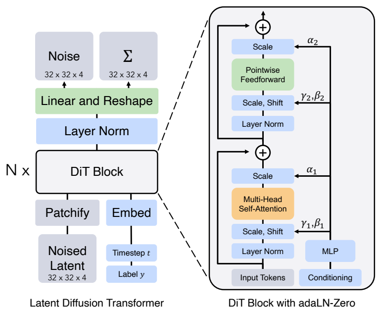


DiT 研究如何用 Transformer 承担扩散模型的去噪计算。图像先经冻结的 VAE 压缩为潜表示，再被切成小块，转换为带有空间位置的 token。每个扩散时刻，所有 token 通过自注意力交换信息，通过前馈网络加工特征；时间与类别向量则通过 adaLN-Zero 调整各层计算。网络最后将 token 还原为两组空间网格，分别预测噪声与反向方差参数，使用噪声误差和变分项联合训练。生成仍从潜空间噪声出发，结合 CFG 逐步去噪，最后经 VAE 解码成图像。实验的核心是比较深度、宽度和 patch 大小：参数更多或 token 更多都能改善质量，但也会增加计算成本。（由 GPT-6 总结）

**关键公式**

$$
z_t=\sqrt{\bar\alpha_t}\,z_0+\sqrt{1-\bar\alpha_t}\,\epsilon.
$$

$$
n=\frac{H}{p}\frac{W}{p},\qquad c=e_t+e_y.
$$

$$
\widetilde U=(1+\gamma)\odot\operatorname{LN}(U)+\beta.
$$

$$
\mathcal L_{\mathrm{hybrid}}=\mathcal L_{\mathrm{simple}}+\lambda\mathcal L_{\mathrm{vlb}}.
$$

$$
\hat\epsilon_s=\epsilon_u+s(\epsilon_c-\epsilon_u).
$$



### 1. 基本思路

在 [DDPM]() 中，扩散模型的核心任务是根据含噪状态和时间，预测加入的噪声。常用的去噪网络是 U-Net：先缩小空间尺寸、提取特征，再逐步放大，并通过跨层连接恢复细节。[LDM]() 把扩散过程移到压缩后的潜空间，降低了每次去噪的成本。

**Scalable Diffusion Models with Transformers** 接着研究：如果把 LDM 中的 U-Net 换成 Transformer，能否得到有效、适合扩展规模的去噪网络？论文将这种结构称为 **DiT（Diffusion Transformer）**。它保留加噪、噪声预测与逐步采样的任务设置，主要改变网络内部处理图像特征的方式。

与文本 Transformer 相比，输入和输出发生了变化。文本位置对应 token，图像位置则对应空间区域；文本模型可以预测词表中的下一个 token，DiT 要为当前含噪潜表示的每个位置预测连续数值。因此，需要先规定图像如何转成 token、时间和类别如何进入网络，以及输出怎样恢复为空间网格。

<figure class="ddpm-figure">
  
  <figcaption>DiT 的输入、条件与输出；来源：原论文 Figure 3 的整体结构</figcaption>
</figure>

图中从下向上是一次去噪预测的计算过程。DiT block 是可重复堆叠的 Transformer 层，左侧 $N\times$ 表示堆叠多层，右侧展开一层的内部结构。Transformer 接收当前时刻的含噪潜表示，时间和类别在各层参与计算，末端输出恢复为空间网格，再交给扩散采样公式使用。

### 2. 从图像到空间 token

#### 2.1 在潜空间中加噪

原始 DiT 使用预训练 **VAE（变分自编码器）** 的编码器与解码器。VAE 将图像压缩为连续的潜表示，并能将潜表示还原为图像；在训练 DiT 时，VAE 参数保持冻结，更新的是去噪网络。论文沿用 LDM 的预训练编码器，空间尺寸缩小 8 倍：

$$
x\in\mathbb R^{256\times256\times3}\ \longrightarrow\ z_0\in\mathbb R^{32\times32\times4}.
$$

每个空间位置的四个通道存放四个压缩特征分量，没有逐个对应 RGB 颜色的含义。这里的 $z_0$ 表示按既定尺度处理后的干净潜表示；官方实现对 VAE 采样出的潜变量乘以 $0.18215$，使它适合后续噪声日程。解码时做相反的尺度还原。

加噪公式与 DDPM 相同，只将作用对象换为 $z_0$：

$$
z_t=\sqrt{\bar\alpha_t}\,z_0+\sqrt{1-\bar\alpha_t}\,\epsilon.
$$

其中 $\bar\alpha_t$ 是截至时刻 $t$ 的累计信号保留比例，$\epsilon$ 是与潜表示同形状的标准高斯噪声。训练时，已知 $z_0$ 和采样的 $\epsilon$，便能直接得到任意时刻的 $z_t$。

#### 2.2 Patchify 与位置编码

Transformer 需要一串等宽向量，因此先把 $H\times W\times C$ 的潜表示划分为互不重叠的 $p\times p$ 小块。**Patchify** 就是这一步切分与映射：每块包含 $p^2C$ 个数，将其展开，再用同一组线性参数映射成宽度为 $d$ 的向量。得到的 token 数为：

$$
n=(H/p)(W/p),\qquad p^2C\longrightarrow d.
$$

对于 $32\times32\times4$ 的潜表示，$p=2$ 时，每块含 $2\times2\times4=16$ 个数，共有 $16\times16=256$ 个 token。每个 token 表示一个小区域的当前特征，整串 token 共同覆盖完整空间。代码可用卷积核与步长都为 $p$ 的卷积完成相同操作，因为各块共享线性映射参数。

切分只保留了一个固定排列，还需要让网络在计算中识别二维位置。DiT 为每个 token 加上固定的二维正弦余弦位置编码，分别记录所在的行与列，再组成宽度为 $d$ 的位置向量。第 $i$ 个 token 的初始表示可写为：

$$
u_i=\operatorname{Linear}(\operatorname{vec}(P_i))+\operatorname{PE}(r_i,c_i).
$$

$P_i$ 是第 $i$ 块，$r_i,c_i$ 是其行列坐标，$\operatorname{vec}$ 表示展开。位置编码与块特征宽度一致，因此可以相加。完成这一步后，网络既有区域内容，也有空间位置；这些位置向量固定生成，映射图像内容的参数则随训练更新。

### 3. 条件怎样影响 Transformer

#### 3.1 空间、时间与类别

空间位置告诉网络“这块在哪里”，但同一个区域还需要不同信息。噪声很强时，网络主要依赖整体分布判断可能的图像结构；噪声较弱时，可以更多利用已经显现的细节。因此，网络必须知道当前扩散时刻 $t$。原论文又研究 ImageNet 类别条件生成，需要类别 $y$ 指定要生成的对象。

三种信息分别进入网络：空间编码加到 token 上；时间先转成正弦余弦特征，再经小型前馈网络得到 $e_t$；类别编号从可学习的类别参数表中取出 $e_y$。时间和类别向量均为 $d$ 维，相加得到条件向量：

$$
c=e_t+e_y.
$$

同一幅含噪潜表示的所有空间 token 共用这份条件，但保有各自的内容与位置。类别参数表随训练学习如何表达类别；时间网络学习如何将噪声程度转成适合调节去噪计算的特征。

#### 3.2 从 LayerNorm 到 adaLN-Zero

一个 DiT block 包含多头自注意力与前馈网络，两者前面都有 LayerNorm，后面都有残差连接。自注意力让不同区域交换信息，前馈网络则在每个 token 内加工特征，其隐藏宽度设为 $4d$，使用 GELU 激活函数引入非线性。多层堆叠使网络能够反复结合全图信息，修正各区域的去噪特征。

去噪需要这种空间联系：一个区域中的轮廓、颜色和纹理，应当与其他区域属于同一个合理图像。自注意力根据当前特征计算区域之间的读取权重，将相关信息汇总到每个 token 中。后续层在更新后的特征上重新计算关系，使最终预测同时依赖局部状态与全图结构。哪些关系有助于去噪，由训练损失共同决定。

**LayerNorm** 对每个 token 的 $d$ 个分量计算均值与方差，调整其数值尺度。标准形式还带有可学习的逐通道缩放与偏移，且这组参数对所有样本相同。DiT 使用 **adaLN（adaptive LayerNorm，自适应层归一化）**：归一化后的缩放与偏移由条件向量 $c$ 生成，因此会随时间和类别改变：

$$
\operatorname{adaLN}(U,c)=(1+\gamma)\odot\operatorname{LN}(U)+\beta.
$$

$U\in\mathbb R^{n\times d}$ 是整串 token，$\gamma,\beta\in\mathbb R^d$ 是条件网络输出的缩放增量与偏移。它们沿 token 维广播，即同一通道在不同位置使用相同的调节参数。各位置的输入特征不同，调节后的结果也不同。这样，时间和类别可以改变哪些通道应被加强、减弱或整体平移，并进一步影响注意力匹配和前馈计算。

**adaLN-Zero** 在此基础上增加逐通道的残差门控。一个 block 根据 $c$ 输出六组向量：注意力和前馈分支各有缩放、偏移与门控，计算依次为：

$$
U'=U+g_A\odot\operatorname{MSA}\!\left(\operatorname{adaLN}_A(U,c)\right).
$$

$$
U''=U'+g_F\odot\operatorname{FFN}\!\left(\operatorname{adaLN}_F(U',c)\right).
$$

MSA 表示多头自注意力；$g_A,g_F\in\mathbb R^d$ 控制各通道写入残差更新的强度。两条分支分别有自己的调节参数，每层也有各自的条件映射参数。通过这些门控，模型可以依据噪声程度与目标类别，调整每层向现有表示加入多少更新。

“Zero” 指条件映射最后一层的权重与偏置初始化为零，使初始的 $\gamma,\beta,g_A,g_F$ 都为零。此时 adaLN 退化为普通的无仿射 LayerNorm，两个残差分支因门控为零而暂时不写入更新，**每个 block 在初始化时满足 $U''=U$**。随着门控参数开始学习，各层逐步参与特征修正。这给深层网络提供了一个受控的起点。

这一恒等关系只涉及 block 的残差结构。输入仍经过 patch 映射，末端仍经过输出层；官方实现还将最终输出投影初始化为零，所以整个网络的初始预测为零。

<figure class="ddpm-figure">
  
  <figcaption>条件注入方式的比较；来源：原论文 Figure 5</figcaption>
</figure>

图中横轴是训练更新次数，纵轴 FID 衡量生成分布与真实分布的差异，数值越低越好。四条曲线比较将条件作为额外 token、使用交叉注意力、adaLN 和 adaLN-Zero。相同训练阶段下，adaLN-Zero 的 FID 最低，论文后续规模实验采用这一结构：自注意力处理空间关系，adaLN-Zero 接收时间与类别条件。

### 4. 输出与训练

经过多层 block 后，每个 token 仍是一个 $d$ 维特征向量。末端先使用受条件调节的 LayerNorm，再把每个 token 线性映射为 $2p^2C$ 个数：

$$
\mathbb R^{n\times d}\ \longrightarrow\ \mathbb R^{n\times2p^2C}\ \longrightarrow\ \mathbb R^{H\times W\times2C}.
$$

最后一步称为 **unpatchify**：将每个输出向量按其块内位置还原为 $p\times p$ 网格，再按照原来的行列顺序拼回完整空间。这只是确定的重排，学习发生在前面的网络与输出投影中。

输出通道分成两组，各有 $C$ 个通道。一组是噪声预测 $\epsilon_\theta(z_t,t,y)$，与真实噪声形状相同；另一组是反向方差的参数，用于确定这一步采样时加入随机扰动的尺度。以 $p=2,C=4$ 为例，每个 token 输出 $32$ 个数，最终恢复为两组 $32\times32\times4$ 网格。

噪声预测部分沿用熟悉的平方误差：

$$
\mathcal L_{\mathrm{simple}}=\mathbb E\!\left[\|\epsilon-\epsilon_\theta(z_t,t,y)\|^2\right].
$$

DiT 同时学习反向方差，因此原论文使用来自 Improved DDPM 的混合目标：

$$
\mathcal L_{\mathrm{hybrid}}=\mathcal L_{\mathrm{simple}}+\lambda\mathcal L_{\mathrm{vlb}}.
$$

$\mathcal L_{\mathrm{vlb}}$ 是负变分下界中的可训练项，约束网络给出的反向高斯分布与训练时可计算的后验分布。噪声预测决定反向均值，方差预测决定分布的宽窄；仅比较噪声误差无法训练后一部分。在计算变分项时，对噪声预测停止梯度，让这一项主要训练方差分支；噪声分支继续由平方误差直接训练。$\lambda$ 表示两项的相对权重，具体实现还涉及逐时刻、逐分量的平均约定。

官方代码用网络的第二组输出生成插值系数，在后验方差与前向噪声方差的对数之间插值，再取指数得到正方差。这样的参数化为方差学习提供了合适的参考尺度，实际网络输出的是构造方差所需的参数。

一次训练更新可按以下顺序理解：

1. 取图像与类别 $y$，通过冻结的 VAE 得到 $z_0$。
2. 随机采样时刻 $t$ 和噪声 $\epsilon$，构造 $z_t$。
3. 将 $z_t,t,y$ 输入 DiT，同时得到噪声与方差参数。
4. 计算混合损失，反向传播并更新 DiT 参数。

一次训练不必生成完整的去噪链。每幅图像在本次更新中只随机抽取一个时刻，下次又可以抽到其他时刻；同一批次的不同图像也可以处于不同噪声程度。经过许多次更新，同一个网络逐渐学会整个时间范围内的预测任务，时间条件使它能够区分这些任务。训练标签中的噪声来自刚才的随机采样，因而无需额外人工标注。

原论文采用 1000 步线性噪声日程，训练批次大小为 256，AdamW 学习率固定为 $10^{-4}$，并使用参数的指数移动平均（EMA）模型评估。EMA 将历次训练参数平滑累积，减少单次更新波动对生成结果的影响。

### 5. 类别条件生成与 CFG

为支持 [CFG]()，训练时以一定概率将真实类别替换为一个可学习的空类别 $\varnothing$。官方配置的丢弃概率为 $10\%$。空类别有自己的一行参数，模型因而能在同一套网络内学习有类别和无类别两种预测。

生成时，从与目标潜表示同形状的高斯噪声 $z_T$ 出发。每个采样时刻分别计算条件与空类别的噪声预测，再按引导尺度 $s$ 组合：

$$
\hat\epsilon_s=\epsilon_u+s(\epsilon_c-\epsilon_u).
$$

$\epsilon_c=\epsilon_\theta(z_t,t,y)$ 是类别条件预测，$\epsilon_u=\epsilon_\theta(z_t,t,\varnothing)$ 是空类别预测。$s=1$ 使用普通类别条件预测；更大的 $s$ 加强相对于无条件预测的偏移，通常增强类别一致性，也可能减少多样性。采样器用组合后的预测构造反向更新，得到下一份更清晰的潜表示，直到 $z_0$，最后交给 VAE 解码器还原图像。

在 DDPM 采样中，噪声预测先转换成反向均值，再结合网络给出的方差采样下一状态。均值规定本步更新的中心，方差规定围绕这一中心的随机变化；这也解释了训练时为何需要两组输出。整个生成过程中复用同一份 DiT 参数，随步骤改变的是含噪状态与时间输入，类别条件则保持为目标类别。

每次调用网络，全部空间 token 共同参与计算，并同时输出完整网格的预测。生成的先后顺序发生在扩散时刻之间：$z_T\to z_{t_1}\to\cdots\to z_0$。图像块之间没有像语言模型那样依次生成下一个 token 的顺序，也不使用阻止未来空间位置可见的因果遮罩。

DiT 指定去噪网络，采样器指定如何利用网络输出。改变采样步数或采用 DDIM 等更新方式，需要按相应规则使用预测；这些选择与 Transformer 主干可以分别讨论。评估速度时也要同时考虑每次网络调用的成本、采样步数，以及 CFG 通常需要的两份预测。

### 6. 规模与实验结果

论文同时改变模型规模和 token 数量。**DiT-XL/2** 中，XL 表示一组深度与宽度配置，`/2` 表示潜空间 patch 边长为 2。XL 配置有 28 个 block，表示宽度为 1152，注意力头数为 16；它的命名没有包含采样步数。

| 配置 | block 数量 | 表示宽度 | 注意力头数 |
| --- | ---: | ---: | ---: |
| DiT-S | 12 | 384 | 6 |
| DiT-B | 12 | 768 | 12 |
| DiT-L | 24 | 1024 | 16 |
| DiT-XL | 28 | 1152 | 16 |

每种配置又分别使用 $p=8,4,2$，共得到 12 个模型。对于 $32\times32$ 的潜空间，对应的 token 数为 16、64、256。减小 patch 让网络以更细的空间单位交换信息；它主要改变序列长度，主体 block 的参数规模基本相同。

计算量却会明显变化。前馈与线性投影随 token 数近似线性增长，自注意力的分数矩阵则有 $n\times n$ 个元素。patch 边长减半时，token 数变为四倍，注意力分数计算部分约变为十六倍；整个 block 还包含其他运算，因此总计算量按各部分共同变化。

<figure class="ddpm-figure">
  
  <figcaption>模型规模、token 数与生成质量；来源：原论文 Figure 6</figcaption>
</figure>

上排每张图固定 patch 大小，比较 S、B、L、XL；下排每张图固定模型规模，比较 patch 大小。横轴是训练更新次数，曲线不使用 CFG。论文在 ImageNet $256\times256$ 上观察到，增加深度、宽度或 token 数，都能降低 FID。这里使用 5 万张生成图像计算 **FID-50K**；指标比较图像特征分布，越低表示这些统计特征越接近。

DiT-XL/2 约有 675M 个参数，一次去噪前向约需 118.64 GFLOPs，即约 1186 亿次浮点运算；两者均不包含 VAE。这是网络单次调用的计算量，完整生成还需要重复采样。更高的每步计算量在这些实验中对应更好的质量，说明参数数量与计算量需要结合 token 数一起观察。

论文进一步将 $256\times256$ 的 DiT-XL/2 训练至约 700 万次更新。Table 2 使用 250 步 DDPM 采样与 ft-EMA VAE 解码器，报告以下结果：

| CFG 尺度 | FID-50K |
| --- | ---: |
| 无 CFG（$s=1$） | 9.62 |
| $s=1.25$ | 3.22 |
| $s=1.50$ | **2.27** |

原论文这组引导实验只对前 3 个潜通道应用 CFG。附录说明，对全部 4 个通道引导并调整尺度也能得到相近结果；复现表中数字时应使用对应的通道与尺度设置。与上面的短训练曲线相比，2.27 同时包含更长训练与引导采样的收益。

论文还将 $512\times512$ 的模型训练至 300 万次更新。此时潜空间为 $64\times64\times4$，$p=2$ 对应 1024 个 token，单次前向为 524.60 GFLOPs。Table 3 在相同 250 步采样下报告无 CFG 的 FID 为 12.03，$s=1.5$ 时为 3.04。

### 7. 联系与局限

沿着前面的学习路径，几项改动各有明确位置：DDPM 建立加噪与反向学习；DDIM 研究怎样减少采样更新次数；CFG 组合有条件和无条件预测；LDM 选择扩散所在的压缩表示；DiT 则研究承担去噪预测的网络结构。把这些问题分开，就能理解为何同一个生成系统可以同时采用其中多项设计。

DiT 的优势是结构统一，深度、宽度和空间粒度都有清楚的扩展方式。成本也相应增加：高分辨率或更小 patch 带来更多 token，自注意力的空间交互开销随之增长；逐步去噪仍需多次运行网络，VAE 的压缩与重建质量也会影响最终图像。

原论文的主要结果来自 **ImageNet 类别条件生成**，条件是单个类别编号。文本到图像需要处理长度可变、含有多种关系的文本表示，条件注入方式也需要进一步设计。后来的 SD3/MMDiT 等模型继续发展了图像与文本的联合处理结构；理解原始 DiT 时，先把握“潜空间 token、条件调节、完整网格预测”这条主线，就能为后续多模态扩散模型建立基础。

### 参考资料

1. William Peebles, Saining Xie. *Scalable Diffusion Models with Transformers*. ICCV 2023. [arXiv:2212.09748](https://arxiv.org/abs/2212.09748)。模型结构见 §3，实验设置见 §4，条件注入与规模实验见 §5；最终 ImageNet 结果见 Table 2、3，通道引导与解码器设置见附录 A、D。本文图片依次裁自 Figure 3、5、6。
2. Meta AI. *DiT 官方代码*. [GitHub](https://github.com/facebookresearch/DiT)。`models.py` 包含 patch 映射、adaLN-Zero、输出重排与模型配置；`train.py` 和 `diffusion/` 包含潜变量缩放、噪声日程与混合训练目标。
3. William Peebles. *DiT 项目主页*. [作者说明](https://www.wpeebles.com/DiT)。展示不同模型规模、patch 大小和生成计算量的比较。
4. Nichol, Dhariwal. *Improved Denoising Diffusion Probabilistic Models*. ICML 2021. [arXiv:2102.09672](https://arxiv.org/abs/2102.09672)。学习反向方差与混合训练目标的来源。
