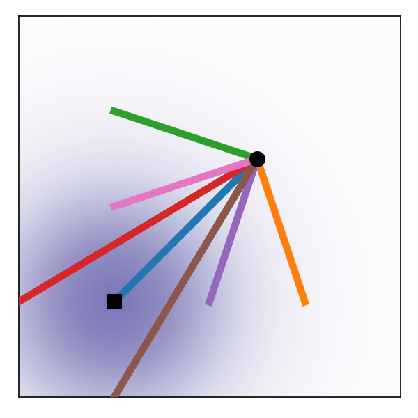
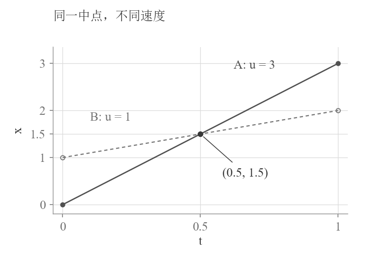
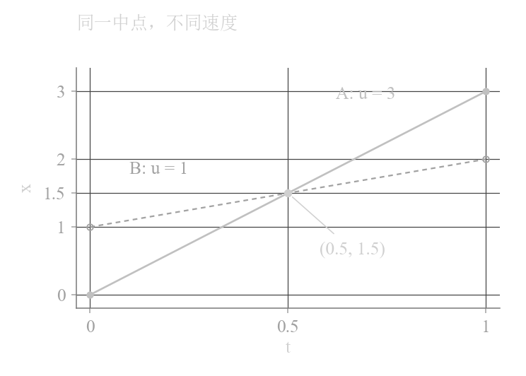
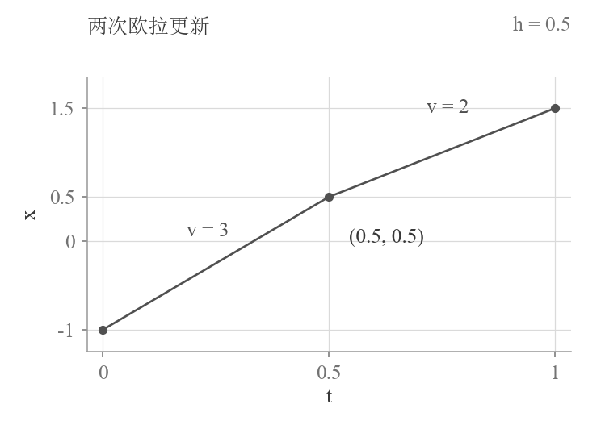
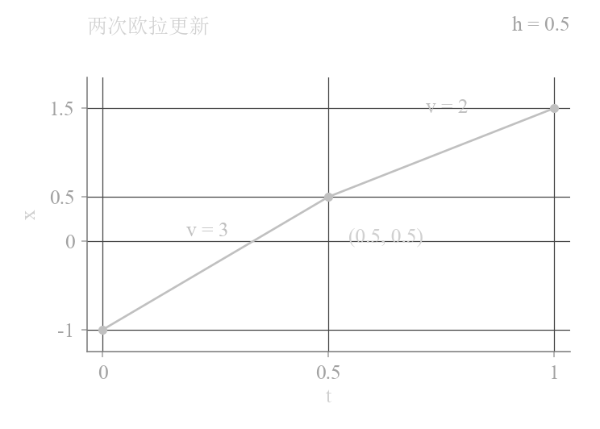


Flow Matching 直接训练网络预测状态随时间变化的速度。训练时，先把一份噪声与一张真实图像放到预先选定的路径上，再随机取一个时刻，算出当前位置和对应速度，用平方误差监督网络。路径上的状态有显式公式，因此每个训练样本只需一次预测，无需先模拟完整生成过程。生成时，从新噪声出发，反复调用速度网络，用数值积分走到数据一端。原论文的高斯最优传输路径把噪声与真实图像附近的小噪声终点配成直线；网络汇总这些条件速度，学习把整个噪声分布变成接近数据的分布。（由 GPT-6 总结）

**关键公式**

$$
\sigma_t=1-(1-\sigma_{\min})t,\qquad x_t=\sigma_t\epsilon+ty.
$$

$$
\mathcal L_{\mathrm{CFM}}=\mathbb E_{t,y,\epsilon}\!\left[\|v_\theta(x_t,t)-(y-(1-\sigma_{\min})\epsilon)\|^2\right].
$$

$$
u_t(x)=\mathbb E[u_t(x\mid Y)\mid X_t=x].
$$

$$
\frac{dx_t}{dt}=v_\theta(x_t,t),\qquad x_0\sim\mathcal N(0,I).
$$



### 1. 基本思路

给一份高斯噪声，让它一点点变成图像。若网络能直接给出各像素此刻该往哪个方向变化、变化多快，采样器就可以按速度走一小段，再到新位置接着问。这就是常微分方程（ODE）生成：同一个速度场接收当前位置和时刻，负责把一批随机起点带到符合数据分布的终点。

难点是怎样教网络这份速度。[DDPM](/papers/ddpm/) 可以自己给图像加噪，因而知道噪声预测的答案；只有图像与噪声两个分布时，训练集里却没有写着“在这里往哪走”。一种做法是算出当前模型给真实图像分配的密度，再用这份误差更新参数；但一次密度计算要沿当前模型定义的速度场做一遍数值积分。

Yaron Lipman 等人的 **Flow Matching for Generative Modeling**（ICLR 2023）希望像 DDPM 那样，随机选一个时刻就能算出训练输入和标签。做法是先固定一张训练图，设计一群通往这张图附近的路径。给定起点和时刻，路径规定了当前状态，它在这一点的导数就是速度标签。真正生成时没有指定要到哪一张图，因此还得解决第二个问题：怎样把各张图给出的局部速度合成一个只看当前状态和时刻的速度场，让一整批噪声走到目标分布。

生成时间从 **$t=0$ 的噪声端走向 $t=1$ 的数据端**。目标图像记为 $y$，噪声记为 $\epsilon$，中间状态记为 $x_t$，网络输出记为 $v_\theta(x_t,t)$，$\theta$ 是训练中更新的网络参数。速度与 $x_t$ 同形状，每个分量对应一个像素通道的变化率。

> [!Note] **速度场与求解器**
> 速度场像一个随位置和时间查询的函数：传入当前状态 $x_t$ 和时刻 $t$，取回此刻的速度。常微分方程把这个速度定义成轨迹的导数。要知道一段时间后走到哪里，求解器需要累积这段时间内的速度。第 5 节的欧拉法先用“当前速度乘一小段时间”近似位移，再从新位置重新算；一次网络调用只给当前速度，整条轨迹由求解器接起来。

### 2. 构造训练路径

#### 2.1 高斯路径

固定一张目标图像 $y\in\mathbb R^d$ 后，先给路径的两端定要求：起点应和其他目标共用同一个标准高斯，终点则集中在这张图像附近。用高斯连接两端，只需把中心从零移到 $y$，同时把噪声的标准差从 1 缩小。论文让均值和标准差都随时间线性变化。设 $d$ 为像素通道总数，$I$ 为 $d$ 维单位矩阵，抽取标准高斯噪声 $\epsilon\sim\mathcal N(0,I)$ 后，任一时刻的状态直接写成：

$$
x_t=\sigma_t\epsilon+ty,\qquad \sigma_t=1-(1-\sigma_{\min})t.
$$

$0<\sigma_{\min}<1$ 是预先选定的终点标准差，也是整条路径上条件标准差的最小值。$t$ 从 0 增至 1 时，目标图像的系数从 0 增至 1，噪声的系数从 1 降至 $\sigma_{\min}$，所以 $x_0=\epsilon$、$x_1=y+\sigma_{\min}\epsilon$。若把噪声压到零，这张图对应的所有轨迹都会收拢到同一个点，该条件分布在终点便没有通常意义下的密度。保留一点噪声让终点仍是可用高斯密度描述的一小片区域。

固定 $y$、反复抽取噪声，在某个时刻得到的状态服从：

$$
p_t(x\mid y)=\mathcal N(ty,\sigma_t^2I).
$$

这就是**条件概率路径**：它描述同一目标图像对应的一群状态，怎样从标准高斯逐渐移动、收缩到目标附近。若再从训练分布抽取不同的 $y$，就会得到整批图像共同对应的状态分布。

讨论一条轨迹时，要固定同一次抽到的 $\epsilon$ 和 $y$，只改变 $t$。这样才有一条可以求导的连续路径。训练的不同样本则会重新抽取噪声、图像和时刻；直接采到的单个中间状态，相当于从这些连续路径中随机截取的一点。

#### 2.2 速度标签

训练只需知道随机时刻那一点的速度。固定刚抽到的 $\epsilon,y$，在相邻时刻 $t$ 和 $t+h$ 比较：目标项增加了 $hy$，噪声项减少了 $h(1-\sigma_{\min})\epsilon$。用总变化除以 $h$，就得到沿线速度：

$$
\frac{dx_t}{dt}=y-(1-\sigma_{\min})\epsilon.
$$

这个结果与 $t$ 无关，所以沿该条轨迹速度恒定。只要知道刚抽到的两端，就能直接给出标签。

也可以把速度写成当前状态 $x$ 的函数。从路径公式解出 $\epsilon=(x-ty)/\sigma_t$，代入得到：

$$
u_t(x\mid y)=\frac{y-(1-\sigma_{\min})x}{1-(1-\sigma_{\min})t}.
$$

$u_t(x\mid y)$ 表示在已知目标 $y$ 的条件下，处于位置 $x$ 的状态应采用什么速度。把实际构造的 $x_t$ 代入，它就等于上面的常量标签。前一个公式方便训练，后一个公式方便讨论速度场和分布。

论文把这种构造称为**最优传输（Optimal Transport，OT）条件路径**。固定 $y$ 后，两个高斯的中心和尺度已经确定，但仍要选定每个起点去往哪里。把初始噪声向量缩小再平移，即令 $T_y(\epsilon)=y+\sigma_{\min}\epsilon$，就能得到目标高斯；相对于各自的中心，两个端点还保持同一个方向。在两端各自的方差固定时，降低平均平方位移等价于增大两端去掉均值后的平均点积；这两个同比例、同方向的向量恰好达到上界。因此用同一份 $\epsilon$ 配出两端 $\bigl(\epsilon,T_y(\epsilon)\bigr)$，再沿直线走：

$$
(1-t)\epsilon+tT_y(\epsilon)=\sigma_t\epsilon+ty.
$$

两端之差就是速度标签 $y-(1-\sigma_{\min})\epsilon$，中间状态则回到了上一节的高斯公式。这里最小化的平均平方位移是针对固定 $y$ 的两个条件高斯；生成时面对的是许多目标混在一起的情形。

<figure class="ddpm-figure">
  
  <figcaption>最优传输条件轨迹；来源：原论文 Figure 3 右图，<a href="https://arxiv.org/html/2210.02747v2/figures/2d_traj/2d_traj_ot.png">arXiv 原始图文件</a></figcaption>
</figure>

从任一线段的外端向共同的目标看：换一个噪声起点，线段的长度和方向会变；沿同一条线前进，速度保持不变。图里固定了目标，下一节再看把不同目标放到一起训练时，网络会学到什么。

#### 2.3 一次训练

现在可以构造一次完整的监督。独立抽取真实图像 $y$、标准高斯噪声 $\epsilon$ 与均匀时刻 $t\sim U[0,1]$；用路径公式计算输入 $x_t$，用两端之差计算速度标签，再让网络预测 $v_\theta(x_t,t)$。这是**条件流匹配**（Conditional Flow Matching，CFM）的训练损失：

$$
\mathcal L_{\mathrm{CFM}}=\mathbb E_{t,y,\epsilon}\!\left[\|v_\theta(x_t,t)-(y-(1-\sigma_{\min})\epsilon)\|^2\right].
$$

**网络输入只有 $x_t,t$，输出是与 $x_t$ 同形状的速度。** 真实目标 $y$ 和噪声 $\epsilon$ 用于构造输入与标签；预测速度与标签之间的平方误差通过反向传播更新 $\theta$。这里的条件指构造监督时已知目标 $y$，后面再讨论类别、低分辨率图像等生成条件。

每个训练样本只取路径上的一个时刻，$x_t$ 由显式公式直接得到。即使网络刚开始训练、它自己的轨迹还走不到真实图像附近，也能在路径上的任意时刻拿到监督。这就是论文所说的**无需模拟轨迹的训练（simulation-free training）**：参数更新用的是预先设计的路径，无需先用当前网络从 $x_0$ 数值积分到 $t$。

原论文使用带时间输入的 U-Net，把当前状态和时刻映射成同形状的速度。也可以换用 DiT 等网络；流匹配规定的是输入、速度标签和训练损失，具体网络负责实现这个预测函数。

### 3. 从条件到整体

#### 3.1 边缘速度

如果把目标图像 $y$ 也交给网络，预测速度会简单得多，但生成时就得先知道要生成哪张图。网络必须只凭当前状态与时刻给出可用的更新，而同一个带噪状态可能来自多张图，标签随之不同。此时要匹配的是这个位置上所有样本的总体流动：多个去向一样常见就平等考虑，一条条件路径在这里出现得多，就让它的速度占更大比重。

将数据分布记为 $q(y)$，随机抽到的目标记为 $Y$，对应的随机状态记为 $X_t$；$y,x$ 表示它们的具体取值。汇总所有目标的条件路径，得到时刻 $t$ 的边缘密度：

$$
p_t(x)=\int p_t(x\mid y)q(y)\,dy.
$$

在某个位置 $x$，可以把 $p_t(x\mid y)q(y)$ 理解成目标 $y$ 对这一带样本的贡献：$q(y)$ 高，表示这类目标本来就多；$p_t(x\mid y)$ 高，表示它们的路径常常经过这里。把这些贡献除以该处的总密度 $p_t(x)$，就得到各目标在当前位置所占的比例。贝叶斯公式写成：

$$
q_t(y\mid x)=\frac{p_t(x\mid y)q(y)}{p_t(x)}.
$$

用这些权重对条件速度求平均，就得到论文构造的**边缘速度场**。这里的“边缘”指已经对所有目标 $y$ 求过平均，速度只依赖当前状态和时刻：

$$
u_t(x)=\int u_t(x\mid y)q_t(y\mid x)\,dy=\mathbb E[u_t(x\mid Y)\mid X_t=x].
$$

在不同目标的条件分布重叠的区域，多个目标都会对局部速度作出贡献。生成沿这个平均速度移动后，新的位置和时刻又会改变各目标的权重，下一次预测的方向也可能随之改变。因此，组成监督的条件轨迹都是直线，生成时沿边缘速度走出的轨迹却可以弯曲。哪些噪声起点最终走向哪些数据区域，由沿途的整个速度场决定。

#### 3.2 目标等价

如果能直接算出边缘速度，最自然的流匹配目标是：

$$
\mathcal L_{\mathrm{FM}}=\mathbb E_{t,X_t\sim p_t}\!\left[\|v_\theta(X_t,t)-u_t(X_t)\|^2\right].
$$

可是为一个输入直接算出 $u_t(x)$，就要知道有哪些目标能产生这个状态、各自多常见。即使用训练集近似，也得拿这个状态与大量图像逐个比较。条件流匹配只取一张图、一份噪声，算出一条线上的标签。它能代替整体标签，靠的是平方误差恰好以条件均值为最优值。

记 $U=u_t(X_t\mid Y)$。固定输入 $X_t,t$ 后，网络输出 $v$ 也就固定了，而标签 $U$ 仍可变化。把它的条件均值简记为 $\bar u=u_t(X_t)$。将误差写成 $v-U=(v-\bar u)+(\bar u-U)$，因为后一项的条件均值为零，平方展开后的交叉项也平均为零。在这个输入下就有：

$$
\mathbb E\|v-U\|^2=\|v-\bar u\|^2+\mathbb E\|U-\bar u\|^2.
$$

再对状态和时刻取平均，左边成为条件流匹配损失，右边第一项成为边缘流匹配损失。最后一项只反映标签本身的波动，与网络参数无关。因此两种损失相差一个常数，对参数求导时得到原论文定理 2 的结论：

$$
\nabla_\theta\mathcal L_{\mathrm{CFM}}=\nabla_\theta\mathcal L_{\mathrm{FM}}.
$$

这个等价也可以从一次参数更新来看。固定输入时，单个标签给网络输出的梯度是 $2(v-U)$；对可能的标签取条件平均，恰好得到 $2(v-\bar u)$，也就是直接回归边缘速度的梯度。再经过同一个网络的链式法则，两者传回参数的平均梯度仍然相同。因此，无需先收集同一位置的许多标签并显式求平均，随机抽取一个条件标签，就能为边缘目标提供无偏的随机梯度。

两种总体损失相差一个与参数无关的常数，所以对同一个网络函数族，它们的最优参数集合也相同。若网络有足够表达能力，最优输出就是 $u_t(x)$；容量有限时，两种目标也会选择同一函数族里最接近它的速度场。不同终点带来的标签波动仍留在条件回归损失里，因此准确的边缘速度也可能对应非零训练误差。

#### 3.3 概率守恒

前两节说明网络会学到什么。还需要确认按这个速度走，整批样本真的会经过我们设计的中间分布。固定一个很小的区域来看：概率增加多少，取决于有多少样本从边界进来、多少出去。边界处，沿同一方向的样本越密、速度越快，穿过去的概率就越多。密度 $p_t$ 与速度 $u_t$ 的这种关系写作**连续性方程**：

$$
\frac{\partial p_t(x)}{\partial t}+\nabla_x\cdot\bigl(p_t(x)u_t(x)\bigr)=0.
$$

> [!Note] **怎样读概率通量**
> 把每张图像的所有像素排成一个向量，它在状态空间里就是一个点。$p_t(x)$ 越大，许多独立生成的样本就越容易落在 $x$ 附近。$p_tu_t$ 是概率通量，表示样本密度乘以移动速度。以一维为例，把向右的通量记为正，左端的通量减去右端的通量，就是区间内的概率增长率。多维里的散度 $\nabla_x\cdot$ 同样是在计算向外的净流出。

固定一张目标图时，每个状态都沿它自己的条件轨迹移动。这些轨迹在任一时刻形成的密度就是 $p_t(x\mid y)$，所以这群样本的密度和速度也满足同样的守恒关系。把各组按 $q(y)$ 汇总，得到总密度 $p_t(x)$ 和各组通量之和。再把第 3.1 节的边缘速度乘以 $p_t(x)$，贝叶斯权重里的分母恰好消去：

$$
p_t(x)u_t(x)=\int p_t(x\mid y)u_t(x\mid y)q(y)\,dy.
$$

等式左边让当前位置的样本统一沿平均速度走，右边则让不同目标对应的样本分别走。比如两组样本在一处以相同的速度大小和密度朝相反方向通过，净通量就是零；把它们替换成同等总密度、速度为零的一组，净通量仍是零。**个体走法可以不同，但每个区域内的概率随时间变化的速率相同。** 这就是原论文定理 1 用通量把条件路径与生成 ODE 接起来的原因。

接下来才轮到采样 ODE。设从 $p_0$ 抽取许多起点，每个点都按 $dx_t/dt=u_t(x_t)$ 移动，移动后形成的密度记为 $\rho_t$。粒子的这种运动本身也满足连续性方程：它使用同一个速度 $u_t$，初始密度也是 $\rho_0=p_0$。当速度场足够光滑、相应流与密度演化唯一时，$\rho_t$ 就与设计的 $p_t$ 相同。这样，条件路径的代数构造才真正接到了“抽取噪声并运行 ODE”的生成程序上。

每个生成样本只需要查询当前位置的边缘速度。它可以在不同条件路径之间汇成的速度场中穿行；保持的是整批样本在各时刻的密度，具体起点与终点的对应关系由这个 ODE 建立。

在 $t=0$，所有条件分布都是同一个标准高斯；在 $t=1$，每个分布都集中在各自图像附近。最终的边缘分布为：

$$
p_1(x)=\int\mathcal N(x;y,\sigma_{\min}^2I)q(y)\,dy.
$$

它是数据分布与小高斯的卷积。$\sigma_{\min}$ 越小，设计的终点越接近原始数据；网络拟合和数值采样则负责尽量实现这条设计好的路径。

### 4. 其他路径

#### 4.1 一般高斯

条件路径的两端决定从哪种噪声出发、最后到达什么分布；中途的安排决定网络会看到哪些输入、速度如何变化。想检验直线路径是否更容易采样，就可以在同一套速度回归目标下比较直线路径和 DDPM 的扩散路径。两种路径都可写成条件高斯：固定目标 $y$，选择可微的均值 $\mu_t(y)$ 与正标准差 $\sigma_t(y)$，任一时刻的状态为：

$$
x_t=\mu_t(y)+\sigma_t(y)\epsilon.
$$

直接求导，训练速度标签是 $\dot\mu_t(y)+\dot\sigma_t(y)\epsilon$。再用 $\epsilon=(x-\mu_t(y))/\sigma_t(y)$ 消去噪声，得到：

$$
u_t(x\mid y)=\dot\mu_t(y)+\frac{\dot\sigma_t(y)}{\sigma_t(y)}(x-\mu_t(y)).
$$

点号表示对时间求导。第一项移动分布中心，第二项使状态相对中心收缩或扩张。原论文定理 3 证明，这个速度场产生所指定的高斯路径。训练仍然只需抽取 $y,\epsilon,t$，计算显式状态与速度。

选择 $\mu_t=ty$、$\sigma_t=1-(1-\sigma_{\min})t$，就回到前面的条件最优传输路径。也可以选择扩散模型采用的信号与噪声系数，把已有扩散路径纳入同一个训练框架。

选择这些函数时还要检查两端。若要从同一个标准高斯开始，就应让所有目标都满足 $\mu_0(y)=0$、$\sigma_0(y)=1$；若要到达数据附近，则令 $\mu_1(y)=y$、$\sigma_1(y)$ 很小。中间怎样移动和收缩决定了网络要在哪些状态上学习、标签会怎样随时间变化，而端点条件决定了生成任务本身。

#### 4.2 联系扩散

将 DDPM 的带噪状态按本文时间方向重写为：

$$
x_t=a_ty+b_t\epsilon.
$$

$a_t$ 随生成时间增加而增大，$b_t$ 相应减小；保方差扩散的信号、噪声系数满足 $a_t^2+b_t^2=1$。同一个带噪状态可以给两种标签：DDPM 回归噪声 $\epsilon$，流匹配回归路径导数 $\dot a_ty+\dot b_t\epsilon$。两种网络都只看到状态和时刻，平方误差所学的是各自标签在这个输入下的条件均值。

在 $a_t>0$ 的时刻，先由 $y=(x_t-b_t\epsilon)/a_t$ 消去目标图像，再对给定状态的噪声取条件均值，便有：

$$
u_t(x)=\frac{\dot a_t}{a_t}x+\left(\dot b_t-\frac{\dot a_tb_t}{a_t}\right)\mathbb E[\epsilon\mid X_t=x].
$$

因此，同一路径下的噪声预测和速度预测存在具体的系数换算。原论文还说明，对常见的保方差、增方差扩散路径，这样构造的边缘速度与相应的概率流 ODE 一致（§4.1、附录 D）。Flow Matching 由此可以直接训练扩散路径的生成速度。

这也解释了为何同一路径上仍值得比较两种训练目标。上面的系数随时间变化，噪声预测中的同样大小误差，换成速度后会在不同时刻被放大或缩小。直接回归速度改变了误差进入优化的方式；有限容量网络与有限训练计算下，最后学到的速度场及其数值求解成本就可能不同。

选择路径和选择监督目标是两件事。使用扩散路径，也可以训练速度；使用前面的线性高斯路径，则同时改变了中间分布和回归标签。后面的实验分别比较这两种改变。与 [DDIM](/papers/ddim/) 一样，生成可以由确定性规则驱动；Flow Matching 进一步给出了直接学习连续速度场的办法。

### 5. 生成与积分

#### 5.1 欧拉更新

训练完成后，固定网络参数，抽取新的 $x_0\sim\mathcal N(0,I)$，求解：

$$
\frac{dx_t}{dt}=v_\theta(x_t,t),\qquad 0\leq t\leq1.
$$

第 3 节的 $u_t$ 是理想边缘速度，训练得到的 $v_\theta$ 负责近似这个函数。生成时，求解器把当前状态 $x_t$ 和时间 $t$ 送入网络，直接取回速度张量；再按步长更新状态。后验平均的计算已经转化成网络拟合，采样过程只需调用 $v_\theta$，无需另行提供目标图像或计算后验积分。

最直接的求解方法是显式欧拉法。选择 $0=t_0<t_1<\cdots<t_N=1$，在第 $k$ 步（$k=0,\ldots,N-1$）用当前速度近似这一个小区间内的变化：

$$
x_{t_{k+1}}=x_{t_k}+(t_{k+1}-t_k)v_\theta(x_{t_k},t_k).
$$

状态在网络外更新后，再送回下一次调用。均匀取点时，步长为 $1/N$，$N$ 次更新需要 $N$ 次速度预测。走到 $t=1$ 后，直接输出末状态 $x_1$。训练要逼近的终点分布是第 3.3 节的小高斯平滑后的数据分布，平滑程度由训练时的 $\sigma_{\min}$ 控制；生成时按上面的 ODE 积分即可。原论文在像素空间训练，因此末状态就是生成图像。

固定初始噪声、网络和求解规则后，这个生成过程是确定的。不同输出的随机性来自重新抽取的起点；同一个速度场会把这些不同起点送往不同的数据区域。

#### 5.2 误差与步数

欧拉法在一步中固定当前方向，忽略了沿途速度的变化。速度足够平滑时，单步截断误差是 $O(h^2)$，在固定总时间内累积的全局误差是 $O(h)$，其中 $h$ 为步长。减少步数会增大这部分数值误差。

条件路径的直线构造简化了训练标签；采样时求解的边缘速度却仍可能沿途改变方向和大小。只在起点预测一次，就会把这个瞬时速度用于整个时间区间；多步更新则能随状态变化重新计算速度，更准确地跟随实际轨迹。

对理想速度场，一步欧拉留下的偏差可以直接写成：

$$
x_{t+h}-x_t-hu_t(x_t)=\int_t^{t+h}\bigl(u_s(x_s)-u_t(x_t)\bigr)\,ds.
$$

右边累计了这一步内“真实沿途速度”与“起点速度”的差。它既包含时间变化，也包含状态移动后引起的速度变化。某一小段变化特别快时，求解器就需要在那里取更短的步长；改变训练路径，正可能改变这些难以用大步长近似的区间。

可以使用中点法、四阶 Runge–Kutta 或自适应求解器，更细致地估计区间内的变化。中点法通常每步调用网络两次，四阶 Runge–Kutta 通常四次；自适应方法会根据误差估计调整步长。因此比较计算成本时，论文使用 **NFE（Number of Function Evaluations，函数评估次数）**，也就是求解过程中速度网络被调用多少次。

除了数值误差，网络拟合误差和终点保留的高斯平滑也会影响生成结果。提高求解精度能更准确地沿已学到的速度场移动；这个速度场是否接近设计目标，以及终点离原始数据分布有多近，则取决于训练和 $\sigma_{\min}$ 的选择。

### 6. 两步生成

#### 6.1 训练样本

用一维分布把训练与生成接起来算一遍。设目标数据 $Y\sim\mathcal N(2,1)$，噪声 $\epsilon\sim\mathcal N(0,1)$，二者独立抽取。本例把 $\sigma_{\min}$ 取为 0，用主文直线路径的边界形式简化计算：$x_t=(1-t)\epsilon+tY$，速度标签为 $Y-\epsilon$。下面的网络预测采用理想边缘速度，是手算假定。

假设一次抽到 $\epsilon=0$、$y=3$，并取 $t=1/2$。中间状态是 $x_{1/2}=0.5\times0+0.5\times3=1.5$，速度标签是 $3-0=3$。所以，这个训练样本把输入 $(1.5,0.5)$ 与答案 3 交给网络。输入和标签都直接由抽样值算出，没有先运行生成循环。

#### 6.2 平均速度

同一个中间状态也可能来自 $\epsilon=1$、$y=2$：仍有 $x_{1/2}=1.5$，速度标签却为 1。这两个组合的概率密度相同，因为噪声相对均值 0 的偏差，与数据相对均值 2 的偏差，恰好交换了位置。

一般地，记两个端点各自偏离均值的量为 $a=\epsilon$ 和 $b=Y-2$。它们独立且服从同一个标准高斯；交换 $a,b$ 不改变配对的密度，也不改变中间状态 $X_{1/2}=1+(a+b)/2$，却把速度 $2+(b-a)$ 变为 $2-(b-a)$。给定任意中间状态后，偏离速度 2 的正负贡献就会抵消，理想网络因此预测 $v_\theta(x,1/2)=2$。实际训练仍然随机取一对端点来算标签。

<figure class="ddpm-figure paper-diagram" style="--diagram-width:372px;">
  
  
  <figcaption>实线与实心端点表示 A，虚线与空心端点表示 B；两线经过同一中点，速度标签分别为 3 和 1。本文按本节数值绘制。</figcaption>
</figure>

在起点 $t=0$，状态就是噪声本身。给定 $x$，标签为 $Y-x$，而独立目标的均值是 2，因此理想预测为 $v_\theta(x,0)=2-x$。接下来两步采样只需用到这两个时刻的速度。

这两个时刻也可以放进同一个解析式里核对。本例的中间分布均值为 $2t$，方差为 $(1-t)^2+t^2$。标签 $Y-\epsilon$ 的均值为 $2$，它与中间状态的协方差为 $t-(1-t)=2t-1$。联合高斯的条件均值等于“标签均值，加上协方差与状态方差之比乘以状态偏差”，因此：

$$
u_t(x)=2+\frac{2t-1}{(1-t)^2+t^2}(x-2t).
$$

代入 $t=0$ 和 $t=1/2$，就分别得到 $2-x$ 与 $2$。其余时刻的速度通常还依赖当前位置，直线标签在平均后确实变成了随时间变化的速度场。

#### 6.3 新起点

现在抽取新噪声 $x_0=-1$，用步长 $h=0.5$ 做两次欧拉更新。每次都把当前状态和时间交给同一个已训练网络：

1. 从 $t=0$ 走到 $0.5$。起点是 $-1$，网络给出的速度是 $2-(-1)=3$，走半步后到达 $-1+0.5\times3=0.5$。
2. 从 $t=0.5$ 走到 $1$。网络现在看到的位置是 $0.5$，由上面的对称性可知，此时它给出的速度是 $2$。走完剩下半步，得到 $0.5+0.5\times2=1.5$。

<figure class="ddpm-figure paper-diagram" style="--diagram-width:372px;">
  
  
  <figcaption>实心点标出两步欧拉更新的状态，线段斜率对应速度 3 和 2；假设网络已学到理想边缘速度，按本节数值绘制。</figcaption>
</figure>

训练时，已知的 $y$ 帮助网络学习整个速度场；这次生成只需新起点、时刻和网络预测，就能沿这个场得到输出。最终的 1.5 是两步欧拉法的离散近似：速度在两个采样时刻之间仍会变化，增加步数可以更细致地跟随它。本例假设网络已经学到理想边缘速度，因而可以单独看到第 5 节所说的数值采样误差。

本例从 $-1$ 出发的精确 ODE 轨迹为 $x_t=2t-\sqrt{(1-t)^2+t^2}$；将它代入上一小节的速度公式，可以核对 $dx_t/dt=u_t(x_t)$，且 $x_0=-1$。它在 $t=1$ 到达 $1$，所以两步结果 $1.5$ 与精确终点相差 $0.5$。这份差异完全来自离散积分，也具体展示了条件轨迹为直线时，生成仍可能需要多次重新预测速度。

### 7. 实验结果

实验分别考察两个问题：把噪声回归改成速度回归是否有帮助，以及在同样的速度回归下，选择不同路径能否降低生成成本。

#### 7.1 同网络对照

原论文在 CIFAR-10 与 ImageNet 上比较训练目标和路径。主要对照采用 Dhariwal 与 Nichol 的 U-Net，在同一数据集上保持架构与主要超参数一致。

NLL 是负对数似然，按每个维度的比特数 BPD 报告，计算依据见文末的密度公式。FID 在预训练 Inception 网络的特征空间中比较生成图与真图的均值、协方差；两者都越低越好。下面摘录 Table 1 中无条件 ImageNet $64\times64$ 的结果：

| 训练方法 | NLL，BPD ↓ | FID ↓ | NFE ↓ |
| --- | ---: | ---: | ---: |
| DDPM 训练目标 | 3.32 | 17.36 | 264 |
| Flow Matching，扩散路径 | 3.33 | 16.88 | 187 |
| Flow Matching，OT 路径 | 3.31 | 14.45 | 138 |

NFE 对 50,000 个样本取平均，使用自适应 Dormand–Prince 求解器 `dopri5`，绝对与相对容差均为 $10^{-5}$。这两个容差是作者为数值求解器设定的精度要求，用来判断当前步长是否合适。表中 DDPM 基线也将噪声预测换算成速度场后用 ODE 评估（附录 E.1）。

第一行和第二行保留扩散路径，把噪声回归换成速度回归：似然接近，平均调用次数从 264 降到 187。第二行和第三行保留速度回归，把扩散路径换成 OT 路径：FID 从 16.88 降至 14.45，平均调用次数从 187 降至 138。这里分别改变了训练要预测的量和训练状态在各时刻的分布，两项改变都影响了求解器为达到相同容差所需的调用次数。

Table 1 还给出无条件 ImageNet $128\times128$ 的 FM-OT 结果：NLL 为 2.90 BPD，FID 为 20.9。这个分辨率采用更大的模型；它展示了方法扩展到高维图像的能力，前面的同网络表则用于比较训练目标和路径。

#### 7.2 少次调用

原论文 Figure 6 固定 ImageNet-64 的初始噪声，展示不同训练方法在生成沿途的状态。OT 路径模型较早显现图像内容，扩散路径模型的明显去噪更多集中在生成末端。二维棋盘格实验也呈现相近现象（Figure 4）：FM-OT 较早形成目标结构。

Figure 7 进一步比较 ImageNet-32 的低成本求解。其中的数值误差曲线采用中点法：作者取 256 份初始噪声，把低 NFE 的结果与同模型 1000 NFE 的参考解比较，计算每像素均方误差。在该实验中，FM-OT 达到相近误差阈值，大约只需扩散模型 60% 的 NFE。

这里的参考是同一模型较精细的数值解，衡量的是积分误差；旁边的 FID 曲线则衡量生成质量。FM-OT 在两种比较下都表现出更好的成本与效果取舍。更容易数值求解的速度场，能让训练得到的生成能力在较少调用下发挥出来。

#### 7.3 条件生成

条件流匹配中的目标图像 $y$ 用于训练监督。实际任务还可以提供额外的条件 $c$，让网络计算 $v_\theta(x_t,t,c)$。例如超分辨率任务把 $y$ 的低分辨率版本记为 $c$：训练时用高清图 $y$ 和噪声构造 $x_t$ 与速度标签，把 $x_t,t,c$ 一起送入网络；生成时提供待放大的低分辨率图 $c$，从新噪声开始积分，沿途每次预测都保留同一个 $c$。

第 3 节的条件平均也随之限制在这个任务条件内：固定 $c$ 后，目标图像来自 $q(y\mid c)$，网络学习给定 $x_t,t,c$ 时的平均速度。一张低分辨率图可以对应多种合理的高分辨率细节，不同噪声起点便可生成这些不同结果；每次训练提供的高清图仍只负责构造一次局部速度监督。

原论文 §6.3、Table 2 在 ImageNet 上研究从 $64\times64$ 到 $256\times256$ 的超分辨率。PSNR 是峰值信噪比，由输出与指定目标的像素均方误差换算；SSIM 是结构相似性，比较两张图的局部亮度、对比度和结构。两者都越高越好。下表摘录生成图像与对应验证图像的评估：

| 方法 | FID ↓ | PSNR ↑ | SSIM ↑ |
| --- | ---: | ---: | ---: |
| SR3 | 5.2 | 26.4 | 0.762 |
| Flow Matching，OT 路径 | 3.4 | 24.7 | 0.747 |

FM-OT 的 FID 更低，PSNR 和 SSIM 则低于 SR3：它更接近整批真实图像的特征分布，但与指定目标的逐图对应程度略低。这个结果说明流匹配可以用于条件图像生成，也展示了自然外观与逐图重建指标之间的取舍。

### 8. 定位与局限

Flow Matching 把连续生成模型的训练化成了局部速度回归：设计能直接采样的条件路径，用它们提供速度标签，再由条件均值得到整个分布的生成速度。这样既能复用扩散路径，也能尝试其他更容易学习和求解的路径。

高斯 OT 路径的简洁来自固定目标图像后的条件配对与直线插值。它给训练带来了易计算的标签，却仍需由网络学习不同目标混合后的边缘速度。实验中的收益因此分成两部分：拟合出的分布质量，以及求解这个速度场需要的 NFE。原论文在相同求解容差下同时改善了二者；进一步追求单步或极少步生成，还要专门处理边缘轨迹沿途的速度变化。

[Rectified Flow](/papers/rectifiedflow/) 从直线插值和速度回归出发，进一步研究怎样借助已有生成轨迹重新配对起点与终点，让生成过程更直。两者在初次线性插值训练上有紧密联系；Flow Matching 更一般地阐述了条件路径、边缘速度与连续分布演化的关系。

这种训练目标与网络结构、生成所在的空间可以分别选择，因此也可与 [LDM](/papers/ldm/) 的潜空间表示、DiT 的 Transformer 网络结合。

#### 连续流的密度计算

前面的生成只需预测速度并更新状态。实验中的负对数似然还需要知道模型给图像分配了多少密度，这可以由同一个速度场算出。这类连续变换分布的模型称为**连续归一化流（Continuous Normalizing Flow，CNF）**。

将连续性方程展开，再沿轨迹使用链式法则，得到：

$$
\frac{d}{dt}\log p_t^\theta(x_t)=-\nabla_x\cdot v_\theta(x_t,t).
$$

这里 $p_t^\theta$ 是实际模型演化出的密度。散度反映局部体积变化：相同的概率摊到更大体积时，密度下降。沿轨迹积分，就能把已知的高斯起点密度换算成图像端的密度：

$$
\log p_1^\theta(x_1)=\log p_0(x_0)-\int_0^1\nabla_x\cdot v_\theta(x_t,t)\,dt.
$$

评估给定图像时，从图像端沿 ODE 反向积分到 $t=0$，找到对应的高斯起点，同时累计散度。高维图像中的散度是雅可比矩阵的迹，通常用随机向量估计：抽取与状态同维的标准高斯向量 $z$，借助自动微分计算 $z^\mathsf T(\partial v_\theta/\partial x)z$，其期望就是散度。流匹配训练只回归速度，所以每次参数更新都省去了这些密度积分。

### 参考资料

1. Yaron Lipman, Ricky T. Q. Chen, Heli Ben-Hamu, Maximilian Nickel, Matt Le. *Flow Matching for Generative Modeling*. ICLR 2023. [arXiv:2210.02747v2](https://arxiv.org/abs/2210.02747v2)；[论文 PDF](https://arxiv.org/pdf/2210.02747v2)；[Figure 3 所在原文](https://arxiv.org/html/2210.02747v2#S4.F3)。本文依据该版本：§3、Theorem 1–2 给出边缘速度与条件训练等价；§4、式 20–24 给出含 $\sigma_{\min}$ 的 Gaussian OT 路径；配图采用 Figure 3 的原始 OT 子图；附录 B、C、D 分别讨论连续性方程、密度计算与扩散联系；Table 1–2、Figure 4、6–7 为本文实验依据。
2. Jonathan Ho, Ajay Jain, Pieter Abbeel. *Denoising Diffusion Probabilistic Models*. NeurIPS 2020. [arXiv:2006.11239](https://arxiv.org/abs/2006.11239)。噪声回归与高斯加噪路径的背景。
3. Yang Song et al. *Score-Based Generative Modeling through Stochastic Differential Equations*. ICLR 2021. [arXiv:2011.13456](https://arxiv.org/abs/2011.13456)。扩散过程与概率流 ODE 的联系。
