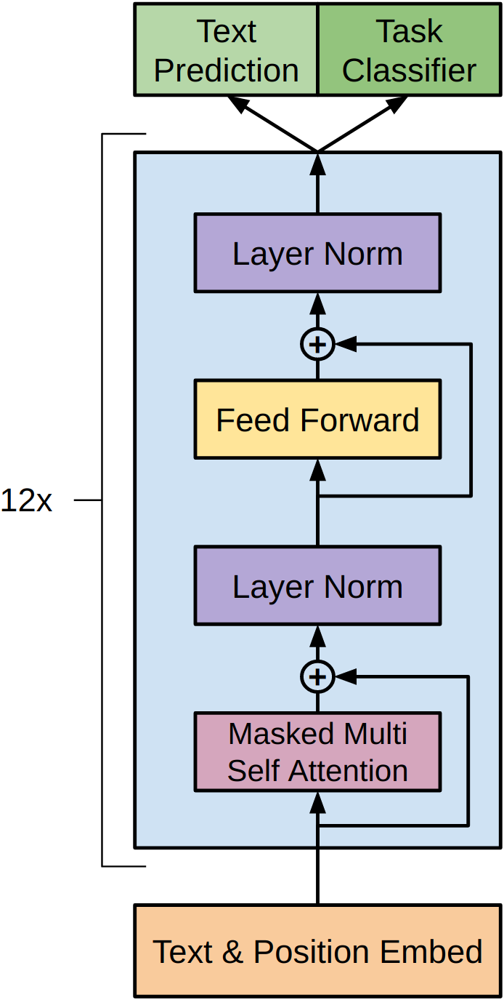
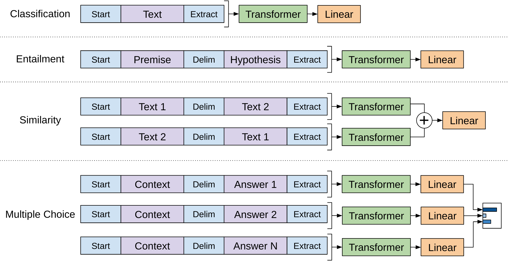


GPT 把语言模型训练和下游任务训练分成两步。预训练时，带因果遮罩的 Transformer 只根据前缀预测下一个 token，从连续文本中学习可复用的表示。微调时，把句子、句对或候选答案整理为 token 序列，使用末尾位置的表示预测标签，并用标签更新模型。这样，几个输入形式不同的任务可以沿用同一个预训练主干，只在输入排列和输出层上做少量改动。

**关键公式**

$$
h_i^{(0)}=E[x_i]+P[i],\qquad z_i=h_iE^\top.
$$

$$
p_\theta(x_1,\ldots,x_n)=\prod_{t=1}^n p_\theta(x_t\mid x_{<t}).
$$

$$
\mathcal L_{\mathrm{LM}}=-\sum_{t=1}^n\log p_\theta(x_t\mid x_{<t}).
$$

$$
p(y\mid x)=\operatorname{softmax}(h_{\mathrm{end}}W_y)_y.
$$

$$
\mathcal L_{\mathrm{fine}}=\mathcal L_{\mathrm{cls}}+\lambda\mathcal L_{\mathrm{LM}}.
$$



### 1. 预训练的目标

要训练一个影评分类器，可以收集标注过的影评，让网络直接学习“正面”或“负面”。问题在于，句子里有许多远比标签复杂的关系。模型得先理解转折、否定和前后指代的作用，才能用好这些标签。如果每换一种任务，就让网络从头用一份标注集学这些东西，既费数据，也重复做了很多工作。

Radford 等人在 2018 年提出的 GPT（后来常称 GPT-1）把两件事分开：**先用大量文本学习怎样读懂已有上下文，再用少量任务专属的结构把这些表示用于具体预测。** 第一步用语言建模，监督信号可以直接从文本里取得；第二步才需要人工标签。例如，同一个预训练模型可以复制出两份，一份用影评标签微调，另一份用问答样本微调。

> [!Note] **预训练和微调**
>
> 两个阶段都可以用反向传播更新参数。区别在于训练从哪里开始、误差由什么决定：预训练从初始参数出发，用文本中实际出现的下一个 token 计算误差；微调从学好的参数出发，用目标任务的标签告诉模型哪些预测需要纠正。这里说的“下游任务”就是要交给预训练模型处理的具体工作。

### 2. 语言模型

#### 2.1 文本怎样进入模型

论文用 BooksCorpus 做预训练，其中包含七千多本未出版书籍。选择书籍的一个原因是可以读到连续的段落：把句子打散以后，模型仍能学到句内的词序，却很少有机会从前一句的内容推断后一句。训练时从语料里随机抽取连续片段，每个片段长度为 512 个 token；“随机”发生在抽哪一段，段内词序保留。

原文经过清理与切词，再使用 BPE（Byte Pair Encoding，字节对编码）切成词表已有的单元。BPE 反复将经常相邻的单元合并，这让常见词可以用较少的 token 表示，罕见词也能用几个较短的片段拼出。论文在构造词表时做了 40000 次合并。经过分词，一个长度为 $n$ 的片段成为 $n$ 个整数编号。每个编号从词嵌入表 $E$ 中查出一个向量，每个位置也从自己的表 $P$ 里查出一个向量，两者相加后得到一个 $n\times768$ 的输入矩阵。

$$
h_i^{(0)}=E[x_i]+P[i].
$$

$E[x_i]$ 描述当前位置的 token，$P[i]$ 补充它在片段中的顺序。两个相同的 token 查到同一条词向量，落在不同位置时加上的向量不同；经过注意力后，它们还会因为各自看到的前缀不同，得到不同的表示。

#### 2.2 解码器块

[原版 Transformer]() 的翻译模型有两条信息流：编码器读原文，解码器读已有译文，并通过交叉注意力向编码器取信息。语言建模只给一段文本，要预测它接下来怎样写，因此 GPT 保留了带遮罩的自注意力和前馈层，去掉单独的编码器和交叉注意力。

<figure class="ddpm-figure">
  
  <figcaption>原论文图 1 左。下方是共用的输入与主干，上方两种输出分别对应语言建模和任务分类。</figcaption>
</figure>

解码器块接收一个 $n\times768$ 的矩阵，输出仍是这个形状。位置之间的信息传递发生在注意力里，各位置的特征变换则由前馈网络完成：

1. **遮罩自注意力。** 12 个注意力头各自把输入投影为查询、键和值。按每头 64 维计算，一次注意力比较得到一张 $n\times n$ 的分数表。第 $i$ 行在 softmax 前屏蔽所有 $j>i$ 的得分，因而只会从当前位置和左侧位置的值向量取信息。各头的结果拼接再投影，得到同样宽度的更新量。
2. **前馈网络。** 注意力更新量与输入相加，再做层归一化。随后每个位置独立经过相同的两层前馈变换，宽度从 768 扩到 3072，经过 GELU 后再投回 768。再加一次残差和层归一化，得到该块的输出。

下一块接到这些已经处理过的向量，再从允许的上下文中读取信息。前面的块输出有时包含了更早的线索，但从未读过右侧 token；后面的块沿用同样的遮罩，因此叠加 12 块后这个限制仍然成立。**模型可以反复加工一个位置的前缀信息，同时保证预测看不到未来。**

#### 2.3 词表输出

令 $h_i$ 表示最后一层在位置 $i$ 的向量。网络要把它从 768 维变成词表上每个 token 一个分数。原论文用输入端的同一张词嵌入表来做这次投影。若词表大小为 $V$，$E$ 的形状就是 $V\times768$；将 $h_i$ 乘以 $E^\top$，得到一行长度为 $V$ 的分数 $z_i$。归一化后便是下一个 token 的预测分布：

$$
p_\theta(\,\cdot\mid x_{\le i})=\operatorname{softmax}(h_iE^\top).
$$

当第 $i$ 行要预测下一项时，$z_i$ 中的每个分量是 $h_i$ 与一个候选 token 的嵌入向量的内积。从输入端看，$E$ 用于把离散编号变成向量；从输出端看，同样的向量用于给各个候选打分。这样不必为输入和输出分别训练两张同样大小的表。

### 3. 预训练与生成

#### 3.1 错位预测

把文本中的 token 依次记为 $x_1,\ldots,x_n$，$x_{<t}$ 是当前窗口里 $x_t$ 之前的前缀。连续预测每个 token，就能给一整段文本算出概率：

$$
p_\theta(x_1,\ldots,x_n)=\prod_{t=1}^n p_\theta(x_t\mid x_{<t}).
$$

训练时，模型已经拿到一段完整文本。怎样让它预测下一个 token，而不是直接读到答案？做法是把**输入位置和预测目标错开一格**。输入第 $i$ 个 token 时，该位置负责预测第 $i+1$ 个。自注意力中的因果遮罩让第 $i$ 个位置只能读取第 $1$ 到第 $i$ 个位置；答案虽然在训练序列里，计算这一步预测时却在遮罩之外。

这样只做一次主干前向计算，就可以同时得到各位置的预测。真实的后续 token 用来给这些预测打分，模型分给正确 token 的概率越低，负对数损失就越高：

$$
\mathcal L_{\mathrm{LM}}=-\sum_{t=1}^n\log p_\theta(x_t\mid x_{<t}).
$$

转折、否定和远处的指代都会影响后文。能通过前缀识别并利用这些关系，模型就更可能给真实出现的下一项打高分。训练文字本身就提供了目标，无须给每条样本额外标注。

> [!Note] **交叉熵怎样影响预测**
>
> 对某个位置，令正确 token 的编号为 $j$，模型预测分布为 $p$。这一项的损失是 $-\log p_j$。分给正确 token 的概率高，误差就小；分给其他 token 的概率高，误差就大。反向传播从词表分数开始，经过输出投影、12 个解码器块和输入嵌入，更新共同影响这次预测的参数。共享的词嵌入表同时从查表和输出投影两条路径收到梯度。

#### 3.2 训练与续写

一次训练取一批连续片段，分别算出各位置的词表分布，与实际后继 token 比较，再汇总这些误差更新参数。第 $i+1$ 个位置要预测第 $i+2$ 项；它直接读原文里的第 $i+1$ 项，无须等前一个位置猜出这个 token。把真实的历史交给模型计算下一步预测，有时叫**教师强制**（teacher forcing）。

生成时，给定的只有前缀。先读取前缀最后一行的词表分布，选出下一个 token，把它接到末尾，再从延长后的前缀继续预测。这是**自回归**生成。如果某一步选了不合适的 token，它也会成为后面所用的上下文。训练和生成用同一套逐位置预测规则，区别在于前缀来自原文，还是包含了模型上一轮的输出。

### 4. 任务微调

#### 4.1 标签预测

给模型一条影评，想要的是两个类别的概率。GPT-1 在输入首尾加特殊 token，用最后一个 Transformer 层在末尾位置的向量 $h_{\mathrm{end}}$ 表示整条输入。之所以选末尾，是因为按照因果遮罩，末尾能读取前面所有位置；更靠前的位置还看不到后半句。

接着，加一个可学习矩阵 $W_y$，把 $h_{\mathrm{end}}$ 投影成每个类别一个分数。它的输出宽度由任务的类别数决定，和词表大小无关。这层通常叫**分类头**。若任务是影评情感分类，softmax 比较的是“正面”和“负面”的分数，训练标签也只用于计算这两个类别的分类误差。

$$
p(y\mid x)=\operatorname{softmax}(h_{\mathrm{end}}W_y)_y.
$$

词表预测和标签预测读的都是主干输出，取法不同。语言模型从每个位置预测下一项；分类头只看末尾位置，用任务标签算误差。设一条样本的正确类别为 $y$，分类损失就是 $\mathcal L_{\mathrm{cls}}=-\log p(y\mid x)$。

分类误差经过输出层传回末尾向量，再沿注意力读取的路径和主干各层传播。分类头、特殊 token 的嵌入和预训练主干都可以随任务调整。比如在影评里，“起初平平”到“后来打动人”都出现在输入中，任务标签可以让主干调整对这两部分的利用方式；只训练输出层则只能从已有的表示里读取信息。

#### 4.2 输入格式

有些任务的输入天然不止一段。GPT-1 给各段安排固定次序，并用特殊 token 标出边界，尽量把变化留在输入和输出两端：

- 文本蕴含有方向：先放前提，再放分隔符和假设。最后预测前提与假设是蕴含、矛盾还是中立关系。
- 文本相似度不应取决于句子谁在前面：交换两句的次序，分别运行主干，将两个末尾向量相加后再预测。
- 选择题里，把材料和问题与每个候选答案分别拼接。主干和线性层对所有候选共用：每条序列输出一个分数，把同一道题的这些分数放进 softmax 后，再用标准答案算分类误差。这样答案数变化时，可以改变送入模型的序列数，输出层本身仍然只负责给一条序列打分。

<figure class="ddpm-figure">
  
  <figcaption>原论文图 1 右。Extract 是取末尾表示的位置，Linear 是任务输出层。</figcaption>
</figure>

#### 4.3 辅助损失

论文在分类目标外还加入了一个辅助的语言建模目标。以最小化损失的记法，这一步是：

$$
\mathcal L_{\mathrm{fine}}=\mathcal L_{\mathrm{cls}}+\lambda\mathcal L_{\mathrm{LM}}.
$$

两项损失可以从同一批任务输入取得。分类头看末尾的位置，学习正确标签；词表输出从各位置学习本来就存在的后继 token。这给主干两种训练信号：标签推动它解决具体任务，辅助项让它在适应任务时继续建模输入中的语言规律。$\lambda$ 控制辅助项的权重，论文设为 $0.5$。部署分类模型时只取分类头的输出。

### 5. 影评分类

用这一条短评，把两个训练阶段和一次分类连起来：

> It starts slowly but ends beautifully.  
> 开头节奏慢，但结尾很精彩。

**预训练。** 暂把英文按词和标点切分，看看模型如何从这样的句子取得目标。从同一份输入能取出下面几组预测，表中每一行对应模型输出的一个位置：

| 输入中看到的前缀 | 要预测的下一项 |
| --- | --- |
| It starts | slowly |
| It starts slowly | but |
| It starts slowly but | ends |
| It starts slowly but ends | beautifully |

以 `but` 位置为例，它的查询可以从 `slowly` 等左侧位置读取信息，却读不到右边的 `ends`。最后一层在 `but` 位置得到的向量，与词表嵌入逐项比较。如果模型只给正确的 `ends` 分配 $0.1$ 的概率，这个位置就贡献 $-\log 0.1\approx2.30$ 的损失。连同表中其他位置的误差一起反传，就是一次语言建模训练的信号。

**微调。** 从预训练参数出发，在另一批有标签的影评上训练。对每条输入加起止 token。此时训练目标换成整句的情感：一条标为正面的影评若只得到 $0.4$ 的正面概率，这条样本的分类损失就是 $-\log 0.4\approx0.92$。误差从结束 token 上的分类预测传回模型，主干可以逐步学会利用转折前后哪部分更能反映总体评价。若同时计算辅助项，各位置还要继续预测后继 token。

**预测。** 将开头那条待测影评交给微调后的模型，它依次经过分词、嵌入和 12 个解码器块。结束 token 的向量可以利用 `starts slowly` 和 `ends beautifully` 两部分，分类头把这个向量变成两个分数。设正面与负面分数分别是 $2$ 和 $0$，则正面概率为 $e^2/(e^2+1)\approx0.88$，输出“正面”。这些数字用于演示计算；这个结果来自一次前向计算，无须逐词生成答案。

### 6. 实验结果

#### 6.1 换任务以后

论文将同一套预训练参数分别迁移到文本蕴含、问答、相似度和分类，共在 12 个数据集中的 9 个达到当时的最好结果。表 3 的 RACE 是阅读理解选择题，模型要给题目配上最合适的答案。GPT 的准确率是 59.0%，对照方法的最好结果是 53.3%。表 4 的 SST-2 正是影评情感分类，GPT 达到 91.3%，同表最好结果为 93.2%。两个任务的输入排列和输出形式不同，却可以从相同的主干起点出发。效果并非在每个数据集上都领先。

#### 6.2 预训练有多大作用

只看完整方法的分数，很难判断增益究竟来自预训练、模型结构，还是微调时的辅助目标。原论文表 5 将这些因素拆开。表中的平均分是所列八项任务指标的简单平均，各项有的用准确率，有的用相关性指标。

| 对照设置 | 平均分 | SST-2 准确率 |
| --- | ---: | ---: |
| 完整 GPT | 74.7 | 91.3% |
| 跳过预训练 | 59.9 | 84.0% |
| 去掉微调辅助项 | 75.0 | 92.0% |

跳过预训练仍然能够用标签学习，但同一架构会丢失预训练带来的起点，SST-2 从 91.3% 降到 84.0%。论文还在 MultiNLI 和 RACE 上逐步增加从语言模型迁移过来的层数（图 2 左）：从复用词嵌入，到复用越来越多的 Transformer 层，表现随之改善。这意味着有用的内容不仅存在词嵌入里，也存在处理上下文的网络层中。

辅助项的效果要按任务看。例如原表中，在微调时保留语言建模目标，QNLI 准确率为 88.1%，高于去掉它时的 86.9%；SST-2 上则是去掉辅助项稍高。完整方法和去掉辅助项的平均分相近，说明主要收益来自预训练本身。

### 7. 从微调到提示

预训练模型还留下另一条路。论文第 5 节在影评后拼上一个提示，比较词表里 `positive` 和 `negative` 的分数，用语言模型直接判断情感。这和前面训练分类头的做法是两种用法。后来 [GPT-3]() 把第二条路径发展成系统的评测：同一个模型不做任务专属的参数更新，仅通过改变输入文字来切换任务。

### 参考资料

1. Radford, Narasimhan, Salimans, Sutskever. *Improving Language Understanding by Generative Pre-Training*. OpenAI, 2018. [论文 PDF](https://cdn.openai.com/research-covers/language-unsupervised/language_understanding_paper.pdf)。本文配图与实验数据来源；第 3 节介绍预训练、微调与输入转换，第 5 节分析预训练的作用。
2. Jay Alammar. *The Illustrated GPT-2*. 2019. [博客原文](https://jalammar.github.io/illustrated-gpt2/)。以 GPT-2 为例图解只用解码器的结构和逐 token 生成过程。
