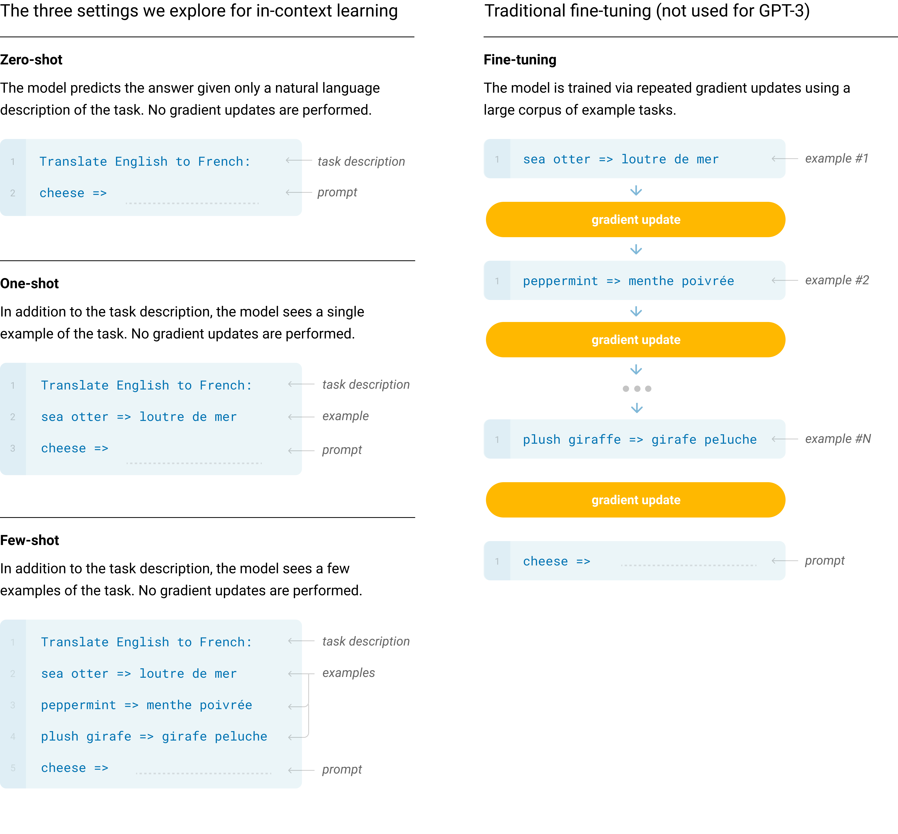


GPT-3 研究的是：同一个语言模型只看任务说明和几条示例，能否在推理时完成不同任务？它延续了自回归预训练，用更大的模型和更多文本学习预测下一个 token。评测时，把任务说明、带答案的示例和待答输入依次放进同一个前缀，模型通过因果注意力利用这些内容，再生成答案或给候选答案打分。示例改变这次输入和中间表示，参数保持不变。论文在不同模型规模上比较了零样本、单样本和少样本设置：许多任务能从示例中受益，表现仍受任务、示例和提问格式影响。

**关键公式**

$$
\mathcal L_{\mathrm{LM}}=-\sum_t\log p_\theta(x_t\mid x_{<t}).
$$

$$
p_\theta(y\mid c)=\prod_{j=1}^m p_\theta(y_j\mid c,y_{<j}).
$$

$$
S(y\mid c)=\frac{1}{m}\log p_\theta(y\mid c).
$$

$$
\hat y=\arg\max_{y\in\mathcal Y}\log p_\theta(y\mid c).
$$



### 1. 从微调到提示

[GPT-1]() 先用大量文本预训练，再用各个任务的标注数据微调。同一个起点可以训练出影评分类器、问答模型等不同版本。这个办法减少了从头学习的工作，但每来一种新任务，仍要准备数据、训练模型并管理一套对应的参数。

另一种办法是把任务组织成一段可以续写的文字。如果前面有“英文：……法文：……”的若干示例，最后给一个新的英文句子，并留出“法文：”作为开头，那么合理的续写就是它的法文译文。GPT-2 已经探索过将翻译、问答等任务写成文本续写。Brown 等人的 GPT-3 论文接着问：**模型变大后，只给任务说明或几条示例，能不能让同一个预训练模型完成各种任务？**

这就是论文所测的**上下文学习**（in-context learning）：把用于说明任务的材料放进当前输入，用已有模型完成预测。在这个过程中，提供给模型的前缀可以变，模型参数保持不变。

### 2. 训练与续写

#### 2.1 文本预训练

GPT-3 沿用 GPT-2 的解码器式 Transformer。它将 token 和位置变成向量，再用多层因果自注意力与前馈网络逐步更新这些表示。论文交替使用全范围和局部的因果注意力层：有的层可以读取更早的全部位置，有的层只处理近邻。每处输出仍是基于当前位置及左侧信息，对下一个 token 给出概率分布。

给训练模型一段完整文本，每个位置用当前和之前的 token 来预测右边紧邻的一项。比如某个位置的正确后续是“因此”，损失就是模型赋给“因此”的概率取负对数。一次前向计算可以为许多位置同时算出这种损失；反向传播再把误差传给词表投影、前馈层和注意力等模块。哪些位置值得读、读来的信息怎样组合，都通过反复降低这个损失学到。

网页和书籍里本来就有问答、翻译对照、项目列表等反复出现的格式。前文可能已经写明接下来谈什么，也可能通过重复给出了格式和规则。利用这些线索有助于预测真实后文。到了推理时，我们可以有意把任务写成这种结构，让以前用来续写自然文本的模型，继续写出新输入所缺的答案。

#### 2.2 数据与规模

作者训练了 8 种规模的模型，最小的约 1.25 亿参数，最大的约 1750 亿。除了层数，也改变了每个位置的向量宽度以及注意力头数。以最大模型为例，同一个位置的表示宽度是 12,288，依次经过 96 层；每个注意力层使用 96 个头，每头的宽度为 128。增加宽度使每层能处理更多特征，增加层数则给这些特征更多轮相互作用的机会。

数据来自筛选后的 Common Crawl 网页、WebText2、两套书籍语料和维基百科。各模型都累计处理了约 3000 亿个 token。采样时没有照搬各来源在语料库里的大小：例如 Common Crawl 有约 4100 亿个候选 token，在训练混合中的权重约为 60%；维基百科仅有约 30 亿个，仍得到约 3% 的采样权重。因此同一来源可能被读过多遍，也可能只被读到一部分。

这里的**参数量**是模型需要学习的数值个数，**累计训练 token 数**是预训练读过多少内容，**上下文窗口**则限制模型一次能处理多长的输入。8 个模型的窗口长度都是 2048 个 token。后面的评测用同一类任务和提示比较不同模型，观察更大模型怎样利用有限的上下文。

#### 2.3 从前缀读任务

提示由任务说明、已完成的示例和一个没写完的新样本组成。先把整段文字按平常的方式分词和嵌入。示例里的输入、正确答案、分隔符都占自己的 token 位置，因此最后一个位置的查询可以匹配它们。早期层已经在各个位置加工过这些信息，后面的层继续把与当前预测有关的表示汇到末尾。最终，末尾向量经过词表投影和 softmax，得到下一项的概率。

举例来说，几条示例都在影评之后写出分类标签，那么正负评价的形式和它们在句子中的线索都出现在当前上下文里。增加或替换示例，会改变注意力能读到的键和值，进而改变末尾的表示和输出概率。这里参与计算的是同一组参数；每次输入产生的中间表示可以不同。这个计算路径解释了示例能影响答案，但模型实际能从示例中学到哪种规律，要通过后面的评测来判断。

### 3. 提示与评测

#### 3.1 示例数量

论文按提示里放了多少条**已完成的示例**，比较了三种推理方式。

| 设置 | 待答样本前的内容 |
| --- | --- |
| 零样本（zero-shot） | 任务说明或能表达任务的输入格式 |
| 单样本（one-shot） | 一条输入、答案对，按任务加入说明 |
| 少样本（few-shot） | 多条输入、答案对，按任务加入说明 |

三种设置都不反向传播。论文做少样本评测时，通常从该任务的训练集随机抽取 $K$ 条示例，连同待答样本组成提示，再对测试集评分。没有训练集的任务使用其他划分提供示例；例如 LAMBADA 从开发集取示例，在测试集测准确率。示例数上限取决于篇幅，论文的窗口通常能放 10 到 100 条。作者会在有独立开发集时试几个 $K$，然后用选定的设置做测试。

<figure class="ddpm-figure">
  <a href="./GPT3-fig2-1-strategies.png"></a>
  <figcaption>原论文图 2.1。左侧的示例随待答句子一起送入模型；右侧的示例先用于梯度更新，完成训练后再预测。</figcaption>
</figure>

> [!Note] **上下文窗口怎么算**
> 窗口按 token 计数。任务说明、示例、待答文本和已经写出的答案都要占位置。示例越长，给待答文本和答案留下的空间越少。评测用的示例通常随每个输入重新提供，因为示例不会存入模型权重。

#### 3.2 候选打分

把提示记为 $c$，把一个候选答案记为 $y$。如果答案由 $m$ 个 token 组成，给第一个 token 打分时只看提示；给第二个打分时还要把第一个放进前缀，后面以此类推。把这些条件概率相乘，就得到整段候选答案的概率：

$$
p_\theta(y\mid c)=\prod_{j=1}^m p_\theta(y_j\mid c,y_{<j}).
$$

对选择题，每个候选的文字已知，可以把它接在提示后一次送入模型，对应位置用遮罩分别取得各项概率。评测只累计候选答案部分，每个候选独立评分。长答案会多乘几项小于 1 的数，所以论文在多数选择题上比较每个 token 的平均对数概率 $S(y\mid c)$，让长短不同的候选更容易比较。

还有一种偏差来自候选词本身的常见程度。有些选项即使不看题目，只接在通用的 “Answer:” 后面也很常见。ARC、OpenBookQA 和 RACE 等任务用完整提示下的概率除以这种通用答案前缀下的概率，看题目能为哪个候选提供更多额外支持。这里除的是两次前向得到的概率；最终用于选择的是分数。

#### 3.3 自由生成

翻译和开放式问答通常没有现成的候选。模型从提示末尾预测下一个 token，接到序列后再预测下一项。论文在这类任务里用束搜索：每轮保留若干条当前得分靠前的续写，继续扩展它们，再返回得分最好的答案。生成结束后，按数据集的规则比较预测和参考答案，例如要求完全匹配，或按译文与参考译文重合的程度评分。

### 4. 影评分类

用 GPT-1 篇中的同一句待测影评：`It starts slowly but ends beautifully.`。这回不接分类头，直接在文本里写两个带答案的示例，让模型续写最后一行：

```text
Classify the review. Answer Positive or Negative.
Review: It looks great but never becomes interesting.
Label: Negative
Review: The acting is uneven, but the story is moving.
Label: Positive
Review: It starts slowly but ends beautifully.
Label:
```

**写入上下文。** 前两条标签都在输入里。它们让模型看到怎么把影评和标签配对，也告诉模型标签应接在 `Label:` 后面。最后一条标签留空，正是本次要预测的内容。删去两条示例就变成零样本，留下一条则是单样本；待测影评和预训练参数都保持原样。

**得到预测。** 最后一处 `Label:` 之前有任务说明、两条示例和待测影评。模型走完整个前缀，在词表上给下一项打分。设 `Positive` 与 `Negative` 在此处各占一个 token，下一步的词表概率分别是 $0.55$ 和 $0.25$，则选 `Positive`。剩下的 $0.20$ 分给其他 token；这里用假设的概率说明如何选标签。

**换一条输入。** 接下来预测另一条影评时，可以保留说明和两条示例，只替换最后一条影评。如果换成完全不同的任务，说明和示例也可以一起替换。GPT-1 的分类头是用标注数据训练出来的；这里标签取自语言模型的词表，任务线索由当前前缀提供。

### 5. 实验结果

#### 5.1 示例和规模

论文图 1.2 选了一个容易控制的任务：从插入了多余符号的单词里恢复原词。图的横轴是放进提示的示例数，纵轴是准确率。读同一条曲线，是固定模型比较加示例前后的变化；在同一横坐标比较不同曲线，是固定示例数比较模型规模。较大模型的曲线随示例增多上升得更明显，加入任务说明后通常更好。这些“学习曲线”的横轴是推理时给了几条示例，并没有增加任何优化步骤。

在 LAMBADA 的段落补全任务中，模型要根据上下文预测最后一个词。论文表 3.2 显示，1750 亿参数模型在零样本、单样本和少样本设置下的准确率分别为 76.2%、72.5% 和 86.4%。少样本提示用填空示例明确“只补一个词”的要求；零样本用了不同格式，因此这个差异也包含了写法改变带来的影响。单样本的分数更低，说明多给一条例子并不总能改进结果。

跨任务的结果差异很大。SuperGLUE 测试集上，GPT-3 少样本平均得分 71.8，超过表 3.8 中微调的 BERT-Large 的 69.0，同时低于当时最高的微调结果 89.0。某些任务上少样本已经接近最优结果，判断同一个词在两个句子里是否同义的 WiC 则仍接近随机猜测。少样本提示提供了一种通用接口，而原始 GPT-3 能在多大程度上用好这个接口，要从具体任务上看。

#### 5.2 检查数据重合

GPT‑3 在公开网络文本上预训练，评测题和答案也可能已经出现在这些网页里。论文第 4 节用连续词串的重合来找可疑题目，剔除后重算成绩。这个对照问的是：避开可能见过的题时，模型的分数还剩多少？LAMBADA 有一部分题与训练语料重合，去掉这些题后，分数和全体相差很小。另一部分重合严重的基准没有被报告。即便拿掉重合样本，剩下的题也可能在难度上发生变化，所以作者同时给出了筛查方法和各基准的比较结果。

这篇论文验证了扩大模型可以改善很多任务的上下文学习。但扩大模型也需要更多训练计算。若算力总量不变，应该把预算用于增加模型参数，还是让模型读更多文本？接下来的 [Chinchilla]() 专门研究这笔分配。

### 参考资料

1. Brown et al. *Language Models are Few-Shot Learners*. NeurIPS 2020. [arXiv:2005.14165](https://arxiv.org/abs/2005.14165)。模型与评测见第 2 节，任务结果和数据重合分析见第 3、4 节，附录 G 展示实际提示。封面取自[原论文图 1.2](https://ar5iv.labs.arxiv.org/html/2005.14165#S1.F2)。
2. Lilian Weng. *Prompt Engineering*. 2023. [Lilian's Blog](https://lilianweng.github.io/posts/2023-03-15-prompt-engineering/#few-shot)。少样本一节用具体提示说明示例怎样传递任务要求，并整理了例子的选择和顺序对结果的影响。
