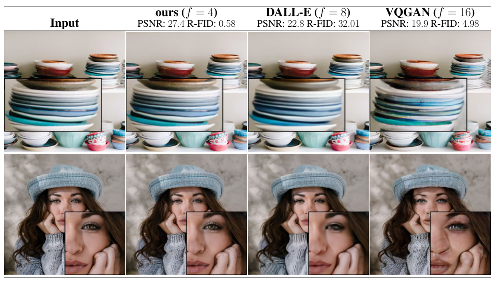
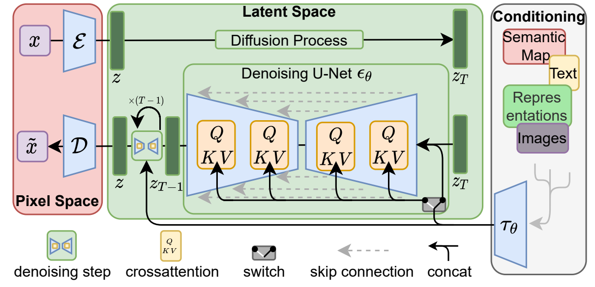


LDM 要解决的是高分辨率扩散生成的计算成本。它先训练自编码器，将图像压缩为保留空间结构的潜表示，再固定自编码器，在较小的潜空间内训练扩散模型。第一阶段通过重建、感知与对抗目标保留可见内容，采用 KL 或向量量化约束潜表示；第二阶段沿用 DDPM 的加噪和噪声预测任务，学习这些表示的分布。去噪 U-Net 在多个尺度处理图像特征，通过交叉注意力读取文本等条件。生成时从潜空间噪声出发，用 DDPM 或 DDIM 等规则迭代，最后只调用一次解码器得到图像。压缩倍率决定计算量与细节保留的取舍，潜表示的数值缩放则影响实际噪声强度。（由 GPT-6 总结）

**关键公式**

$$
z_0=s\mathcal E(x),\qquad\tilde x=\mathcal D(z_0/s).
$$

$$
z_t=\sqrt{\bar\alpha_t}\,z_0+\sqrt{1-\bar\alpha_t}\,\epsilon.
$$

$$
L_{\mathrm{LDM}}=\mathbb E_{x,y,t,\epsilon}\!\left[\|\epsilon-\epsilon_\theta(z_t,t,\tau_\phi(y))\|^2\right].
$$

$$
Q=FW^Q,\qquad K=CW^K,\qquad V=CW^V.
$$

$$
\operatorname{Attention}(Q,K,V)=\operatorname{softmax}\!\left(\frac{QK^\top}{\sqrt{d_k}}\right)V.
$$


### 1. 基本思路

**LDM（Latent Diffusion Models，潜空间扩散模型）** 来自 Rombach 等人的 *High-Resolution Image Synthesis with Latent Diffusion Models*，论文于 2021 年公开，发表于 CVPR 2022。它承接 [DDPM](/papers/ddpm/) 的去噪训练，并结合 [注意力机制](/papers/transformer/) 将文字等条件送入生成网络。

DDPM 直接处理像素。图像分辨率提高后，训练需要在更大的特征图上计算梯度，生成还要反复运行去噪网络。[DDIM](/papers/ddim/) 减少的是生成时的网络调用次数；LDM 进一步考虑：**每次调用，是否都需要处理原图那么多像素？**

自然图像中包含大量细微的像素变化。逐点保存这些变化，对精确还原有用，却未必同等影响视觉内容。因此，论文先学习一种压缩表示，让它足以重建图像的主要结构和可见细节，再让扩散模型学习这种表示的分布。这个经过学习的表示称为**潜表示**，它们所在的空间称为潜空间。

整个方法分成两个阶段：先训练一对编码器与解码器，完成图像压缩和重建；再固定这对网络，训练潜空间中的扩散模型。生成时，扩散网络先产生一份新的潜表示，解码器再将它转换为图像。理解 LDM 的关键，是分清**压缩模型学习怎样表示图像，扩散模型学习怎样生成这些表示**。

### 2. 感知压缩

#### 2.1 保留空间结构

将原图记为 $x$，编码器记为 $\mathcal E$，解码器记为 $\mathcal D$。编码器得到潜表示 $z=\mathcal E(x)$，解码器根据它重建图像：

$$
\tilde x=\mathcal D(z)=\mathcal D(\mathcal E(x)).
$$

这对网络合称**自编码器**。训练时有真实图像可供比较，编码器和解码器共同调整参数，使压缩后的信息足以支持重建。

原图的形状为 $H\times W\times3$，潜表示的形状为 $h\times w\times c$。其中 $c$ 是每个潜空间位置的特征维度，称为通道数；空间下采样倍率定义为：

$$
f=H/h=W/w.
$$

以 $f=8,c=4$ 为例，一张 $512\times512\times3$ 的图像变为 $64\times64\times4$ 的潜表示。空间位置数减少到原来的 1/64，分量总数减少到原来的 1/48。网络内部还会使用不同宽度的特征，因此实际耗时需要测量，但处理的空间网格已经明显缩小。

潜表示仍是一张二维网格，每个位置存放一个特征向量。编码器通过卷积和下采样汇集输入区域的信息，邻近区域在潜表示中仍具有对应的空间关系，后续网络可以继续利用二维卷积处理它。这里每个格点存放的是学到的特征，并非缩小图中的 RGB 颜色；较深的编码层也能结合更大范围的图像内容。

保留网格，使模型能够分别表示不同位置的结构，而不必将整张图压成一个没有空间轴的向量。适度降低分辨率，则把大量像素层面的处理交给自编码器，让后续生成网络集中处理较紧凑的内容。

#### 2.2 重建与正则化

这种压缩称为**感知压缩**，因为训练不仅要求像素接近，还考虑视觉特征和局部真实感。像素重建损失约束颜色与布局；感知损失比较原图和重建图在预训练视觉网络中的特征，关注较高层的结构差异。只依赖像素误差时，难以确定的纹理容易被平均成模糊结果。

论文还使用基于局部图块的判别器：判别器学习区分真实与重建的局部区域，自编码器则学习产生更难区分的重建。这是**对抗训练**，用于改善局部纹理。进入第二阶段后，判别器完成了任务，不参与扩散去噪。

计算感知损失时，作为比较依据的预训练视觉网络保持固定，但误差仍能通过它传回重建图，进而更新自编码器。重建、感知和对抗目标共同约束同一张输出：前两者使它与输入对应，对抗目标改善局部外观。若只要求看起来像真实图像，却不要求对应输入，就无法得到可用的压缩与重建关系。

<figure class="ddpm-figure">
  
  <figcaption>自编码器的重建比较；来源：原论文 Figure 1</figcaption>
</figure>

图中第一列是输入，后面三列是不同压缩模型的重建。放大区域便于观察纹理与五官细节；这是第一阶段的比较，展示压缩对后续可用信息的影响。

除了重建质量，还要约束潜表示的分布，避免数值尺度任意增大。论文比较了两种**正则化**方式，即在主要训练目标之外加入对表示形式的约束。

**KL-reg** 使用类似变分自编码器的结构。编码器为各潜分量输出高斯分布的均值与标准差，再抽取潜表示：

$$
z=\mu(x)+\sigma(x)\odot\xi,\qquad\xi\sim\mathcal N(0,I).
$$

这里 $\odot$ 表示逐分量相乘，$\xi$ 用于抽取编码样本，与第二阶段加入的扩散噪声分别抽取。解码器根据这个样本重建图像，同时用较小权重的 KL 损失，使编码分布靠近标准高斯。论文使用弱约束以保留重建能力，后续扩散仍要学习真实图像编码所得的分布。

**VQ-reg** 使用向量量化。模型维护一组可学习的向量，称为码本；重建时，将每个位置的连续向量替换为码本中距离最近的向量，再送入后续解码网络。训练同时调整编码器、码本和解码器，使选中的码向量能够支持重建。

在论文的 VQ 方案中，扩散模型处理的是**量化之前的连续潜表示**，量化操作被归入解码器。这样依然可以加入连续高斯噪声，生成结束后再经过量化与解码。KL-reg 和 VQ-reg 是两种第一阶段方案，不需要在同一个编码器中同时使用。

### 3. 潜空间扩散

第一阶段完成后，固定编码器和解码器的参数。图像编码所得的连续表示，成为第二阶段的数据；扩散模型现在需要学习怎样生成它们。

重建成功，只说明解码器能处理真实图像经过编码器得到的表示；它没有规定任意潜向量都对应自然图像。真实图像的编码在潜空间中仍有特定的组合规律，弱 KL 约束也没有把这些规律全部变成标准高斯。因此，第二阶段需要学习这个分布，逐步把容易抽取的高斯噪声变成适合解码的潜表示。

潜表示的数值幅度还会影响加噪强度。实际实现可使用一个固定缩放系数 $s$，将扩散使用的清晰状态记为：

$$
z_0=s\mathcal E(x).
$$

其中 $\mathcal E(x)$ 也包含前一节 KL 方案的抽样操作。官方实现支持根据编码样本的标准差设置缩放，使潜表示的标准差接近 1。**$f$ 控制空间尺寸，$s$ 控制数值幅度**；放大潜表示而保持噪声不变，会使同一时刻保留更多信号，因此训练和生成必须沿用相同的缩放约定。解码前再除以 $s$，回到自编码器接收的尺度。

接下来沿用 DDPM：$\alpha_t=1-\beta_t$ 为单步信号系数，$\bar\alpha_t=\prod_{u=1}^t\alpha_u$ 为累计系数。随机选取时刻 $t$，抽取与 $z_0$ 同形状的标准高斯噪声，直接构造：

$$
z_t=\sqrt{\bar\alpha_t}\,z_0+\sqrt{1-\bar\alpha_t}\,\epsilon,\qquad\epsilon\sim\mathcal N(0,I).
$$

加噪对象是潜表示，训练不需要先给像素图加噪再编码。$z_t$ 的空间形状与 $z_0$ 相同，随着 $t$ 增大，信号占比逐渐降低；当末端信号足够弱时，其分布接近标准高斯。

去噪网络接收 $z_t$ 和时刻 $t$，预测这次构造所用的累计噪声。无条件训练目标为：

$$
L_{\mathrm{LDM}}=\mathbb E_{x,t,\epsilon}\!\left[\|\epsilon-\epsilon_\theta(z_t,t)\|^2\right].
$$

$\theta$ 是去噪网络的可学习参数。网络输出与潜表示同形状，每个分量对应一个潜特征的噪声预测。监督答案来自已抽取的 $\epsilon$，因此训练时能够直接计算误差，无需运行整条反向生成路径。

生成时也可以沿用 DDPM 或 DDIM，只需将原来的像素状态换成潜状态。例如记 $\hat\epsilon_t$ 为当前预测，由它估计清晰潜表示：

$$
\hat z_0=\frac{z_t-\sqrt{1-\bar\alpha_t}\,\hat\epsilon_t}{\sqrt{\bar\alpha_t}}.
$$

再选择较低噪声时刻 $u<t$，使用确定性 DDIM 更新：

$$
z_u=\sqrt{\bar\alpha_u}\,\hat z_0+\sqrt{1-\bar\alpha_u}\,\hat\epsilon_t.
$$

这里用 $u$ 表示下一时刻，避免与缩放系数 $s$ 混淆。每轮重新预测，最终得到生成的 $z_0$，再计算 $\mathcal D(z_0/s)$。主生成循环始终在潜空间运行，无需每一步都将状态解码回像素。

### 4. 条件去噪网络

#### 4.1 U-Net 与跳跃连接

论文使用 **U-Net** 实现噪声预测。它的输入已经是压缩后的潜表示，网络内部仍会继续降低特征图分辨率，以较低成本汇集更大范围的信息，再逐层上采样，恢复到输入的潜空间尺寸。

降采样路径在提取整体结构时，也会削弱精细的位置信息。因此，U-Net 将下降路径的中间特征保存下来，在上升路径遇到相同分辨率时，沿通道维度拼接给当前特征，再交给后续卷积加工。这些跨越多层的通路称为**跳跃连接**，让较细尺度的信息能够直接参与噪声预测。块内部还使用残差相加，帮助特征与梯度传递。

时刻 $t$ 经过时间编码后注入残差块，使同一套网络知道当前噪声强度；自注意力让较远图像位置直接交互。网络最后输出与 $z_t$ 相同的形状，若输入有 4 个潜通道，噪声预测也有 4 个通道。

通道数在内部可以扩大，用来保存更丰富的中间特征。例如，一个 4 通道的潜输入可以先变为几百通道，再经历多尺度计算，最后由输出层回到 4 通道。内部特征服务于预测，只有最后的输出才与加噪时抽取的噪声逐分量比较。

这里有两组不同用途的“编码与解码”：自编码器负责像素与潜表示之间的转换；U-Net 内部的下降和上升路径，负责一次噪声预测中的多尺度特征计算。第二阶段训练更新的是后者，自编码器已经固定。

#### 4.2 交叉注意力读取文本

要根据文字生成图像，还需要将文字条件送入去噪网络。将提示词记为 $y$，文本编码器记为 $\tau_\phi$，其中 $\phi$ 为它的参数。文本分词后经过嵌入和 Transformer，得到一组结合上下文的 token 表示：

$$
C=\tau_\phi(y)\in\mathbb R^{M\times d_c}.
$$

$M$ 是文本 token 数，$d_c$ 是文本特征宽度。文本编码器在这里提供整段提示的特征，不负责逐词生成。去噪网络通过**交叉注意力**，让各图像位置读取这些文本特征。

取 U-Net 某一层的特征图，将它的空间位置展开成 $N$ 行，记为 $F\in\mathbb R^{N\times d_u}$。每行仍对应一个图像位置，$d_u$ 为该层通道数。以一个注意力头为例：

$$
Q=FW^Q,\qquad K=CW^K,\qquad V=CW^V.
$$

查询来自当前带噪图像的特征，键和值来自文本。设查询和键的宽度为 $d_k$，值的宽度为 $d_v$，则 Q、K、V 的形状分别为 $N\times d_k$、$M\times d_k$、$M\times d_v$。匹配后得到：

$$
A=\operatorname{softmax}\!\left(\frac{QK^\top}{\sqrt{d_k}}\right),\qquad O=AV.
$$

A 的形状为 $N\times M$，每行是一个图像位置对所有文本 token 的读取权重；O 的形状为 $N\times d_v$，存放读取到的文本内容。多头结果拼接后，经输出变换回到 $d_u$ 维，再通过残差连接更新图像特征，并恢复为二维特征图。

例如，当前特征图为 $32\times32\times320$，文本表示为 $77\times1280$，则图像侧有 1024 个查询位置，文本侧有 77 个候选位置。每个注意力头的权重矩阵为 $1024\times77$；一个图像位置汇总的是 77 个文本值向量，输出仍放回这个图像位置。展开与恢复只改变排列方式，图像网格的空间对应关系一直保留。

因此，图像位置能够根据当前特征，选择与自己相关的文字内容。文本与图像的原始宽度可以不同，各自的可学习变换负责建立匹配与内容传递方式；送回 U-Net 的是已经变换到图像特征宽度的更新。最终噪声损失会训练这些变换，使读取到的文字有助于生成对应图像。

<figure class="ddpm-figure">
  
  <figcaption>潜空间扩散与条件输入；来源：原论文 Figure 3</figcaption>
</figure>

图左侧是自编码器，绿色区域是潜空间中的扩散；上方箭头表示加噪，下方 U-Net 表示反向生成所用的噪声预测网络。右侧条件经过 $\tau$ 编码，送入 U-Net 多处交叉注意力的 K、V，Q 则来自图像特征。灰色虚线表示跳跃连接。图中的拼接通路适合语义分割图、低分辨率图等空间对齐的条件，它们可以按位置加入；文本使用前面介绍的注意力读取。

加入条件后，训练目标变为：

$$
L_{\mathrm{LDM}}=\mathbb E_{x,y,t,\epsilon}\!\left[\|\epsilon-\epsilon_\theta(z_t,t,\tau_\phi(y))\|^2\right].
$$

训练数据提供成对的图像与文字。论文的条件训练同时优化去噪网络和条件编码器：预测误差不仅更新卷积与注意力，也经 K、V 的计算传回文本编码器，使其学到适合图像生成的表示。

同一段文字可以对应多张合理图片，训练因而学习的是文字条件下的图像分布。生成时固定提示词、改变初始噪声，可以得到不同的布局与细节；交叉注意力让这些不同结果都能持续读取同一份文字要求。

### 5. 训练与生成

#### 5.1 两阶段训练

**第一阶段只学习压缩与重建。** 从图像得到潜表示，按所选的 KL 或 VQ 方案构造解码输入，重建图像，再结合重建、感知、对抗和正则化目标更新自编码器。判别器交替更新。这一阶段不需要随机扩散时刻，也不训练噪声预测。

**第二阶段学习潜表示的分布。** 固定自编码器后，每次训练可以按以下步骤进行：

1. 抽取图像及对应条件，用固定编码器取得潜表示，应用约定的缩放得到 $z_0$。
2. 随机抽取时刻 $t$ 与高斯噪声 $\epsilon$，直接构造 $z_t$。
3. 编码文本条件，将 $z_t,t,C$ 送入 U-Net，得到噪声预测。
4. 计算预测与 $\epsilon$ 的平方误差，反向传播并更新这一阶段的可训练参数。

第二阶段的监督来自已知噪声，通常无需运行图像解码器或计算像素重建损失。自编码器提供固定的数据表示，扩散训练也就不必在学习生成分布的同时改变这个表示。训练好的第一阶段可供多个扩散模型复用。

#### 5.2 从文字生成图像

生成开始前，固定所有网络参数，指定图像尺寸、采样步数及与模型匹配的噪声时间表。以文本条件生成与确定性 DDIM 为例：

1. 将提示词编码成 C，并按目标尺寸确定潜网格，抽取初始 $z_T\sim\mathcal N(0,I)$。
2. 沿选定的时间子序列下降，每次用 U-Net 预测噪声，再按第 3 节的公式更新潜状态。提示词不变时，同一份 C 可反复使用。
3. 得到最终 $z_0$ 后，先除以缩放系数，再调用一次解码器，将结果转换到显示图像的数值范围。

这条路径不需要真实图像，也不需要运行图像编码器。若进行图生图，则先编码已有图像，加噪到选定时刻，再从该状态开始生成；较强噪声通常允许更大的内容变化。无论从哪里开始，迭代处理的仍是潜状态。

实际工具还常加入 **CFG（无分类器引导）**，组合有条件与无条件噪声预测，增强条件对结果的影响。它改变每步使用的预测，DDIM 规定怎样据此推进状态，LDM 则规定在哪个空间推进；三者可共同使用。

### 6. 实验结果

压缩越强，网格越小，但重建时可能失去更多细节。论文第 4.1 节比较 $f=1,2,4,8,16,32$；其中 LDM-1 直接处理像素。实验固定网络参数规模，在单张 A100 上比较训练进展与采样表现。**FID** 衡量真实与生成图像的特征分布差异，越低越好。

<figure class="ddpm-figure">
  
  <figcaption>压缩倍率与速度、质量；来源：原论文 Figure 6</figcaption>
</figure>

左图为 CelebA-HQ，右图为 ImageNet；横轴是每秒生成的样本数，越靠右越快，纵轴是 FID 的对数，越低越好。每条曲线从右向左依次使用 10、20、50、100、200 个 DDIM 步骤，FID 用 5,000 个生成样本评估。图中 $f=4$、$f=8$ 在速度与质量之间较均衡；过弱压缩的计算成本高，过强压缩则限制可恢复的内容。

条件生成的具体结果可看原论文 Table 2、3。下面按任务分别列出未使用和使用 CFG 的结果，生成分辨率均为 $256\times256$，采用 250 个 DDIM 步骤：

| 任务与模型 | 条件引导 | FID ↓ |
| --- | --- | ---: |
| MS-COCO 文本生成，LDM-KL-8 | 无 CFG | 23.35 |
| MS-COCO 文本生成，LDM-KL-8 | CFG | 12.61 |
| ImageNet 类别生成，LDM-4 | 无 CFG | 10.56 |
| ImageNet 类别生成，LDM-4 | CFG | 3.60 |

两组使用的引导尺度均为 1.5。文本模型有约 14.5 亿参数，在 LAION-400M 上训练，使用 BERT 分词器和 Transformer 文本编码器；MS-COCO 是这里的评估集，按其验证集的 30,000 个样本计算指标。ImageNet 模型约有 4 亿参数。表中各任务内使用 CFG 后 FID 明显降低，展示了在已有条件模型上进一步增强引导的效果。

论文还在超分辨率与图像修补上验证了这一框架。空间对齐的条件可以直接拼接到网络输入，使同一套潜空间生成思路处理不同任务；具体任务仍要使用相应数据与条件方式训练。

### 7. 联系与局限

LDM 将 DDPM 的生成过程移到学习得到的压缩空间，交叉注意力则把 Transformer 中的读取机制用于条件输入。DDIM 进一步减少生成步数。这几项方法分别作用于表示、条件交互与采样，组合后构成许多图像生成系统的基础。

**Stable Diffusion 是这一框架的具体模型系列。** 例如 SD v1 使用 $f=8$、4 潜通道的 KL 自编码器，并采用固定的 CLIP 文本编码器。CLIP 通过图文配对学习表示，这里使用其文本分支编码提示词。SD v1 配置中的潜表示缩放系数为 0.18215。原论文的文本模型采用另一套 Transformer 文本编码器并参与训练，因此阅读代码时，应按具体模型确认编码器、缩放和网络配置。

压缩也带来边界：第一阶段在重建中已经丢失的细节，无法由后续扩散可靠找回。解码器会根据潜表示和学到的图像规律生成细节，过强压缩容易影响小文字、细线与精细几何。提高生成分辨率，还要同时考虑训练时见过的尺度和结构，而不只是扩大噪声张量。

潜空间减少了每次网络计算的空间规模，生成仍需多次去噪；总耗时也包括条件编码与最终解码。对于需要精确指定边缘、深度或姿态的任务，还需要更直接的空间控制；对于继续扩展去噪网络规模的任务，则可以进一步研究 Transformer 骨干。这分别引向后续的 ControlNet 与 DiT。

### 参考资料

1. Rombach et al. *High-Resolution Image Synthesis with Latent Diffusion Models*. CVPR 2022. [论文主页](https://arxiv.org/abs/2112.10752)；[CVPR 正文](https://openaccess.thecvf.com/content/CVPR2022/papers/Rombach_High-Resolution_Image_Synthesis_With_Latent_Diffusion_Models_CVPR_2022_paper.pdf)。本文框架、配图与实验数据来源，主要对应第 3 节、第 4.1／4.3 节，Figure 1／3／6 与 Table 2／3。
2. 原论文 [补充材料](https://openaccess.thecvf.com/content/CVPR2022/supplemental/Rombach_High-Resolution_Image_Synthesis_CVPR_2022_supplemental.pdf)。第 C.1 节与第 F 节说明潜表示缩放、两种正则化和第一阶段训练；VQ 方案在量化前提取连续潜表示。
3. CompVis. [latent-diffusion 官方实现](https://github.com/CompVis/latent-diffusion)。重点参照 `ldm/models/autoencoder.py`、`ldm/models/diffusion/ddpm.py` 与 `configs/latent-diffusion/txt2img-1p4B-eval.yaml`，核对编码抽样、参数冻结与条件编码配置。
4. CompVis. [Stable Diffusion 官方实现](https://github.com/CompVis/stable-diffusion)。SD v1 的 CLIP 条件编码与缩放设置见模型说明和 `configs/stable-diffusion/v1-inference.yaml`。
