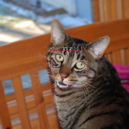
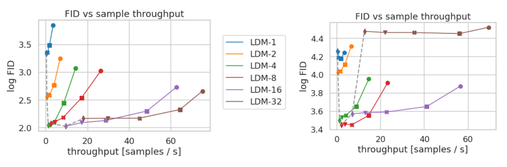


LDM 先训练编码器把图像压缩成较小的特征网格，同时训练解码器从网格重建图像。等这套压缩模型训练好，再固定它，在网格上训练扩散模型。生成时，从与网格同尺寸的高斯噪声出发，按文本等条件逐步去噪，最后才用解码器得到像素图像。较小的网格让每次去噪更省计算；压缩得太小，又会丢失重建所需的细节。（由 GPT-6 总结）

**关键公式**

$$
z_0=s\mathcal E(x),\qquad\tilde x=\mathcal D(z_0/s).
$$

$$
z_t=\sqrt{\bar\alpha_t}\,z_0+\sqrt{1-\bar\alpha_t}\,\epsilon.
$$

$$
L_{\mathrm{LDM}}=\mathbb E_{x,y,t,\epsilon}\!\left[\|\epsilon-\epsilon_\theta(z_t,t,\tau_\phi(y))\|^2\right].
$$

$$
Q=FW^Q,\qquad K=CW^K,\qquad V=CW^V.
$$

$$
\operatorname{Attention}(Q,K,V)=\operatorname{softmax}\!\left(\frac{QK^\top}{\sqrt{d_k}}\right)V.
$$


### 1. 基本思路

将一套像素扩散模型从 $256\times256$ 扩大到 $1024\times1024$，要处理的空间位置增加 16 倍。[DDIM](/papers/ddim/) 可以减少去噪网络的调用次数，但每调一次，网络还是要在大网格上工作。Rombach 等人在 *High-Resolution Image Synthesis with Latent Diffusion Models* 中问的是：**能否让每次去噪只处理一张小网格，最后仍然生成清楚的大图？**

直接缩小图像，确实能省计算；可小图只留下少量 RGB 像素，细线和边缘在去噪前就可能消失。论文让网络自己学习怎样缩小：用卷积编码器把原图变成小网格，每个位置的多个通道可以保留不同信息，例如边缘的位置和走向；再用解码器学习把这些信息展开成像素。训练时拿重建图和原图对照，才能判断哪些信息值得保留。这叫**感知压缩**，得到的特征网格叫**潜表示**。

接下来把真实图像换成它们的潜表示，沿用 [DDPM](/papers/ddpm/) 的方法训练去噪网络。这样，生成就分成两件事：用小网格上的反复去噪决定画面内容，到最后再用一次解码器生成像素。这就是 **LDM（Latent Diffusion Models，潜空间扩散模型）**。

### 2. 感知压缩

#### 2.1 网格表示

将图像记为 $x\in\mathbb R^{H\times W\times3}$，编码器记为 $\mathcal E$，解码器记为 $\mathcal D$。第一阶段计算：

$$
u=\mathcal E(x)\in\mathbb R^{h\times w\times c},\qquad \tilde x=\mathcal D(u).
$$

$H,W$ 是原图的高和宽，$h,w$ 是潜网格的高和宽，$c$ 是网格每个位置的通道数。$u$ 表示未经缩放的编码结果，$\tilde x$ 是与原图同样大小的重建图。空间下采样倍率为：

$$
f=H/h=W/w.
$$

以原论文的文本生成模型为例，$f=8,c=4$：编码器把 $256\times256\times3$ 的图像变为 $32\times32\times4$ 的网格。每条空间轴缩小 8 倍，位置数减少到原来的 $1/64$；再计入通道数，潜分量与像素分量之比为：

$$
\frac{hwc}{3HW}=\frac{c}{3f^2}=\frac1{48}.
$$

编码器在 $256\times256$ 的图像上先提取卷积特征，再经过降采样和残差块，依次处理 $128\times128$、$64\times64$、$32\times32$ 的特征图，最终形成 4 通道的潜表示。一个潜位置综合了附近多个像素的信息，各通道共同记录有助于重建的特征；随着感受野扩大，它也能结合更远的内容。

解码器学习相反方向的变换：在 $32\times32$ 网格上读取特征，通过卷积、残差块和上采样，逐层恢复到 $64\times64$、$128\times128$、$256\times256$，最后输出 3 个颜色通道。每层都根据邻域特征计算新的数值，逐步将特征展开为图像。

**潜网格与解码器共同决定重建图像。** 一张图的哪些位置有边缘，由它自己的小网格传下去；怎样把这些线索展开成像素，由所有图片共用的解码器来学。假如编码器给两张图完全相同的网格，解码器也只能给出同一个重建结果。这就把问题变成了：小网格容量有限，训练时应该对哪些重建差异罚得更重？

> [!Note] **自编码器怎样训练**
> 输入图像就是监督目标，不需要人为标注。前向时依次运行编码器和解码器；反向时从重建误差出发，算出解码器参数的梯度，再沿着潜网格算出编码器参数的梯度。最后用这些梯度更新两边的参数。网格里的数是网络算出的中间特征，没有单独的标签；关于这张原图的信息都要经过小网格。

#### 2.2 重建目标

先取一张训练图像 $x$，经编码和解码得到重建图 $\tilde x$。训练要回答两个问题：重建保留了原图的哪些内容？补出的纹理看起来是否自然？像素和感知损失拿重建图与原图逐张对照，局部判别器则从真实图和重建图的样本中学习怎样判断纹理。

**像素损失 $L_{\mathrm{pixel}}$** 把原图与重建图在同一位置、同一颜色通道上的绝对差加起来，记作 $\|x-\tilde x\|_1$。它要求坐标和颜色对得上。如果相似的潜表示对应好几种细纹理，逐像素折中就可能把纹理抹平。下一项改在视觉特征上比较同一对图像。

**感知损失 $L_{\mathrm{perc}}$** 中的 $\mathrm{perc}$ 是 *perceptual* 的缩写。实现采用 **LPIPS**（Learned Perceptual Image Patch Similarity，学习得到的感知距离）：让 $x$ 和 $\tilde x$ 分别经过同一个预训练的卷积网络 VGG-16，从五个层级取出卷积特征来比较。浅层特征响应局部边缘和纹理；较深层的一个位置能看到更大的区域，可以比较更大的形状。同一处碗沿即使颜色略有偏差，只要边缘还在，提取出的边缘特征就可能相近；边缘被抹掉时，这些特征就会拉开差距。

在每层的每个位置，把该位置的通道向量按长度归一化，减少整体幅度对比较的影响。记第 $\ell$ 层、位置 $p$、通道 $k$ 的归一化特征为 $\phi_{\ell pk}$，两张图在这里的差就是 $\delta_{\ell pk}=\phi_{\ell pk}(x)-\phi_{\ell pk}(\tilde x)$。$w_{\ell k}$ 是 LPIPS 预先学好的通道权重；第 $\ell$ 层有 $N_\ell$ 个空间位置。LPIPS 把特征差平方，按通道加权、按位置取平均，再把各层的结果相加：

$$
L_{\mathrm{perc}}
=\sum_\ell\frac{1}{N_\ell}\sum_p\sum_k w_{\ell k}\,\delta_{\ell pk}^2.
$$

训练时固定 VGG-16 和 LPIPS 的权重。原图的特征是参照，重建图的特征会随自编码器的输出改变。梯度因此沿重建图的计算路径传回解码器和编码器，训练它们一起保住能产生这些特征的信息。

**对抗损失 $L_{\mathrm{gen}}$** 中的 $\mathrm{gen}$ 指 *generator*，这里负责生成重建图的是自编码器。局部判别器 $D_\psi$ 的任务不同：它每次只看一张图，给各个图块打分，不拿它与对应原图比较。更新判别器时，把原图和重建图分别当作真实和重建样本，让它学会给真实图块打更高的分；这一步只更新判别器参数 $\psi$。更新自编码器时，固定判别器，把重建图的局部分数取平均再加负号，得到 $L_{\mathrm{gen}}=-\operatorname{mean}D_\psi(\tilde x)$。损失越小，重建图的分数就越高。梯度能穿过判别器传回重建图，引导自编码器把局部纹理做得更接近真实图块。

还有一项是**潜表示的正则化损失 $L_{\mathrm{reg}}$**，其中 $\mathrm{reg}$ 指 *regularization*。它直接约束编码器产生的网格；第 2.3 节分别说明高斯约束和向量量化怎样计算这项代价。将四种信号合在一起，用 $L_{\mathrm{AE}}$（AE 指自编码器）表示自编码器更新时的目标：

$$
L_{\mathrm{AE}}=L_{\mathrm{pixel}}+\lambda_{\mathrm{perc}}L_{\mathrm{perc}}+\lambda_{\mathrm{adv}}L_{\mathrm{gen}}+\lambda_{\mathrm{reg}}L_{\mathrm{reg}}.
$$

$\lambda_{\mathrm{perc}}$、$\lambda_{\mathrm{adv}}$ 和 $\lambda_{\mathrm{reg}}$ 分别控制感知、对抗（*adversarial*）和潜空间约束的权重。官方实现还会根据重建项和对抗项在解码器末层产生的梯度大小，调节对抗权重。自编码器和判别器在不同批次的图像上反复交替更新，让小网格在有限容量下尽量保留重建所需的结构和纹理。进入第二阶段时保留编码器和解码器，感知网络和判别器不再参与训练。

<figure class="ddpm-figure">
  
  <figcaption>自编码器的重建比较；来源：原论文 Figure 1</figcaption>
</figure>

第一列是输入，后面是不同压缩模型的重建。观察碗碟上的纹理和人脸五官，可以看到压缩后的信息怎样影响最终可恢复的外观。这比较的是自编码器，尚未运行扩散生成。

#### 2.3 潜分布约束

重建目标约束了解码后的图像，第二阶段却要直接学习中间的潜表示，因此也需要整理这些编码的数值尺度与结构。例如，编码器输出乘以一个数，解码器在入口除以它，重建仍然相同，潜表示的尺度却变了。论文加入较弱的正则化，比较两条路线：让每张图的编码分布向标准高斯靠近，或让局部编码向一组可学习的代表向量靠近。

**高斯约束（KL-reg）。** 这条路线让编码器为每张图输出一个分布，从中抽取一个网格来重建。后面的 KL 项给均值偏离零、方差偏离一的编码增加代价，让编码尽量处在相近的数值范围内。编码器给出每个分量的均值 $\mu_j(x)$ 和方差的对数，再换算出标准差 $\sigma_j(x)$。实际抽样写成噪声乘标准差、再加均值：

$$
u=\mu(x)+\sigma(x)\odot\xi,\qquad\xi\sim\mathcal N(0,I).
$$

$\odot$ 表示逐分量相乘。$\xi$ 是第一阶段或提取潜表示时抽取的噪声；第二阶段给潜网格加的扩散噪声另行抽取。

> [!Note] **随机抽样后怎样反传**
> 以上写法叫重参数化。一次前向算出 $u_j=\mu_j+\sigma_j\xi_j$ 后，反向时就把这次抽到的 $\xi_j$ 当作常数。于是改动 $\mu_j$ 会等量改动 $u_j$，改动 $\sigma_j$ 则会按 $\xi_j$ 的比例改动 $u_j$。重建误差因此能通过这两个普通的加乘运算，传回编码器预测均值和标准差的部分。

正则项 $L_{\mathrm{reg}}$ 比较这张图的编码分布 $q_{\mathcal E}(u\mid x)$ 与标准高斯，用的是 KL（Kullback–Leibler）散度，两个分布相同时取零。下面省略均值和标准差对 $x$ 的依赖：

$$
L_{\mathrm{reg}}=\frac12\sum_j\left(\mu_j^2+\sigma_j^2-\log\sigma_j^2-1\right).
$$

这个式子来自对两个高斯密度的对数比取期望：$\mathbb E[(u_j-\mu_j)^2]=\sigma_j^2$，$\mathbb E[u_j^2]=\mu_j^2+\sigma_j^2$，代入即可得到各项。均值偏离零、方差偏离一都会增加代价。

论文将 KL 项乘以约 $10^{-6}$ 的小权重，使编码仍能优先保留当前图像的信息。不同图像会得到不同的均值与标准差，把这些编码汇在一起，仍然形成需要学习的复杂分布。以单个分量为例，它的总体方差同时包含编码抽样和图像内容的差异，全方差公式给出：

$$
\operatorname{Var}(u_j)=\mathbb E_x[\sigma_j(x)^2]+\operatorname{Var}_x(\mu_j(x)).
$$

前一项来自同一图像编码时的抽样，后一项来自不同图像的均值差异。

**向量量化（VQ-reg）。** 这条路线用一组可学习的代表向量整理局部编码。向量 $e_1,\ldots,e_K$ 合称码本；对每个空间位置的连续向量 $u_i\in\mathbb R^c$，选择最近的码向量：

$$
k_i=\mathop{\arg\min}_{k\in\{1,\ldots,K\}}\|u_i-e_k\|^2.
$$

重建时，位置 $i$ 的解码输入就是选中的码向量 $e_{k_i}$。最近邻选择会在分界处突然换码，不能直接靠它求梯度。训练使用直通梯度：前向把选中的码向量交给解码器，反向则把解码器传回的梯度交给量化前的 $u_i$。正则项另做两次距离比较：固定 $u_i$，把选中的码向量 $e_{k_i}$ 拉向它；再把码向量当成固定目标，让编码器输出靠近所选的码。前者更新码本，后者让编码器逐渐用稳定的码表示相似的局部外观。

若在量化后只取码本编号，编号之间的大小和差值没有视觉意义；取出编号对应的特征向量，才有可比较的距离。LDM 选择在**量化前**取连续特征做扩散，保留每个位置向哪个码向量靠近的信息。生成结束后，把新网格交给解码器入口做最近邻量化，后面的重建网络就仍然收到它训练时使用的码向量。采用 KL 时则可直接解码抽样得到的连续向量。

### 3. 潜空间扩散

#### 3.1 数据与尺度

第二阶段固定编码器和解码器，让扩散模型在同一套表示上学习。编码器给训练图像提供清晰网格，解码器将来按同样的特征约定读取生成网格。在这个阶段，去噪误差只需在潜网格上计算；每训练一步都解码成大图，既增加计算，也没有为当前的噪声预测提供必要的标签。

这里可以把生成质量拆成两个问题。先从验证集中取一张真图，编码后马上解码：如果细线在重建时就断了，采样器还没有参与，问题已经出在表示或解码环节。再用扩散模型生成许多新网格，交给同一个解码器：即使它能完全复现训练数据的潜网格分布，解码出来的也只是**与真实图像的重建结果同分布**，而不会自动还原编码时丢掉的信息。这正是论文既比较真实图的重建，也比较从噪声生成的样本的原因。前者检验压缩保留了什么，后者还检验去噪网络把潜分布学得怎么样。

潜网格虽然变小了，其数值大小却可能和像素相差很多。如果网格值远大于要加入的噪声，照搬 DDPM 的噪声表，同一时刻就会保留更多原图信息，末端也可能残留本来要抹掉的信号。因此还要把潜表示的尺度调到和单位高斯噪声相配。将扩散使用的清晰潜状态写为：

$$
z_0=s\mathcal E(x).
$$

$s>0$ 是固定缩放系数；KL 方案中的 $\mathcal E(x)$ 包含上一节的抽样。生成完毕后，用 $\mathcal D(z_0/s)$ 回到图像。空间倍率 $f$ 改变网格尺寸，数值系数 $s$ 改变同一网格中数的大小。

数值尺度会影响潜表示被噪声破坏的程度。设原始潜表示某个分量的方差为 $v$，缩放后变为 $s^2v$。按 [DDPM 的加噪公式](/papers/ddpm/)，$\bar\alpha_t$ 是时刻 $t$ 保留的信号方差比例，因此信号方差为 $\bar\alpha_t s^2v$，噪声方差为 $1-\bar\alpha_t$。两者之比就是该分量的信噪比（SNR，*signal-to-noise ratio*）：

$$
\operatorname{SNR}_t=\frac{\bar\alpha_t s^2v}{1-\bar\alpha_t}.
$$

保持噪声表不变，将潜表示放大两倍，信噪比便增大四倍。此时同一个 $t$ 对应的实际破坏程度更轻，网络需要处理的任务也随之改变。训练和生成必须使用同一尺度。

对 KL 正则化的潜空间，补充材料 F 节用第一个训练批次的编码样本估计标准差。把整个批次的所有通道和空间位置展成 $K$ 个数，用它们的均值 $\hat\mu$ 计算方差，再取标准差的倒数作为缩放系数：

$$
\hat\sigma^2=\frac1K\sum_{j=1}^K(u_j-\hat\mu)^2,\qquad s=1/\hat\sigma.
$$

估计后固定这个系数，使潜表示的整体标准差接近一。这是全体分量的一个尺度估计，不是逐图、逐位置重新归一化；计算均值是为估计方差，论文的缩放操作本身是乘以 $s$。不同通道与位置仍然可以具有不同统计规律。

#### 3.2 加噪与训练

沿用 DDPM 的记号，$\alpha_t=1-\beta_t$，$\bar\alpha_t=\prod_{r=1}^t\alpha_r$。从干净潜状态直接构造第 $t$ 步：

$$
z_t=\sqrt{\bar\alpha_t}\,z_0+\sqrt{1-\bar\alpha_t}\,\epsilon,\qquad\epsilon\sim\mathcal N(0,I).
$$

$\epsilon,z_0,z_t$ 的形状相同。以 $B$ 表示批量大小，代码常按通道在前写为 $B\times c\times h\times w$；前面的每个样本都是 4 通道、$32\times32$ 的网格。这里是先编码清晰图像，再给潜表示加噪；编码器是非线性网络，若先给像素加噪再编码，一般会得到不同结果。

无条件噪声预测目标为：

$$
L_{\mathrm{LDM}}=\mathbb E_{x,t,\epsilon}\!\left[\|\epsilon-\epsilon_\theta(z_t,t)\|^2\right].
$$

训练时均匀抽取时刻 $t$，每次只构造一个噪声程度的样本。网络输出与 $z_t$ 同形状，逐分量预测已知的 $\epsilon$。平方误差把训练结果推向给定 $z_t,t$ 时噪声的条件均值，这与 DDPM 中的结论相同。

与 DDPM 对照，变化的只是干净样本：像素图 $x_0$ 换成了固定编码器给出的网格 $z_0$。前向加噪仍是高斯过程，所以原来的后验与变分推导也适用；严格推导会给不同时刻的噪声误差分配不同权重，论文沿用 DDPM 的简化目标，将它们等权处理。

#### 3.3 采样与解码

生成时直接在潜网格的形状上抽样：对 $32\times32\times4$ 个位置和通道独立抽取标准高斯数，组成 $z_T$。用这种噪声作起点，是因为训练噪声表在 $T$ 已把清晰网格的系数压得很小。每步把当前潜状态 $z_t$ 和时刻 $t$ 交给 U-Net；有条件生成还输入对应条件。网络输出同形状的噪声预测 $\hat\epsilon_t$，一次网络调用到这里结束。

接着由**网络外的采样器**使用噪声表和预测结果，计算下一潜状态。先换算清晰潜状态估计：

$$
\hat z_0=\frac{z_t-\sqrt{1-\bar\alpha_t}\,\hat\epsilon_t}{\sqrt{\bar\alpha_t}}.
$$

选择更低噪声的时刻 $r<t$，确定性 DDIM 更新是：

$$
z_r=\sqrt{\bar\alpha_r}\,\hat z_0+\sqrt{1-\bar\alpha_r}\,\hat\epsilon_t.
$$

这里用 $r$ 表示下一时刻，与缩放系数 $s$ 区分。更新式的第一项保留当前估出的清晰内容，第二项按目标时刻 $r$ 的噪声程度保留一部分噪声。于是即使已经算出了 $\hat z_0$，采样器也先走到 $z_r$：在较清晰的输入上，网络还有机会修正上一次的估计。也可以换成 DDPM 或带新随机噪声的 DDIM 更新；这些选择改变的是怎样从噪声预测得到下一网格。

每轮重新调用网络，最终得到生成潜状态，再解码：

$$
x_{\mathrm{gen}}=\mathcal D(z_0^{\mathrm{gen}}/s).
$$

所有 $z_t$ 都保持 $32\times32\times4$，反复去噪改变的是网格中的数值。结束时才除以 $s$，让固定解码器将最终网格变成 $256\times256\times3$ 的图像。KL 方案直接解码连续向量，VQ 方案则先经过解码器入口的量化。

### 4. 条件去噪

解码器擅长把网格转成图像，但它并不读提示词。要改变画什么，需要在生成网格时就让文字参与。比如一处正在形成的轮廓可能是猫也可能是椅背，网络需要根据该处的特征决定参考描述中的哪部分。LDM 把这个选择放入 U-Net 的各个尺度：粗尺度也能借助文字决定布局，细尺度也能借助文字调整局部内容。

#### 4.1 多尺度特征

U-Net 也会缩小再放大网格，但它处理的是一次去噪中的内部特征。它的输入和输出都在 $32\times32$ 的潜空间，最终要给网格的每个分量预测一个噪声值。Figure 3 把这次计算横着画出：右侧宽端到中央窄处是特征的下降路径，再向左逐级恢复分辨率，是上升路径。

<figure class="ddpm-figure">
  
  <figcaption>潜空间扩散与条件输入；来源：原论文 Figure 3</figcaption>
</figure>

**先看图的外圈。** 左上真实图像 $x$ 经过 $\mathcal E$ 进入绿色潜空间，训练时沿上方箭头加噪。生成时直接从右侧的 $z_T$ 出发，不运行左上的图像编码。去噪方向从右向左，最后在左下经过 $\mathcal D$ 得到像素图像。图中 $z$ 对应本文未缩放的表示；数值缩放 $s$ 在这个示意图中省略了。

**再看一次 U-Net 调用。** 在生成的某个时刻，将 $32\times32\times4$ 的 $z_t$ 送入右侧宽端。入口卷积先将 4 通道变为 320 通道，之后的特征保持图像网格形式，但通道含义由网络学习。原论文文本模型采用基础宽度 320、通道倍率 $1,2,4,4$，下面列出各层级完成特征融合后的代表尺寸，省略批量维度：

| 路径位置 | 特征形状 | 这一级做什么 |
| --- | --- | --- |
| 入口 | $32\times32\times320$ | 将当前带噪潜状态转换为工作特征 |
| 下降一级 | $16\times16\times640$ | 降采样，融合更大范围的信息 |
| 下降二级 | $8\times8\times1280$ | 继续结合远处结构 |
| 中央窄处 | $4\times4\times1280$ | 在较粗网格上计算整体联系 |
| 上升一级 | $8\times8\times1280$ | 上采样，并融合对应的下降特征 |
| 上升二级 | $16\times16\times640$ | 恢复更细的位置区分 |
| 上升三级 | $32\times32\times320$ | 回到输入潜网格的空间尺寸 |
| 输出层 | $32\times32\times4$ | 将工作特征投影为噪声预测 |

每一级包含多个残差块。一个块在当前尺度做卷积变换，再与块的输入相加；通道变化时，输入支路也会做相应投影。下降使每个特征位置结合更大范围的内容，上升则把这些内容重新分配到更细的位置。因此，一次预测可以同时利用局部纹理线索和整体布局。

**灰色虚线是跳跃连接。** 下降路径会保留各级特征。上升路径回到 $16\times16$ 时，就取回下降途中同样大小的特征，沿通道拼接，再交给残差块融合。这样，回到细网格时既有中央窄处传来的整体结构，也能取回细节尚未被下采样削弱时的位置线索。

**时间和文本从不同入口进入。** 时刻 $t$ 先经过正弦、余弦编码和多层感知机，得到一个时间向量；各残差块再把它映射到自己的通道宽度，加到中间特征上，沿空间位置广播。它告诉每个块当前噪声程度。文本则从图右侧经过 $\tau_\phi$，沿下方黑线送往下降、上升路径多处黄色 Q、K、V 模块，在那里更新图像特征。时间调节与文字读取都参与这一整次预测。

**最后从 320 通道回到 4 通道。** U-Net 输出当前潜噪声的估计 $\hat\epsilon_t$，采样器才用第 3.3 节的公式算出下一状态 $z_r$。图上简写的 $z_T\to z_{T-1}$ 包含这两项计算；左侧的回环表示下一轮还要拿新的网格重走一遍 U-Net。

因此这里有两种恢复分辨率的过程：U-Net 从 $4\times4$ 回到 $32\times32$，目的是预测潜网格上的噪声；固定图像解码器从 $32\times32$ 回到 $256\times256$，目的是生成最终像素。后者在采样结束时才运行。

#### 4.2 文本编码

将提示词记为 $y$，文本编码器记为 $\tau_\phi$，$\phi$ 是它的可训练参数。先把文字拆成词元（token），给每个词元查出一个向量，再加上它在句中的位置向量。这些只是初始特征；编码器接着让每个位置结合整句的其他词。例如在「椅背后的小猫」里，和「猫」有关的向量也会带上附近词提供的上下文。最终输出的每一行仍对应一个词元位置：

$$
C=\tau_\phi(y)\in\mathbb R^{B\times M\times d_c}.
$$

$B$ 是一批中的提示词条数，$M$ 是每条提示的序列长度，$d_c$ 是每个位置的特征宽度。原论文用 BERT 的分词器把文字切成词元，可以细到一个单词的一部分；这些词元交给随图像生成任务联合训练的条件 Transformer。这一网络有 32 层，序列长度为 77、特征宽度为 1280（补充材料 Table 17）。

编码器一次读完整句提示，每个位置的表示都能利用前后的词。$C$ 只依赖输入文字，所以同一句提示只需编码一次；随采样时刻改变的是从它读取信息的图像特征。

#### 4.3 交叉注意力

如果把整句先合成一个向量，再复制给所有位置，每处都收到同一份文字摘要。交叉注意力保留逐个词元的特征，让每个图像位置用自己的特征去找相关的词。取 U-Net 某层的特征图，高和宽为 $h_i,w_i$，通道数为 $d_u$。把空间轴展开成 $N=h_iw_i$ 个位置，暂省略批量维度，得到 $F\in\mathbb R^{N\times d_u}$。这只改变排列方式，每一行仍对应原网格的一个位置。

> [!Note] **查询、键和值分别做什么**
> 卷积按网格上的邻域读取，使用训练后固定的卷积核；注意力先为当前输入算一组读取权重。查询和键负责打分，点积越大，经过 softmax 后分到的权重越大；值向量携带真正要取回的内容。把键和值分开投影，就可以分别学习「什么情况下应该读这个词」与「读到它时应该取回哪些特征」。[Transformer 的注意力部分](/papers/transformer/) 有完整计算。

以一个注意力头为例，令查询与键的宽度为 $d_k$，值的宽度为 $d_v$。用三个可学习矩阵投影：

$$
Q=FW^Q,\qquad K=CW^K,\qquad V=CW^V.
$$

这里 $C$ 表示当前样本的 $M\times d_c$ 文本特征。各矩阵的形状为：

| 量 | 形状 | 含义 |
| --- | --- | --- |
| $W^Q$ | $d_u\times d_k$ | 把图像特征投影为查询 |
| $W^K$ | $d_c\times d_k$ | 把文本特征投影为键 |
| $W^V$ | $d_c\times d_v$ | 把文本特征投影为值 |
| $Q$ | $N\times d_k$ | 每个图像位置提出一个查询 |
| $K,V$ | $M\times d_k$、$M\times d_v$ | 每个文本位置提供匹配与内容 |

将 Q 的第 $i$ 行向量记为 $q_i$，K、V 的第 $j$ 行向量记为 $k_j,v_j$。查询和键逐对点积，得到 $N\times M$ 的匹配分数。令缩放点积 $a_{ij}=q_i k_j^\top/\sqrt{d_k}$，沿文本轴作 softmax，再加权读取值向量：

$$
A_{ij}=\frac{\exp(a_{ij})}{\sum_{m=1}^M\exp(a_{im})},\qquad o_i=\sum_{j=1}^M A_{ij}v_j.
$$

对每个图像位置 $i$，有 $\sum_jA_{ij}=1$。$\sqrt{d_k}$ 用于控制点积随特征宽度增长的数值尺度，避免 softmax 过早集中到少数项。输出 $O=AV\in\mathbb R^{N\times d_v}$ 仍有 $N$ 行，读取的是文本，更新的位置仍在图像网格上。

沿一行看，这里实际做了两件事：先用 $q_i$ 与整句的键比较，决定当前位置该从哪些词元取信息；再用这些权重对值向量求和，决定带回什么内容。相邻位置 $i'$ 即使用的是同一句话，也有自己的查询 $q_{i'}$，所以可以得到另一组权重。换到下一去噪步，文字的键和值在该层仍然相同，但更新后的图像产生了新的查询，位置与词元的对应关系也可以改变。

多个头在各自的投影空间读取条件，将输出拼接并投影回 $d_u$ 维，随后通过残差连接更新 $F$，再恢复为空间特征图。以 $32\times32\times320$ 的图像特征和 $77\times1280$ 的文本特征为例，每个头有 1024 个查询，权重矩阵为 $1024\times77$；每行都把 77 个文本值向量汇总到一个图像位置。

**Q 来自图像，K、V 来自文本**，所以它称为交叉注意力。图像自注意力则让 Q、K、V 都来自图像位置，用于图像区域间的信息交互。论文在 U-Net 的多个尺度加入结合自注意力、交叉注意力和前馈计算的 Transformer 模块，使结构推断和文字读取可以反复交替。

加入条件后的目标为：

$$
L_{\mathrm{LDM}}=\mathbb E_{x,y,t,\epsilon}\!\left[\|\epsilon-\epsilon_\theta(z_t,t,\tau_\phi(y))\|^2\right].
$$

图文配对数据通常不标注每个词对应哪些像素。注意力仍能学会这种联系，因为改变某个图像位置读取的文本内容，就可能改变最终的噪声误差。反向传播时，梯度沿 U-Net 回到注意力层，更新生成 Q、K、V 的投影；K、V 又由 $C$ 算出，因而原论文中可训练的文本编码器 $\tau_\phi$ 也会更新。第一阶段的图像编码器仍然固定。

#### 4.4 空间条件

语义分割图、低分辨率图像与修补掩码具有直接的空间位置。可先将条件变换到潜网格尺寸，得到 $Y\in\mathbb R^{B\times c_{\mathrm{cond}}\times h\times w}$，其中 $c_{\mathrm{cond}}$ 是条件通道数，再沿通道拼接：

$$
\operatorname{input}=\operatorname{concat}(z_t,Y)\in\mathbb R^{B\times(c+c_{\mathrm{cond}})\times h\times w}.
$$

条件增加输入通道，噪声预测仍只输出被加噪的 $c$ 个潜通道。对前面的 $32\times32$ 潜网格，条件也要变换为 $32\times32$，使相同位置的信息对齐后一起进入入口卷积。语义图应采用适合标签的缩放或编码，低分辨率图则提供对应位置的颜色与结构；所用变换要在训练和生成时保持一致。

文字没有这样的像素对应关系，交叉注意力允许每个图像位置读取全部文本。框布局也可编码成类别与坐标 token，再通过注意力读取；原论文同时验证了这两种条件接入方式。选择拼接还是注意力，取决于条件的结构和具体任务。

可以从第一个卷积核看到两种入口的差别。采用空间拼接时，卷积核在位置 $(i,j)$ 附近同时读取潜特征与该处的条件通道，后续层再逐渐扩大感受野。条件图平移了一个位置，输入的对应关系也跟着移动。采用文本交叉注意力时，模型没有“第 $(i,j)$ 个词”可以直接对齐，需要在每一行的匹配分数里学出这种对应。前者借助数据已有的位置关系，后者从图文配对中学习在哪里使用哪个词。

### 5. 训练与生成

#### 5.1 两阶段训练

**第一阶段学会保存一张给定的图。** 在 Figure 3 左侧，编码器将 $256\times256\times3$ 的图像压缩成潜网格，按 KL 或 VQ 方案抽样或量化，解码器据此重建原图。第 2 节的重建、感知、对抗和正则化目标训练这套自编码器，局部判别器与它交替更新。

**第二阶段固定这套表示，训练绿色区域中的生成网络。** 取图像与对应文字，图像经固定编码器和缩放得到 $z_0$。均匀抽取 $t\in\{1,\ldots,T\}$，用一份 $32\times32\times4$ 的已知噪声构造 $z_t$；文字经条件编码器得到 $C$。然后用 $z_t,t,C$ 运行一遍完整 U-Net，将它输出的 4 通道与加入的噪声逐分量比较。

这一次噪声预测就足以更新 U-Net 和文本编码器。误差直接在潜网格上计算，图像解码器与判别器都不用运行。第一阶段已经决定了哪些细节能进入网格；第二阶段学习的是怎样按照条件生成这样的网格。

#### 5.2 条件采样

生成时固定全部参数，选择与模型匹配的噪声表和采样时刻。文字先编码为 $C$，然后直接抽取 $32\times32\times4$ 的高斯噪声作为 $z_T$。这里没有训练图像，所以 Figure 3 左上的 $x\to\mathcal E$ 路径被省去。

从第一个采样时刻开始，反复执行同一件事：把当前 $z_t$、时间 $t$ 和文字 $C$ 交给 U-Net，得到噪声预测；采样器再据此计算 $z_r$，令它成为下一轮输入。所有轮次共用网络参数和文字特征，改变的是潜状态及时间。到达时刻 0，才将最终网格除以 $s$，通过固定解码器恢复成 $256\times256\times3$ 的图像。

使用 [CFG（无分类器引导）](/papers/cfg/) 时，训练要让模型同时学会有条件和无条件预测，例如随机丢弃一部分条件。在同一个 $z_t,t$ 上，令 $\epsilon_c=\epsilon_\theta(z_t,t,C)$、$\epsilon_u=\epsilon_\theta(z_t,t,\varnothing)$。引导尺度记为 $s_{\mathrm{cfg}}$，以区别于潜变量的缩放系数 $s$：

$$
\hat\epsilon_t=\epsilon_u+s_{\mathrm{cfg}}(\epsilon_c-\epsilon_u).
$$

$s_{\mathrm{cfg}}=1$ 使用普通条件预测，$s_{\mathrm{cfg}}>1$ 放大条件与无条件预测的差异。随后仍使用同一套潜空间采样公式。实现可以把两次预测合成一个批量调用，但计算量仍包含两支预测；使用 CFG 时，要把这些成本计入生成速度。

#### 5.3 计算量来源

压缩缩小的是网络所处理的空间网格。固定卷积核和通道数时，卷积计算量随空间位置数近似线性变化，因而受益于约 $f^2$ 倍的位置减少。图像自注意力若在 $N$ 个位置之间建立完整权重矩阵，需要处理 $N^2$ 个匹配；交叉注意力则处理 $NM$ 个图文匹配。

实际 U-Net 还会改变通道宽度、降采样层级与注意力位置，速度收益需由整套模型测量。第一阶段本身也需要训练，文本条件要编码，生成结束要解码。LDM 主要减少反复执行的去噪网络开销；它与减少采样步数的 DDIM 可以叠加使用。

#### 5.4 把小图放大四倍

先看下面的左图：能辨认出猫头、眼睛和椅背，但胡须和额头的条纹已经模糊。论文用 LDM-SR 做四倍超分辨率（SR，*super-resolution*），即从一张 $64\times64$ 的小图生成 $256\times256$ 的图像。左图用双三次插值放到同样尺寸，方便与右边的生成结果比较。插值可以多算出一些像素，却没有增加新的观测。

<figure class="ddpm-figure">
  
  
  <figcaption>同一张输入小图：左为双三次插值，右为 LDM-SR 输出。来源：<a href="https://arxiv.org/html/2112.10752v2#S4.F10">原论文 Figure 10 第一行前两幅</a>，右图方框为原图标记。</figcaption>
</figure>

模型怎样学会从左走到右？训练时有高清照片，可以从中同时准备**条件和目标**。先把照片缩成 $64\times64$ 的 RGB 小图，作为 U-Net 可以一直查看的条件。再用训练好并固定的自编码器编码高清原图，得到去噪目标所在的潜网格。原论文的超分辨率模型取 $f=4$、潜通道数为 3，因此这个网格也是 $64\times64\times3$。两者虽然形状一样，一份装的是小图的颜色，另一份装的是高清图编码后的特征。

只给目标潜网格加噪。假设其中一个清晰分量为 $0.5$，抽到的噪声为 $-1$，此时信号和噪声的系数是 $0.8$、$0.6$，则带噪值为 $0.8\times0.5+0.6\times(-1)=-0.2$。U-Net 接收时刻，以及沿通道拼在一起的带噪网格和未加噪的小图：每个位置共 6 个输入分量，只预测 3 个潜噪声分量。选中那一项的答案是 $-1$；小图作为已知条件，提供有助于预测这份噪声的位置和轮廓线索。

实际放大时只提供小图，在目标潜网格的位置抽一份新的高斯噪声。每次更新，U-Net 都能在同一位置读到小图提供的颜色和轮廓；采样器改变的是潜网格，小图一直不变。到此可以看出把生成放在潜空间的用处：网络用同样的 $64\times64$ 网格反复判断眼睛和额头该怎样补细节，等网格定下来，解码器才把这些特征展开到 $256\times256$。小图约束了眼睛的位置，新出现的毛发纹理则来自模型学到的规律。

### 6. 实验结果

#### 6.1 压缩与重建

先看第一阶段。补充材料 Table 8 在 OpenImages 上训练自编码器，在 ImageNet 验证集上评价重建。两项指标回答不同的问题：**峰值信噪比**（PSNR）先计算原图与重建图的像素均方误差，再衡量像素最大值的平方是该误差的多少倍，用分贝表示。误差越小，PSNR 越高。**Fréchet Inception 距离**（FID）则用预训练网络提取两组图像的特征，比较它们的均值和协方差，数值越低表示两组越接近。

| 空间倍率 $f$ | 潜通道 $c$ | 重建 FID ↓ | PSNR ↑ |
| ---: | ---: | ---: | ---: |
| 2 | 2 | 0.086 | 32.47 |
| 4 | 3 | 0.27 | 27.53 |
| 8 | 4 | 0.90 | 24.19 |
| 16 | 8 | 2.63 | 20.94 |

计算重建 FID 时，先把真实图像逐张编码、解码，再汇总这些重建图的特征；后文的生成 FID 则用从随机噪声生成的新图。两者分别评价压缩与生成。这些行同时改变了倍率与潜通道，展示的是各套压缩配置的结果。较强压缩降低了潜空间规模，也使重建更难。

重建能力之外，还要看生成模型是否容易学习编码的分布。论文观察到，VQ 表示上的扩散样本质量往往更好，虽然相应自编码器的重建指标略逊于连续 KL 方案。因此原论文多数实验采用 VQ，采用 KL 时会单独标注。

#### 6.2 速度与质量

论文第 4.1 节比较 $f=1,2,4,8,16,32$，其中 LDM-1 直接在像素上扩散。实验使用单张 A100，保持模型参数量接近，比较训练进展和采样表现。空间压缩越弱，单步计算越重；压缩过强，第一阶段丢失的信息又会限制可达到的质量。

<figure class="ddpm-figure">
  
  <figcaption>压缩倍率与速度、质量；来源：原论文 Figure 6</figcaption>
</figure>

左侧为 CelebA-HQ，右侧为 ImageNet。横轴是每秒生成样本数，越右越快；纵轴是 FID 的对数，越低越好。每条曲线从右向左依次使用 10、20、50、100、200 个 DDIM 步骤。该图用 5,000 个生成样本评估 FID，CelebA 模型训练 50 万步，ImageNet 模型训练 200 万步。

读图时先固定一条曲线：从 10 步走到 50 步，并没有改变编码器，只是同一个去噪网络被多调用了几次，所以吞吐量下降，FID 通常改善。再固定一个步数比较不同曲线：这才是在比较改变压缩倍率后，一次调用有多贵、同样步数能得到什么质量。这组实验中，$f=4$ 和 $f=8$ 较好地兼顾了两者。论文 Figure 5 的训练结果补上另一面：LDM-1 在大网格上学习得慢，LDM-32 虽然便宜，却较早停在较差质量。

#### 6.3 条件生成

原论文 Table 2、3 给出文本与类别生成结果。下表均为 $256\times256$ 输出、250 步 DDIM；标为 CFG 的行采用引导尺度 1.5：

| 任务与模型 | 引导 | FID ↓ |
| --- | --- | ---: |
| MS-COCO 文本生成，LDM-KL-8 | 无 CFG | 23.35 |
| MS-COCO 文本生成，LDM-KL-8 | CFG | 12.61 |
| ImageNet 类别生成，LDM-4 | 无 CFG | 10.56 |
| ImageNet 类别生成，LDM-4 | CFG | 3.60 |

无 CFG 的行仍提供正常的文本或类别条件，直接使用条件噪声预测；CFG 的行再按第 5.2 节组合条件与无条件预测。

文本模型约有 14.5 亿参数，在 LAION-400M 上训练，使用前文的 BERT 分词器与可训练 Transformer。MS-COCO 在这里是评估集，指标依据其验证集的 30,000 个样本计算。ImageNet 模型约有 4 亿参数，类别条件可由单个可学习嵌入提供，通过交叉注意力送入 U-Net。

CFG 明显改善了表中的 FID，但它也改变生成分布的覆盖程度。Table 3 中，ImageNet 的 Precision 从 0.71 提高到 0.87，Recall 从 0.62 降到 0.48：样本更集中于符合数据特征的区域，同时覆盖的变化范围变窄。条件引导的作用需要连同质量、覆盖和计算成本一起理解。

#### 6.4 修补与放大

在[第 5.4 节的四倍超分辨率任务](#54-把小图放大四倍)中，生成结果补出了输入小图里看不清的纹理。论文比较多种模型时发现，LDM-SR 在 FID 上有优势，另一种超分辨率扩散模型 SR3 在某些细小结构上更连贯，单纯回归模型则取得更高的 PSNR 和结构相似度（SSIM）。SSIM 对照两幅图的对应区域，比较局部亮度、对比度和结构。FID 比的是成组样本，所以补出的纹理即使没有和原图对齐，也可能因整体外观更接近真实照片而降低 FID。

修补实验在 Places 图像上训练和测试。正文 Table 6 固定模型参数规模，比较像素模型与潜空间模型；其中一组结果为：

| 模型 | 训练吞吐量 ↑ | $256^2$ 采样吞吐量 ↑ | 每轮训练与验证耗时 ↓ |
| --- | ---: | ---: | ---: |
| LDM-1，像素空间 | 0.11 | 0.26 | 20.66 小时 |
| LDM-4，KL、带注意力 | 0.32 | 0.97 | 7.66 小时 |

吞吐量单位为样本/秒。这组配置中，训练约快 2.9 倍，采样约快 3.7 倍；两者与仅按网格位置数估算的倍数不同。论文也提示各速度实验的批量和 GPU 配置应分别查看。

卷积结构还允许在较大的潜网格上运行。论文以语义图、超分辨率和修补等密集空间条件约束结构，将一些在 $256^2$ 上训练的模型用于 $512^2$ 至约百万像素的输出。较大图像会改变特征统计与全局结构要求；修补模型进一步在 $512^2$ 上微调后，整体 FID 从 2.40 改善到 1.50（Table 7）。这个实验也说明扩大张量可以执行，与在新尺度上获得稳定质量，是两个需要分别检查的环节。

### 7. 定位与局限

回到最初的计算问题：编码器在训练时把真实图像移入潜空间，解码器在生成末尾把新网格还原为像素，反复调用的只有较小网格上的去噪网络。因此减少了多少计算，要结合潜网格大小和采样步数一起看。换采样器可以继续减少调用次数，却改变不了固定编码器已经舍去了哪些细节。

**Stable Diffusion 是这一框架的具体模型系列。** 例如 SD v1 使用 $f=8$、4 潜通道的 KL 自编码器，固定的 CLIP 文本编码器，以及配置中的缩放系数 0.18215。原论文的文本模型使用另一套 Transformer 并联合训练，因此两者的条件编码与尺度约定需要按模型区分。LDM 中的 $z_0$ 是可解码的清晰表示，$z_T$ 则像 DDIM 的 $x_T$ 一样，是生成所用的高斯噪声起点。

第一阶段对每张图的重建能力，是需要精细像素对应任务中的实际限制。压缩后的小文字、细线与精确几何可能改变；感知与对抗目标还会倾向于产生自然外观，即使它与原图某些分量不同。后续扩散能学习新纹理，却无法把已经丢失的指定信息变成可靠恢复。

文本交叉注意力提供灵活的语义条件，但没有直接规定每个像素的位置和形状。需要精确边缘、深度或姿态时，可以继续研究 [ControlNet](/papers/controlnet/) 等空间控制方法；需要扩大去噪网络规模时，[DiT](/papers/dit/) 研究如何用 Transformer 取代 U-Net。无论换哪种骨干，潜空间压缩都仍需同时考察重建质量、生成能力和计算成本。

### 参考资料

1. Rombach et al. *High-Resolution Image Synthesis with Latent Diffusion Models*. CVPR 2022. [论文主页](https://arxiv.org/abs/2112.10752)；[CVPR 正文](https://openaccess.thecvf.com/content/CVPR2022/papers/Rombach_High-Resolution_Image_Synthesis_With_Latent_Diffusion_Models_CVPR_2022_paper.pdf)。框架见 §3，压缩权衡见 §4.1，条件任务见 §4.3—4.5；本文配图取自 Figure 1、3、6，生成与效率结果取自 Table 2、3、6、7。
2. 原论文 [补充材料](https://openaccess.thecvf.com/content/CVPR2022/supplemental/Rombach_High-Resolution_Image_Synthesis_CVPR_2022_supplemental.pdf)。§C.1 讨论潜尺度与高分辨率生成；Table 8 给出自编码器重建；§D.2、Table 15—17 说明条件网络和张量配置；§D.3 说明评估协议；§F 说明第一阶段目标、KL 抽样、缩放及量化前的连续表示，§G 讨论精细像素任务的局限。
3. CompVis. [latent-diffusion 官方实现](https://github.com/CompVis/latent-diffusion)。自编码器与扩散模型分别位于 `ldm/models/autoencoder.py`、`ldm/models/diffusion/ddpm.py`，文本模型配置见 `configs/latent-diffusion/txt2img-1p4B-eval.yaml`。
4. CompVis. [Stable Diffusion 官方实现](https://github.com/CompVis/stable-diffusion)。SD v1 的 CLIP 条件编码与缩放设置见模型说明和 `configs/stable-diffusion/v1-inference.yaml`。
