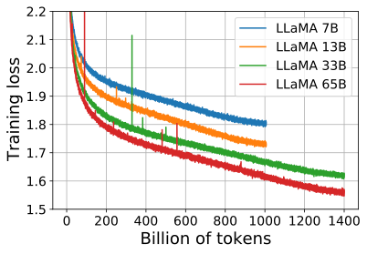


LLaMA 研究的是怎样用更多预训练数据，把足够强的语言模型做得更小，以降低日常生成的成本。第一代 LLaMA 沿用逐 token 预测，采用仅由解码层组成的 Transformer。每层先做 RMSNorm，再用带旋转位置编码的因果注意力读取前文，最后用 SwiGLU 加工当前位置的特征。训练时一次计算多个位置的预测损失，推理时每次取出一个 token，并缓存前文的键和值供下一步复用。（由 GPT-6 总结）

**关键公式**

$$
u=x+\operatorname{Attn}\!\left(\operatorname{RMSNorm}_1(x)\right).
$$

$$
y=u+\operatorname{FFN}\!\left(\operatorname{RMSNorm}_2(u)\right).
$$

$$
(R_iq_i)^\top(R_jk_j)=q_i^\top R_{j-i}k_j.
$$

$$
\operatorname{FFN}(v)=W_2\!\left(\operatorname{SiLU}(W_1v)\odot W_3v\right).
$$



### 1. 小模型的取舍

**LLaMA: Open and Efficient Foundation Language Models** 是 Touvron 等人在 2023 年发表的论文。[Chinchilla](../chinchilla/) 问的是训练算力固定时，模型多大、读多少 token 才能把预训练损失降得最低。LLaMA 从部署出发：如果模型需要回答大量请求，每次生成都要读取权重并进行运算。达到相近效果时，参数较少的模型一般需要更少的权重内存和计算量，值得为它增加一次性的训练投入。

作者训练了约 70 亿到 650 亿参数的四档模型。小档的 7B 和 13B 读过 1 万亿 token，大档的 33B 和 65B 读过 1.4 万亿。以 7B 为例，每个参数约对应 150 个训练 token，远多于 Chinchilla 模型的约 20 个。两者对应的是不同的取舍：在既定模型大小下继续训练，希望把长期使用的模型做小；为一笔固定训练预算挑模型，则还要比较把追加算力花在增大模型上能带来多少收益。

### 2. 一个解码层

#### 2.1 从文本到向量

LLaMA 与 [GPT](../gpt/) 都把提示和后续文本放在同一条序列里。分词器先按词表规则把文本拆成片段，再把每片换成一个编号。第一代 LLaMA 使用 SentencePiece 的 BPE 实现：训练分词器时，从短单元出发反复合并常相邻的单元，得到可以重复使用的较长片段。一个常见词可能只用一个 token，罕见词也能用几个短片段组合表示。论文还提到把数值按单个数字拆开，词表未覆盖的字符可回退到 UTF-8 字节。

token 编号指向嵌入表的一行；取出的向量才是解码层的输入。若有 $T$ 个 token、模型宽度为 $d$，这一层接收 $T$ 个 $d$ 维向量，输出也是 $T$ 个同样宽度的向量。以 7B 为例，$d=4096$，这样的层叠了 32 层，每层有独立参数。提示和回答的关系由因果自注意力处理，没有翻译模型中专门读取源句的交叉注意力。

#### 2.2 预归一化与残差

一个解码层要做两件事：让不同位置交换信息，再分别加工各位置刚汇总的特征。用 $x$ 表示层输入、$u$ 表示注意力更新后的中间结果、$y$ 表示层输出：

$$
u=x+\operatorname{Attn}\!\left(\operatorname{RMSNorm}_1(x)\right).
$$

$$
y=u+\operatorname{FFN}\!\left(\operatorname{RMSNorm}_2(u)\right).
$$

两次归一化都放在分支入口，因此称为**预归一化**。对每个位置独立处理，4096 维进、4096 维出；它控制的是当前位置的特征尺度。相加时保留原向量，在它上面加计算分支给出的改动。多层相连时，表示和梯度都有一条途经这些加法的直接路径。

> [!Note] **RMSNorm 控制什么量**
> 对一个 $d$ 维向量 $v$，先算每维平方的平均值，再开方得到均方根。用它给整个向量定尺度，最后按各维可学习的增益 $g$ 调整。公式为 $\operatorname{RMSNorm}(v)=g\odot v/\sqrt{\frac1d\sum_{k=1}^d v_k^2+\varepsilon}$，其中 $\odot$ 表示逐元素相乘，$\varepsilon$ 用于避免分母过小。RMSNorm 直接对原向量缩放；原 Transformer 使用的 LayerNorm 会先减去向量的均值。

#### 2.3 因果注意力

将位置 $i$ 归一化后的向量记为 $z_i$。每个注意力头用三个投影矩阵，把它分别变成查询 $q_i$、键 $k_i$ 和值 $v_i$：

$$
q_i=W_Qz_i,\quad k_i=W_Kz_i,\quad v_i=W_Vz_i.
$$

查询表示这个位置要找什么信息；键表示某个候选位置如何被匹配；值才是匹配后被读取的内容。第一代 LLaMA 使用普通多头注意力。以 7B 为例，32 个头各生成 128 维的查询、键和值。每个头独立汇总一份 128 维的内容，拼回 4096 维，再经一次输出投影得到用于残差相加的结果。

位置 $i$ 的候选范围是 $j\le i$。实现通常在 softmax 前把 $j>i$ 的分数遮成 $-\infty$，使这些位置的权重为零。于是同一批次里即使已有完整句子，较早位置也只用到当前和它左边的信息；把这样的层叠多次，也不会让后文绕回较早的位置。

#### 2.4 旋转位置编码

原 Transformer 把位置编码加到输入嵌入上；LLaMA 把位置信息放进每层的注意力匹配。**旋转位置编码**（RoPE）把每个头的查询和键按维度两两分组，将每对分量看成平面向量。对位置 $i$，第 $m$ 对分量旋转角度 $i\omega_m$。第一代参考实现取 $\omega_m=10000^{-2m/d_h}$，其中 $d_h$ 是单头宽度，$m$ 从零开始。一对分量 $(a,b)$ 旋转角度 $\phi$ 后，是 $(a\cos\phi-b\sin\phi,\ a\sin\phi+b\cos\phi)$。

把给位置 $i$ 的全部旋转记为 $R_i$，用列向量写点积：

$$
(R_iq_i)^\top(R_jk_j)=q_i^\top R_{j-i}k_j.
$$

原因是先转 $-i\omega_m$ 再转 $j\omega_m$，等于转 $(j-i)\omega_m$。因此保持查询和键不变、同时平移两者的位置，这项点积也不变。不同分量对旋转的快慢不同，模型可以学习用哪些分量来区分距离。实际计算把点积除以 $\sqrt{d_h}$，加上遮罩后沿允许读取的键取 softmax，再用所得权重汇总原样保留的值向量。

#### 2.5 SwiGLU 前馈层

注意力负责在位置之间交换信息。交换完成后，每个位置各自通过同一个前馈网络，组合已经读到的特征。原 Transformer 的前馈层先投影、激活，再投影回来；LLaMA 加了一条从同一个输入计算的门控支路。

$$
\operatorname{FFN}(v)=W_2\!\left(\operatorname{SiLU}(W_1v)\odot W_3v\right).
$$

$W_3v$ 产生待加工的特征，$\operatorname{SiLU}(W_1v)$ 决定各通道如何调节，最后由 $W_2$ 投影回模型宽度。SiLU 定义为 $\operatorname{SiLU}(a)=a\,\sigma(a)$，$\sigma$ 是 sigmoid。门值随输入而变，可以放大、压低或改变特征的符号。

设中间宽度为 $b$。两条升维分支的矩阵各有 $bd$ 个参数，降维矩阵也有 $bd$ 个，一共约 $3bd$。原 Transformer 的前馈层采用中间宽度 $4d$，两次投影共有约 $8d^2$ 个参数。令两种规模接近，便得到 $b\approx 8d/3$。7B 模型取便于计算的对齐宽度 11008：两条支路各从 4096 维投影到 11008 维，逐元素相乘后再压回 4096 维，才能加回残差。

### 3. 训练和输出

#### 3.1 预测目标

最后一层输出后，再做一次 RMSNorm，然后通过词表投影为每个候选 token 得到一个分数（logit）。在词表维度上做 softmax，就得到下一 token 的分布。长度为 $T$ 的序列中，记位置 $i$ 的 token 为 $t_i$，把截至该位置的前缀写成 $t_{\le i}$。训练用这个前缀预测 $t_{i+1}$，平均各处的负对数概率作为损失：

$$
\mathcal L=-\frac1{T-1}\sum_{i=1}^{T-1}\log p_\theta(t_{i+1}\mid t_{\le i}).
$$

比如一段文本依次分成 $t_1,t_2,t_3$，位置 1 的标签就是 $t_2$，位置 2 的标签是 $t_3$。训练批次有原文，所以两个标签都已知，可以一次算完两处损失，再用反向传播更新同一套参数。注意力遮罩保证用于预测 $t_2$ 的表示只读到 $t_1$。这套监督来自原文相邻位置，预训练时不必为每个样本人工提供分类标签。

#### 3.2 语料和算力

原论文强调只使用公开可获得的训练数据。采样配比中，英语 CommonCrawl 占 67%，C4 占 15%，其余包括 GitHub、Wikipedia、书籍、arXiv 和 Stack Exchange。比例是送入训练的份额，不等于各来源在磁盘上的大小。作者对网页和代码做了去重与质量过滤，其中多数来源在最长的训练中大致被读一遍，Wikipedia 和书籍大约读了两遍。

四档模型每次参数更新都汇总约 400 万 token 的梯度，用 AdamW 优化。学习率先预热 2000 步，再沿余弦曲线降到峰值的十分之一；较大的两个模型用更低的峰值学习率。训练 65B 时，论文第 2.4 节报告使用 2048 张 A100 80GB，约 21 天处理 1.4 万亿 token。把模型做小可以降低单次推理成本，预训练的总成本仍随处理的 token 数增长。

### 4. 句子分类

给基础模型一条例子，再请它补全第二条的标签：

~~~text
Text: The room was clean.
Label: positive
Text: The room was noisy.
Label:
~~~

#### 4.1 处理整段提示

在推理时，整段直到末尾冒号都是已知前缀。示意上，最后一行可以看成 “Label” 和 “:” 两块，实际片段由词表决定。每块先换成编号，再查表得到一个向量。模型并行计算提示里的各位置，随着层数增加，末尾位置可以逐步结合示例中的标签、待判断句子的内容和当前格式。这个首次处理提示的阶段称为 **prefill**。

取其中一个注意力头来看。为演示旋转，假设末尾冒号的查询有一对分量是 $(1,0)$，前文某个候选键的对应分量也是 $(1,0)$。用位置 5 和 3、频率 $\pi/6$ 做一组示意数：旋转角差为 $(3-5)\pi/6$，这对分量对点积的贡献便从 $1$ 变为 $\cos(-\pi/3)=0.5$。把所有分量对的贡献加起来才是完整点积；再经缩放、遮罩和 softmax，确定这个候选值向量在汇总中占多少。结果经头合并和残差，交给当前位置的 SwiGLU，逐层传到末端。

#### 4.2 逐 token 补全

先将末尾位置的向量投影成词表分数。从这组分数选择第一个补全 token，再将它接到提示末尾。标签如果由多个 token 组成，就继续预测余下的部分，最终才解码为 “negative” 这样的文本。相比预训练，这里没有已知的下一个 token 用来计算损失，提示里的示例也不会改动权重；它们和待判断句子一起影响当前的前向计算。

prefill 时，每层已经算过提示中各位置旋转后的键与对应的值。新 token 在右边，旧位置按因果规则看不到它，旧键和值便可以放在 **KV 缓存**中复用。进入逐步生成（**decode**）时，每层只为新位置计算查询、键和值，把新键和值存进缓存。新查询需要和已有所有可见键打分，旧查询却无须再算，因为这些旧位置不在本步输出新分布。缓存省掉的是旧位置重复走一遍解码层的计算，代价是每层都要留下随序列变长而增长的键和值。

### 5. 实验结果

原论文按 GPT-3 的方式做零样本和少样本评估：可以从上下文生成答案，也可以给候选续文评分。以五样本 MMLU 为例，LLaMA-13B 的平均准确率是 46.9%，GPT-3 175B 是 43.9%。LLaMA-65B 达到 63.4%，低于 Chinchilla-70B 的 67.5%。换到表 3 的零样本常识题，13B 在 ARC-Easy 上是 74.8%，高于 GPT-3 的 68.8%；在 PIQA 上则是 80.1%，低于 GPT-3 的 81.0%。较小的模型可以在多个任务上接近或超过早期大模型，收益也随任务变化。

Figure 1 横轴是已处理的 token 数，纵轴是训练损失。沿着一条线向右看是在观察同一档模型的训练进度；在同一个横坐标比较两条线，则是在比较读过相同数量 token 的不同模型，训练算力并不相同。小档模型接近 1 万亿 token 时，语言模型损失仍在下降。论文 Figure 2 还跟踪了训练中的下游成绩，多数所测任务也随训练改善。损失曲线说明模型还能学到东西，下游评估进一步检验这些改进有没有转到问答和常识任务上。

<figure>
  
  <figcaption>论文 Figure 1（亦作封面）。每条线跟踪一档模型的训练损失，横轴按十亿 token 计。</figcaption>
</figure>

预训练提供了一个能续写文本、能利用提示示例的基础模型；论文还试过少量指令微调，进一步改善了按要求回答的表现。实际部署中，一个基础模型往往需要适配多个数据集或任务。接下来的 [LoRA](../lora/) 研究怎样保存一份共同的基础权重，只训练和保存每个任务所需的小型更新。

### 参考资料

1. Touvron et al. *LLaMA: Open and Efficient Foundation Language Models*. 2023. [arXiv:2302.13971](https://arxiv.org/abs/2302.13971)。数据、解码层和训练规格见第 2 节，评估见第 3 节；正文训练曲线及封面取自原论文 Figure 1。
2. Meta. *LLaMA Reference Implementation*. 2023. [GitHub](https://github.com/meta-llama/llama/blob/llama_v1/llama/model.py)。可对照第一代模型的预归一化、旋转位置编码、门控前馈和 KV 缓存。
3. Raschka. *From GPT-2 to gpt-oss: Analyzing the Architectural Advances*. Ahead of AI, 2025. [技术博客](https://magazine.sebastianraschka.com/p/from-gpt-2-to-gpt-oss-analyzing-the)。用后续模型对比介绍 RoPE、SwiGLU 和 RMSNorm。
