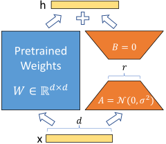


LoRA 解决的是大模型微调时训练参数太多、每个任务都要保存一份模型的问题。它保留预训练权重，把需要学习的改变量写成两个窄矩阵的乘积。输入先被压缩为少量系数，再用这些系数组合出对原输出的修正。训练时只更新两个矩阵，几个任务可以共享同一份底座；部署单一任务时，也可以把修正加回原权重，沿用原来的线性层。（由 GPT-6 总结）

**关键公式**

$$
h=W_0x+\frac{\alpha}{r}B(Ax).
$$

$$
\operatorname{rank}(BA)\le r,\quad N=r(d_{\rm in}+d_{\rm out}).
$$

$$
W_{\rm merged}=W_0+\frac{\alpha}{r}BA.
$$



### 1. 微调的成本

[GPT‑3](/papers/gpt3/) 可以把几条带标签的影评放进提示词，再给新影评分类。示例影响这一次预测，下一次调用时需要重新提供。手里若已有一批领域标注，希望模型在后续请求中都能沿用同一套分类标准，就可以用这些数据**微调**：运行模型、计算任务损失、反向传播，再更新参数。

全量微调会更新整套模型的权重。以 GPT‑3 的最大版本为例，光是维护约 1750 亿个参数的梯度和 Adam 优化器状态，就需要大量显存；同一模型若为分类、摘要等任务分别微调，每个任务还要保存一份完整权重。

> [!Note] **优化器为什么也占显存**
> 反向传播算出每个参数的梯度，优化器决定该沿这个方向走多远。Adam 会为每个要更新的参数保存两份统计量，分别跟踪梯度和梯度平方的移动平均。冻结一层后，这层的权重仍要留着算前向，但不用为它的权重保留这两份状态，也不用计算权重梯度。

Hu 等人的 **LoRA（Low-Rank Adaptation，低秩适配）** 从微调的结果出发。若某层原来的权重是 $W_0$，全量微调得到的是 $W_0+\Delta W$，任务带来的改变都在 $\Delta W$ 里。LoRA 保留 $W_0$，用较少的参数表示 $\Delta W$。这就把问题变成：一个大矩阵的改变量，怎样用两个小矩阵表示？

### 2. 把更新变窄

#### 2.1 两次线性变换

取 Transformer 中一个线性层，例如把当前位置的特征投影成查询向量。用列向量表示输入 $x$，其长度是 $d_{\rm in}$；原来的权重 $W_0$ 把它映射到长度为 $d_{\rm out}$ 的输出。LoRA 在这条路径旁加一个并行分支：$A$ 先把输入变成长度为 $r$ 的向量，$B$ 再把它变回输出所需的长度。两路相加后交给下一层。

$$
h=W_0x+sB(Ax),\qquad s=\frac{\alpha}{r}.
$$

这里 $r$ 称为 LoRA 的**秩**，也是分支中间向量的宽度；$\alpha$ 是训练前设定的缩放参数，$s$ 决定这条分支对输出的贡献尺度。$A$ 的尺寸是 $r\times d_{\rm in}$，$B$ 的尺寸是 $d_{\rm out}\times r$。逐个数元素，前者有 $rd_{\rm in}$ 个，后者有 $rd_{\rm out}$ 个；全量微调则有 $d_{\rm in}d_{\rm out}$ 个参数可调。对输入输出同宽的层，训练参数的比例就是 $2r/d_{\rm in}$。当宽度为 $4096$、$r=8$ 时，一个完整矩阵有约 1680 万个元素，两个小矩阵总共只有 65,536 个元素，是原来的 $1/256$。原矩阵仍参与前向计算，这里比较的是需要训练和保存的**更新参数**。

<figure class="ddpm-figure">
  
  <figcaption>LoRA 论文图 1。左侧是冻结的预训练权重，右侧是可训练分支；同一个输入沿两路计算，最后在顶部相加。</figcaption>
</figure>

#### 2.2 秩的作用

$Ax$ 的第 $j$ 个分量是 $A$ 的第 $j$ 行与 $x$ 的内积；它给出当前输入沿某个方向的读数。接着 $B$ 用这 $r$ 个读数作为系数，把自己的 $r$ 列线性组合起来：

$$
B(Ax)=\sum_{j=1}^{r}B_{:,j}(Ax)_j.
$$

因此，无论送进来多少种 $x$，修正都在 $B$ 的列张成的空间里。$A$ 学习从输入里提取什么，$B$ 学习向输出添加哪些方向；每条样本产生的修正仍会随 $x$ 改变。论文的出发点是，基础模型已学到大量特征，适配新任务可能只需要改变其中少量组合。低秩约束只作用在加上去的修正上，原有的变换仍由 $W_0x$ 完成。

> [!Note] **秩可以看作独立方向的数量**
> 一个矩阵作用在不同输入上，可能得到许多不同的输出。若这些输出都在同一条过原点的直线上，矩阵的秩至多为 1；若都能用两条独立方向组合出来，秩至多为 2。这里 $B$ 只有 $r$ 列，所以 $BA$ 最多提供 $r$ 个独立的修正方向。

训练前选定的 $r$ 限制了修正能使用多少个独立方向；具体用哪些方向，则由任务数据决定。也可以先做全量微调，再用奇异值分解（SVD）保留 $\Delta W$ 的主要方向。这需要先付出全量微调的成本，得到的是对原更新矩阵的近似。LoRA 一开始就在低秩约束下优化任务损失，让小矩阵直接学习对任务有用的修正。

### 3. 怎样训练

#### 3.1 初始化

论文将 $A$ 用高斯随机数初始化，将 $B$ 初始化为零。于是起步时 $BA=0$，带 LoRA 的模型会给出和底座相同的输出。两个矩阵都为零会卡住：$A$ 的梯度需要乘到 $B$，$B$ 的梯度也需要用到 $Ax$，两边都收不到更新信号。留下随机的 $A$，第一步就能先让 $B$ 学到一个非零修正。

记 $g=\partial\mathcal L/\partial h$ 为损失从后续网络传回当前层的梯度。对一条输入，分支的梯度为：

$$
\nabla_B\mathcal L=sg(Ax)^\top,\quad \nabla_A\mathcal L=sB^\top gx^\top.
$$

当 $B=0$ 时，$\nabla_A\mathcal L$ 为零，$\nabla_B\mathcal L$ 仍可能非零；$B$ 更新后，后续步骤就能同时调整两者。还要区分**权重梯度**和**输入梯度**：冻结 $W_0$ 省下的是它的权重梯度与优化器状态。若前面还有可训练的分支，误差必须继续传回本层的输入 $x$：

$$
\nabla_x\mathcal L=W_0^\top g+sA^\top(B^\top g).
$$

原来的主路和小分支各传回一份误差。若把冻结层当作反向传播的终点，更早的 LoRA 分支便收不到训练信号。训练仍需让底座参与计算，并保留反传所需的中间结果；激活所占显存也随批量大小和序列长度变化。

#### 3.2 目标层

Transformer 有许多线性层：注意力里的 $W_Q,W_K,W_V,W_O$，以及前馈网络中的投影。原论文主要研究注意力里的投影矩阵。以 $W_Q,W_V$ 各接一组独立的 $A,B$ 为例，选中的每一层都要各存自己的这两组小矩阵。同一层的各个 token 用的是同一组权重，但由于它们的输入向量不同，各自得到的修正也不同。

在[自注意力](/papers/transformer/)里，先从每个位置的输入 $x_i$ 算出查询 $q_i$、键 $k_i$ 和值 $v_i$。LoRA 对原查询 $W_Qx_i$ 加上 $s_Q B_Q(A_Qx_i)$，值投影做同样的事，键仍按 $W_Kx_i$ 计算。修正后的查询与键进行匹配，注意力权重因此可能变化；再用这些权重对修正后的值做加权求和。因此两处更新分别改变了**去哪里读**和**读回什么**。注意力结果通过原来的输出投影、残差和前馈层传给下一层。后面的实验比较了把同样多的训练参数集中给一个投影，或是分给多个投影。

#### 3.3 任务损失

LoRA 改的是参数更新的方式，损失仍取决于用什么数据适配。以生成标签为例，每个样本由提示部分和答案部分拼接而成：提示里写影评与“情感：”，答案接“正面”或“负面”。设拼接后的第 $t$ 个 token 是 $y_t$，$\mathcal A$ 是答案 token 的位置集合。一种常用做法是对答案位置计算交叉熵：

$$
\mathcal L=-\sum_{t\in\mathcal A}\log p(y_t\mid y_{<t}).
$$

这里有两种不同的遮罩。**因果遮罩**决定模型能读取哪些信息：用前缀预测下一个 token 时，看不到这个 token 本身，所以第一个答案 token 仍要靠读完提示来预测。**损失遮罩**决定哪些位置要计入训练目标：提示里的 token 仍参与前向计算，只是不要求模型为复现提示词而调整参数。若答案有多个 token，训练时用真实的前几个答案 token 作为后续位置的条件。推理时只有提示，模型用自己生成的 token 接着往下预测。

比较预测分布与正确答案后，误差信号沿整个模型传回，只有接入 LoRA 的 $A,B$ 交给优化器更新。适配完成后，训练影评无需再放进提示里；保存下来的小矩阵已经记录了为了让模型按这套标准分类而做的权重修正。

### 4. 合并与切换

部署一个固定任务时，两路乘法可以事先合并。利用线性层的分配律：

$$
W_0x+sB(Ax)=(W_0+sBA)x.
$$

合并需要预先算出完整的 $sBA$，加到 $W_0$ 上。合并后的权重与 $W_0$ 同尺寸，每次推理仍只做原来的一次大矩阵乘法。这正是论文所说的合并后没有额外推理延迟的原因。若把合并版单独保存，它仍是一份完整模型；小文件的优势来自保存时只存 $A,B$ 和配置，部署时再决定是否合并。

若同一底座要服务多个任务，可以保留原权重，按任务挂载各自的小分支。切换时只需更换这组小矩阵，每次前向则会多做 $Ax$ 和 $B(Ax)$。对一个 token，这两步的乘加次数分别是 $rd_{\rm in}$ 和 $rd_{\rm out}$。秩远小于层宽时，这部分计算量相对较小；实际延迟还取决于硬件和这些运算的实现方式。

每份适配权重都应加载到训练时使用的底座和目标层上。除了要让矩阵形状对得上，$A,B$ 学到的方向也建立在原有的特征表示上。即使两个模型结构相同，换掉底座权重也会改变这些特征。保存适配权重时，要一并记录底座版本、目标层、秩和缩放参数。

### 5. 影评分类

沿用 GPT‑3 一篇的影评分类。训练样本最后给出正确标签“正面”，希望模型在看到 “It starts slowly but ends beautifully.” 后更倾向这个标签。下面只展开其中一个投影的更新，后面的计算简化为一个固定的读出：取输出的第三个分量 $h_3$ 当作正面标签的分数，负面标签的分数固定为 $0$。这样可以跟着算清误差怎样到达低秩分支。

原层取 $W_0=I_3$。令 $r=1$、$s=1$，输入为 $x=(2,1,0)^\top$，起始的 $A=(1,-1,0)$，$B$ 是三维零列向量。这里取整数是为了便于计算；完整模型里的 $A$ 按前面的方式随机初始化。

1. **第一次预测。** $Ax=2-1=1$，但 $B=0$，所以 $h=W_0x=(2,1,0)^\top$。两类分数都是 $0$，softmax 给正面标签的概率是 $0.5$。
2. **用正确标签更新。** 交叉熵是 $-\log p_{\rm pos}$。对正面分数求导，得到 $p_{\rm pos}-1=-0.5$。梯度沿 $h_3$ 传给 $B$ 的第三个分量，再乘以此时的 $Ax=1$，仍为 $-0.5$。若为演示取一步学习率 $1$，得到 $B=(0,0,0.5)^\top$，$A$ 在这一步保持不变。
3. **使用更新后的模型。** 对相同输入，LoRA 分支给出 $(0,0,0.5)^\top$，正面分数从 $0$ 升到 $0.5$，概率约为 $0.62$。真实训练会对许多影评重复这一过程；预测新影评时，只提供影评和问题，由已学到的 $A,B$ 产生修正。

这个分支只有一个输出方向。上面的训练步之后，该方向只修改第三个分量；修改多少由 $Ax$ 决定。若部署前合并，原矩阵的第三行就从 $(0,0,1)$ 变为 $(0.5,-0.5,1)$。它与同一个 $x$ 相乘也得到 $0.5$，所以合并和并联的预测相同。

### 6. 实验结果

#### 6.1 适配成本

对 GPT‑3 175B，论文将全量微调和几种参数高效的方法放在同一套任务上比较。下表摘录自[表 4](https://arxiv.org/html/2106.09685v2#S5.T4)。WikiSQL 根据问题和表格生成 SQL，比较生成的查询形式是否正确；MultiNLI 判断前提与假设之间是蕴含、矛盾还是中立。表里都是验证集准确率。

| 方法 | 可训练参数 | WikiSQL | MultiNLI |
| --- | ---: | ---: | ---: |
| 全量微调 | 约 1753 亿 | 73.8% | 89.5% |
| LoRA | 470 万 | 73.4% | 91.7% |
| LoRA | 3770 万 | 74.0% | 91.6% |

470 万参数的 LoRA 在 WikiSQL 上略低于全量微调，在 MultiNLI 上则更高。三行使用同一规格的底座，差别在于有多少参数参与适配、它们怎样影响输出。

原论文还报告了适配成本。只给 GPT‑3 175B 的查询和值投影加 $r=4$ 的 LoRA 时，按半精度保存的任务权重约为 35 MB，全量微调的权重约为 350 GB。作者报告的训练显存从约 1.2 TB 降到 350 GB。参数文件缩小得更多，因为训练仍要在显存中保留底座并完成前向和反传。

#### 6.2 投影与秩

[表 5](https://arxiv.org/html/2106.09685v2#S7.T5) 固定了约 1800 万可训练参数。GPT‑3 175B 有 96 层，在每层只适配一种投影时可给它 $r=8$；覆盖两种投影时，每个投影分到 $r=4$。两种做法的总参数量相同，因为这里对比的投影尺寸都一样。

| 适配投影 | 各自的秩 | WikiSQL | MultiNLI |
| --- | ---: | ---: | ---: |
| 仅查询 | 8 | 70.4% | 91.0% |
| 查询、键 | 4 | 71.4% | 91.3% |
| 查询、值 | 4 | 73.7% | 91.3% |
| 四种注意力投影 | 2 | 73.7% | 91.7% |

这组数据有两层意思。第一，修正不必全堆在一种投影上；查询和值各抓住几个方向，就超过了只加宽查询更新的结果。第二，投影的选择本身也有影响：查询加键和查询加值的预算相同，但在 WikiSQL 上表现不同。把类型从两种扩到四种后，WikiSQL 持平，MultiNLI 略升，两个任务的取舍也有所不同。

[表 6](https://arxiv.org/html/2106.09685v2#S7.T6) 再固定投影位置，比较不同秩。在查询和值两处加入 LoRA 时，WikiSQL 在 $r=1,4,64$ 分别取得 73.4%、73.7%、73.5%。论文报告的不同随机种子间标准差约为 0.5 个百分点，小幅升降没有稳定趋势。这组结果说明，用很少的修正方向也能得到接近的效果。选择配置时，可以从小秩开始，分别看扩大秩和扩大目标层覆盖范围能带来多少收益。

### 7. 微调与提示

上下文学习把示例放进输入，同一个模型可以随当前提示改变任务。LoRA 则通过训练改变一部分有效权重，把任务适配保存在单独的小文件里，之后可以反复使用。两者也能一起用：先加载为某个领域微调过的分支，再根据当前请求给几条具体的格式示例。

在这一组文章里，[Chinchilla](/papers/chinchilla/) 讨论训练底座时怎样在模型和数据之间分配算力，[LLaMA](/papers/llama/) 展示怎样用这种思路训练基础模型。LoRA 从底座已经训练好的地方接着往下走：为新的任务学习一份小的修正。至于训练样本应怎样写、模型应该遵循怎样的指令，则是后续指令微调要回答的问题。

### 参考资料

1. Hu et al. *LoRA: Low-Rank Adaptation of Large Language Models*. ICLR 2022. [arXiv:2106.09685v2](https://arxiv.org/abs/2106.09685v2)。图 1 与实验数据来源；第 4 节介绍低秩参数化，第 7 节比较投影位置与秩。
2. Raschka. *Improving LoRA: Implementing Weight-Decomposed Low-Rank Adaptation (DoRA) from Scratch*. Ahead of AI, 2024. [博客原文](https://magazine.sebastianraschka.com/p/lora-and-dora-from-scratch)。前半部分用线性层代码演示并联计算和权重合并。
