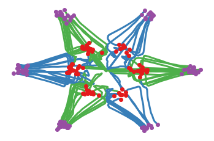
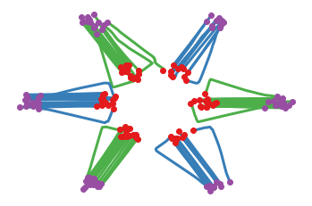
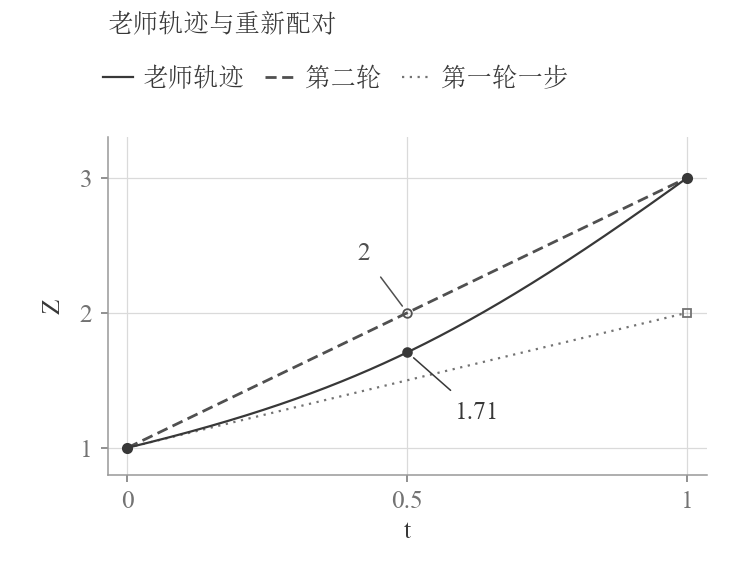
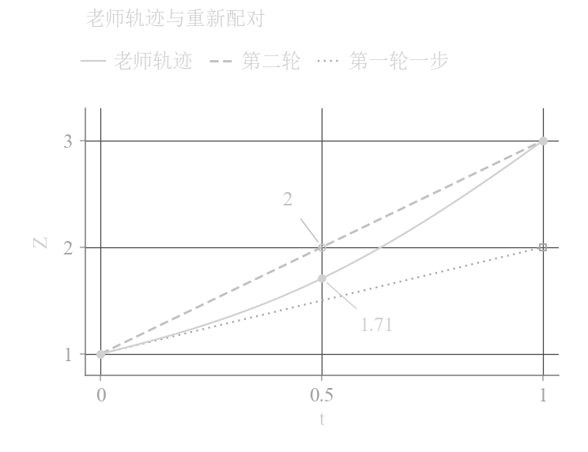


Rectified Flow 把生成看成从噪声到数据的连续运动。训练时将一份噪声与一张图像连成直线，用两端的差作为速度标签；网络只看到当前位置和时间，因此学到的是经过该处的训练速度的条件平均。理想速度场的连续演化把噪声分布变成数据分布，单条轨迹仍可能弯曲。Reflow 用同一条生成轨迹的起点和终点重新配对，再训练速度场，让实际轨迹更接近匀速直线，从而减少采样时的网络调用。蒸馏则在此基础上进一步训练单步模型直接预测老师的终点。（由 GPT-6 总结）

**关键公式**

$$
X_t=(1-t)X_0+tX_1,\qquad \dot X_t=X_1-X_0.
$$

$$
L(\theta)=\mathbb E\!\left[\|v_\theta(X_t,t)-(X_1-X_0)\|^2\right].
$$

$$
v^*(x,t)=\mathbb E[X_1-X_0\mid X_t=x],\qquad \dot Z_t=v^*(Z_t,t).
$$

$$
\operatorname{Law}(Z_t)=\operatorname{Law}(X_t),\qquad 0\le t\le1.
$$

$$
Z^{(k+1)}=\operatorname{RectFlow}\bigl(Z_0^{(k)},Z_1^{(k)}\bigr).
$$



### 1. 基本思路

上一篇 [Flow Matching](/papers/flowmatching/) 已经能从噪声生成图像，但每一步都要调用网络重算速度。若只允许算一次，最直接的省法是用起点速度走完全程。这样会发生什么？第一轮从噪声和真图两端独立取样时，每个噪声都有可能配到任何一张图，起点预测只能折中。走一步以后，所有起点甚至会被送到同一张平均图。细致求解原来的速度场还能生成不同结果：移动到新位置后，网络可以重新判断该往哪里走。

Xingchao Liu、Chengyue Gong 和 Qiang Liu 提出的 **Rectified Flow（整流流，ICLR 2023）**，把这个问题带回训练：让起点算出的速度更接近整段路的位移。若一条轨迹始终以同样的速度走，调用一次网络就能算出终点。关键在于弄清为什么这里用直线训练，得到的速度场却还需要多步求解。

第一轮先用随机配对的直线提供速度标签，再运行训练好的网络，为每份噪声找到实际生成的终点。后面的**重新整流**（Reflow）保留这次生成的两端，放弃中途走过的弯路，在新的起终点之间重新拉一条直线教下一轮网络。这既让每份噪声有更明确的去处，也给学习匀速移动提供了新标签。

生成从 $t=0$ 的噪声端走向 $t=1$ 的数据端。$X_t$ 表示训练时用两个已知端点插出的状态，$Z_t$ 表示生成时从噪声出发、按速度场走到的状态。

### 2. 直线监督

#### 2.1 端点配对

记噪声分布为 $\pi_0$，例如标准高斯；记真实图像的分布为 $\pi_1$。两边各抽一个样本 $X_0,X_1$，就得到一对起点和终点。如何从两边抽取并把它们配在一起，由联合分布决定，称为**耦合（coupling）**。只要单独看起点仍服从 $\pi_0$、单独看终点仍服从 $\pi_1$，各种不同配法都是这两个分布的耦合。

> [!Note] **分布相同，配法可以不同**
> 想象左边是一批噪声、右边是一批图，每边各自的样本保持不动。把两条连线的右端交换一下，两边各有什么样的样本没有变，但这两份噪声各自对应到了另一张图。边缘分布只看单独一边；耦合还记录两边怎样搭配。

做无条件生成时，训练数据提供了真实图像，却没有提供噪声与图像的对应关系。第一轮因此可以独立抽取 $X_0$ 和 $X_1$：同一张图下次还可以配到另一份噪声，起点与终点各自的分布也能保留。选定一对之后，用匀速直线连接二者。这条线允许直接计算任意训练时刻的输入和标签：

$$
X_t=(1-t)X_0+tX_1,\qquad \dot X_t= X_1-X_0.
$$

例如 $t=0.25$ 时，中间状态由四分之三的噪声端和四分之一的图像端相加得到。因为整段时间长度是 $1$，所以每单位时间的位移就是两端之差。训练时随机取一个 $t$，直接算 $X_t$，用 $X_1-X_0$ 作为标签。像 [Flow Matching](/papers/flowmatching/) 一样，构造训练样本时可以直接得到任意时刻的状态。

#### 2.2 局部速度

送给网络的只有当前的状态 $X_t$ 和时间 $t$，两个端点只用于构造输入和标签。每次从 $[0,1]$ 均匀抽取 $t$，算出 $X_t$，再让网络输出与状态同维的速度向量。记可学习的网络参数为 $\theta$，训练目标是使预测接近那条插值线的速度：

$$
L(\theta)=\mathbb E_{X_0,X_1,t}\!\left[\|v_\theta(X_t,t)-(X_1-X_0)\|^2\right],\qquad t\sim\mathcal U[0,1].
$$

假设只看一个分量，一条训练线从 $1$ 走到 $2$，另一条从 $0$ 走到 $3$。两条线都在 $t=0.5$ 经过位置 $1.5$，给出的速度却分别是 $1$ 和 $3$。网络收到的输入都是 $(1.5,0.5)$，只能给出一个速度值。只考虑这两个同样常见的标签时，输出它们的平均值 $2$ 能让平方误差最小。

一般地，固定网络输入 $(x,t)$ 后，模型仍不知道这个状态来自哪一对端点。哪类训练对更常在时刻 $t$ 经过 $x$ 附近，它给的速度就在平均中占越大的权重。这种给定输入再取平均的做法叫条件均值，也是平方误差下的最优预测。用星号表示这个理想速度：

$$
v^*(x,t)=\mathbb E[X_1-X_0\mid X_t=x].
$$

这个平均只针对时刻 $t$、位置 $x$ 的可能速度。换一个位置或时刻，参与平均的训练对与它们的权重都可能不同。所以每条训练线的速度虽然恒定，学到的速度场仍会随位置和时间变化。

训练对的配法会直接影响这个平均。如果许多方向相反的训练线经过同一区域，单一网络就要用一个折中的局部速度回应它们；如果重新配对后，经过该处的位移更加接近，标签之间的分歧就会减小。后面的 Reflow 正是通过改变端点的联合分布，间接改变局部回归问题。

### 3. 速度场采样

#### 3.1 欧拉更新

生成时没有真实图像端点。先抽一份噪声 $Z_0\sim\pi_0$，然后在当前位置调用网络，按照它给出的速度往前移动。这是一个常微分方程（ODE）：

$$
\frac{\mathrm d Z_t}{\mathrm dt}=v_\theta(Z_t,t),\qquad Z_0\sim\pi_0.
$$

用最简单的欧拉法时，把 $[0,1]$ 分成 $N$ 段，每段开始时算一次速度，然后在这小段里把它当作常数。若当前时间是 $t_i$，下一时刻是 $t_{i+1}$，更新就是：

$$
Z_{t_{i+1}}=Z_{t_i}+(t_{i+1}-t_i)v_\theta(Z_{t_i},t_i).
$$

现在算一下开头提到的一步生成。初始状态就是 $X_0$，而独立配对下，给定任意 $X_0=x$，终点的平均值都等于数据的均值 $m=\mathbb E[X_1]$。因此理想速度是 $v^*(x,0)=m-x$。用步长 1 做欧拉更新，每个起点都到达 $x+(m-x)=m$。问题出在把起点的局部速度用到了整段路上。

中间时刻则不同：输入同时混合了起点和终点。走到新位置后，训练时更可能经过此处的配对已经变了，网络要重算当下的平均速度。生成轨迹因此可能改变方向，也可能沿同一方向加快或减慢。小步求解可以把这些变化保留下来，下一节再看它为什么能走出正确的终点分布。

#### 3.2 边缘分布

用一步欧拉会把样本送到平均图，那么准确跟随速度场会怎样？先考虑网络恰好给出 $v^*$、ODE 也被精确求解的情况。想象训练直线上的样本经过一小块区域的边界：有的从里往外走，有的往里走。朝外算正，朝里算负，各组速度按它们在这一带所占的比例求平均，乘以总密度，就得到边界上的净流出。这与 [Flow Matching 的概率通量](/papers/flowmatching/#33-概率守恒)一样。换成让样本统一沿平均速度走，区域内样本密度的变化率仍然相同。

这也能直接从期望看出来。取一个光滑的函数 $h$，例如让它在观察的小区域里取值较高，离开这个区域后逐渐降到零。这样 $\mathbb E[h(X_t)]$ 就反映了样本在这个区域里有多集中。沿训练线，$h(X_t)$ 的变化率是当前位置的梯度与沿线速度的内积。梯度只取决于当前状态，可以在对 $X_t$ 取条件期望时提出，因此：

$$
\begin{aligned}
\frac{\mathrm d}{\mathrm dt}\mathbb E[h(X_t)]
&=\mathbb E[\nabla h(X_t)\cdot(X_1-X_0)]\\
&=\mathbb E[\nabla h(X_t)\cdot v^*(X_t,t)].
\end{aligned}
$$

取不同的 $h$，就能考察不同区域。上式的右边只用到当前位置的密度和平均速度 $v^*$，沿 ODE 走出的 $Z_t$ 也按同一条规则改变密度。两边从同一个噪声分布开始，在原论文的可整流条件下（速度场局部有界，且 ODE 解存在并唯一），每刻的边缘分布因此都相同。用 $\operatorname{Law}$ 表示随机变量的分布，就有：

$$
\operatorname{Law}(Z_t)=\operatorname{Law}(X_t),\qquad 0\le t\le1.
$$

特别地，$Z_1$ 的分布是 $\pi_1$。这个结论描述的是一批样本的统计分布。对某个具体的起点而言，$Z_1$ 由 ODE 决定，不必是训练时随机配给它的那张图。实际网络 $v_\theta$ 只是近似 $v^*$；将它代入 ODE 后，得到的是这个已学速度场自己的分布演化。减小步长可以更准确地跟随该速度场，速度本身与 $v^*$ 的差异则仍需靠训练减少。

### 4. 重新配对

#### 4.1 再次整流

现在有了一套可以用细步生成的速度场，便可以把昂贵的求解提前做完，用结果给下一轮训练定目标。把已有模型称为**老师**，接下来要训练的模型称为**学生**。从噪声端抽取新的起点，用老师的速度场仔细积分到终点。每生成一张图，就把它和实际生成它的那份噪声一起保存为 $(Z_0^{(1)},Z_1^{(1)})$。接着用这些新配对取代原来的独立配对，重新画直线、重新计算速度标签：

$$
X_t^{(2)}=(1-t)Z_0^{(1)}+tZ_1^{(1)},\qquad \dot X_t^{(2)}=Z_1^{(1)}-Z_0^{(1)}.
$$

每次参数更新，从保存的数据中取一对端点，再均匀抽取时刻 $t$，按上式计算 $X_t^{(2)}$ 和两端之差。学生预测 $v_\theta(X_t^{(2)},t)$，用它与 $Z_1^{(1)}-Z_0^{(1)}$ 的平方误差更新参数。老师生成的终点作为固定训练数据，反向传播只更新学生。

这里特意只留下老师的两个端点。如果直接拿老师经过的状态和瞬时速度当标签，学生学到的仍是老师沿途的弯路。重新插值得到的是在同样两端之间匀速前进的状态，标签也改为老师整段路的总位移。由于每份起点现在都有一个确定的终点，只看训练线起点，速度标签就已经指向老师实际生成的图；原来把许多无关终点平均到一起的原因消失了。

<figure class="ddpm-figure">
  
  
  <figcaption>第一轮（左）与第二轮（右）的 ODE 轨迹。来源：<a href="https://arxiv.org/html/2209.03003v1#S2.F3">原论文 Figure 3(a)、(b)</a></figcaption>
</figure>

这是论文的二维实验。紫色点是起点样本，红色点是终点样本，蓝线和绿线表示连接不同点簇的轨迹。两幅图画的都是训练结束后求解 ODE 得到的轨迹。可以跟着左下方一束绿线看：第一轮的轨迹有些先向中央绕，再到达红色点簇；第二轮大多更直接。这与第二轮训练时拿第一轮的两端重新连线相呼应，图中仍可看到一些轨迹有弯折。

重新配对和训练可以重复。原论文把用原始配对训练的模型叫作 **1-Rectified Flow**；用它生成的配对再训练一次，就得到 **2-Rectified Flow**。上标 $(k)$ 表示第 $k$ 轮，$Z_0^{(k)},Z_1^{(k)}$ 是这一轮生成的两端。记 $\operatorname{RectFlow}$ 为“用端点对训练速度场，再求解它的 ODE”的操作，$Z^{(k+1)}$ 表示下一轮得到的整条生成轨迹：

$$
Z^{(k+1)}=\operatorname{RectFlow}\bigl(Z_0^{(k)},Z_1^{(k)}\bigr).
$$

把老师从起点到终点的映射记为 $T$，新训练对就是 $(Z_0,T(Z_0))$。第一端仍由 $Z_0\sim\pi_0$ 抽取；理想老师若已把 $\pi_0$ 输送到 $\pi_1$，第二端就服从 $\pi_1$。学生用这批端点对画出的直线虽然和老师走过的路线不同，插值到 $t=1$ 时仍落在同一批老师终点上。第 3.2 节的结论又保证，理想学生的 ODE 在终点重现这些标签的**分布**。例如，两条新训练线在中途相遇，学生还要取平均，未必会把同一份噪声送回它原来的老师终点。

实际保存端点时，运行的是“老师网络加数值求解器”这套生成程序，记为 $\widehat T$。新配对就是 $\bigl(Z_0,\widehat T(Z_0)\bigr)$，其终点分布为 $\operatorname{Law}(\widehat T(Z_0))$，下一轮也以这个分布为训练目标。更精细地积分能减少执行老师速度场时的数值误差，老师速度预测本身的偏差仍会体现在终点里；学生拟合和后续少步采样还各自引入近似误差。

#### 4.2 少步采样

假设一条轨迹已经是匀速直线，那么从 $0$ 到 $1$ 的总位移就等于起点的速度乘以总时间 $1$，一次欧拉更新 $Z_0+v_\theta(Z_0,0)$ 就能到达 ODE 的精确终点。实际轨迹如果在方向和大小上变化较小，用少量速度预测也有机会得到好的近似。这里的“直”包含**匀速**：即使路径在空间里不拐弯，只要速度先快后慢，直接用起点速度走完整段也会走过头。

重新配对之后，即使每个起点有明确去处，不同起点的训练线仍可能在中途相遇，学生在这里还要对不同速度取平均。训练中又是在整个时间区间抽样，并没有专门给起点的预测加约束。因此 Reflow 的实际目标是减小沿途的速度变化，让只算少数几个时刻也能走得够准。训练结束后，重新抽取噪声，按第 3.1 节的更新式调用学生，只选择少量时间步点。老师已经把信息写入训练数据，生成时只运行学生。

固定任意一轮训练后的速度网络。从同一个 $Z_0$ 出发，按 ODE 精确求解的总位移为 $Z_1-Z_0=\int_0^1v_\theta(Z_t,t)\,dt$；一步欧拉则用 $v_\theta(Z_0,0)$ 替代这个积分。两种求解方式的终点之差为：

$$
Z_1-\bigl(Z_0+v_\theta(Z_0,0)\bigr)=\int_0^1\bigl(v_\theta(Z_t,t)-v_\theta(Z_0,0)\bigr)\,dt.
$$

沿途速度越接近起点速度，这个残差就越小。重新训练的作用，是让网络在整段路径上更容易给出接近总位移的速度；这样，少步采样用到的局部预测就更接近这一步真正需要完成的位移。

### 5. 单步蒸馏

当采样只允许调用一次网络，模型只需把起点直接送到对的位置。Reflow 仍在整个 $[0,1]$ 抽取时刻，学生学的是沿途的速度；**单步蒸馏**把监督集中到起点。给定 $Z_0^{(k)}$，让学生只算一次速度，并把它作为整段位移，得到：

$$
\hat Z_1=Z_0^{(k)}+v_\theta(Z_0^{(k)},0).
$$

训练数据仍是第 $k$ 轮老师生成并保存的端点对，目标是对应的老师终点 $Z_1^{(k)}$。记比较两张图的误差函数为 $\mathcal D$，蒸馏损失就是：

$$
\mathcal L_{\mathrm{distill}}(\theta)=\mathbb E\!\left[\mathcal D\bigl(\hat Z_1,Z_1^{(k)}\bigr)\right].
$$

每次取一对端点，先算学生的一步输出，再与固定的老师终点比较，误差只通过学生输出反向传播。论文的 CIFAR-10 实验把 $\mathcal D$ 取为 [LPIPS 感知距离](/papers/ldm/#22-重建目标)：用固定的预训练视觉网络提取两张图的多层特征，归一化后再对特征差的平方加权。训练后抽取新噪声 $z_0\sim\pi_0$，调用一次学生并输出 $z_0+v_\theta(z_0,0)$，就完成一次生成。

> [!Note] **蒸馏里的老师与学生**
> 老师负责生成标签，学生负责学习这些标签。老师调多次网络算出一份噪声的终点；学生可以沿用同样的网络结构，只改变训练方式，让它用一次调用做完这件事。这里节省的是训练完成后的调用次数，训练前仍要花时间生成标签。

直接一步欧拉与一步蒸馏在生成时使用同一个式子，网络里学到的量却不同。直接一步把起点的瞬时速度外推到全程；蒸馏用老师走完全程后的结果监督学生，因此这个位置上要学的是能一步送到老师终点的位移。相同的端点对交给 Reflow，会产生许多时刻的训练输入；交给单步蒸馏，训练输入始终在 $t=0$。

### 6. 两轮算例

沿用第 2.2 节的配对 $(1,2)$，把整个过程算一遍。这里让起点服从 $\mathcal N(0,1)$，数据端服从 $\mathcal N(2,1)$。两边都是一维高斯，标准差相同，均值相差 $2$，也与前一篇 Flow Matching 的算例一致。那一篇比较同一个速度场的训练标签和两步近似，这里进一步比较重新配对前后的两个速度场。假设每轮模型都学到了该轮的最优速度场。

**第一轮训练。** 从两端独立取样，假设这次抽到起点 $1$、终点 $2$ 和时刻 $t=0.5$。用直线插值得到 $X_{0.5}=1.5$，速度标签是 $2-1=1$。网络只看 $(1.5,0.5)$，用预测速度和标签 $1$ 的平方误差更新参数。整个训练会反复抽取不同的配对和时刻，所以这次标签只是一条线给出的答案。

**求解老师轨迹。** 训练完成后，只给老师起点 $Z_0=1$，并沿它的速度场积分。按第 3.2 节，每一时刻的分布都和第一轮训练插值相同。在这个一维例子里，轨迹不能交叉：如果两个点在同一时刻相遇，沿唯一的轨迹往回，它们就该有同一个起点。所以起点 $1$ 在整批样本中的相对位置始终不变：起初比均值高一个标准差，每个时刻也比当时的均值高一个标准差。第一轮插值的均值为 $2t$，两端独立，方差为 $(1-t)^2+t^2$，所以：

$$
Z_t=2t+\sqrt{(1-t)^2+t^2}.
$$

走到一半时，$Z_{0.5}=1+1/\sqrt2\approx1.71$；走完全程，$Z_1=3$。老师从同一个起点 $1$ 出发，到达的是 $3$，第一轮随机配给它的 $2$ 从未作为生成输入。

对这条解析轨迹求导，可以更清楚地看到少步采样的难点：

$$
\dot Z_t=2+\frac{2t-1}{\sqrt{(1-t)^2+t^2}}.
$$

起点的速度为 $1$，中点为 $2$，终点为 $3$。即使只有一维、始终向同一方向移动，速度大小仍在变化；只用起点速度外推全程，就会少走一段。这也是前面把“直”与匀速联系起来的原因。

**重新配对与训练。** 保存老师真正得到的端点对 $(1,3)$。第二轮若也取 $t=0.5$，输入位置来自新直线的中点 $(1+3)/2=2$，而不是老师实际经过的 $1.71$；新标签是 $3-1=2$。第一轮对其他起点也是如此：起点在噪声分布的相对位置不变，而目标分布恰好平移了 $2$，所以每份新配对的位移都是 $2$，第二轮学到的速度便处处等于 $2$。

**只采样一步。** 再从同一个起点 $1$ 出发，步长取 $1$。第一轮模型在起点的预测是 $2-1=1$，只能走到数据均值 $2$。换成别的起点，一步也同样到 $2$，这批输出没有目标分布应有的方差。第二轮网络预测的速度处处为 $2$，所以这次可以一步走到老师积分得到的终点 $1+1\times2=3$。对整批起点做这一步，结果就是把原来的高斯整体向右平移 $2$；目标分布的均值和方差都保住了。

<figure class="ddpm-figure paper-diagram" style="--diagram-width:372px;">
  
  
  <figcaption>实线表示老师轨迹，长虚线与空心圆表示第二轮，点线与空心方点表示第一轮一步欧拉；按本节解析式绘制。</figcaption>
</figure>

这个例子里，第二轮的轨迹已经是匀速直线，一步就能求准，无需另做蒸馏。图像生成时一般只能把轨迹拉得更直，少步采样和蒸馏的效果还要看实际实验。

### 7. 实验结果

一维算例可以推到精确终点；真实图像要比较的是同样只算一次，哪种训练能保住生成质量。原论文在 CIFAR-10 上比较了不同轮次的整流流和扩散 ODE。这里摘录使用同一 DDPM++ U-Net 架构的结果。**NFE**（函数评估次数）在这里就是生成过程中的速度网络调用次数；一步欧拉和一步蒸馏都只调用一次。**FID** 用预训练 Inception 网络提取两批图像的特征，比较其均值和协方差，越低越好。

下表“直接一步”表示用训练好的速度场做一步欧拉；最后一列使用自适应四/五阶 Runge–Kutta 求解器（RK45），根据误差估计调整步长，细致求解 ODE：

| 模型 | 直接一步 FID | 蒸馏后一步 FID | RK45 FID |
| --- | ---: | ---: | ---: |
| 1-Rectified Flow | 378 | 6.18 | 2.58 |
| 2-Rectified Flow | 12.21 | 4.85 | 3.36 |
| 3-Rectified Flow | 8.15 | 5.21 | 3.96 |

先看直接一步：从第一轮到第二轮，FID 从 $378$ 降到 $12.21$，说明 Reflow 显著改善了大步长欧拉采样的生成质量。再看蒸馏：从第二轮继续训练出来的一步模型达到 $4.85$；第三轮虽然直接一步更好，蒸馏后的 FID 却略高。这两列考查的是不同训练目标下的一步生成效果。

第一轮蒸馏后的一步 FID 为 $6.18$，也远好于直接一步的 $378$：老师本来需要沿途多次调用的能力，被学生学成了起点到终点的映射。第二轮再蒸馏达到 $4.85$，则展示了重新配对与单步训练可以配合使用，效果与两者各自改善的环节相对应。

RK45 求解三轮模型分别用 $127$、$110$、$104$ 次网络调用，第一轮在这种设置下的 FID 最低。结合直接一步的结果看，第二轮更适合粗步长近似，第一轮则在细致求解时达到更好的生成质量。论文将后续轮次的质量下降归因于 Reflow 过程中估计误差的累积：学生的目标来自上一个老师，老师生成图像中的偏差也可能被带入下一轮。

这里的网络调用次数只计算推理。生成训练配对的计算事先完成：论文的 CIFAR-10 设置会先生成 $400$ 万对起点和终点，再微调 $30$ 万步得到下一轮模型。论文也在 $256\times256$ 的人脸、卧室、教堂和猫脸数据上展示了生成结果，并将同一框架用于两种图像域之间的转换。封面取自[原论文 Figure 1](https://arxiv.org/html/2209.03003v1#S1.F1)，展示了猫脸生成和图像转换时，不同轮次模型在不同欧拉步数下的结果。

### 8. 运输代价

前面的算例和实验显示，换一批训练配对确实能让少步近似更准。本节解释论文为什么能从理论上预期这种变化。起点、终点的分布都相同，能变化的是配法。若把每对端点的平方距离取平均，就可以衡量新配法用了多少位移；论文在理想速度场和精确 ODE 下进一步算出了，重新配对节省的位移代价来自哪里。

把训练端点的位移记为 $D=X_1-X_0$。给定状态后，标签与条件平均速度的差，正是局部回归留下的波动；沿一条生成轨迹，各时刻速度与总位移 $Z_1-Z_0$ 的差，则刻画了速度变化。把两者在时间和样本上平均，分别记为：

$$
\begin{aligned}
V(X)&=\int_0^1 \mathbb E\|D-v^*(X_t,t)\|^2\,\mathrm dt,\\
S(Z)&=\int_0^1 \mathbb E\|v^*(Z_t,t)-(Z_1-Z_0)\|^2\,\mathrm dt.
\end{aligned}
$$

先固定时刻 $t$。在训练插值上对速度标签取条件均值，就把标签的平均平方分成了两份：平均速度本身的平方，以及标签围绕它的波动。把后一份沿时间积分，就是 $V(X)$。在生成轨迹上，整段时间长为 1，因此总位移正好是沿途速度的时间平均。同样分解沿途速度的平均平方，得到总位移的平方加上沿途波动 $S(Z)$。因为 $X_t$ 与 $Z_t$ 在同一时刻同分布，把这两种状态代入同一个 $v^*$ 得到的平均平方也相同，两次分解就能接起来：

$$
\mathbb E\|X_1-X_0\|^2-\mathbb E\|Z_1-Z_0\|^2=V(X)+S(Z).
$$

左边是端点平方运输代价的减少量。这个代价只取决于哪两个端点被配在一起；右边则说明，重新配对节省的代价，恰好对应局部标签分歧与沿途速度变化这两部分。

其中，$S(Z)$ 与轨迹形状直接相关。记同一对端点之间的匀速直线为 $\ell_t=(1-t)Z_0+tZ_1$，则：

$$
Z_t-\ell_t=\int_0^t\bigl(v^*(Z_s,s)-(Z_1-Z_0)\bigr)\,ds.
$$

由此可得 $\mathbb E\|Z_t-\ell_t\|^2\leq tS(Z)$。$S(Z)$ 小时，轨迹在平均平方意义下贴近这条直线；$S(Z)=0$ 时，沿途速度几乎处处等于总位移。这把代价的下降接到了匀速直线这一采样目标上；单步蒸馏又进一步直接约束起点的一次输出。

下一轮以本轮生成的端点训练，输入端点代价就是本轮的输出代价。把等式逐轮相加，中间的代价相互抵消，因此连续做 $K$ 轮，各轮 $V+S$ 的总和不会超过初始代价。若初始代价为 $C_0$，前 $K$ 轮至少有一轮满足 $V+S\le C_0/K$。这不要求每一轮都比上一轮更直；即使已经得到匀速直线，也可能存在另一种运输代价更低的端点配法。

更一般地，对位移的凸代价函数 $c$，在可整流且期望存在的条件下，论文证明：

$$
\mathbb E[c(Z_1-Z_0)]\leq\mathbb E[c(X_1-X_0)].
$$

这个不等式沿用了同一机制：局部速度是训练位移的条件平均，总位移又是沿途速度在单位时间内的平均。凸函数作用于平均值时，代价不会超过先算各项再平均的结果；各时刻边缘分布相同，使这两次平均能够相接。

### 9. 方法联系

[Flow Matching](/papers/flowmatching/) 给出训练连续速度场的通用办法，插值路径可以有多种选择。Rectified Flow 选择端点之间的匀速直线，重点研究 ODE 如何建立新配对，以及用它反复训练时，怎样让实际生成轨迹更适合少步求解。后面的 [Stable Diffusion 3](/papers/sd3/) 将直线流训练用于大规模文本条件图像生成，还要面对时间采样、潜空间与图文网络架构等问题。

具体到前一篇的高斯 OT 路径，把终点标准差取到零的边界，并独立抽取噪声与数据，便得到这里第一轮的直线插值和速度损失。Rectified Flow 在此基础上继续改变端点的耦合：数据端仍应保持目标分布，哪些噪声与哪些终点配在一起却可以逐轮调整。它把“如何训练出正确的分布演化”进一步推进到“如何让这个演化适合少次调用”，而单步蒸馏最后直接针对固定调用预算训练。

### 参考资料

1. Xingchao Liu, Chengyue Gong, Qiang Liu. *Flow Straight and Fast: Learning to Generate and Transfer Data with Rectified Flow*. ICLR 2023. [论文](https://arxiv.org/abs/2209.03003)。训练与 Reflow 见 §2，边缘分布、运输代价及拉直性质见 §3，CIFAR-10 对照见 §5.2、Table 1 及附录 A。
2. Liu et al. *Rectified Flow 官方实现*. [GitHub](https://github.com/gnobitab/RectifiedFlow)。包含图像生成、Reflow 和蒸馏的训练代码。
