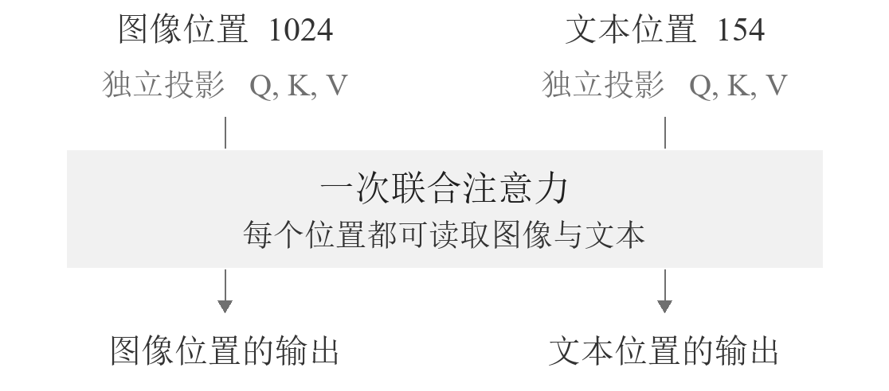
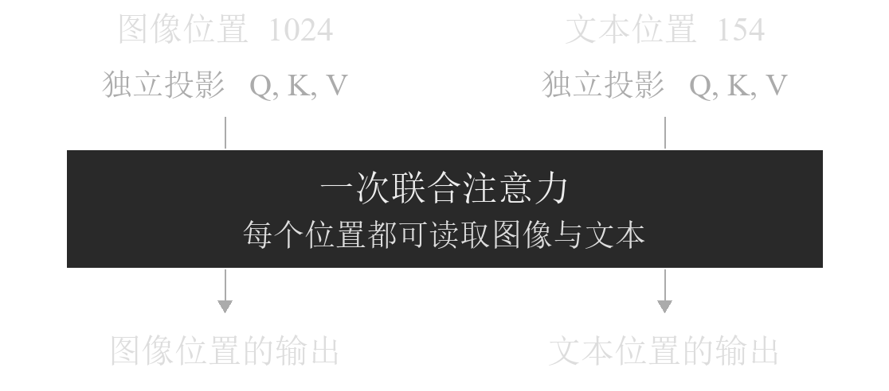
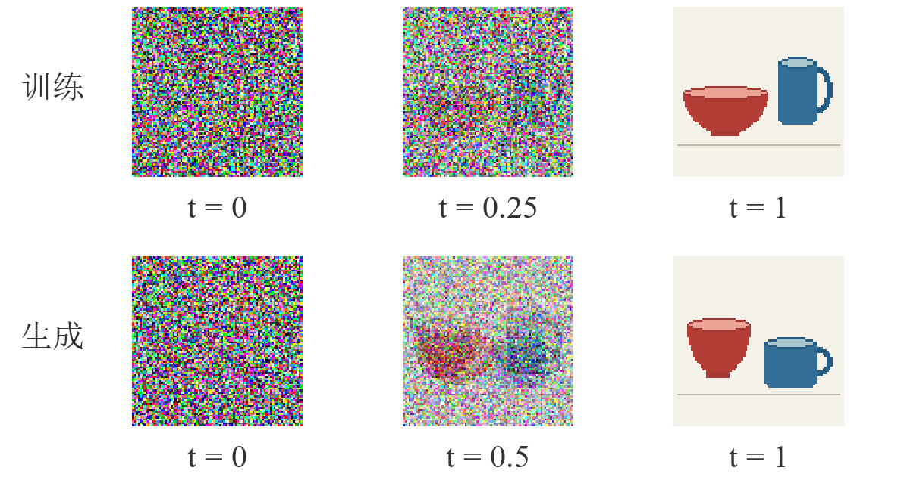
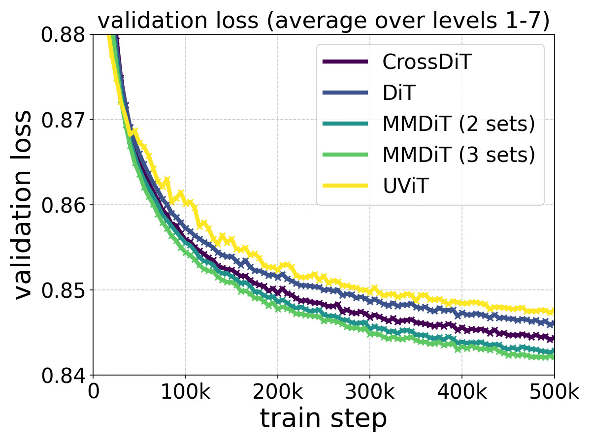
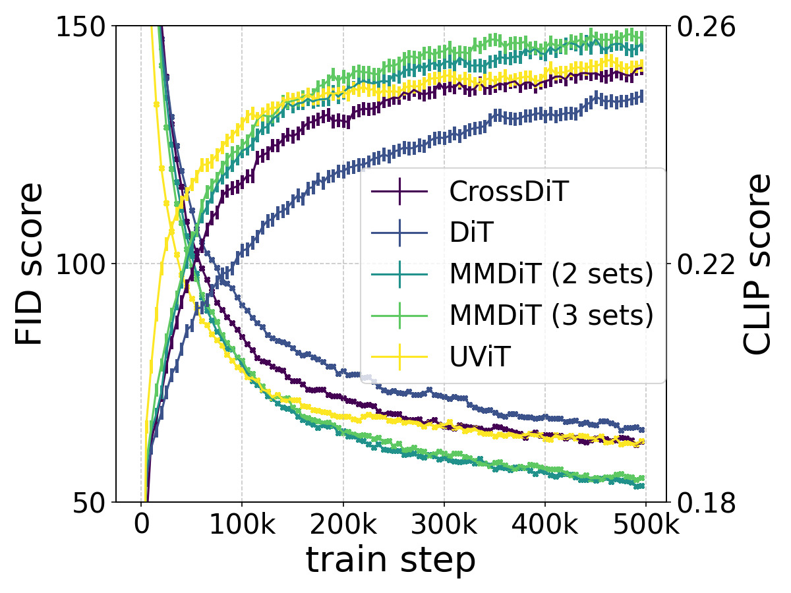


SD3 在压缩后的图像网格上学习怎样从噪声生成一幅符合描述的图。训练时，真实图像的潜表示和随机噪声确定一条直线，线上任一点的速度都能由两端之差算出。网络根据中间状态和文字预测这个速度。图像块和文本词元各用一套参数，再通过联合注意力交换信息，因而不同位置可以读取提示词中不同的细节。生成时，采样器按预测速度逐步更新网格，最后解码成像素。（由 GPT-6 总结）

**关键公式**

$$
z_t=(1-t)\epsilon+t z_1,\qquad v^*=z_1-\epsilon.
$$

$$
\mathcal L=\mathbb E\!\left[\|v_\theta(z_t,t,c)-(z_1-\epsilon)\|^2\right].
$$

$$
O=\operatorname{softmax}\!\left(QK^\top/\sqrt{d_k}\right)V.
$$

$$
z_{t+\Delta t}\approx z_t+\Delta t\,v_\theta(z_t,t,c).
$$


### 1. 基本思路

“一只红碗放在一只蓝杯的左边。”如果生成的图里碗和杯都有，颜色却配反了，或者碗出现在右边，模型就只认出了画什么，还没学会把物体、颜色和位置对起来。[DiT](/papers/dit/) 用一个类别向量调节所有图像块，足以告诉网络要画哪一类东西。到了这句话，同一处带噪轮廓到底该往碗还是杯的方向更新，还要结合提示词的细节，以及另一个物体在图里哪里。

Patrick Esser 等人在 *Scaling Rectified Flow Transformers for High-Resolution Image Synthesis* 中用两项设计来处理这个任务。首先是**一步预测什么**：网络在潜网格上工作。它是压缩后的图像特征，形状比像素图小；所谓速度，就是其中每个数每单位时间应该改变多少。训练时连接噪声与清晰网格，用两端之差给出速度标签；生成时，速度乘以步长就是对当前网格的改动。其次是**预测如何用上文字**：多模态扩散 Transformer（MM-DiT）让图像块和文字通过联合注意力交换信息，使不同图像位置能找不同的文字线索。

生成从一张高斯噪声网格开始。每一步把当前网格、时间和同一句提示交给网络，预测速度，再由采样器更新网格。提示词只需编码一次，但“左边”影响哪些位置，要随构图重新计算。最后由图像解码器将潜网格还原为像素。

### 2. 学习速度

#### 2.1 一条训练线

要学会从噪声走一步，训练程序得先准备**当前状态**和**应该往哪走的答案**。[整流流](/papers/rectifiedflow/) 先规定一条容易算的路：把训练图像编码成清晰潜网格 $z_1$，配对的文字描述记作 $c$，再独立抽一份同形状的标准高斯噪声 $z_0=\epsilon$。以 $t=0$ 为噪声端，$t=1$ 为图像端，随机选一个时刻 $t$，沿两者之间的直线构造当前状态：

$$
z_t=(1-t)\epsilon+t z_1,\qquad \epsilon\sim\mathcal N(0,I).
$$

把时间增加 $\Delta t$，状态的变化就是 $\Delta t\,(z_1-\epsilon)$。直线上的速度恒为 $z_1-\epsilon$，所以直接用两端相减就能构造标签。训练程序知道两端，网络却只接收 $z_t,t,c$。同一句提示可以配到许多张合适的图，而不同的图和噪声也可能混出相同的中间网格。平方误差会让网络在这些可能的速度标签之间取平均，越可能造成当前输入的配对，占的权重越大。这就是这里的**条件均值**；给出不同的网格、时刻或文字，平均速度也会变。SD3 直接用真实图像和独立噪声训练，对应整流流的第一轮训练目标。

对照原文时，论文采用从数据到噪声的时间 $\tau=1-t$。同一状态写成 $z=(1-\tau)z_1+\tau\epsilon$，速度也随之变号，成为 $\epsilon-z_1$。生成时沿 $\tau$ 减小的方向积分，走向的仍是清晰图像。

#### 2.2 选择时刻

训练时还要决定：有限的训练批次，应该有多少花在重噪声、有多少花在轻噪声？同一条线的标签虽一样，线索却不同。站在纯噪声端，给定的网格只告诉网络起点是什么，哪张清晰图和它配对只能从文字推测；站在清晰端，图已经给定，要猜的主要是那次配对的独立噪声。中间状态同时含有两端的信息，网络要结合带噪轮廓和文字来推断该怎样更新。论文把多练习中间时刻作为一个可以做对照实验的选择。

均匀抽取会给等长区间相同的训练机会。要提高中间区间被抽中的概率，可以先抽一个集中在零附近的正态变量，再用 sigmoid 将它变成位于 0 到 1 之间的**噪声时刻**：

$$
u\sim\mathcal N(m,s^2),\qquad \tau=\frac{1}{1+e^{-u}}.
$$

这里的 $m$ 和 $s$ 分别是正态变量 $u$ 的均值和标准差。Sigmoid 把 $u=0$ 映射到 $\tau=0.5$，大幅偏离零的值才会被压到接近两端。这样得到的时刻分布称为 logit-normal。论文采用 $m=0,s=1$ 时，时刻关于中点对称，靠近两端的样本较少。

一次训练先抽 $u$，再算出噪声时刻 $\tau$，换成本文的 $t=1-\tau$，最后用这个 $t$ 在直线上构造 $z_t$。速度标签仍是 $z_1-\epsilon$；变的是网络在哪些位置更常收到训练信号。生成时采用多少步则由采样器另行决定。

### 3. 图像与文本

#### 3.1 图像分块

以一张 $512\times512$ 图像为例，自编码器把高和宽都压缩到原来的八分之一，每个位置用 16 个特征表示。论文用训练集的一部分估计潜表示的均值和标准差，把编码结果统一减去均值、再除以标准差，得到送入流模型的 $z_1$；这样，图像特征与标准高斯噪声的数值尺度接近。清晰潜网格 $z_1$ 和带噪网格 $z_t$ 都是 $64\times64\times16$。

网格上的噪声已经加好了，接下来才轮到 Transformer 分块。若让每个网格位置单独互相匹配，序列会有 4096 个位置。和 DiT 一样，将相邻的 $2\times2$ 格合成一块，可以把位置数降到 1024。每块的 $2\times2\times16=64$ 个数经同一个线性层映射到宽度 $d$，得到一个图像 token，也就是一行供 Transformer 处理的特征。再把二维位置编码加到每行，让注意力知道小块原来在网格的哪个位置。最后输出速度时，仍要按这些位置把小块拼回网格。

#### 3.2 两种文本信息

如果只把整句话压成一个向量，网络能知道整体主题，却很难让每个图像位置单独寻找与自己有关的词。论文保留提示词的两种表示：**整句向量**与时间一起调节每一层；**词元序列**留给图像和文本在注意力中逐个位置读取。

> [!Note] **文本编码器给出的是什么**
> 编码器先把长短不同的句子拆成词元，一个词元可以是整词，也可以只是词的一部分。每个位置输出一组数，表达的是结合上下文后的特征；“左边”依附于什么物体，周围的“碗”和“杯”能给这个词提供线索。CLIP 的整句向量与逐词元的序列是两种输出。下表中的 77 是论文这套配置的序列长度，短句也会补齐。

论文配置采用三个预训练并冻结的文本编码器。CLIP L/14 和 OpenCLIP bigG/14 的文本端在图文配对任务中学过怎样表示视觉描述；T5-v1.1-XXL 的文本端来自语言模型，SD3 只用它的编码器来提取逐词上下文特征。三者都读同一句提示词，输出按以下方式组合（省略批次轴，论文附录 B.2）：

| 用途 | 怎样得到 | 形状 |
| --- | --- | --- |
| 整句向量 | 两个 CLIP 的汇总向量按特征维拼接 | $768+1280=2048$ 维 |
| CLIP 序列 | 两个 CLIP 的倒数第二层输出按特征维拼接 | $77\times2048$ |
| T5 序列 | 取 T5 编码器的最后一层输出 | $77\times4096$ |
| 联合文本序列 | 将 CLIP 的特征宽度补零到 4096，再和 T5 沿序列维拼接 | $154\times4096$ |

两次拼接沿不同的方向。两个 CLIP 的词元输出并排放，仍有 77 个位置，每个位置的特征变宽；接上 T5 时则增加 77 行，合起来有 154 个位置。这样不用把 T5 和 CLIP 的词元逐个对齐。最后将每行映射到宽度 $d$。至此图像与文本都是一串等宽向量，可以在同一层中计算位置之间的相关性。

### 4. 一层 MM-DiT

#### 4.1 联合注意力

有了 1024 个图像位置和 154 个文本位置，就可以像 [LDM](/papers/ldm/#43-交叉注意力) 那样，让图像位置向固定的文字特征查询。MM-DiT 进一步让文字位置也读图像：深一层的图像块可以向已经结合当前构图的文字特征再次查询。两种序列既要交换信息，又要各自学会处理不同的输入，于是每块先分开算投影，再合起来算注意力。

> [!Note] **怎样读注意力公式**
> 每个位置算出查询（Q）、键（K）和值（V）三组数。$QK^\top$ 一次算出所有两两匹配分数：某一行回答一个位置该读哪些地方。该行通过 softmax 变成总和为 1 的权重，再用这些权重对值向量加权求和。CNN 的卷积核在训练后固定，注意力的读取权重则用当前输入重算。一个注意力头做一次这样的读取；多头就是用几组不同的投影并行读取，再合并结果。

<figure class="ddpm-figure paper-diagram" style="--diagram-width:372px;">
  
  
  <figcaption>MM-DiT 块内的联合注意力（本文自绘）。两列的位置数沿用上一节的例子；完整网络和块结构见<a href="https://raw.githubusercontent.com/mlresearch/v235/main/assets/esser24a/esser24a.pdf#page=5">原论文 Figure 2(a)、(b)</a>。</figcaption>
</figure>

把图像序列记作 $I$，文本序列记作 $C$。两者虽然都有 $d$ 个通道，但图像特征和词元特征的含义不同，因此各自学习怎样从中提取查询、键和值。例如，图像查询是 $Q_I=IW_I^Q$，文本查询则是 $Q_C=CW_C^Q$；键和值也各有两套投影。

接下来才交换信息。将两种查询沿位置轴拼成 $Q=[Q_I;Q_C]$，同样拼出键矩阵 $K$ 和值矩阵 $V$。记每个头的查询和键的宽度为 $d_k$。点积除以 $\sqrt{d_k}$，使分数的尺度不会随宽度增大而明显升高。一个头的计算为：

$$
O=\operatorname{softmax}\!\left(QK^\top/\sqrt{d_k}\right)V.
$$

在前面的尺寸下，$QK^\top$ 有 $1178$ 行、$1178$ 列。每行属于一个发出查询的位置，每列属于一个可以读取的位置。图像位置既可以从其他图像块收集轮廓线索，也可以从“红碗”相关词元读取颜色与对象信息；文本位置同样可以读取图像。softmax 在每行的所有列上进行，所以两类信息在同一次读取中分配权重。

只跟踪其中一个图像块 $i$。设 $A_{ij}$ 是它给位置 $j$ 的注意力权重，$v_j$ 是从值矩阵 $V$ 的第 $j$ 行取出的内容向量，$\mathcal I$ 和 $\mathcal C$ 分别是图像和文本位置集合。这个头在位置 $i$ 读到的内容可以拆开看：

$$
o_i=\sum_{j\in\mathcal I} A_{ij}v_j+\sum_{j\in\mathcal C} A_{ij}v_j.
$$

两组权重**合起来**才等于 1。因此，当这个块需要定位物体边缘时，可以把较多权重分给邻近图块；需要区分“红碗”和“蓝杯”时，也可以把更多权重分给文字。一行中某个词元的分数升高，归一化后它分到更多权重，同一行图像和其他词元的权重都随之减少。这就是把两种键放在同一次注意力里计算的具体作用。

输出按原位置拆开，前 1024 行送回图像分支，后 154 行送回文本分支。两边各自做输出投影、残差相加和逐位置前馈计算。下一层面对的图像特征已经读过文字，文本特征也已经看过当前图像。**图文共享的是这次注意力运算，学习怎样读写特征的参数各自独立。**

把相邻两层连起来，双向读取的意义就更明显。第一层中，“碗”对应的文本位置可以从图像里汇总与碗形相符的线索；这份更新后的文本特征到了第二层，又能被图像位置读回去。于是第二层读到的“碗”已经包含当前网格的上下文。同一层的查询、键和值都从该层的输入得到，这种“图像影响文字、文字再影响图像”的往返要跨层才完成。

#### 4.2 条件调节

逐词注意力决定一个位置**读什么**；整句主题和噪声时刻则让同一套层在不同输入上采取不同的更新方式。接近纯噪声时，网络要先建立构图；接近成图时，已经出现的轮廓只需细调。模型先对时间做正弦编码，再用小型网络映射；整句向量也经投影，两者相加后，得到原论文 Figure 2(b) 里标作 $y$ 的调节条件。

在图 2(b) 的联合块中，调节条件 $y$ 用于算两类系数。注意力或前馈网络开始计算**之前**，先对输入特征归一化，再对各通道缩放、偏移，改变这一支实际读到的特征。分支算完**之后**，用另一组系数乘它的输出，再加回原特征，决定这次更新改动多大。图像和文本用同一个 $y$，却各用一套参数计算这些系数，因此对相同的时间和提示可以有不同的响应。

> [!Note] **归一化与残差**
> 这里的 LayerNorm 在一个位置内部对特征通道求均值和方差，用它们把数值拉回较一致的范围。缩放和偏移发生在此之后，可以按条件重新突出某些通道。残差连接则保留原特征，只把算出的改动加上去；如果某个通道的输出乘了零，那么这个分支就不会改动该通道。

[LDM 的交叉注意力](/papers/ldm/) 让图像向一份固定的文本编码查询。MM-DiT 还允许文本向图像查询，因此在一次速度预测内部，深层收到的是已结合当前图像的文本特征。到下一个采样时刻，图像换了，MM-DiT 从原始文本编码出发再做一次交互。可以缓存的是三个文本编码器的输出。

#### 4.3 网格输出

最后一层只需保留图像位置的输出。每个图像 token 经过条件调节和线性投影，给出对应小块的 64 个速度分量。按分块时的坐标拼回去，就得到一张 $64\times64\times16$ 的速度网格 $v_\theta(z_t,t,c)$。

这张网格与训练标签 $z_1-\epsilon$ 形状相同，因而每个位置、每个通道都能直接计算平方误差。误差从图像输出传回联合块：图像位置读取过文本的键和值，改变这些文本投影也会改变速度预测，所以文本分支可以从同一个损失学习。训练更新的是 MM-DiT，自编码器和文本编码器的参数保持固定。

### 5. 生成与分辨率

#### 5.1 速度更新

生成时只有提示词和目标尺寸。得到文字的两种表示后，按潜网格的形状抽取起始噪声 $z_0=\epsilon$。若采样器从 $t$ 走到 $t+\Delta t$，一次欧拉更新为：

$$
z_{t+\Delta t}=z_t+\Delta t\,v_\theta(z_t,t,c).
$$

速度乘以步长，得到这一小段时间内各分量的位移。下一步仍用同一句提示，但网络会根据新的 $z_{t+\Delta t}$ 和时间重新预测。

训练线上的速度是常数，生成为什么还要分多步？在一条训练线上，剩余位移确实等于剩余时间乘以速度，也就是 $z_1-z_t=(1-t)(z_1-\epsilon)$。但生成时，网络不知道是哪一条训练线，只能预测这些速度的加权平均。对给定的 $z_t$，若一步就走完剩余时间，等于把各条线的剩余位移取平均，也就是直接跳到候选终点的加权平均。不同构图叠在一起，可能得到一张模糊的图。先走一小段，到了新位置再估计哪些构图更可能，后续的速度就能随之调整。

走到 $t=1$ 后，把网格乘回训练时用的标准差，再加回均值，交给自编码器的解码器生成像素。

使用[无分类器引导（CFG）](/papers/cfg/) 时，同一份网格在同一时刻送入模型两次：一次带提示词，得到速度 $v_c$；一次不给文本特征，得到无条件速度 $v_u$。两者相减就得到提示词带来的速度变化。采样器用引导系数 $s_{\mathrm{cfg}}$ 调整这份变化，得到速度 $v_u+s_{\mathrm{cfg}}(v_c-v_u)$，再乘本步的 $\Delta t$。系数为 1 时就是普通的有条件预测；大于 1 时沿两种预测之差再多推一点。

#### 5.2 高分辨率

同样的噪声比例，用在不同分辨率上并不等效。一片颜色相近的区域，在更大的图上有更多相邻位置提供线索。合起来看，独立噪声的影响会减弱，轮廓因而更容易辨认。作者在高分辨率训练时把抽到的中间时刻往噪声端移，让网络更常见到结构尚不清晰的输入；采样时也调整中间时刻，让更多更新发生在噪声较重的区间。状态仍用上节的欧拉公式更新，步长由调整后的相邻时刻之差决定。[分辨率实验](#74-分辨率与噪声)给出了具体的换算关系。

### 6. 画一只红碗和一只蓝杯

回到开头的提示词：“一只红碗放在一只蓝杯的左边。”先用一张符合描述的照片训练，再拿走照片，看训练好的网络怎样只凭这句话生成另一张图。下面沿用 $512\times512$ 的尺寸，只挑潜网格中的一个数来算；它是编码器学出的特征，不能直接读成某个像素的红色强度。

#### 6.1 有照片时怎样学

照片经编码后得到 $64\times64\times16$ 的潜网格。假设选中的分量在清晰网格里是 $1$，这次抽到的噪声分量是 $-1$。取 $t=0.25$，直线上这个分量就走到了 $-1+0.25\times 2=-0.5$，对应的速度标签是 $1-(-1)=2$。训练程序知道两个端点，所以能算出答案；交给网络的只有当前带噪的整张网格、时刻和描述。

这个 $-0.5$ 随所在的小块进入图像分支。只跟一个注意力头的一行：假设这个图块给“红碗”相关词元、疑似杯身的图块和邻近图块分别打出 $\log 2$、$0$、$0$ 的分数。忽略其他位置后，取指数就是 $2$、$1$、$1$，归一化得到 $1/2$、$1/4$、$1/4$。这一行便取回半份文字值向量和各四分之一份图像值向量。把结果加回当前图块的特征后，后续层就能用这几处线索一起判断怎样更新。这里的权重只用来演示计算。

权重本身不是速度。网络还要经过后续的块和最后的线性投影，把图像位置的特征还原成速度网格。假如选中分量最终预测为 $1.6$，它对这次平方误差的贡献就是 $(1.6-2)^2=0.16$。用误差反向更新时，图块读取文字采用的投影也会收到梯度；这样，相关物体和文字是否读得有用，由速度误差来检验。

#### 6.2 只有提示词时怎样画

训练完成后，保留同一句提示词，重新抽一张噪声网格。这时没有可供编码的红碗照片，也就没有上一段的速度标签。为了能算到终点，这里用两步等长的欧拉更新，直接采用有文本条件的预测。假设新网格在同一分量上从 $0.3$ 出发，模型第一次预测速度为 $0.8$。走半个单位时间，它变成 $0.3+0.5\times0.8=0.7$；其余分量同时按各自的速度更新。

第二次调用仍用同一句话，但图像分支看到的是**更新后的整张网格**，时刻也变成了 $0.5$。假设这次该分量的预测是 $-0.2$，走完剩下半步，终值就是 $0.7+0.5\times(-0.2)=0.6$。前半步增加、后半步减小，是因为模型在两个不同状态上给出了不同速度。到 $t=1$ 时再解码整张网格，才看得出碗有没有画在杯子的左边。

<figure class="ddpm-figure paper-diagram" style="--diagram-width:396px;">
  
  
  <figcaption>同一句描述下，训练插值与两步生成的对照（本文自绘）。这里直接在简笔图的像素上计算，便于看见变化；实际 SD3 更新的是潜网格。原理见<a href="https://arxiv.org/html/2403.03206v1#S2">原论文 §2</a>。</figcaption>
</figure>

上排的噪声和宽碗高杯都已给定，中间一格由两端按比例混合。下排则只给起始噪声，图中的简化模型把两种符合提示的构图当作候选。第一步时，网格里还没有图像信号，两种候选的权重各半。到 $t=0.5$，模型再比较：把每种候选按当前时刻的比例缩放后，哪一个与眼前状态的差更像一份较小的高斯噪声？这次起始噪声让窄碗矮杯的权重更高，第二步便主要沿着它对应的速度更新。同一句提示没有指定要重现上排的照片，因此两排可以得到不同的碗和杯。

### 7. 实验结果

#### 7.1 时间采样

先固定骨干，只改变训练的噪声路径或时刻分布。下表摘自原论文 Table 2，取其中两种直线流训练方法，在 **25 步**生成时比较。FID 比较生成图与真实图的特征分布，越低越好。CLIP 分数则在评估时分别编码生成图和输入提示词，比较两个向量的相似程度，越高表示图文越匹配。这里同时用 CLIP 的图像端和文本端；前面送入 MM-DiT 的只有文本端特征。

| 训练时刻 | ImageNet FID ↓ | CC12M FID ↓ | CC12M CLIP ↑ |
| --- | ---: | ---: | ---: |
| 均匀 | 49.70 | 94.90 | 0.217 |
| logit-normal，$m=0,s=1$ | 45.78 | 89.91 | 0.224 |

为什么训练时改一个抽样分布，能影响使用相同步数的生成器？在给定 $z_t,t,c$ 后，对速度标签取条件均值的规则没有变。变化发生在不同 $t$ 之间：有限容量的同一个网络既要预测接近纯噪声时的方向，又要预测接近图像时的细节。多抽中间时刻，它就在这些状态收到更多次参数更新。表里两种模型生成时都走 25 步，因而差异反映的是训练时怎样分配练习机会，而不是多算了几次采样。论文还在 Table 1 汇总多套训练和评估配置，$m=0,s=1$ 在所比较的方案中平均排名最好。

#### 7.2 图文交互

架构实验专门比较了三种容易混淆的做法：让图像与文本共用所有块参数；在图像网络里加入面向文本的交叉注意力；像 MM-DiT 那样各用一套参数，在注意力中交换信息。原论文 Figure 4 在 CC12M 上比较训练进展，同时报告验证损失和生成指标。

<figure class="ddpm-figure">
  
  <figcaption>不同网络在 CC12M 上的验证损失。来源：<a href="https://arxiv.org/html/2403.03206v1#S5.F4">原论文 Figure 4 左图</a>。</figcaption>
</figure>

先比较同一训练步数下的验证损失：曲线越低，表示网络在留出的样本上预测速度越准。图中的 “MMDiT (2 sets)” 就是第 4 节讲的两套参数，图像用一套，所有文本共用另一套。它的验证损失低于共享参数的 DiT。不过，速度预测得准，并不直接告诉我们生成的图像质量如何、有没有画对提示词描述的东西。

<figure class="ddpm-figure">
  
  <figcaption>同一批网络的生成指标。下降的一组曲线读左轴 FID，上升的一组读右轴 CLIP。来源：<a href="https://arxiv.org/html/2403.03206v1#S5.F4">原论文 Figure 4 右图</a>。</figcaption>
</figure>

再看生成指标：在相同训练进度下，双分支 MM-DiT 的 FID 比共享参数的 DiT 更低，CLIP 分数也更高。也就是说，在这组实验中，验证损失的改善同时反映在生成图像的分布和图文匹配程度上。作者还把 CLIP 与 T5 的 token 分给两套不同的文本参数（“3 sets”）；相比双分支，额外收益很小，还会增加参数和显存开销。

网络能读到“左边”这样的词，还需要配图和描述一起告诉它这个词指什么。原论文 Table 4 比较了两种训练数据：全部使用原配文，或将一半配文替换成合成描述。论文用 GenEval 检查生成结果：按测试提示生成一批图，再用物体检测结果检查画了什么、有几个、相互位置对不对，颜色类项目还会检查物体的颜色。混用合成描述后，总体成功率由 43.27% 升到 49.78%，其中位置关系由 6.50% 升到 18.00%，单物体项目则由 95.00% 变为 93.75%。这组对照里，改进主要出现在更难的项目，例如按要求摆放对象。

#### 7.3 规模与步数

扩大 MM-DiT 时，作者同时增加层数、宽度和注意力头数。最大模型有 38 层、约 80 亿参数，在 $512\times512$ 下的 GenEval 得分为 0.68。作者还用**直接偏好优化**（DPO，Direct Preference Optimization）做后训练：对同一提示词收集一对有优劣标记的图，再微调模型，使它相对于微调前的版本更倾向于给出被偏好的结果。原论文 Table 5 中，加入 DPO 后得分为 0.71；在 $1024\times1024$ 且使用 DPO 的配置下为 0.74。画质偏好和画面内文字的可读性另用人评考察。

原论文 Table 6 换了一个问题：同一模型少走几步，图文匹配分数会下降多少？以**每个模型自己走 50 步时**的 CLIP 分数为基线，固定种子减到 10 步，15 层模型下降 0.86%，38 层模型下降 0.14%；减到 5 步分别下降 4.30% 和 2.71%。大模型用更少的更新仍能接近自己的基线，但它每次预测要经过更多层。估算一张图的生成成本，还得把单步开销乘进去。

#### 7.4 分辨率与噪声

第 5 节提到分辨率越高，同样的噪声比例越容易留下可辨认的轮廓。把这件事写成一个可计算的例子：一块区域内有 $n$ 个位置，全都具有相同的信号值 $a$，噪声 $\epsilon_i$ 是各位置独立抽取的标准高斯。用论文的噪声时间 $\tau$ 表示，第 $i$ 个观测是 $(1-\tau)a+\tau\epsilon_i$。取平均时，信号仍是 $(1-\tau)a$；噪声的方差先相加，再除以 $n^2$，得到 $n\tau^2/n^2=\tau^2/n$。将平均值除以 $1-\tau$，就能估计 $a$，这份估计的标准误差是：

$$
\frac{\tau}{(1-\tau)\sqrt n}.
$$

位置越多，取平均时独立噪声抵消得越充分，而共同的信号 $a$ 保留下来。因此，把同一区域从 $n$ 个位置细分为 $m$ 个位置后，要保持相同的估计难度，就得相应提高噪声比例。具体地，让新的比值 $\tau'/(1-\tau')$ 等于原比值 $\tau/(1-\tau)$ 的 $\alpha$ 倍，解出新时刻（原文式 23）：

$$
\tau'=\frac{\alpha\tau}{1+(\alpha-1)\tau}.
$$

在上述常值区域里，保持标准误差不变给出 $\alpha=\sqrt{m/n}$。当 $\alpha>1$，原来的中间时刻被移到更靠近噪声端的位置，两个端点仍是 0 和 1。对真实图像，作者用生成结果来选偏移幅度，后续 $1024\times1024$ 的训练和采样采用 $\alpha=3$。若换回本文从噪声走向图像的时间，变换后的时刻是 $1-\tau'$。

### 8. 适用边界

回到红碗和蓝杯：联合注意力给左侧图像块提供了读取颜色、物体和方位词的途径，速度损失则根据配对图像告诉网络，这样读取以后给出的更新是否接近目标。整套模型学到的图文关系，最终要看生成的图中位置和颜色是否真的配对正确。

这条图文交互路径也有代价。分辨率越高，参与联合注意力的图像位置越多；文本侧的 T5 编码器本身也占显存。SD3 训练时会独立丢弃各文本编码器的条件，因此模型见过缺少 T5 的输入。论文据此比较了推理时保留和移除 T5 的结果：两者在审美偏好上接近；遇到复杂提示，尤其要在画面中写出指定文字时，保留 T5 更有帮助。

### 参考资料

1. Esser et al. *Scaling Rectified Flow Transformers for High-Resolution Image Synthesis*. [ICML 2024 正式版](https://proceedings.mlr.press/v235/esser24a.html)；[arXiv 全文](https://arxiv.org/html/2403.03206v1)。时间采样见 §3.1、Table 1–2；图文架构见 §4、Figure 2、附录 B.2；架构、描述与生成实验见 §5、Figure 4、Table 3–6；分辨率偏移见 §5.3.2。
2. Stability AI. [SD3 参考推理实现](https://github.com/Stability-AI/sd3-ref)。可对照潜表示、采样时刻、MM-DiT 和文本条件在一次生成中的调用顺序。
3. Lipman et al. *Flow Matching for Generative Modeling*. ICLR 2023. [arXiv:2210.02747](https://arxiv.org/abs/2210.02747)。条件速度监督的来源。
4. Liu, Gong, Liu. *Flow Straight and Fast: Learning to Generate and Transfer Data with Rectified Flow*. ICLR 2023. [arXiv:2209.03003](https://arxiv.org/abs/2209.03003)。直线路径与整流训练的来源。
