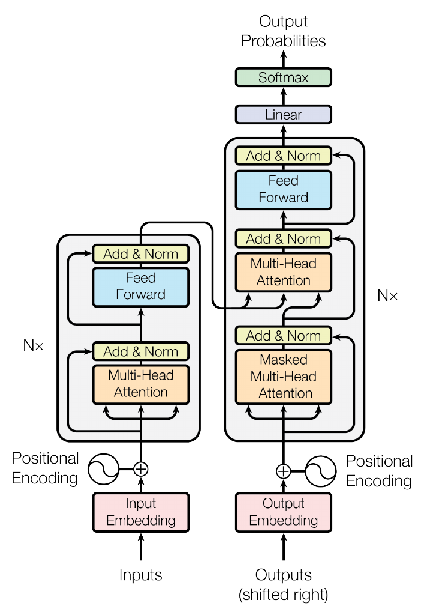


Transformer 要解决的是如何利用序列中的上下文完成预测。注意力先为不同位置计算匹配分数，将分数归一化为读取权重，再汇总相应内容。查询和键决定匹配方式，值决定传递内容；三者由可学习变换生成，使同一套计算能适应不同输入。多头注意力提供多组汇总，前馈网络继续加工特征，残差连接与归一化支持多层计算。编码器据此处理原文，解码器结合原文和已有译文预测下一个 token。训练通过右移与遮罩并行计算预测损失，生成则逐步扩展前缀。（由 GPT-6 总结）

**关键公式**

$$
Q=XW^Q,\qquad K=XW^K,\qquad V=XW^V.
$$

$$
\operatorname{Attention}(Q,K,V)=\operatorname{softmax}\!\left(\frac{QK^\top}{\sqrt{d_k}}\right)V.
$$

$$
\operatorname{MultiHead}(X)=\operatorname{Concat}(\operatorname{head}_1,\ldots,\operatorname{head}_h)W^O.
$$

$$
\mathcal L=-\sum_{t=1}^{m}\log p_\theta(y_t\mid y_{<t},x).
$$

$X$ 为输入表示，Q、K、V 分别为查询、键和值，$\operatorname{head}_r$ 为第 $r$ 个头的注意力输出。训练目标中，$x$ 为原文，$y_t$ 为第 $t$ 个目标 token，$y_{<t}$ 为其前缀，$\theta$ 为模型参数。


### 1. 基本思路

**Attention Is All You Need** 是 Vaswani 等人在 2017 年提出 Transformer 的论文，研究的主要任务是机器翻译：读入原文，根据原文与已经生成的译文，预测下一个词。完成这个任务，不仅需要识别词语，还需要利用词语之间的关系。

例如，“小猫困了，它睡着了”中的“它”指代“小猫”。如果一个位置的表示只取决于当前位置的词，就无法记录这种关系。模型需要根据当前句子更新各位置的表示，使后续预测能够利用上下文。

早期序列模型通常用循环网络按位置依次更新状态。远处的信息需要经过中间状态传递，同一层的计算也存在前后依赖。Transformer 采用自注意力，让各位置直接读取其他位置的信息，并通过矩阵运算同时计算这些关系。**本文的核心问题是：一个位置应当怎样选择并汇总上下文，才能得到有助于预测的表示？**

计算前，文本先被切分成 **token**，即模型处理的基本单位，可以是词、子词、汉字或标点。词表为每个 token 分配编号，模型再根据编号，从一张可学习的参数表中取出对应向量。这张表称为**嵌入表**，取出的向量称为**嵌入表示**（embedding）。编号用于区分 token，向量则用于后续计算；表中数值随训练调整，各维通常没有人工指定的语义。

同一 token 在不同句子中查到的初始向量相同，而经过上下文计算后的表示可以不同。下面暂时省略标点，将例句示意为“小猫／困了／它／睡着了”，分别记为 $x_1,x_2,x_3,x_4$。一般情况下，长度为 $n$ 的输入写成 $X\in\mathbb R^{n\times d}$，每一行对应一个位置，$d$ 是表示宽度；后续层的输入则是上一层的输出。顺序信息的加入方式在第 4 节介绍。

### 2. 注意力计算

#### 2.1 汇总目标

先考虑一个简单方案：更新位置 $i$ 时，将整句的输入向量加权汇总，得到上下文信息 $c_i$：

$$
c_i=\sum_{j=1}^{n}a_{ij}x_j,\qquad a_{ij}\geq0,\qquad\sum_{j=1}^{n}a_{ij}=1.
$$

$i$ 是待更新的位置，$j$ 是被读取的位置。对例句中的“它”，$i=3$；如果“小猫”与当前预测更相关，就希望 $a_{31}$ 较大。这个输出仍是向量，将用于后续处理，并不直接决定生成哪个词。

若所有权重都取 $1/n$，不同位置会得到相同的平均结果，无法区分各自需要的上下文。因此，**权重应当由待更新位置和候选位置共同决定，并随输入变化。** 上式还直接使用 $x_j$ 传递内容，接下来分别规定匹配方式和内容表示。

#### 2.2 匹配分数

直接使用 $x_i x_j^\top$ 可以计算匹配分数，但这要求同一组输入特征同时承担两种作用：在位置 $i$ 主动检索信息，以及在位置 $j$ 供其他位置匹配。Transformer 为这两种作用使用独立的可学习变换：

$$
q_i=x_iW^Q,\qquad k_j=x_jW^K.
$$

$q_i$ 称为**查询**（Query），表示更新位置 $i$ 时采用的匹配特征；$k_j$ 称为**键**（Key），表示位置 $j$ 用于被匹配的特征。二者的名称来自信息检索：查询与检索条目进行匹配。这里实际计算的都是向量，不需要人工编写查询条件。

查询和键分开后，模型可以分别学习两种特征，位置之间的读取关系也不必对称。一个位置既生成自己的查询，用于读取其他位置，也生成自己的键，供其他位置读取。匹配不再局限于初始词向量的相似程度，而是由任务训练出适合信息交互的特征。

论文采用**缩放点积**作为匹配分数：

$$
s_{ij}=\frac{q_i k_j^\top}{\sqrt{d_k}}.
$$

$d_k$ 是查询与键的维度。除以 $\sqrt{d_k}$ 是为了控制分数尺度：在分量独立、均值为 0、方差为 1 的简化假设下，点积的方差为 $d_k$，缩放后回到 1。分数差距过大时，softmax 会将权重高度集中到少数位置，使权重对分数变化不够敏感，影响训练。缩放用于减轻这一问题。

#### 2.3 权重与内容

得到一组匹配分数后，需要将它们转换为读取比例。对同一位置 $i$，沿所有候选位置做 **softmax**：

$$
a_{ij}=\frac{\exp(s_{ij})}{\sum_{\ell=1}^{n}\exp(s_{i\ell})}.
$$

这样得到的权重为正，且 $\sum_j a_{ij}=1$。候选位置的分数越高，所占权重越大；它得到的比例也取决于同一行的其他分数。因此，权重反映的是当前输入下各位置之间的相对匹配，而不是某个词永久对应的固定比例。

现在再考虑传递什么内容。用于匹配的特征，不一定是后续计算需要的全部信息。例如，检索资料时，条目适合参与匹配，正文才是需要读取的内容。Transformer 因而另用一个可学习变换生成**值**（Value）：

$$
v_j=x_jW^V,\qquad z_i=\sum_{j=1}^{n}a_{ij}v_j.
$$

这将第 2.1 节直接汇总 $x_j$ 的方案，推广为汇总变换后的 $v_j$。**查询与键决定各位置的读取权重，值提供被汇总的信息。** 输出 $z_i$ 是位置 $i$ 获得的上下文内容，后面还要与原表示结合并继续加工。

$W^Q,W^K,W^V$ 是训练需要调整的参数矩阵，同一层内的所有位置共享这三套变换。分开匹配与内容表示，为模型提供了分别优化它们的空间；这是结构设计上的选择，并不是加权汇总唯一可行的形式。参数如何由最终预测任务学习，在第 5 节说明。

#### 2.4 完整计算

把全部位置的查询、键和值按行排列，就可以一次完成上述计算：

$$
Q=XW^Q,\qquad K=XW^K,\qquad V=XW^V.
$$

$$
A=\operatorname{softmax}\!\left(\frac{QK^\top}{\sqrt{d_k}}\right),\qquad Z=AV.
$$

$QK^\top$ 计算所有位置对的分数，softmax 分别对每一行归一化，最后乘 V 得到各位置的汇总结果。这就是**缩放点积注意力**：

$$
\boxed{\operatorname{Attention}(Q,K,V)=\operatorname{softmax}\!\left(\frac{QK^\top}{\sqrt{d_k}}\right)V}.
$$

若 Q、K 为 $n\times d_k$，V 为 $n\times d_v$，则 A 为 $n\times n$，Z 为 $n\times d_v$。A 的第 $i$ 行对应更新位置 $i$ 时的读取权重；Z 仍为每个位置保留一个输出，并未将整句压缩为单个向量。查询与键的维度必须相同，值的维度 $d_v$ 可以不同。

用同一个例句说明分数怎样产生权重。假设一次投影得到“它”的查询 $q_3=(\sqrt2,0)$，查询和键均为二维，各位置的键及相应计算结果如下：

| 被读取的位置 | 键 $k_j$ | 分数 $s_{3j}$ | 权重 $a_{3j}$ |
| --- | --- | ---: | ---: |
| 小猫 | $(2,0)$ | 2 | 0.6103 |
| 困了 | $(0,1)$ | 0 | 0.0826 |
| 它 | $(1,1)$ | 1 | 0.2245 |
| 睡着了 | $(0,-1)$ | 0 | 0.0826 |

这些权重由分数经过 softmax 得到。用于汇总的是各位置的值向量，因此输出为：

$$
z_3=\frac{e^2v_1+v_2+ev_3+v_4}{e^2+e+2}.
$$

这组向量与数值仅用于展示计算路径，不代表真实模型的语义特征。0.6103 表示本次汇总中 $v_1$ 的混合比例，不能解释为“它”指代“小猫”的概率。**当 Q、K、V 来自同一序列时，这种计算称为自注意力**；“自”描述信息来源，当前位置仍然可以读取序列中的其他位置。

### 3. 自注意力层

单次注意力已经能汇总上下文，但完整网络还要解决两个问题：如何保留多种信息关系，以及如何将汇总结果与原表示结合、继续加工。这决定了 Transformer 一层中的其他结构。

#### 3.1 多头注意力

单个头对每个查询只产生一组权重，所有值都按这一组比例混合。如果一个位置同时需要指代、动作和修饰等不同线索，分别形成多组汇总，可以减少这些信息过早混合带来的限制。

**多头注意力**并行使用 $h$ 套 Q、K、V 变换。第 $r$ 个头计算：

$$
\operatorname{head}_r=\operatorname{Attention}(XW_r^Q,XW_r^K,XW_r^V).
$$

随后沿特征维度拼接各头输出，再通过 $W^O$ 混合：

$$
\operatorname{MultiHead}(X)=\operatorname{Concat}(\operatorname{head}_1,\ldots,\operatorname{head}_h)W^O.
$$

每个头都可以读取整句，区别在于特征变换和权重，而不是各自处理不同句子片段。具体分工由训练形成，没有为某个头预先指定语法职责，也不保证各头一定形成清晰不同的解释。

原论文基础模型的输入宽度为 512，使用 8 个头，每头的查询、键和值为 64 维。8 组输出拼接后恢复为 512 维，再经 $W^O$ 变换，保持模型宽度不变。

<figure class="ddpm-figure">
  
  <figcaption>缩放点积注意力与多头注意力；来源：原论文 Figure 2</figcaption>
</figure>

图从下向上读。Linear 对应生成 Q、K、V 的线性变换，MatMul、Scale、Softmax 对应前面的匹配与归一化，再乘 V 完成汇总。右侧将这套计算并行执行多次后拼接。Mask 用于限制读取范围，在第 5 节说明。

#### 3.2 特征加工

多头注意力输出的是从上下文汇总的信息，原位置的表示仍然需要保留。为此，模型将子层输出加回输入，形成**残差连接**；再用**层归一化**调整每个位置内部的数值尺度，使后续计算更稳定。注意力子层写成：

$$
H=\operatorname{LayerNorm}\!\left(X+\operatorname{MultiHead}(X)\right).
$$

接下来使用**逐位置前馈网络**（FFN）加工汇总后的特征。它由两次线性变换与中间的 ReLU 激活函数组成，提供非线性特征变换：

$$
\operatorname{FFN}(u)=\max(0,uW_1+b_1)W_2+b_2.
$$

$u$ 为某一位置的向量，$W_1,W_2,b_1,b_2$ 均为可学习参数。基础模型先将 512 维扩展到 2048 维，再变回 512 维。同一层各位置共用 FFN 参数，但分别计算；跨位置的信息交流由前面的注意力完成。

前馈子层同样配有残差连接和归一化：

$$
X'=\operatorname{LayerNorm}\!\left(H+\operatorname{FFN}(H)\right).
$$

两步分别完成“读取上下文”和“加工每个位置的特征”，输入与输出保持相同宽度，因此可以继续叠加下一层。第一层自注意力已经能读取全部允许位置，后续层则在更新后的表示上重新匹配、汇总与加工信息。

> [!Note] **残差与归一化**
> 原论文采用先残差相加、后层归一化的顺序。LayerNorm 分别对每一行计算均值与方差，再使用可学习的缩放和平移；它不依赖同一批次中其他句子的统计量。残差连接也为误差信号向较早层传播提供直接路径。上面两式省略了子层输出上的 dropout；训练时它随机屏蔽部分分量并缩放，生成时关闭。

### 4. Transformer

前面得到了一种可以重复堆叠的序列处理层。原论文用它构成编码器，再为解码器增加读取原文的通路，完成从输入序列到输出序列的转换。

#### 4.1 位置信息

只按内容进行匹配，还不能区分“我喜欢猫”与“猫喜欢我”中的词序。对完整可见的序列，不含位置信息的自注意力在输入重排时，输出也只会相应重排，因此输入需要额外携带顺序信息。

原论文在词嵌入上加入**位置编码**。令 $E[t_i]$ 为第 $i$ 个 token 的嵌入，$d$ 为模型宽度，实际输入为：

$$
x_i=\sqrt d\,E[t_i]+\operatorname{PE}(i).
$$

位置向量与词向量维度相同，加入后共同参与 Q、K、V 的计算。根号系数用于调整词嵌入的数值尺度。原论文的位置向量由不同频率的正弦、余弦生成；记 $\omega_r=10000^{-2r/d}$，有：

$$
\operatorname{PE}(p,2r)=\sin(p\omega_r),\qquad\operatorname{PE}(p,2r+1)=\cos(p\omega_r).
$$

$p$ 为位置，$r$ 为维度对编号。各频率随位置以不同速度变化，共同构成位置特征。编码按固定公式生成，模型学习怎样利用它；论文也测试了可学习的位置向量，结果接近。能为更长位置计算编码，并不自动保证模型能处理更长的句子。

#### 4.2 编码器

编码器在加入位置的原文表示上，重复第 3 节的层结构。基础模型共 6 层，各层参数独立：每层先做多头自注意力，再做逐位置前馈网络，两个子层各有残差连接和归一化。

在原文完整给定的翻译任务中，编码器可以读取全部有效源位置。最终输出仍是一组按原文位置排列的向量，保留各位置结合上下文后的信息，供解码器使用。

#### 4.3 解码器

以 “I like cats” 翻译为“我喜欢猫”为例，解码器需要同时利用已有译文和完整原文。它的每一层依次执行：**目标序列自注意力 → 读取编码器输出的交叉注意力 → 逐位置前馈网络**。三个子层各有残差连接和归一化，基础模型同样重复 6 层。

其中，**交叉注意力**沿用相同的注意力公式，只改变 Q、K、V 的输入来源：

| 注意力 | Q 的输入来源 | K、V 的输入来源 | 读取内容 |
| --- | --- | --- | --- |
| 编码器自注意力 | 原文表示 | 同一批原文表示 | 完整原文 |
| 解码器自注意力 | 目标序列表示 | 同一批目标序列表示 | 当前及更早的目标输入 |
| 交叉注意力 | 经过前一子层的解码器表示 | 编码器最终输出 | 完整原文 |

表中的来源还需分别经过各自的参数变换，才能得到 Q、K、V。例如预测“猫”时，解码器的查询可以与 cats 等源位置的键匹配，汇总相应值向量。若目标长度为 $m$、原文长度为 $n$，交叉注意力的权重矩阵就是 $m\times n$，为每个目标位置分别计算一组读取原文的比例。

解码器最后一层的输出仍是各位置的特征向量。将第 $t$ 个位置的最终表示记为 $h_t$，通过词表输出层得到预测概率：

$$
p_t=\operatorname{softmax}(h_tW_{\mathrm{vocab}}+b).
$$

$p_t$ 为词表中每个 token 分配一个概率。这里的 softmax 在词表上分配预测概率，注意力中的 softmax 则在输入位置之间分配读取权重，两者作用不同。

<figure class="ddpm-figure">
  
  <figcaption>编码器与解码器；来源：原论文 Figure 1</figcaption>
</figure>

从下向上看图：底部是词嵌入与位置编码；左侧是编码器层，右侧是增加了交叉注意力的解码器层；中间连线将编码器输出送入解码器。$N\times$ 表示层的重复次数，顶部 Linear 和 Softmax 对应词表预测。目标自注意力前的 Masked 表示需要限制读取范围。

### 5. 训练与生成

#### 5.1 右移与遮罩

生成时，原文已经完整给定，目标序列却只有已生成的前缀。训练需要维持相同的信息条件，不能让某个预测位置读取待预测的目标词。

以参考译文“我／喜欢／猫／EOS”为例，用 BOS 表示开始、EOS 表示结束，将解码器输入右移一位：

| 位置 | 1 | 2 | 3 | 4 |
| --- | --- | --- | --- | --- |
| 解码器输入 | BOS | 我 | 喜欢 | 猫 |
| 预测标签 | 我 | 喜欢 | 猫 | EOS |

第 3 个位置的输入是“喜欢”，任务是根据“BOS／我／喜欢”预测“猫”。右移使当前位置不包含自己的答案，但右侧第 4 个输入仍然是“猫”，因此还需要**因果遮罩**。

在注意力分数中，将不允许读取的未来位置设为负无穷，再做 softmax：

$$
M_{ij}=\begin{cases}0,&j\leq i,\\-\infty,&j>i,\end{cases}\qquad A=\operatorname{softmax}\!\left(\frac{QK^\top}{\sqrt{d_k}}+M\right).
$$

由于 $\exp(-\infty)=0$，未来位置的权重为零，其他位置重新归一化。第 3 个位置因此只能读取 BOS、我、喜欢。完整原文本来就是给定条件，交叉注意力无需施加这种未来遮罩。

训练输入来自完整参考译文，各位置的正确前缀都已知，因此可以在遮罩约束下同时计算整句预测，称为 **teacher forcing**。这里并行的是同一层内不同位置的计算，层与层仍然依次执行。不同长度的句子组成批次时，还要用 padding mask 排除补齐位置，补齐标签也不计入损失。

#### 5.2 预测目标

模型输出的是每个位置上的词表概率。训练时，从这组概率中取出正确标签对应的一项，计算其负对数。例如要预测“猫”，即使模型给“狗”的概率更高，损失使用的仍是“猫”的概率，而不是先选出一个词再判断对错。

把原文记为 $x$，参考译文记为 $y_1,\ldots,y_m$，全部可学习参数记为 $\theta$，基本训练目标为：

$$
\mathcal L=-\sum_{t=1}^{m}\log p_\theta(y_t\mid y_{<t},x).
$$

$y_{<t}$ 是位置 $t$ 之前的正确译文，条件概率表示在给定原文与这个前缀时，模型分配给正确 token 的概率。正确词的概率越高，该位置的损失越小。原论文还使用标签平滑，为其他有效类别保留少量目标权重；上式是不加平滑时的基本负对数似然。

**反向传播**计算损失对参数的梯度，优化器据此更新嵌入表、Q/K/V 变换、前馈网络和输出层等参数。训练数据只需提供原文与译文，不需要额外标注每个头应该读取哪个位置；这些匹配与传递方式由最终预测目标共同约束。

因此，**训练学习的是参数，注意力权重则是参数作用于当前输入得到的结果。** 改变句子时，即使部分位置的初始查询不变，其他位置的键和值也可能改变，继而改变汇总结果。它并不是训练后固定的一张词对关系表。

#### 5.3 逐步生成

训练完成后，编码器先处理完整原文，解码器从 BOS 开始预测。每次选择一个 token，追加到当前前缀，再进行下一次预测：

| 当前目标输入 | 下一步可能选出 |
| --- | --- |
| BOS | 我 |
| BOS／我 | 喜欢 |
| BOS／我／喜欢 | 猫 |
| BOS／我／喜欢／猫 | EOS |

选择到 EOS 或达到长度限制时结束。最直接的方法是每步取概率最大的 token，称为**贪心解码**。原论文评估采用**束搜索**，同时保留几条候选译文，逐步扩展，并按累计得分和长度修正比较。

生成过程固定参数，改变的是输入前缀。下一步依赖上一步选出的 token，因此仍然逐步进行；训练时则能使用已知的正确前缀并行计算。若模型生成了错误前缀，后面也需要在这个前缀上继续，这与训练时使用参考译文的条件不同。

### 6. 实验结果

论文在 WMT 2014 英德、英法机器翻译上评估 Transformer，数据分别约为 450 万和 3600 万句对。**BLEU** 主要衡量生成译文与参考译文的词组重合程度，越高越好。原论文 Table 2 的部分结果如下：

| 模型 | 英德 BLEU ↑ | 英法 BLEU ↑ |
| --- | ---: | ---: |
| GNMT + RL | 24.6 | 39.92 |
| ConvS2S | 25.16 | 40.46 |
| Transformer base | 27.3 | 38.1 |
| Transformer big | 28.4 | 41.8 |

前两行是此前的翻译系统。base 约有 6500 万参数；big 将宽度增至 1024、FFN 中间宽度增至 4096，采用 16 个头，约有 2.13 亿参数。两者都使用 6 层编码器和 6 层解码器，在 8 张 NVIDIA P100 上的训练时长分别约为 12 小时和 3.5 天。

big 在这两项任务上取得了较好的翻译结果；base 在英法任务上并未超过表中的两种既有模型。论文的结论来自翻译质量、训练成本与具体配置的共同比较，不能只用其中一个分数概括。

论文还改变组件配置后重新训练，以判断各设计的作用。下面摘录 Table 3 的英德开发集结果，开发集用于比较配置，与上面的测试集分数分开理解：

| 设置 | 开发集 BLEU ↑ |
| --- | ---: |
| 8 头基础设置 | 25.8 |
| 改为 1 头 | 24.9 |
| 改为 32 头 | 25.4 |
| 不使用 dropout | 24.6 |
| 使用可学习的位置编码 | 25.7 |

单头的结果较差，但增加到 32 头也没有继续改善。固定总宽度时，每头维度随头数变化，因此增加头数并不等于单纯增加能力。去掉 dropout 后的下降说明控制过拟合有帮助；固定与可学习位置编码的结果则接近。这些实验提供了对应配置和任务下的证据。

### 7. 定位与局限

注意力在本文之前已经用于机器翻译。Transformer 的主要推进，是将多头自注意力组织成完整的序列转换网络，使编码器与解码器不再依赖循环或卷积完成位置间的信息交流。远处两个位置在一层内即可直接交互，训练也更便于并行。

代价来自全局位置匹配。长度为 $n$ 的序列需要处理 $n^2$ 个位置对，主要交互计算量为 $O(n^2d)$；完整层还包括线性变换与 FFN，计算量为 $O(n^2d+nd^2)$。常规实现显式保存各头的权重时，存储开销也随 $hn^2$ 增长。因此，长序列成本和自回归生成的串行依赖仍然存在。

注意力提供了学习位置关系的结构，并不保证每个权重都能对应清楚的语言学解释。最终输出还经过其他头、残差与后续层，不能仅凭单张注意力图完整解释预测。

这套计算也可用于图像：图块或空间特征构成序列，自注意力用于图像内部交互，交叉注意力可让图像位置读取文本条件。它与 DDPM 的关系在于，扩散规定加噪与生成过程，注意力可以作为去噪网络中的信息交互模块。分析具体模型时，仍需区分序列中各位置的含义、Q/K/V 的来源与允许读取的范围。

### 参考资料

1. Vaswani et al. *Attention Is All You Need*. NeurIPS 2017. [arXiv:1706.03762](https://arxiv.org/abs/1706.03762)。本文公式、架构配图与实验数据的主要来源；图保留英文标注，正文给出阅读顺序。
2. Bahdanau, Cho, Bengio. *Neural Machine Translation by Jointly Learning to Align and Translate*. ICLR 2015. [arXiv:1409.0473](https://arxiv.org/abs/1409.0473)。注意力用于机器翻译的早期代表工作。
3. Ba, Kiros, Hinton. *Layer Normalization*. 2016. [arXiv:1607.06450](https://arxiv.org/abs/1607.06450)。层归一化的定义与动机。
4. Rush. *The Annotated Transformer*. [Harvard NLP](https://nlp.seas.harvard.edu/annotated-transformer/)。原论文各组件的对应实现。
