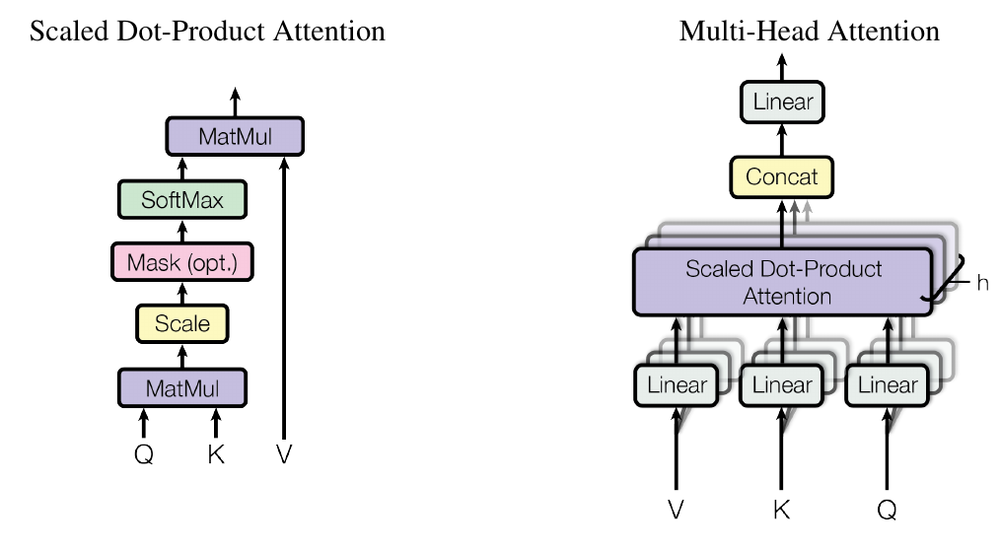


Transformer 要解决的是如何利用序列中的上下文完成预测。注意力先为不同位置计算匹配分数，将分数归一化为读取权重，再汇总相应内容。查询和键决定匹配方式，值决定传递内容；三者由可学习变换生成，使同一套计算能适应不同输入。多头注意力提供多组汇总，前馈网络继续加工特征；残差连接让子层在已有表示上学习修正，归一化调整各位置的数值尺度，支持多层计算。位置编码补充顺序信息，编码器据此处理原文，解码器结合原文和已有译文预测下一个 token。训练通过右移与遮罩并行计算预测损失，生成则逐步扩展前缀。（由 GPT-6 总结）

**关键公式**

$$
Q=XW^Q,\qquad K=XW^K,\qquad V=XW^V.
$$

$$
\operatorname{Attention}(Q,K,V)=\operatorname{softmax}\!\left(\frac{QK^\top}{\sqrt{d_k}}\right)V.
$$

$$
\operatorname{MultiHead}(X)=\operatorname{Concat}(\operatorname{head}_1,\ldots,\operatorname{head}_h)W^O.
$$

$$
\operatorname{PE}(p,2r)=\sin(p\omega_r),\qquad\operatorname{PE}(p,2r+1)=\cos(p\omega_r).
$$

$$
\mathcal L=-\sum_{t=1}^{m}\log p_\theta(y_t\mid y_{<t},x).
$$



### 1. 基本思路

**Attention Is All You Need** 是 Vaswani 等人在 2017 年提出 Transformer 的论文，研究的主要任务是机器翻译：读入原文，根据原文与已经生成的译文，预测下一个词。完成这个任务，不仅需要识别词语，还需要利用词语之间的关系。

例如，“小猫困了，它睡着了”中的“它”指代“小猫”。如果一个位置的表示只取决于当前位置的词，就无法记录这种关系。模型需要根据当前句子更新各位置的表示，使后续预测能够利用上下文。

早期序列模型通常用循环网络按位置依次更新状态。远处的信息需要经过中间状态传递，同一层的计算也存在前后依赖。Transformer 采用自注意力，让各位置直接读取其他位置的信息，并通过矩阵运算同时计算这些关系。**本文的核心问题是：一个位置应当怎样选择并汇总上下文，才能得到有助于预测的表示？**

计算前，文本先被切分成 **token**，即模型处理的基本单位，可以是词、子词、汉字或标点。词表为每个 token 分配编号，模型再根据编号，从一张可学习的参数表中取出对应向量。这张表称为**嵌入表**，取出的向量称为**嵌入表示**（embedding）。编号用于区分 token，向量则用于后续计算；表中数值随训练调整，各维通常没有人工指定的语义。

同一 token 在不同句子中查到的初始向量相同，而经过上下文计算后的表示可以不同。下面暂时省略标点，将例句示意为“小猫／困了／它／睡着了”，分别记为 $x_1,x_2,x_3,x_4$。一般情况下，长度为 $n$ 的输入写成 $X\in\mathbb R^{n\times d}$，每一行对应一个位置，$d$ 是表示宽度；后续层的输入则是上一层的输出。顺序信息的加入方式在第 4 节介绍。

### 2. 注意力计算

#### 2.1 汇总目标

先考虑一个简单方案：更新位置 $i$ 时，将整句的输入向量加权汇总，得到上下文信息 $c_i$：

$$
c_i=\sum_{j=1}^{n}a_{ij}x_j,\qquad a_{ij}\geq0,\qquad\sum_{j=1}^{n}a_{ij}=1.
$$

$i$ 是待更新的位置，$j$ 是被读取的位置。对例句中的“它”，$i=3$；如果“小猫”与当前预测更相关，就希望 $a_{31}$ 较大。得到的上下文向量将交给后续层，作为预测所需的特征。

若所有权重都取 $1/n$，不同位置会得到相同的平均结果，无法区分各自需要的上下文。因此，**权重应当由待更新位置和候选位置共同决定，并随输入变化。** 上式还直接使用 $x_j$ 传递内容，接下来分别规定匹配方式和内容表示。

#### 2.2 匹配分数

直接使用 $x_i x_j^\top$ 可以计算匹配分数，但这要求同一组输入特征同时承担两种作用：在位置 $i$ 主动检索信息，以及在位置 $j$ 供其他位置匹配。Transformer 为这两种作用使用独立的可学习变换：

$$
q_i=x_iW^Q,\qquad k_j=x_jW^K.
$$

$q_i$ 称为**查询**（Query），表示更新位置 $i$ 时采用的匹配特征；$k_j$ 称为**键**（Key），表示位置 $j$ 用于被匹配的特征。二者的名称来自信息检索：查询与检索条目进行匹配；在模型中，这些匹配特征由训练学习。

查询和键分开后，模型可以分别学习两种特征，位置之间的读取关系也不必对称。一个位置既生成自己的查询，用于读取其他位置，也生成自己的键，供其他位置读取。匹配不再局限于初始词向量的相似程度，而是由任务训练出适合信息交互的特征。

论文采用**缩放点积**作为匹配分数：

$$
s_{ij}=\frac{q_i k_j^\top}{\sqrt{d_k}}.
$$

$d_k$ 是查询与键的维度。除以 $\sqrt{d_k}$ 是为了控制分数尺度：在分量独立、均值为 0、方差为 1 的简化假设下，点积的方差为 $d_k$，缩放后回到 1。分数差距过大时，softmax 会将权重高度集中到少数位置，使权重对分数变化不够敏感，影响训练。缩放用于减轻这一问题。

#### 2.3 权重与内容

得到一组匹配分数后，需要将它们转换为读取比例。对同一位置 $i$，沿所有候选位置做 **softmax**：

$$
a_{ij}=\frac{\exp(s_{ij})}{\sum_{\ell=1}^{n}\exp(s_{i\ell})}.
$$

这样得到的权重为正，且 $\sum_j a_{ij}=1$。候选位置的分数越高，所占权重越大；它得到的比例也取决于同一行的其他分数。因此，权重反映的是当前输入下各位置之间的相对匹配。

匹配分数决定怎样分配读取比例，接下来还要规定每个位置传递什么内容。例如，检索资料时可以根据标题匹配，读取的则是正文。Transformer 也将匹配特征与传递内容分别表示，用另一个可学习变换生成**值**（Value）：

$$
v_j=x_jW^V,\qquad z_i=\sum_{j=1}^{n}a_{ij}v_j.
$$

这将第 2.1 节直接汇总 $x_j$ 的方案，推广为汇总变换后的 $v_j$。**查询与键决定各位置的读取权重，值提供被汇总的信息。** 输出 $z_i$ 是位置 $i$ 获得的上下文内容，后面还要与原表示结合并继续加工。

$W^Q,W^K,W^V$ 是训练需要调整的参数矩阵，分别学习查询特征、键的匹配特征与待传递内容。在这次注意力计算中，所有位置共用这套参数。参数如何由最终预测任务学习，在第 5 节说明。

#### 2.4 完整计算

把全部位置的查询、键和值按行排列，就可以一次完成上述计算：

$$
Q=XW^Q,\qquad K=XW^K,\qquad V=XW^V.
$$

$$
A=\operatorname{softmax}\!\left(\frac{QK^\top}{\sqrt{d_k}}\right),\qquad Z=AV.
$$

$QK^\top$ 计算所有位置对的分数，softmax 分别对每一行归一化，最后乘 V 得到各位置的汇总结果。这就是**缩放点积注意力**：

$$
\boxed{\operatorname{Attention}(Q,K,V)=\operatorname{softmax}\!\left(\frac{QK^\top}{\sqrt{d_k}}\right)V}.
$$

若 Q、K 为 $n\times d_k$，V 为 $n\times d_v$，则 A 为 $n\times n$，Z 为 $n\times d_v$。A 的第 $i$ 行为位置 $i$ 分配一组读取权重，Z 的第 $i$ 行保存相应的汇总结果，因此输出仍与输入位置一一对应。

**$d_k$ 决定用多少维特征进行匹配，$d_v$ 决定传递多少维内容。** 匹配分数通过查询与键的点积得到，因此二者需要相同的维度 $d_k$。值不参与这一步评分，而是按得到的权重进行汇总：每个位置的一个权重系数，可以作用于该位置的整份值向量，因此 $d_v$ 可以独立选择。下面的例子用二维查询和键计算权重，再汇总三维的值。

用同一个例句说明分数怎样产生权重。假设一次变换得到“它”的查询 $q_3=(\sqrt2,0)$，查询和键均为二维，各位置的键及相应计算结果如下：

| 被读取的位置 | 键 $k_j$ | 分数 $s_{3j}$ | 权重 $a_{3j}$ |
| --- | --- | ---: | ---: |
| 小猫 | $(2,0)$ | 2 | 0.6103 |
| 困了 | $(0,1)$ | 0 | 0.0826 |
| 它 | $(1,1)$ | 1 | 0.2245 |
| 睡着了 | $(0,-1)$ | 0 | 0.0826 |

这些权重由分数经过 softmax 得到。用于汇总的是各位置的值向量，因此输出为：

$$
z_3=\frac{e^2v_1+v_2+ev_3+v_4}{e^2+e+2}.
$$

例如，取下面四个值向量：

$$
v_1=(1,0,0),\quad v_2=(0,1,0),\quad v_3=(0,0,1),\quad v_4=(1,1,0).
$$

汇总结果约为：

$$
z_3=(0.6929,\;0.1652,\;0.2245).
$$

这次计算为“小猫”位置分配了约 0.6103 的权重，因此它的值向量在汇总中占较大比例，其他位置共同提供剩余内容。查询和键虽然是二维，汇总的内容与输出则都是三维。

本例中，查询、键和值都由同一句话产生，称为**自注意力**。每个位置都用自己的查询读取句中各位置的值，从而更新自己的表示。如果查询来自另一序列，而键和值来自被读取的序列，就得到**交叉注意力**；第 4 节会用它连接译文与原文。

### 3. 自注意力层

单次注意力已经能汇总上下文，但完整网络还要解决两个问题：如何保留多种信息关系，以及如何将汇总结果与原表示结合、继续加工。这决定了 Transformer 一层中的其他结构。

#### 3.1 多头注意力

前面的一次注意力计算称为一个**头**。每个查询在一个头中得到一组读取权重，所有值按这组比例汇总。如果一个位置同时需要指代、动作和修饰等不同线索，多组权重就能分别形成多份上下文表示。

**多头注意力**并行使用 $h$ 套 Q、K、V 变换。第 $r$ 个头计算：

$$
\operatorname{head}_r=\operatorname{Attention}(XW_r^Q,XW_r^K,XW_r^V).
$$

随后，对每个位置分别合并各头的结果。公式中的 **Concat** 表示沿特征维度拼接：把同一位置上各头输出的分量依次接起来，形成一个更宽的向量。以两个头、每头二维为例：

$$
\operatorname{Concat}\bigl((a,b),(c,d)\bigr)=(a,b,c,d).
$$

每个头都为全部 $n$ 个位置产生输出，因此拼接后仍有 $n$ 行，只是每行从 $d_v$ 维扩展为 $hd_v$ 维。各头提取的内容由此保留在同一个向量中，再交给可学习的输出变换 $W^O$ 组合：

$$
\operatorname{MultiHead}(X)=\operatorname{Concat}(\operatorname{head}_1,\ldots,\operatorname{head}_h)W^O.
$$

$W^O$ 的形状为 $hd_v\times d$，将拼接后的向量变换为模型所需的 $d$ 维，并学习不同头的特征怎样组合。

每个头都接收同一份输入 X，通过各自的 Q、K、V 变换形成读取权重和汇总结果，具体分工在训练中形成。这样，一个位置就能同时保留多组上下文线索，再由输出变换综合利用。

原论文基础模型的输入宽度为 512，使用 8 个头，每头的查询、键和值为 64 维。每个位置的 8 份 64 维输出拼成 512 维向量，再通过形状为 $512\times512$ 的 $W^O$ 混合；整层的输入与输出宽度都为 512。

<figure class="ddpm-figure">
  
  <figcaption>缩放点积注意力与多头注意力；来源：原论文 Figure 2</figcaption>
</figure>

图从下向上读。Linear 对应生成 Q、K、V 的线性变换，MatMul、Scale、Softmax 对应前面的匹配与归一化，再乘 V 完成汇总。右侧将这套计算并行执行多次后拼接。Mask 用于限制读取范围，在第 5 节说明。

#### 3.2 特征加工

本节的一层包含多头注意力和前馈网络两个计算模块，各称为一个**子层**。注意力负责读取上下文，前馈网络继续加工特征，两者都配有残差连接和层归一化。

**残差连接**将模块输出加回输入，让模块在已有表示上学习补充和修正；若只需少量改动，模块在相加前给出较小的更新即可。训练时，加法还为从输出传回的误差信号提供一条绕过模块内部变换的路径，有助于训练较深的网络。

这里的**数值尺度**指向量分量的整体幅度和分散程度。线性变换中的权重可以放大或缩小部分分量，残差相加也可能增强或抵消其中的数值。因此，经过多层计算后，后续层接收到的数值幅度和分散程度会随输入与参数变化，影响训练的稳定性。

**层归一化**（LayerNorm）对每个位置内部的全部分量计算均值与方差，先减去均值、按标准差缩放，再施加可学习的缩放和平移。这样可以控制输入尺度的波动，同时让模型学习合适的特征幅度。原论文先残差相加，再归一化：

$$
H=\operatorname{LayerNorm}\!\left(X+\operatorname{MultiHead}(X)\right).
$$

相加要求两边形状相同，因此上一节的输出变换要将各头结果变回 $d$ 维。

注意力与残差连接已经得到根据上下文调整后的表示。**逐位置前馈网络**（FFN）接收这个向量，进一步学习其中各特征的非线性组合，增加模型的表达能力。它先通过全连接变换构造中间特征，用 **ReLU** 将负值置零、保留正值，再组合回模型宽度：

$$
\operatorname{FFN}(u)=\max(0,uW_1+b_1)W_2+b_2.
$$

$u$ 为某一位置的向量，其余矩阵与偏置均为可学习参数。“全连接”表示每个中间单元都接收输入向量的全部分量；ReLU 使不同输入启用不同的中间特征。基础模型先将 512 维扩展到 2048 维，再组合回 512 维。同一层各位置共用这套参数，但分别计算，因此称为“逐位置”。

前馈子层同样配有残差连接和归一化：

$$
X'=\operatorname{LayerNorm}\!\left(H+\operatorname{FFN}(H)\right).
$$

整层保持输入与输出宽度一致，因此可以继续堆叠。后续层在更新后的表示上，再次匹配上下文并加工特征。

归一化还有其他统计范围与缩放方式。图像特征中的“通道”表示特征维度：**BatchNorm** 按通道跨样本及空间位置统计，**GroupNorm** 在每个样本内按通道分组统计；序列模型中的 **RMSNorm** 则对每个位置的向量按均方根缩放，省去减均值的步骤。本文使用的是前面介绍的 LayerNorm。

> [!Note] **训练时的 dropout**
> 上面两个子层的公式省略了输出上的 dropout。原论文在残差相加前，对子层输出随机屏蔽部分分量并缩放，以减轻对训练样本细节的过度依赖，即过拟合；生成时关闭。

### 4. Transformer

前面得到了一种可以重复堆叠的序列处理层。原论文用它构成编码器，再为解码器增加读取原文的通路，完成从输入序列到输出序列的转换。

#### 4.1 位置信息

只按内容进行匹配，还不能区分“我喜欢猫”与“猫喜欢我”中的词序。对完整可见的序列，不含位置信息的自注意力在输入重排时，输出也只会相应重排，因此输入需要额外携带顺序信息。

原论文在词嵌入上加入**位置编码**。令 $E[t_i]$ 为第 $i$ 个 token 的嵌入，$d$ 为模型宽度，实际输入为：

$$
x_i=\sqrt d\,E[t_i]+\operatorname{PE}(i).
$$

位置向量与词向量维度相同，加入后共同参与 Q、K、V 的计算。根号系数用于调节词嵌入相对位置编码的数值幅度。原论文的位置向量由不同频率的正弦、余弦生成；记 $\omega_r=10000^{-2r/d}$，有：

$$
\operatorname{PE}(p,2r)=\sin(p\omega_r),\qquad\operatorname{PE}(p,2r+1)=\cos(p\omega_r).
$$

$p$ 为位置编号，$r=0,\ldots,d/2-1$ 为维度对编号。维度从 0 开始计数，每一对相邻维度使用同一频率：第 $2r$ 维填入正弦值，第 $2r+1$ 维填入余弦值。$r$ 越大，$\omega_r$ 越小，编码随位置变化得越慢；不同维度对共同提供多种变化尺度的位置特征。

**正弦与余弦成对使用，还使相同的位置偏移对应统一的线性变换。** 将同一频率的一对编码记为 $\mathbf e_r(p)$，根据三角函数的和角公式：

$$
\mathbf e_r(p+k)=\mathbf e_r(p)\begin{pmatrix}\cos(k\omega_r)&-\sin(k\omega_r)\\\sin(k\omega_r)&\cos(k\omega_r)\end{pmatrix}.
$$

$k$ 是两个位置之间的偏移量。右侧矩阵只依赖 $k$ 和该维度对的频率，与起始位置 $p$ 无关。将这些 $2\times2$ 矩阵沿对角线排列，其余部分置零，就得到作用于完整向量的 $d\times d$ 矩阵 $M_k$，满足 $\operatorname{PE}(p+k)=\operatorname{PE}(p)M_k$。因此，相同偏移量在不同起始位置上具有一致的数学关系，为模型学习相对位置提供了结构依据。

这套位置编码由固定公式生成，无需学习位置参数；模型学习的是怎样利用这些编码。另一种做法是为各位置设置可训练的向量，由任务损失更新。原论文比较了两种方案，结果接近；最终选择正余弦方案，考虑到它也能计算训练长度以外的位置编码。

#### 4.2 编码器

编码器的任务，是将原文中各 token 的初始表示更新为结合上下文的表示。原文经过分词、嵌入与位置编码后，组成输入矩阵 $X^{(0)}\in\mathbb R^{n\times d}$：$n$ 为原文长度，每行对应一个位置，包含一个 $d$ 维向量。

每层先做**多头自注意力**，由该层输入分别生成 Q、K、V，根据位置之间的关系更新各位置的向量。原文已经完整给定，因此每个位置都可以读取自己及前后的有效位置，无需因果遮罩；同一层各位置的计算可以并行进行。随后，**FFN** 对已经融合上下文的向量再做非线性变换，进一步调整特征。两步都配有第 3 节介绍的残差连接与层归一化。

基础模型堆叠 6 层，各层参数独立，输入与输出均保持 $n\times d$ 的形状。下一层接收上一层更新后的表示，用自己的参数重新计算匹配关系并继续更新：

$$
X^{(0)}\xrightarrow{\text{第 1 层}}X^{(1)}\longrightarrow\cdots\xrightarrow{\text{第 6 层}}X^{(6)}=C.
$$

第一层从词嵌入与位置编码生成查询和键；后续层则从已经结合上下文的表示生成查询和键，因此可以利用上一轮获取的信息，重新决定怎样读取原文。最终输出 $C$ 仍包含 $n$ 个 $d$ 维向量，与原文位置一一对应。它们是通过翻译任务学到的上下文特征，供解码器进一步读取。

#### 4.3 解码器

编码器将完整原文转换成一组上下文向量，解码器则根据这些向量和已有译文，预测下一个 token。以 “I like cats” 翻译为“我喜欢猫”为例，假设已经生成“我／喜欢”，现在要预测“猫”。解码器接收的目标输入为“BOS／我／喜欢”，BOS 是开始标记；**最后一个输入位置“喜欢”的计算结果，用于预测下一个 token“猫”。**

**第一步，用自注意力处理已有译文。** 第一层从目标输入的嵌入与位置编码开始，分别生成 Q、K、V。每个位置用查询匹配目标序列中的键，汇总对应的值，从而利用已有译文的上下文。这里限制每个位置只读取自己及更早的目标输入，称为带因果遮罩的自注意力；具体遮罩在第 5.1 节介绍。

**第二步，用交叉注意力读取原文。** 上一步形成的目标表示作为查询的来源，编码器最终输出则作为键和值的来源。这样，模型可以根据已有译文的状态，决定从原文读取什么。记经过第一步更新的目标表示为 $D$，编码器最终输出为 $C$，以交叉注意力的一个头为例：

$$
Q=DW^Q,\qquad K=CW^K,\qquad V=CW^V.
$$

已有译文提供当前生成状态，原文提供待表达的内容。查询与原文各位置的键计算匹配分数，再按权重汇总原文的值；K、V 来自同一批原文位置，使匹配到的位置能提供对应内容。预测“猫”时，就可以侧重读取 cats 等相关源位置的信息。多头结果经 $W^O$ 变换后，作为更新量加回目标表示；这些变换与整个翻译任务一起训练，学习怎样将原文信息用于译文预测。

若本次解码器输入有 $m$ 个位置，原文有 $n$ 个位置，交叉注意力的权重矩阵就是 $m\times n$。每行对应一个目标输入位置，每列对应一个原文位置；一行权重决定该目标位置怎样汇总完整原文的信息。

**第三步，用 FFN 加工更新后的特征。** 此时各目标位置已结合已有译文与原文信息，逐位置前馈网络继续组合这些特征。上述三个子层各有残差连接和归一化，基础模型共堆叠 6 层。后续层接收上一层更新后的目标表示，各层的交叉注意力都读取同一份编码器最终输出，但使用各自的变换参数。

最后一层得到的仍是 $d$ 维特征向量，还要通过**词表输出层**变成预测概率。将负责预测第 $t$ 个目标 token 的位置的最终向量记为 $h_t$，线性变换先为词表中的每个候选 token 计算一个分数，再由 softmax 转换成概率：

$$
p_t=\operatorname{softmax}(h_tW_{\mathrm{vocab}}+b).
$$

$W_{\mathrm{vocab}}$ 和 $b$ 是可学习参数，$p_t$ 的长度等于词表大小，每一项对应一个 token 的概率。在本例中，取“喜欢”所在位置的这组概率，选择下一个 token，并将它追加到已有译文后。这里的 softmax 在词表上分配预测概率，注意力中的 softmax 则在输入位置之间分配读取权重。

<figure class="ddpm-figure">
  
  <figcaption>编码器与解码器；来源：原论文 Figure 1</figcaption>
</figure>

从下向上看图：底部是词嵌入与位置编码；中间连线将编码器最终输出送入解码器的交叉注意力。左右的 $N\times$ 表示各自灰框中的完整层堆叠 N 次，因此每个解码器层都有一次交叉注意力。底部嵌入与顶部词表输出层位于重复框之外，Linear 和 Softmax 对应词表预测。Masked 表示目标自注意力需要限制读取范围。

### 5. 训练与生成

#### 5.1 右移与遮罩

生成时，原文已经完整给定，目标序列却只有已生成的前缀。因此，训练中每个位置也应根据目标词之前的前缀进行预测。

训练数据中的参考译文提供正确目标，也用于构造解码器输入。用 BOS 表示开始、EOS 表示结束，参考目标为“我／喜欢／猫／EOS”；在开头加入 BOS、去掉末尾 EOS，得到输入“BOS／我／喜欢／猫”。**输入与目标相差一位，每个输入位置的输出负责预测下一个 token。**

下表每行对应一个预测位置。“可见目标前缀”是施加因果遮罩后允许读取的目标输入；各位置还可以读取完整原文。

| 位置 | 当前输入 | 可见目标前缀 | 正确目标 |
| --- | --- | --- | --- |
| 1 | BOS | BOS | 我 |
| 2 | 我 | BOS／我 | 喜欢 |
| 3 | 喜欢 | BOS／我／喜欢 | 猫 |
| 4 | 猫 | BOS／我／喜欢／猫 | EOS |

第 3 行表示：在输入“喜欢”的位置，根据“BOS／我／喜欢”预测“猫”。虽然当前位置的输入已经与目标错开，但“猫”仍出现在第 4 个输入位置。因此，右移之外还需要**因果遮罩**，屏蔽后面的目标输入。

具体做法是在注意力分数中，将不允许读取的未来位置设为负无穷，再做 softmax：

$$
M_{ij}=\begin{cases}0,&j\leq i,\\-\infty,&j>i,\end{cases}\qquad A=\operatorname{softmax}\!\left(\frac{QK^\top}{\sqrt{d_k}}+M\right).
$$

由于 $\exp(-\infty)=0$，未来位置的权重为零，其他位置重新归一化。遮罩作用于目标自注意力，交叉注意力仍可读取完整原文。

训练时使用参考译文的正确前缀，这种做法称为 **teacher forcing**。表中第 3 个位置始终输入参考词“喜欢”，即使模型在第 2 个位置没有正确预测出它，训练输入也保持不变。预测结果与正确目标比较，形成训练损失；后续位置的输入由参考译文确定。

因此，各位置的输入在计算开始前就已确定，无需等待前一个位置选出 token。同一层可以一次处理整句，因果遮罩保证每个位置只利用对应的前缀；各层仍然依次执行。生成时则要将模型刚选出的 token 追加到输入，才能进行下一次预测，第 5.3 节会具体说明。

将不同长度的句子组成一个训练批次时，通常用 **PAD** 占位符将较短序列补齐，以便成批计算。**padding mask** 使有效位置不读取这些占位内容；计算损失时，忽略目标序列中补齐位置对应的标签。

#### 5.2 预测目标

模型输出的是每个位置上的词表概率。训练时，从这组概率中取出正确标签对应的一项，计算其负对数。例如正确标签为“猫”，给它分配的概率从 0.1 提高到 0.8，该位置的损失就从 $-\log0.1$ 降到 $-\log0.8$，训练由此鼓励模型提高正确词的概率。

把原文记为 $x$，参考译文记为 $y_1,\ldots,y_m$，全部可学习参数记为 $\theta$，基本训练目标为：

$$
\mathcal L=-\sum_{t=1}^{m}\log p_\theta(y_t\mid y_{<t},x).
$$

$y_{<t}$ 是位置 $t$ 之前的正确译文，条件概率表示在给定原文与这个前缀时，模型分配给正确 token 的概率。正确词的概率越高，该位置的损失越小。原论文还使用标签平滑，为其他有效类别保留少量目标权重；上式是不加平滑时的基本负对数似然。

**反向传播**计算损失对参数的梯度，优化器据此更新嵌入表、Q/K/V 变换、前馈网络和输出层等参数。训练数据提供原文与译文，最终预测损失沿这条计算路径传回各层，使匹配和内容变换一起朝有利于预测的方向调整。

因此，**训练学习的是参数，注意力权重则是参数作用于当前输入得到的结果。** 换一个句子，候选位置的键和值随输入变化，模型就会重新计算读取比例与汇总内容。这使同一套参数能够处理不同的上下文。

#### 5.3 逐步生成

训练完成后，编码器先处理完整原文，解码器从 BOS 开始预测。每次选择一个 token，追加到当前前缀，再进行下一次预测：

| 当前目标输入 | 下一步可能选出 |
| --- | --- |
| BOS | 我 |
| BOS／我 | 喜欢 |
| BOS／我／喜欢 | 猫 |
| BOS／我／喜欢／猫 | EOS |

选择到 EOS 或达到长度限制时结束。最直接的方法是每步取概率最大的 token，称为**贪心解码**。原论文评估采用**束搜索**，同时保留几条候选译文，逐步扩展，并按累计得分和长度修正比较。

生成过程固定参数，改变的是输入前缀。下一步依赖上一步选出的 token，因此仍然逐步进行；训练时则能使用已知的正确前缀并行计算。若模型生成了错误前缀，后面也需要在这个前缀上继续，这与训练时使用参考译文的条件不同。

### 6. 实验结果

论文在 WMT 2014 英德、英法机器翻译上评估 Transformer，数据分别约为 450 万和 3600 万句对。**BLEU** 主要衡量生成译文与参考译文的词组重合程度，越高越好。原论文 Table 2 的部分结果如下：

| 模型 | 英德 BLEU ↑ | 英法 BLEU ↑ |
| --- | ---: | ---: |
| GNMT + RL | 24.6 | 39.92 |
| ConvS2S | 25.16 | 40.46 |
| Transformer base | 27.3 | 38.1 |
| Transformer big | 28.4 | 41.8 |

前两行是此前的翻译系统。base 约有 6500 万参数；big 将宽度增至 1024、FFN 中间宽度增至 4096，采用 16 个头，约有 2.13 亿参数。两者都使用 6 层编码器和 6 层解码器，在 8 张 NVIDIA P100 上的训练时长分别约为 12 小时和 3.5 天。

big 在这两项任务上取得了较好的翻译结果，base 则以更少的参数和较短训练时间，在英德任务上超过了表中的两种既有模型。这些结果展示了模型规模、训练成本与翻译质量之间的取舍。

论文还改变组件配置后重新训练，以判断各设计的作用。下面摘录 Table 3 的英德开发集结果：开发集用于选择配置，测试集用于评估最终模型，上表报告的是测试集结果。

| 设置 | 开发集 BLEU ↑ |
| --- | ---: |
| 8 头基础设置 | 25.8 |
| 改为 1 头 | 24.9 |
| 改为 32 头 | 25.4 |
| 不使用 dropout | 24.6 |
| 使用可学习的位置编码 | 25.7 |

8 头的结果优于单头和 32 头。固定总宽度时，增加头数会缩小每头的特征维度，因此需要在关系的组数与每组的表示宽度之间取舍。保留 dropout 时开发集表现更好；固定与可学习位置编码的结果则接近。

### 7. 定位与局限

注意力在本文之前已经用于机器翻译。Transformer 的主要推进，是将多头自注意力组织成完整的序列转换网络，使编码器与解码器不再依赖循环或卷积完成位置间的信息交流。远处两个位置在一层内即可直接交互，训练也更便于并行。

代价来自全局位置匹配。长度为 $n$ 的序列需要处理 $n^2$ 个位置对，主要交互计算量按 $n^2d$ 的量级增长，记为 $O(n^2d)$；完整层还包括线性变换与 FFN，计算量为 $O(n^2d+nd^2)$。常规实现显式保存各头的权重时，存储开销也随 $hn^2$ 增长。因此，长序列成本和自回归生成的串行依赖仍然存在。

注意力权重描述某个头在一次汇总中怎样分配读取比例。最终预测还综合了其他头、残差和后续层的加工，因此分析语言关系时，单张权重图提供的是其中一部分信息。例如“小猫”得到较大权重，说明该位置的内容在这次汇总中占比较大；指代判断则取决于整个网络的计算。

位置编码虽然可以为训练长度以外的位置生成向量，更长句子的预测仍需要模型学会利用这些位置与上下文。实际使用时，序列长度同时受到计算资源和模型训练范围的影响。

这套计算也可用于图像：图块或空间特征构成序列，自注意力用于图像内部交互；以图像特征生成查询、文本特征生成键和值，交叉注意力就能让各图像位置读取文本条件。它与 DDPM 的关系在于，扩散规定加噪与生成过程，注意力作为去噪网络中的信息交互模块，将图像上下文与条件信息送入去噪预测。

### 参考资料

1. Vaswani et al. *Attention Is All You Need*. NeurIPS 2017. [arXiv:1706.03762](https://arxiv.org/abs/1706.03762)。本文公式、架构配图与实验数据的主要来源；图保留英文标注，正文给出阅读顺序。
2. Bahdanau, Cho, Bengio. *Neural Machine Translation by Jointly Learning to Align and Translate*. ICLR 2015. [arXiv:1409.0473](https://arxiv.org/abs/1409.0473)。注意力用于机器翻译的早期代表工作。
3. Ba, Kiros, Hinton. *Layer Normalization*. 2016. [arXiv:1607.06450](https://arxiv.org/abs/1607.06450)。层归一化的定义与动机。
4. He et al. *Deep Residual Learning for Image Recognition*. CVPR 2016. [arXiv:1512.03385](https://arxiv.org/abs/1512.03385)。残差学习的设计动机与深层网络的优化。
5. Rush. *The Annotated Transformer*. [Harvard NLP](https://nlp.seas.harvard.edu/annotated-transformer/)。原论文各组件的对应实现。
